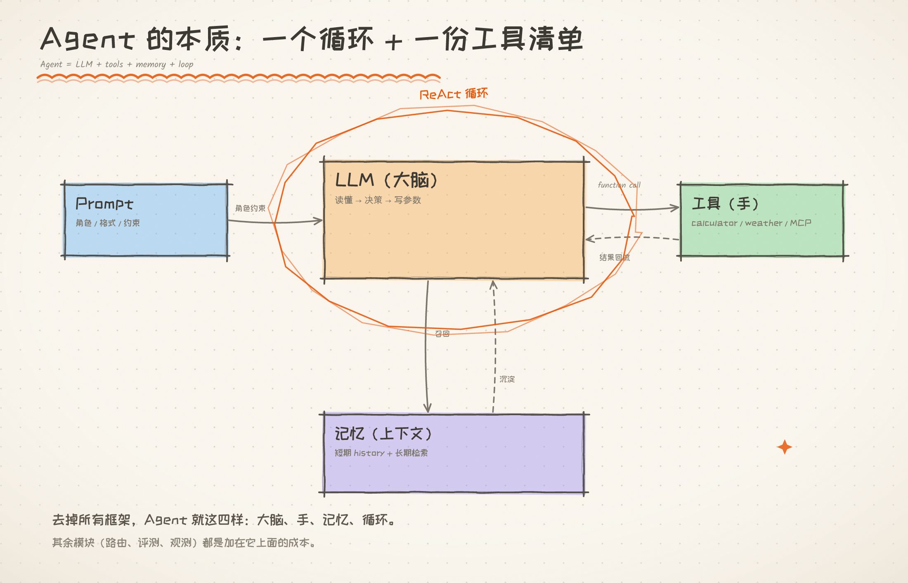
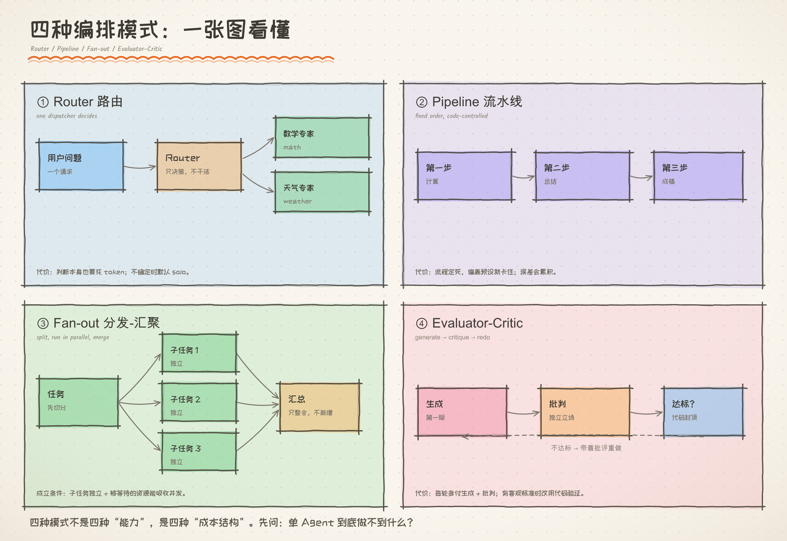
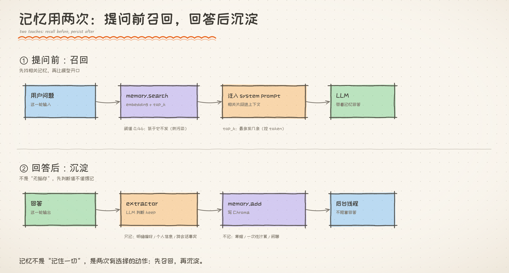
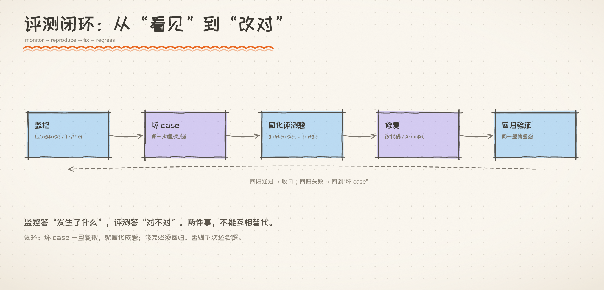
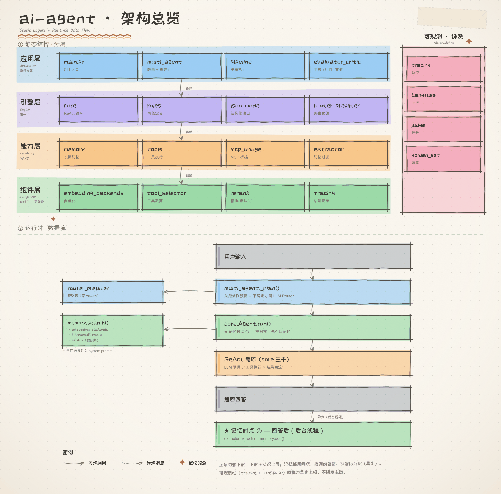
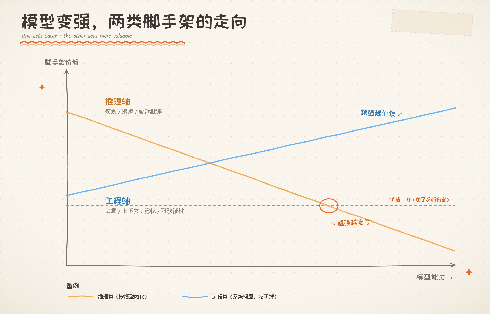

# AI Agent 教学总览：从 88 行到一个多 Agent 系统

> 这不是论文，是一张“先看懂、再动手”的学习地图。
> **适合**：刚开始学 Agent，或者写完 demo 但不知道下一步学什么的人。
> **读法**：先看三句话 → 再看六张图 → 最后按兴趣点进各章。
> **一句话**：Agent 没那么神秘；难的是知道**什么时候该加东西、加了要付什么代价**。

---

## 先看三句话

1. **Agent 的本质 = 一个循环 + 一份工具清单。**
   模型负责“想”，工具负责“做”，记忆负责“别失忆”，循环负责“做完看一眼再决定下一步”。
2. **多 Agent 不是能力升级，是成本结构。**
   每多一个 Agent，就多一份交接、压缩上下文和 token；买不到“单 Agent 做不到的事”，就别买。
3. **能测量的别猜。**
   “明显更快”不算，`5.11s → 3.04s` 才算；负结果和正结果一样值钱。

---

## 概念小抄（先混个脸熟）

| 词 | 一句话 | 打个比方 |
|---|---|---|
| **LLM** | 只会读文字、写文字的大脑 | 一个很会答题但没手没脚的人 |
| **Agent** | 给大脑装上循环、工具、记忆 | 给那个人配了手、笔记本和流程 |
| **ReAct** | 想 → 做 → 看 → 再想 | 边做边看反馈，不是一口气写完 |
| **Prompt** | 给模型的角色说明和格式要求 | 上岗前的岗位说明书 |
| **Token** | 模型读写文字的计量单位 | 电表；也是账单 |
| **Tool / function call** | 模型决定“调用哪个函数”，程序真正执行 | 模型点菜，程序做菜 |
| **Router** | 一个调度者判断“拆不拆、派给谁” | 医院前台分诊 |
| **Worker** | 被派活的专家 | 专科医生 |
| **Pipeline** | 固定顺序串联，上一步输出 = 下一步输入 | 流水线 |
| **Fan-out** | 先切分，再分头做，最后汇总 | 几个人分头查资料，最后合并 |
| **Evaluator-Critic（EC）** | 生成 → 批判 → 不达标重做 | 写完找同事挑错，再改一版 |
| **RAG / embedding** | 把文字变成向量，按相似度找回来 | 把书页变成坐标，找“离问题最近”的几页 |
| **MCP** | 工具的通用插座 | USB 接口：换个工具不用重写一遍 |
| **Golden set / judge** | 固定题库 + 评卷规则 | 期末考试卷 + 评分标准 |
| **Observability** | 记录每一步在干什么 | 行车记录仪 |

> 这些词后面都会反复出现。第一次看不懂没关系，先有个印象，读到对应章节再回来查。

---

## 图 1：Agent 的本质

> 图 1｜大脑、手、记忆、循环，四样东西；其余都是加在它上面的成本。

**看图说话**：

- **LLM（大脑）**：只负责“读懂 → 决策 → 写参数”。它**不执行**任何东西。
- **工具（手）**：计算器、天气、MCP 工具……真正干活的是它们。
- **记忆（上下文）**：短期是这一轮对话的历史；长期是向量库检索回来的片段。
- **循环（ReAct）**：模型要工具就执行，结果回填，再让模型看；直到它不再要工具。
  `max_steps` 是保险丝，防止它一直转。

**一个常见误解**：

> “Agent 很聪明，是它自己会规划。”

不是。智能 100% 来自 LLM；Agent 只是把“角色 + 历史 + 工具”装配好，
让模型的决策能落地。**看懂 `minimal.py` 的 88 行，就懂了一半。**

→ 深入：[能力阶梯](../01-基础章/能力阶梯.md)

---

## 图 2：四种编排模式

> 图 2｜四种模式不是四种“能力”，是四种“成本结构”。

**看图说话**：

| 模式 | 一句话 | 什么时候用 | 代价 |
|---|---|---|---|
| **Router** | 前台分诊，决定拆不拆 | 请求类型多、需要动态判断 | 判断本身也要 token |
| **Pipeline** | 固定顺序，A→B→C | 步骤天然有先后 | 流程定死，不会拐弯 |
| **Fan-out** | 分头做，再汇总 | 子任务独立、工具慢 | 交接会丢信息 |
| **EC** | 生成→批判→重做 | 有明确标准、且能改 | 每轮多付生成 + 批判 |

**最容易踩的坑**：

> “这道题跨了两个领域，所以应该拆成两个专家。”

不一定。跨域不是判据；**“单 Agent 做不到”**才是。
两个各只有半个工具集的专家，常常各自漏答一半。

→ 深入：[编排模式](../02-编排章/编排模式.md)、[显式规划调查](../02-编排章/显式规划调查.md)

---

## 图 3：记忆用两次

> 图 3｜记忆不是“记住一切”，是两次有选择的动作。

**看图说话**：

- **① 提问前：召回**。把问题变成向量，去库里找最相关的几条；低于阈值的不发，
  防止“不相干的记忆”污染上下文。`top_k` 管发几条，阈值管发不发。
- **② 回答后：沉淀**。不是无脑存；先用一个轻量 LLM 判断“值不值得记”，
  只记明确偏好、个人信息、跨会话事实；写入放后台线程，不阻塞回答。

**两个常见误解**：

> “上下文窗口很大，就不用记忆了。”

窗口大 ≠ 管得好。塞得越多，注意力越容易被稀释；而且关掉页面就没了。

> “记忆越多越好。”

无限制扩张的记忆会传播错误、污染判断。**会忘，和会记一样重要。**

→ 深入：[记忆抽取](../03-实战章/记忆抽取.md)、[记忆召回修复](../03-实战章/记忆召回修复.md)、[记忆切分](../03-实战章/记忆切分.md)

---

## 图 4：评测闭环

> 图 4｜监控答“发生了什么”，评测答“对不对”；两件事不能互相替代。

**看图说话**：

- **监控**（Langfuse / Tracer）：哪一步慢、贵、错。它只描述，不判断。
- **评测**（golden set + judge）：拿固定题集跑，回答“这版比上版好还是坏”。
- **闭环**：监控发现坏 case → 固化成评测题 → 修复 → 回归。
  不回归，下次还会踩同一个坑。

**一条硬规矩**：

> 有客观、可程序验证的标准（能算、能跑测试）→ **用代码验证**，别雇 LLM 评委。

这条规矩在 2026/10/19 又被实测证了一遍：同模型 EC 在数值题上 0/6，
会把对的判错、把错的认同。

→ 深入：[数值题EC可靠性调查](../02-编排章/数值题EC可靠性调查.md)、[成文规矩](成文规矩.md)

---

## 图 5：系统是怎么搭的

> 图 5｜上层依赖下层，下层不认识上层；10 个“纯叶子”是项目的可替换策略层。

**看图说话**：

- **应用层**：`main.py`、Router、Pipeline、EC——负责“发起”和“编排”。
- **引擎层**：`core.py` 是唯一的 ReAct 主干；`roles` 定义专家。
- **能力层**：`memory` 有状态；`tools` 执行；`mcp_bridge` 接外部工具。
- **组件层**：embedding、rerank、提取器、评测、轨迹……都是可替换零件。

**为什么这么分**：

> 越底层越“无知”，越上层越“知道全局”。

`tools.py` 不该知道“谁在用它”；`memory.py` 不该知道“这次是哪个专家”。
底层不认识 Agent，才能被单独测试、A/B、整体换掉。

→ 深入：[架构](../05-收尾章/架构.md)

---

## 图 6：模型变强后，哪些脚手架还值钱

> 图 6｜模型变强，吃掉“替它想”的脚手架，吃不掉“帮它够得着/记得住/验得了”的能力。

**看图说话**：

- **推理轴**（拆步、规划、自我批评）：模型自己在内化；外挂的价值在下降，甚至转负。
- **工程轴**（工具、上下文、记忆、验证、隔离）：模型变强帮不上忙，价值不降反升。

这解释了本项目的几个“反直觉”结论：

- 显式规划：小任务全对，长链救不了，**零增益**；
- rerank：实现了，但本项目语料上 **Top-1 反而降**；
- Debate：强模型自己就会质疑前提，**必要性未复现**；
- EC：文案题有用，数值题同模型自评 **不可靠**。

→ 深入：[模型能力与Agent编排](../99-番外/模型能力与Agent编排.md)

---

## 实测账：哪些结论有数字撑腰

| 实验 | 关键数字 | 这说明什么 |
|---|---|---|
| Router 预筛 | 86% 跳过，总 token −25% | 简单任务用规则更省 |
| 真并行 Fan-out | 5.11s → 3.04s（−41%） | 独立子任务 + 慢工具才值 |
| EC 文案 | 84→84→85；及格线 90 时回退 | 及格线是旋钮，拧太高会反噬 |
| 显式规划 | N≤8 可，N≥9 不可；规划 0 增益 | 边界是预算，不是计划 |
| 工人池（慢工具） | 12.0/16.2s → 4.7/4.0s | 慢工具下并行真必要 |
| 去中心化协商 | 33% vs 100%；成本 1.25× | 信息分散时不可替代 |
| Contract Net | 33% vs 100%；成本 ≈5× | 中央无法评估时才值 |
| Debate | 12/12 vs 11/12 | 强模型自己会质疑前提 |
| Blackboard | 静态 0/6；单 Agent 4/6；黑板 5/6 | 关键变量是“反应式控制” |
| 记忆 | 有记忆 4/5 vs 无 2/5 | 记忆有贡献，但会漏召 |
| MCP 工具裁剪 | 省 42% 工具声明 token | 工具清单有租金 |
| 同模型 EC（数值） | **0/6**；9 被改成 771429 | 同模型自评不是独立信号 |

> 所有数字带日期与实验语境；n 小，别当“定律”。

---

## 负结果：哪些热闹不能跟

| 负结果 | 数字 | 这告诉我们什么 |
|---|---|---|
| 显式规划 | 长链 N≥9 一样失败 | “把计划写出来”≠“跑得动” |
| 精排 rerank | Top-1 14→13，延迟 +296ms | 新组件不一定比旧的好 |
| Debate | 12/12 vs 11/12 | 强模型不需要“正反方”来纠错 |
| Blackboard | 单 Agent 反应 4/6，黑板 5/6 | 优势主要来自“先看再决定” |
| 同模型 EC | 0/6，9→771429 | 有客观标准时，代码验证 > LLM 评委 |

**一句话**：

> 不为未复现的问题增加复杂度；先找最便宜的修法，再加机器。

---

## 什么时候用什么

| 你的情况 | 建议 |
|---|---|
| 单 Agent 能做完 | **solo**；别加 Router |
| 步骤天然有先后 | **Pipeline**（代码控制） |
| 子任务独立、工具慢 | **Fan-out / 工人池** |
| 需要批判人格、且能从批评中改进 | **EC**；但要有外部信号 |
| 信息分散在多方 | **Group Chat / Contract Net** |
| 中央无法评估“该谁干” | **Contract Net** |
| 有客观标准（能算/能测） | **代码验证**，不用 LLM 评委 |

---

## 九句话

1. 同一句“100%”，含金量可以完全不同。
2. 能测量的别让 LLM 判；恒为满分的维度只当一票否决。
3. 多 Agent 是花钱买“单 Agent 做不到的事”；买不到就别买。
4. 软提示改不了行为惯性；要改行为，得改“可用动作”。
5. 不为未复现的问题增加复杂度；先找最便宜的修法。
6. 编排的必要性是有条件的：子任务独立 + 单任务耗时足够大。
7. 模型变强吃掉推理类脚手架，吃不掉工程类能力。
8. 接口契约的价值取决于“谁来消费”；程序消费不能靠概率。
9. 同模型自评不是独立信号；有客观标准时，代码验证 > LLM 评委。

> 展开版：[学习总结](学习总结.md)。

---

## 怎么读这套文档

**第一次读（建立整体印象）**：

1. [能力阶梯](../01-基础章/能力阶梯.md)：从 88 行到 4800 行，一条纵向代码阶梯
2. [编排模式](../02-编排章/编排模式.md)：四种模式 + 判据
3. [约束与收尾](../03-实战章/约束与收尾.md)：为什么不能“撞墙才停”
4. [架构](../05-收尾章/架构.md)：四层 + 数据流
5. [学习总结](学习总结.md)：主线 + 九句话

**带着问题查**：

| 想知道 | 看这里 |
|---|---|
| 怎么省钱 | [路由成本优化](../02-编排章/路由成本优化.md) |
| 慢工具怎么提速 | [并行分发](../02-编排章/并行分发.md) |
| 记忆检索不准 | [记忆召回修复](../03-实战章/记忆召回修复.md) |
| 工具怎么复用 | [MCP基础](../04-协议章/MCP基础.md) |
| 多 Agent 怎么协作 | [去中心化协商调查](../02-编排章/去中心化协商调查.md) |

**学方法论**：

[学习总结](学习总结.md) 的“被证伪的判断” + [问题清单](问题清单.md) 的 40 条踩坑 +
各篇“调查”类讲义。**结论不是学到的，是测出来的。**

---

## 诚实边界

- **样本小**：很多实验 n=3–6；只能写“方向性”，不能写“证明”。
- **单作者**：实验设计、判分器、复核都是一个人，容易有盲区。
- **模型会漂移**：2026/09 的 `deepseek-flash` 和今天不一定一样；旧数字要重跑。
- **判分器会错**：T2 的期望值就曾算错；数字整齐到可疑时，先查实验台。
- **任务会泄漏**：用测试查询写提示词，分数会虚高；必须用留出集。

> 这份文档不追求 SOTA，追求**可解释的边界**；能被证伪，比“看起来厉害”重要。

---

## 延伸阅读

- [教学大纲](教学大纲.md)：12 节进阶路线
- [学习总结](学习总结.md)：主线 + 五模块 + 九句话
- [问题清单](问题清单.md)：40 条踩坑
- [成文规矩](成文规矩.md)：讲义怎么写
- [模型能力与Agent编排](../99-番外/模型能力与Agent编排.md)：文献综述
- [文档地图](../README.md)：全部讲义入口
