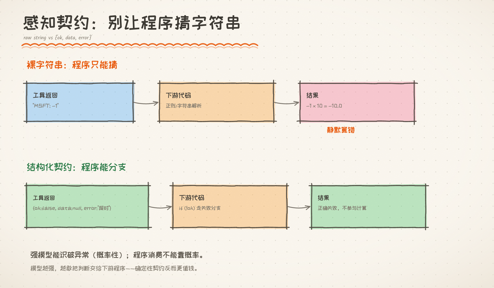

# 基础章 · 感知-行动回路结构化调查

> 2026/10/06。这一讲只回答一个问题：工具结果要不要加一层固定的形状？
> 纪律还是老规矩：**先证明「病」存在，再决定要不要治**。

---

**一句话**：工具结果要不要加 `{ok,data,error}`？看谁来读：LLM 读，收益小；代码读，必需。
**适读**：写过工具调用，但没想过“工具结果到底给谁读”的人。
**相关讲义**：[编排四模式](../02-编排章/编排模式.md)、[能力阶梯](能力阶梯.md)

> **打个比方**：给程序递一张“体检单”（ok/data/error），而不是一张模糊的便签。

> **前情提要**：最小 Agent 已经会调工具，但工具返回的是一段字符串。
> **本章只回答**：怎么让“模型消费”和“程序消费”都不翻车？
> **读完后你能**：解释 `{ok,data,error}` 契约，并说出它防住的两种失败。
> **下一章为什么存在**：循环越跑，历史越长；上下文会先撞墙。

**目录**
- [1. 先看现在的问题：工具结果只是一段字符串](#1-先看现在的问题工具结果只是一段字符串)
- [2. 先试一个最容易被想到的担心：模型会不会把异常当数据？](#2-先试一个最容易被想到的担心模型会不会把异常当数据)
  - [结果：**三例全没打中**](#结果三例全没打中)
- [3. 换一个消费者：只让代码读同一份结果](#3-换一个消费者只让代码读同一份结果)
  - [3.1 第一种翻车：换一种写法，解析器就返回空](#31-第一种翻车换一种写法解析器就返回空)
  - [3.2 第二种翻车：错误值被当成价格，参与了计算](#32-第二种翻车错误值被当成价格参与了计算)
- [4. 所以，契约到底为谁而加？](#4-所以契约到底为谁而加)
- [5. 实现：结构化感知契约（`agent/observation.py`）✅ 2026/10/06](#5-实现结构化感知契约agentobservationpy-20261006)
  - [5.1 契约形态](#51-契约形态)
  - [5.2 接入 `core.py`](#52-接入-corepy)
  - [5.3 验证（`docs/experiments/perception_contract_validate.py`）](#53-验证docsexperimentsperception_contract_validatepy)
  - [5.4 诚实边界](#54-诚实边界)
- [6. 一句话结论](#6-一句话结论)
  - [与项目铁律的关系](#与项目铁律的关系)
  - [产品](#产品)
- [7. 待决](#7-待决)



> 图 1｜LLM 能识破异常，程序不能靠概率；用 {ok,data,error} 分支。

## 1. 先看现在的问题：工具结果只是一段字符串

上一讲的最小 Agent 里，工具返回什么，`core.py` 就原样塞进 history：

```text
工具返回 "AAPL: 189.5; GOOGL: 141.2"
  → 作为 role="tool" 的消息塞进 history
  → LLM 读它，决定下一步
  → 如果下一步是代码，代码也读它
```

这里有个容易被忽略的点：**LLM 读得懂，不等于代码读得懂。**

LLM 可以容忍“AAPL 189.5 美元”“价格 AAPL=189.5”这些不同写法；
代码通常不行——它要么按某个格式写死解析，要么直接 `json.loads`。
一旦格式对不上，代码不会“理解”，只会返回空值或抛异常。

> 项目里已经有 `json_mode.py`，但那是给**最终答案**用的；
> 这一讲说的是**回路中间**的工具结果：它还没有固定的形状。

---

## 2. 先试一个最容易被想到的担心：模型会不会把异常当数据？

我们先假设：模型可能把 `-1`、`未知`、`超时 3000ms` 当成正常数据。
于是构造了三个坑（`docs/experiments/perception_probe.py`）：

| # | 工具返回 | 我们希望模型说 |
|---|---|---|
| A1 | 未知代码返回哨兵 `-1` | “这不是有效价格” |
| A2 | 持仓串里 MSFT=`未知` | “数据缺失，算不了” |
| A3 | 错误信息里有“超时（3000ms）” | “3000ms 是超时上限，不是延迟” |

结果：**三例全被识破**。

| # | 裸字符串 | 加契约 |
|---|---|---|
| A1 | ✅ “`-1` 并不是有效价格” | ✅ |
| A2 | ✅ “MSFT 返回‘未知’，无法算出” | ✅ |
| A3 | ✅ “3000ms 是超时上限，不是实际延迟” | ✅ |

所以，“模型把异常当数据”这个担心，**在强模型上基本不成立**。
它自己能从上下文里判断：`-1` 不是价格，`未知` 不是数字。

那是不是说明：契约没必要了？

> 先别下结论。上面是“模型读”；下面换一个消费者——**只让代码读**。

---

## 3. 换一个消费者：只让代码读同一份结果

`docs/experiments/perception_determinism.py` 把 LLM 拿掉，
只让下游代码解析同一份工具结果。

道理很简单：如果代码也能稳，契约确实没必要；
如果代码会翻车，那问题就不在模型，而在“结果有没有固定的形状”。

### 3.1 第一种翻车：换一种写法，解析器就返回空

假设工具返回股票价格，下游代码用正则解析。它只认这一种写法：

```python
# 解析器按格式 #1 写死
"AAPL: 189.5; GOOGL: 141.2"
# 正则大致是：(\w+): ([\d.]+)
```

现在，同一份数据换两种**意思完全一样**的写法。

> 下表的“结构化返回”，指工具直接把 `data` 给成字典；不是让正则去猜另一种写法。

| 写法 | 裸正则解析 | 结构化返回 |
|---|---|---|
| `AAPL: 189.5; GOOGL: 141.2` | ✅ `{AAPL, GOOGL}` | ✅ |
| `AAPL 189.5 美元；GOOGL 141.2 美元` | ❌ 返回 `{}` | ✅ |
| `价格 AAPL=189.5 \| 价格 GOOGL=141.2` | ❌ 返回 `{}` | ✅ |

注意：第二、三种**没有抛异常**，只是返回了空对象。
程序不会崩，它会继续跑，然后以为“没有数据”。
这就是**静默失败**——比崩溃更难发现。

> 这里变的不是模型，是**写法**。
> 只要工具的输出格式由工具作者决定，下游代码就永远可能遇到“等价但不同形”的写法。

契约的作用，不是“让正则变聪明”，而是**把解析提前到生产者**：
工具直接返回 `data`（比如 `{"AAPL": 189.5, "GOOGL": 141.2}`），
消费者不再猜字符串。

### 3.2 第二种翻车：错误值被当成价格，参与了计算

再假设下游要算持仓市值：

```python
price = tool("UNKNOWN")   # 未知代码，工具返回 -1
value = price * 10        # 10 股
# 结果：-10.0
```

没有异常，没有报错，程序得到一个**负的市值**。
如果这个结果再被写进报表、喂给下一步，错误就会继续传下去。

加契约后：

```python
obs = tool("UNKNOWN")     # {"ok": false, "error": "unknown code"}
if not obs["ok"]:
    return "无法计算：未知代码"
```

| 感知形态 | 下游计算 | 结果 |
|---|---|---|
| 裸字符串（失败 = `-1`）| `-1 × 10` | **−10.0** ❌ 静默算错 |
| 结构化（`ok=false`）| 先判断，再决定算不算 | “无法计算（未知代码）” ✅ |

---

## 4. 所以，契约到底为谁而加？

把上面两个实验放在一起，答案其实只有一句话：

> **契约的价值，取决于“谁来读结果”。**

| 谁读结果 | 没有契约会怎样 | 有契约会怎样 | 结论 |
|---|---|---|---|
| **LLM** | 强模型通常能读懂 | 帮助有限，反而多一层格式 | 主要是成本 |
| **代码** | 格式漂移 → 返回空；哨兵值 → 静默算错 | 能按 `ok` 分支，错误不会被当成数据 | **必需** |

这也解释了为什么第 2 节的 A 探针“没打中”：
它测的是“模型能不能读懂”，而真正的风险在“代码能不能消费”。
模型读懂了，不等于代码读懂了；模型不会把自己的理解自动传给下游代码。

回到最小 Agent：

- 如果只有 LLM 读工具结果，裸字符串还能跑；
- 一旦加了 Pipeline、Evaluator-Critic、外部系统，**代码开始读结果**，就必须有契约。

> 下一讲要解决的是另一个问题：历史越跑越长，上下文会先撞墙。
> 契约解决“结果能不能被消费”，上下文解决“结果塞不塞得下”。

---

## 5. 实现：结构化感知契约（`agent/observation.py`）✅ 2026/10/06

契约不用很重，只做三件事：**告诉我成功还是失败、把数据放在固定位置、把错误说清楚**。

### 5.1 契约形态

```
{"ok": bool, "data": Any, "error": str | None, ...可选元信息}
```

- 生产者：`ok(data)` / `fail(error)`（推荐显式）
- 兼容旧工具：`normalize()` 把裸字符串启发式判断，并标 `_normalized=True`
  （提示"此处走了有损推断"，消费方可据此决定是否信任 `ok`）

### 5.2 接入 `core.py`

- 新增开关 `OBSERVATION_CONTRACT = True`（关闭时与旧版完全一致）
- 工具结果先在**未截断**时归一化为 Observation（下游要完整契约，非给 LLM 看的截断串），
  再截断给 LLM；`TraceStep` 新增可选字段 `observation`
- 长输出时给契约加 `truncated=True` / `raw_len`

### 5.3 验证（`docs/experiments/perception_contract_validate.py`）

| 测试 | 内容 | 结果 |
|---|---|---|
| **T1 契约生成** | 显式 fail / 旧字符串 / 成功 → `ok` 正确 | ✅ |
| **T2 确定性消费** | 下游按 `ok=false` 分支 → "无法计算"（不再静默算错） | ✅ |
| **T3 无回归** | `123*456=56088` 照常 | ✅ |

> 对照 §3.2：旧式 `-1×10 = -10.0`（静默算错）→ 契约后走正确分支。

### 5.4 诚实边界

- 契约**只在生产者遵守时才确定**；旧工具靠启发式（标 `_normalized=True`）。
- 想真正确定，得把工具改成返回 `ok()/fail()`（本项目工具已可逐步迁移）。
- 对 **LLM 消费**几乎无影响（强模型本就能识破）；价值在**程序消费**侧。

---

## 6. 一句话结论

> 感知结构化不是“让模型更聪明”，是“让代码敢接模型的结果”。
> 模型越强，越敢把结果交给下游程序，契约反而越值钱。

### 与项目铁律的关系
- 「多 Agent 是成本结构」的同一逻辑：**接口契约也是成本结构，看消费方而定**；
- 呼应番外篇（`docs/99-番外/模型能力与Agent编排.md`）：
  **强模型吃掉「推理类」鲁棒性，吃不掉「接口类」确定性**。

### 产品
- `agent/observation.py`（新模块）；`agent/core.py`（接入 + 开关）；`agent/tracing.py`（`observation` 字段）
- `docs/experiments/perception_{probe,determinism,contract_validate}.py`
- 本文件

## 7. 待决

- 将 `agent/tools.py` 现有工具逐步迁移到 `ok()/fail()`（真正确定性）；
- 接受结论收口本专题。
