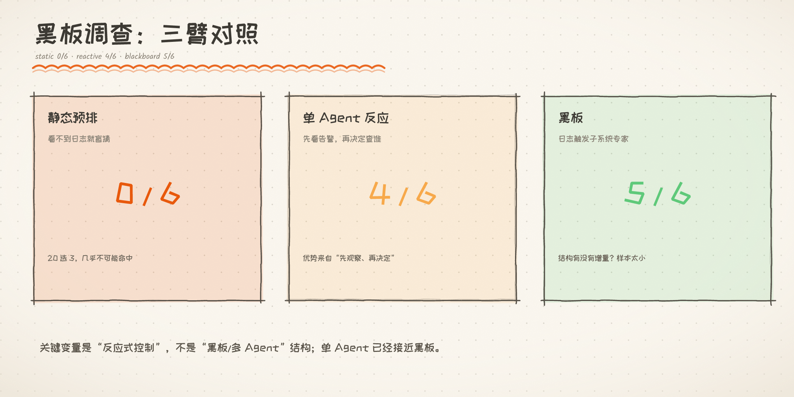

# 编排章 · Blackboard（黑板模式）调查

> 起因：大纲 §3 最后一种未落地模式。用户提供场景：**故障诊断**（下一步查谁取决于中间发现）。
> 纪律：**先证明「病」存在**。日期：2026/10/11。

---

> 图 1｜静态 0/6、单 Agent 反应 4/6、黑板 5/6；关键变量是反应式控制。

## 1. 问题

**Blackboard 的核心主张**：**数据驱动**的控制流 —— 谁出手、下一步做什么，
**由当前「黑板状态」决定**，而非事先排好。经典原型＝**诊断/信号理解**。

与已做模式的区别：

| 模式 | 控制流来源 | 出场顺序 |
|---|---|---|
| Router / Pipeline / Fan-out | 中央预先规划 | 事先排定 |
| Group Chat | 频道 + 固定轮转 | 事先排定 |
| **Blackboard** | **黑板状态触发** | **由内容决定** |

**该治的病**：预排式编排处理不了「**下一步取决于中间发现**」的任务。

---

## 2. 探针演进（四轮，逐步排掉实验缺陷）

| 版本 | 文件 | 缺陷 / 结论 |
|---|---|---|
| v1 | `blackboard_diagnosis_probe.py` | 动作空间仅 5 组件 → **可穷举** → 预排 4/4、迭代 4/4（无差异）|
| v2 | `blackboard_decisive.py` | 20 组件但**预算按步数** → 被「一步多调用」绕过（迭代臂跑到 21 次调用）|
| v3 | `blackboard_trigger{,2}.py` | 严格调用预算；但**打分器假阳性**（`root in 结论`／解析宣告）→ 6/6 虚高 |
| v4 | `blackboard_final.py` | **确定性指标**：只看「根因是否被 inspect **验证**」，不看模型怎么说 |

### 2.1 打分器两次翻车（重要教训）

- **v3 假阳性 #1**：`root_comp in 结论` —— 结论**枚举了所有查过的组件**，命中即算对；
- **v3 假阳性 #2**：解析「最终宣告」—— 模型**猜中未被验证的组件**也算对。
  （铁证：`es-search` 预算耗尽、结论自承"未检查"，但仍被猜中 → 判 ✅）

→ 两轮"6/6"都是**打分器缺陷**造成。**数字整齐到可疑时，先怀疑实验台。**

---

## 3. 终版实验（确定性指标）

`docs/experiments/blackboard_final.py`

- 动作空间 **20 组件 / 4 子系统**；`inspect` 严格预算 **3**（监控/日志免费）；
- 指标＝**某次 inspect 是否真的返回根因标记**（`确认异常`），与模型输出无关；
- 三臂：
  - **静态预排**：看到任何结果**之前**盲列 3 个 inspect；
  - **单 Agent 反应**：一个 Agent 先看告警/日志、再决定查谁（**非**多 Agent）；
  - **黑板**：日志写入黑板 → **匹配的子系统专家被触发** → 只在自家 5 个组件内查；
    组件顺序**打乱**（排除"根因恰好在列表前列"的位置红利）。

### 3.1 结果（n=6）

| 根因 | 系统 | 静态预排 | 单 Agent 反应 | 黑板 |
|---|---|---|---|---|
| node-01 | 宿主 | ❌ | ✅ | ✅ |
| lb-nginx | 网络 | ❌ | ✅ | ✅ |
| node-01 | 宿主 | ❌ | ✅ | ❌ |
| dns | 网络 | ❌ | ✅ | ✅ |
| es-search | 存储 | ❌ | ❌ | ✅ |
| payment-svc | 计算 | ❌ | ❌ | ✅ |

> **静态预排 0/6 ｜ 单 Agent 反应 4/6 ｜ 黑板 5/6**

---

## 4. 结论：**关键变量是「反应式控制」，不是「黑板/多 Agent」**

**病确实是复现了**：静态预排 **0/6** —— 看不到日志就盲猜（20 选 3），几乎不可能命中。

**但决定性对照推翻了「黑板必要」**：

> **单 Agent 反应式（4/6）已经接近黑板（5/6）** ——
> 说明优势主要来自「**先观察、再决定**」（reactive control），
> 而**不是**来自「多专家 + 共享黑板」这套结构。

即：**Blackboard 的价值可以被一个「先看再查」的单 Agent 吃掉**。
（n=6 样本小，4/6 vs 5/6 不足以判定黑板是否真有增量；但**两者都远超静态预排**是硬结论。）

### 与既有结论一致

- 「多 Agent 是成本结构：买不到单 Agent 做不到的事，就别买」—— 又一次印证；
- 与 Debate / 显式规划 / 层级同源：**结构带来的增益常被"更强的单体"吃掉**；
- 真正不可替代的仍是**信息 / 并行 / 隔离 / 审计**，不是「换个编排形状」。

---

## 5. 代价（未实现为模块）

本专题**只做调查、未落地模块**（因必要性未确立）。若实现，代价参照邻近模式：
每步决策一次 LLM 调用 + 黑板状态注入上下文（token 随步数增长）。

---

## 6. 诚实边界

- **n=6 样本小**，未做显著性检验；单 Agent 4/6 vs 黑板 5/6 的差**不可作为结论**；
- 黑板臂加了「打乱顺序」控制，单 Agent 臂没有 —— 严格讲**不完全对称**
  （但打乱对黑板是**不利**的，故不改变"黑板未显著优于单 Agent"的方向）；
- 「子系统线索」由日志**直接给出**（较理想）；现实中线索可能更含糊，
  那时黑板的"专家触发"可能更有用（**未测**）。

---

## 7. 待决

1. 接受结论（**反应式控制是主因，黑板结构无显著增量**）收口；
2. 或加大样本 / 让线索更含糊，验证黑板的"触发"是否有独立价值。
