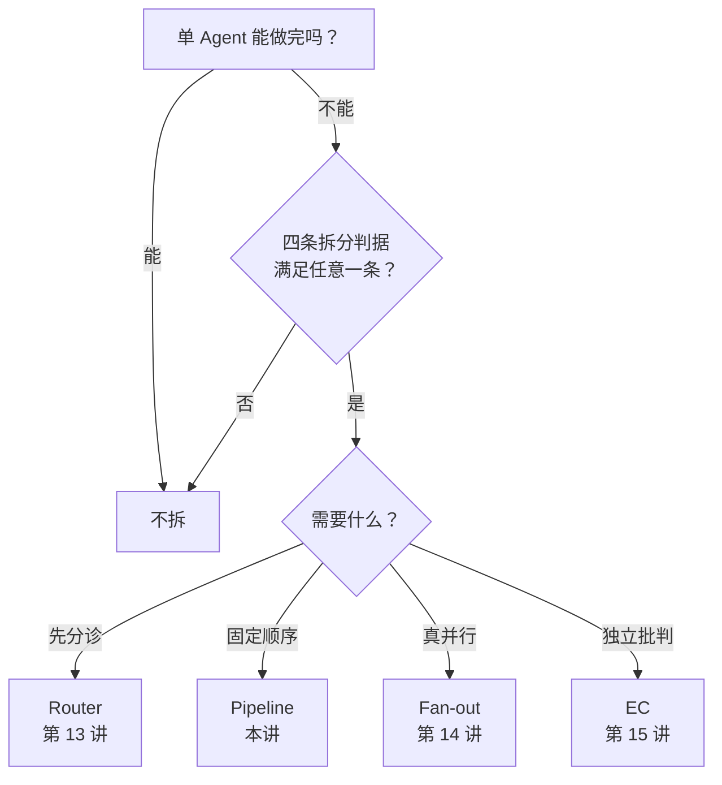

# 编辑试点 · 第 12 讲《四种基本编排》

> 日期：2026-10-22
> 对象：[`docs/02-编排章/编排模式.md`](../02-编排章/编排模式.md)（初稿 第三篇 第 12 讲）
> 试读稿：[`编辑试点-第12讲-改写稿.md`](编辑试点-第12讲-改写稿.md)
> 初稿结构：**6 篇 + 32 讲**；第 12 讲在第三篇“编排”里，后面第 13–15 讲分别深入
> Router 成本 / Fan-out / EC 边界。
> 说明：[`全书目录与主线`](../00-索引/全书目录与主线.md) 的 27 章是**编辑目标**，
> 不是当前初稿；本次只按 6 篇 32 讲改。
> 方法：`clarity` review + `book-editor` structural/line/copy
> + `Academic-Humanizer` 保数字改写。
> **范围：只出建议，不改正文。**

---

## 0. 先看结论

### 最大问题不是句子，是第 12 讲和 13–15 讲的分工没拉开

第 12 讲现在同时在做 8 件事：

1. 给坐标系（§0）；
2. 讲 Router（§1）；
3. 讲 Pipeline（§2）；
4. 讲 Fan-out（§3）；
5. 讲 Evaluator-Critic（§4）；
6. 给四条判据与四条否决线（§5）；
7. 汇总实测账（§6）；
8. 给学习顺序（§7）。

但初稿后面已经有：

- 第 13 讲：Router 成本；
- 第 14 讲：Fan-out 真并行/假并行；
- 第 15 讲：EC 边界（0/6）。

所以第 12 讲不是“缺章”，是**导览和深入讲重叠**：Router 853、Fan-out 3624/2242、
EC 14865/9437/24211 这些细节，在 12 讲先讲一遍，13–15 讲再讲一遍，
读者会觉得自己在原地打转。

**P0 建议：不拆章，保留 6 篇 32 讲；把第 12 讲瘦身成“篇首导览 + 四模式地图”。**

试读稿已经按这个方案写出来了：[`编辑试点-第12讲-改写稿.md`](编辑试点-第12讲-改写稿.md)。

### 最值得保留的

- 主论点：**多 Agent 不是能力升级，是成本结构。**
- 四条判据：上下文隔离 / 真并行 / 不同视角 / 装不下。
- 四条循环否决线：能程序判 / 标准说不清 / 任务太便宜 / 批了也改不动。
- “**跨域不在此列**”这个纠偏。
- 负结果：EC 在客观数值题上 0/6。
- 同一道“算数 + 查天气”贯穿 Router 与 Fan-out。
- 个人语气：“判断税”“拆了就是纯负债”。

### 最该先改的三处

1. **瘦身**：第 12 讲只做“该不该拆 + 四模式地图”，细节交给 13–15 讲。
2. **判据前置**：现在 §5 才给判据，前面 §1–§4 已经在用“判据②”。
3. **补前情与结尾钩子**：开头接住第 11 讲 rerank；结尾接第 13 讲 Router 成本。

---

## 1. Clarity review

### 1.1 读者 / 承诺 / 带走什么

| 项 | 判断 |
|---|---|
| 读者 | 会一点 Python、写过 demo、没写过完整 Agent；已读过工具、记忆、rerank |
| 本章承诺 | 判断“该不该拆”，并知道四种模式的分工 |
| 读者带走 | 四条拆分判据 + 四条循环否决线 + 一张模式地图 |
| 主要障碍 | 承诺是“决策”，内容却先讲四种模式的细节；判据在 §5 才出现 |

一句话：**读者是来学“怎么判断”的，不是来背四个模式的。**  
现在的结构让读者先爬四座山，最后才拿到地图；而 13–15 讲又把山重新爬一遍。

### 1.2 做得好的地方

- 主论点够硬，能一句话记住。
- “跨域不是判据”是反直觉的纠偏，有教学价值。
- 每条模式都写“代价”，符合本书的硬规矩。
- 负结果没有被藏起来（EC 边界、rerank 否决）。
- “算数 + 查天气”这个例子能横向比较不同模式。
- “判断税”“纯负债”这些说法有个人判断，不要磨平。

### 1.3 十个清晰度问题

| # | 位置 | 现象 | 读者的成本 | 建议 |
|---|---|---|---|---|
| 1 | 标题 vs front matter | 标题是“四种基本编排”，front matter 问“什么时候值得拆” | 不知道这是模式目录还是决策章 | 标题改成“什么时候该拆：四种编排速览” |
| 2 | §1–§4 → §5 | 判据在四个模式之后才出现 | 读到“判据②”要往后翻 | 判据前置，至少先给一张四行表 |
| 3 | 开篇 | 从“本项目已落地”开始 | 没接住第 11 讲 rerank 的结论 | 加前情：rerank 被否决，单 Agent 还缺什么 |
| 4 | 与 13–15 讲 | §1 的 853、§3 的 3624/2242、§4 的 EC 表，在 13–15 讲会再出现 | 同一组数据读两遍，像在原地打转 | 12 讲只留结论/数字，细节链接 13–15 |
| 5 | §1–§4 | 四次重复“代价（值钱那行）”“代码在哪”“怎么跑” | 像四篇独立讲义拼贴 | 12 讲压成一张对比表；每章保留一次 |
| 6 | §5 | “四条判据”与“四条否决线”都叫四条 | 容易把“该不该拆”与“该不该上循环”混在一起 | 改名“四条拆分判据”“四条循环否决线” |
| 7 | §0 | 说“10 种编排模式”，表里只有 4 种 | 读者以为漏了 6 种 | 明确“其余 6 种在第 16–20 讲” |
| 8 | §3 / §6 | 2213 与 2242 两个总账并存 | 读者会怀疑数据口径 | 作者确认是否同一 run；若不是，标注差异 |
| 9 | §6 | “2026/09/16 复测”与 §4 的 2026/10/19 补测并列 | 不知道哪张表对应哪次实验 | 两张表分开标日期；补 n、模型、单次/多次 |
| 10 | §1–§4 | 代码块和命令嵌在概念章里 | 打断“该不该拆”的阅读节奏 | 移到第 13–15 讲或附录 C |
| 11 | front matter vs 章末 | “下一章为什么存在”放在开头 | 读到结尾没有出口 | 章末再放一次钩子，开头只留前情/问题 |
| 12 | 全书图 | 初稿这一讲没有图；源文件有一张“四模式”图 | 读者缺少一张决策图 | 第 12 讲加“决策树”，第 13–15 讲各自一张 |

---

## 2. Book-editor structural pass

### 2.1 现在的章节地图

| 节 | 现在做什么 | 问题 |
|---|---|---|
| 0 | 两个轴、10 种模式、四模式表 | 在读者还不知道“为什么要拆”时先上坐标系 |
| 1 | Router | 已经用到“判据②”，但判据还没出现 |
| 2 | Pipeline | 这是 12 讲里唯一需要保留较多细节的模式（13–15 没单独讲 Pipeline） |
| 3 | Fan-out | 14 讲会深入，12 讲可压缩成地图一行 |
| 4 | EC | 15 讲会深入，12 讲可压缩成地图一行 |
| 5 | 四条判据 + 四条否决线 | 全讲最重要的决策工具，位置太晚 |
| 6 | 实测账 + 三条结论 | 数据好，但和 13–15 讲重复，日期/口径混 |
| 7 | 学习顺序 | 像大纲，不像讲末；可移到篇首“怎么读第三篇” |

### 2.2 核心诊断

**第 12 讲被写成了“四篇小论文的合集”，而不是“第三篇的导览”。**

初稿已经有 13–15 讲做深入，所以 12 讲不需要把每个模式讲全。
它应该只回答两个问题：

1. **什么时候该拆？**（四条判据 + 四条否决线）
2. **拆了之后有哪四种基本形状？**（一张地图，细节去 13–15 讲）

### 2.3 推荐分工（保持 6 篇 32 讲）

| 讲 | 角色 | 保留什么 | 不要再展开什么 |
|---|---|---|---|
| **第 12 讲** | 第三篇导览 + 决策 | 四条判据、四条否决线、四模式地图、Pipeline 最小例 | Router 853 细节、Fan-out 3624/2242、EC 三组实验、四组代码块 |
| **第 13 讲** | Router 成本 | 853 / 1360 / 2213、0 token 预筛 | 不重复四判据全文 |
| **第 14 讲** | Fan-out 深入 | 3624 / 2242 / 1347、真并行/假并行 | 不重复四模式定义 |
| **第 15 讲** | EC 边界 | 14865 / 9437 / 24211、0/6、独立信号 | 不重复“生成-批判”定义 |
| **第 16–20 讲** | 高级结构 | 层级/群聊/合同网/辩论/黑板 | 不塞回 12 讲 |

### 2.4 第 12 讲推荐顺序

1. **前情**：第 11 讲把 rerank 否决了；单 Agent 的检索够用，但有些任务一个人做不完。
2. **先判断**：四条拆分判据 + 四条循环否决线。
3. **再给地图**：四模式表（控制流 / 信息流 / 适用判据 / 代价 / 详见哪一讲）。
4. **只留 Pipeline 最小例**：13–15 讲没有单独讲 Pipeline，12 讲保留它的“固定顺序 + 结构化输出”。
5. **一句成本总结**：Router 853、Pipeline 2650、Fan-out 3624/2242、EC 14865；
   详细账在 13–15 讲。
6. **决策树/清单**：三个问题走完。
7. **章末钩子**：Router 每次 853 token，下一讲看 0 token 预筛。

### 2.5 试读稿的结果

按上面的方案写了一版试读稿：

- 原稿：6,754 字符 / 254 行；
- 试读稿：3,615 字符 / 149 行，约 **-46%**；
- 四个模式的详细实验/代码移到 13–15 讲；
- Pipeline 保留最小例（13–15 讲没有单独讲 Pipeline）；
- 四条判据/否决线前置；
- 加了一张决策树。

试读稿见：[`编辑试点-第12讲-改写稿.md`](编辑试点-第12讲-改写稿.md)。

### 2.6 三个结构补丁

#### 补丁 A：前情

现在开头是：

> 本项目已落地的 4 种编排模式，用同一套框架逐个拆解……

建议改成：

> 上一讲把 rerank 否决了：单 Agent 的检索够用，加精排反而添乱。
> 但有些任务一个人做不完，或者太慢。这一讲先判断“该不该拆”，
> 再给四种基本形状；Router、Fan-out、EC 的细节分别在第 13–15 讲。

#### 补丁 B：判据/否决线分名

- **四条拆分判据**：决定“要不要拆”；
- **四条循环否决线**：决定“要不要上 EC 这种循环”。

两者不是同一层，不要都叫“四条”。

#### 补丁 C：一张决策表

| 问题 | 是 | 否 |
|---|---|---|
| 单 Agent 能做完吗？ | 不拆 | 进入下一问 |
| 上下文互相干扰 / 真能并行 / 需要不同视角 / 装不下？ | 拆 | 不拆 |
| 需要分诊？ | Router（第 13 讲） | — |
| 需要固定顺序？ | Pipeline（本讲） | — |
| 需要并行？ | Fan-out（第 14 讲） | — |
| 需要独立批判？ | EC（第 15 讲） | — |

---

## 3. Academic-Humanizer 前后对比

### 3.1 原则

只处理“模板腔/论文腔/重复句式”，不改：

- 数字（853 / 1360 / 2213 / 2650 / 2.7s / 3624 / 2242 / 1347）；
- 日期（2026/09/16、2026/10/19）；
- 代码、命令、引用；
- 作者的个人判断（“判断税”“纯负债”“跨域不在此列”）。

**不要全书统一过一遍**；只改被标记的段落，否则会把教学语气磨平。

### 3.2 四组 before / after

#### 样本 1 · 开篇

**原文**

> 本项目已落地的 4 种编排模式，用**同一套框架**逐个拆解：
> 是什么 → 结构定位 → 为什么这么设计 → **代价** → 代码在哪 → 实测账。
> 配套代码：…… 收口日期：2026/09/16。

**建议**

> 这一讲先判断“该不该拆”，再给四种基本形状：Router、Pipeline、Fan-out/Fan-in、EC。
> 四种模式都按同一组问题看：谁控制流、信息怎么流、解决什么问题、多付什么代价、
> 代码在哪、实测多少。代码在……；数据收口于 2026/09/16。

**为什么**：少一点“框架/拆解”的元语言，直接把“先判断、再给形状”说清楚；日期和代码不变。

#### 样本 2 · Router 的“为什么”

**原文**

> 用户的问题五花八门，但不需要为每种问题各写一段 if-else。
> 把「该怎么处理」交给 LLM 判断，规则一变只改 prompt，不动代码——
> 这就是「LLM 控制流」相对「代码写死」的价值：**灵活**。

**建议**

> 用户的问题不会按你写好的分支出现。为每种问法写一段 if-else，规则一改就要动代码；
> 把“怎么处理”交给 LLM，改的是 prompt，不是程序。这是 LLM 控制流的价值：灵活。
> 代价是每次判断都要付费，而且会判错。

**为什么**：把“五花八门/不需要”改成具体动作；把代价提前一句，避免只讲好处。

#### 样本 3 · §5 判据开头

**原文**

> 满足**任意一条**才值得把任务拆给多个 Agent：
> 1. **上下文隔离**：……

**建议**

> 四条判据，满足任意一条，拆才可能划算；一条都不满足，拆就是纯负债。
> 1. **上下文隔离**：……

**为什么**：先给结论，再列条件；“纯负债”是作者原话，保留。

#### 样本 4 · §6 三条结论

**原文**

> 1. **连「不拆」这个决定本身都要花钱**——Router 每次 853 token，是判断税；
> 2. **能省钱的办法是把控制权交给代码**……
> 3. **每个模式的代价都不一样，且都可测量**……

**建议**

> 先记住三个数：Router 判断一次 853 token；判“不拆”后总账 2,213
> （853 + 1,360）；Pipeline 两步 2,650。它们说明三件事：判断要付费；
> 固定流程交给代码更省；每种模式的代价都能测。写不出代价，就是还没搞懂边界。

**为什么**：三个数字先落地；补上 2,213 的加法；保留原结论，不新增主张。

### 3.3 一段样章（只作为改写示例，不直接替换正文）

```markdown
# 第 12 讲 什么时候该拆：四种编排速览

> 前情：第 11 讲把 rerank 否决了。单 Agent 的检索够用，但有些任务一个人做不完。
> 本讲只回答：什么条件下，拆成多个 Agent 才划算？
> 读完后你能：用四条拆分判据和四条循环否决线，判断该不该拆。

先看一次拆错的经历。

「算 123×456，再查上海天气」看起来跨了两个域，于是 Router 把它拆给
“数学专家”和“天气专家”。两位专家各自只有半个工具集，最后各漏答一半。
错不在“跨域”，在把“跨域”当成了拆分判据。

拆之前，先过四条判据：

| 判据 | 问什么 |
|---|---|
| 上下文隔离 | 两边的知识/工具会互相干扰吗？ |
| 真能并行 | 子任务独立，且并行能显著省墙钟时间吗？ |
| 不同视角 | 需要“生成”和“批判”这种互斥立场吗？ |
| 装不下 | 单 Agent 的上下文真的装不下吗？ |

四条都不满足，不拆。拆了就是纯负债。

拆了之后，四种基本形状是：

| 形状 | 一句话 | 详见 |
|---|---|---|
| Router | 先分诊，再决定拆不拆/拆给谁 | 第 13 讲 |
| Pipeline | 固定顺序，上一步输出是下一步输入 | 本讲 |
| Fan-out | 切分后分发，再汇聚 | 第 14 讲 |
| EC | 生成-批判-重做 | 第 15 讲 |
```

**注意**：这是示例，不是已合并的正文；真正的讲还要补实测账、图和代码链接。

---

## 4. 优先级修改清单

### P0 · 结构（先做）

- [ ] **不拆章**：6 篇 32 讲保持不变。
- [ ] 第 12 讲瘦身为“篇首导览 + 四模式地图”。
- [ ] 把四条拆分判据/四条否决线前置。
- [ ] 把 Router 853、Fan-out 3624/2242、EC 三组实验的细节移到 13–15 讲。
- [ ] 开头补“第 11 讲 rerank 之后”的前情；结尾补“第 13 讲 Router 成本”的钩子。

### P1 · 数据与术语

- [ ] 确认 2,213 与 2,242 是否同一口径；不是就标日期/run。
- [ ] 每张实测表补：日期、模型 `deepseek-flash`、n、单次/多次。
- [ ] 1,347 标明“理想值/未实测”，不要混进实测列。
- [ ] 统一：多 Agent（不用 Multi-Agent）、编排结构、`solo` 首次出现加“不拆”。
- [ ] “四条判据”/“四条否决线”改名并分隔。

### P2 · 行文与图

- [ ] 用第 3 节的四组 before/after 做一轮 line pass。
- [x] 第 12 讲决策图已换成手绘版，箭头改为规整的直角/圆角连接：[`教学-什么时候该拆.png`](../diagrams/教学-什么时候该拆.png)；第 13–15 讲各一张图。
- [ ] 代码块/命令移到 13–15 讲或附录 C。
- [ ] 删掉重复的“代价（值钱那行）”模板，改成一张对比表。

---

## 5. 试点验收

找 2 位目标读者（会 Python、没写过完整 Agent），读完第 12 讲后问：

1. **回忆**：四条拆分判据是什么？四条循环否决线是什么？
2. **迁移**：给“写周报 + 查天气”，该不该拆？为什么？
3. **定位**：Router / Fan-out / EC 的细节分别在哪几讲？
4. **一句话**：这一讲最记得哪句话？

期望：

- 能说出至少 3 条判据；
- 能判断“周报 + 天气”不该按“跨域”拆；
- 能指出“判据缺失/工具集不完整”，而不是“模型不够强”；
- 知道“细节去 13–15 讲”，不会在 12 讲里找全所有实现；
- 最记得“**多 Agent 不是能力升级，是成本结构**”。

如果读者只记住“四种模式”，没记住“先判断”，说明结构还没改到位。

---

## 6. 不要改的

- 不要磨平“判断税”“纯负债”“跨域不在此列”这些有个人判断的句子。
- 不要把 853 / 1360 / 2213 / 2650 / 3624 / 2242 改成形容词。
- 不要把负结果（EC 0/6、rerank 否决）删掉。
- 不要把教学讲改成论文；`paper-writing` 只用于附录/正式报告。
- 不要让 Academic-Humanizer 重写代码块和命令。

---

## 附录：决策树（可直接改成手绘图）


