# Agent 入门（结构 / 视觉试读版）

> **版本：2026-10-22 试读版 · 6 篇 32 讲。** 这不是终稿。
> 这一版只做三件事：统一讲前卡、重写第 12 讲、统一书中插图。
> 其余正文仍是初稿内容，没有逐讲重写；标 ⬜ 的仍是待写。
>
> **本版改了什么**
> 1. 32 讲统一增加/保留“前情 → 本讲只回答 → 读完后你能 → 下一讲”讲前卡；
> 2. 第 12 讲按试读方案重写：判据前置、四模式地图、Pipeline 最小例、决策树；
> 3. 书中全部插图（13 组）统一成手绘卡片风格：4 张核心图重绘，6 张保留内容加统一框，
>    第 12 讲决策树 + DSH 架构/Step 两张图；
> 4. 其余讲正文未重写，只做结构入口和图片替换。
>
> **读法**：先看第 0 讲地图；再按 6 篇顺序读。每讲先看讲前卡，再看正文。
> 复习时只看每讲开头和结尾的“代价 / 下一讲”。
>
> **编辑方案**：[全书目录与主线](../00-索引/全书目录与主线.md) ·
> **编辑试点报告**：[编辑试点-第12讲](../08-日志/编辑试点-第12讲.md) ·
> **项目日志**：[项目日志 2026](../08-日志/项目日志-2026.md)

---

## 目录


**序章**
- [第 0 讲 · 教学总览：从 88 行到一个多 Agent 系统](#j-0) 🟡

**第一篇 · 本质：从“会说”到“会做”**
- [第 1 讲 · 一个只会说话的模型](#j-1)
- [第 2 讲 · 最小 Agent：一个循环 + 一份工具清单](#j-2) 🟡
- [第 3 讲 · 工具结果怎么回来：感知契约](#j-3)
- [第 4 讲 · 上下文与历史：短期记忆的边界](#j-4) ⬜

**第二篇 · 记忆：让 Agent 不失忆**
- [第 5 讲 · 为什么需要长期记忆](#j-5)
- [第 6 讲 · 写侧：抽取什么、怎么抽](#j-6)
- [第 7 讲 · 读侧：召回、阈值、文本增富](#j-7)
- [第 8 讲 · 读侧进阶：换更强 embedding](#j-8)
- [第 9 讲 · 切分与指代：跨轮“它”到底指谁](#j-9)
- [第 10 讲 · 记忆评测：答案有没有变](#j-10)
- [第 11 讲 · 检索进阶：rerank 为什么被否决](#j-11)

**第三篇 · 编排：从单 Agent 到多 Agent**
- [第 12 讲 · 什么时候该拆：四种编排速览](#j-12) 🟡
- [第 13 讲 · Router 成本：先花 0 token 判断](#j-13)
- [第 14 讲 · Fan-out 深入：真并行与假并行](#j-14)
- [第 15 讲 · EC 的边界：同模型在数值题上 0/6](#j-15)
- [第 16 讲 · 层级与工人池：慢工具才值](#j-16)
- [第 17 讲 · 去中心化：Group Chat](#j-17)
- [第 18 讲 · 合同网：中央无法评估时](#j-18)
- [第 19 讲 · 辩论：必要性未复现](#j-19)
- [第 20 讲 · 黑板：关键变量是反应式控制](#j-20)
- [第 21 讲 · 能力 × 编排：模型变强后](#j-21)

**第四篇 · 工程化：可运行、可负担、可观测**
- [第 22 讲 · 约束与收尾：别等撞墙才停](#j-22) 🟡
- [第 23 讲 · MCP：把 N×M 变成 N+M](#j-23)
- [第 24 讲 · MCP 边界：什么该做成工具](#j-24)
- [第 25 讲 · 架构：四层与纯叶子](#j-25)
- [第 26 讲 · 观测与评测：怎么知道它行不行](#j-26) ⬜

**第五篇 · 边界：什么时候不该加**
- [第 27 讲 · 学习总结：九句话与被证伪的判断](#j-27)
- [第 28 讲 · 模型能力与 Agent 编排](#j-28)

**第六篇 · 下一步：从教学项目到 harness**
- [第 29 讲 · DSH 技术设计与实现](#j-29)
- [第 30 讲 · 从 DSH 吸收什么：路线](#j-30)
- [第 31 讲 · 交互可视化：把流程拍下来](#j-31)
- [第 32 讲 · 长任务、状态、安全：还缺什么](#j-32) ⬜

**附录**
- [第 34 讲 · 附录 A · 问题清单（40 条）](#j-34)
- [第 35 讲 · 附录 B · 课程地图与自检](#j-35)
- [第 36 讲 · 附录 C · 写作规范](#j-36)

---

# 序章

先看整本书的地图：Agent 是什么、为什么这样长、怎么读。

<a id="j-0"></a>
## 第 0 讲 · 教学总览：从 88 行到一个多 Agent 系统

> 状态：🟡 改写

> 这不是论文，是一张“先看懂、再动手”的学习地图。
> **适合**：刚开始学 Agent，或者写完 demo 但不知道下一步学什么的人。
> **读法**：先看三句话 → 再看六张图 → 最后按兴趣点进各章。
> **本书目录与章节关系**：[全书目录与主线](../00-索引/全书目录与主线.md)。
> **单文件初稿**：[Agent 入门（初稿汇编）](Agent入门-初稿.md)。
> **一句话**：Agent 没那么神秘；难的是知道**什么时候该加东西、加了要付什么代价**。


> **前情**：接着序章的问题往下走。  
> **本讲只回答**：这本书怎么读？  
> **读完后你能**：知道全书五拍主线，并能按问题跳读。  
> **下一讲**：第 1 讲会接着这个问题。

---

### 先看三句话

1. **Agent 的本质 = 一个循环 + 一份工具清单。**
   模型负责“想”，工具负责“做”，记忆负责“别失忆”，循环负责“做完看一眼再决定下一步”。
2. **多 Agent 不是能力升级，是成本结构。**
   每多一个 Agent，就多一份交接、压缩上下文和 token；买不到“单 Agent 做不到的事”，就别买。
3. **能测量的别猜。**
   “明显更快”不算，`5.11s → 3.04s` 才算；负结果和正结果一样值钱。

---

### 概念小抄（先混个脸熟）

| 词 | 一句话 | 打个比方 |
|---|---|---|
| **LLM** | 只会读文字、写文字的大脑 | 一个很会答题但没手没脚的人 |
| **Agent** | 给大脑装上循环、工具、记忆 | 给那个人配了手、笔记本和流程 |
| **ReAct** | 想 → 做 → 看 → 再想 | 边做边看反馈，不是一口气写完 |
| **Prompt** | 给模型的角色说明和格式要求 | 上岗前的岗位说明书 |
| **Token** | 模型读写文字的计量单位 | 电表；也是账单 |
| **Tool / function call** | 模型决定“调用哪个函数”，程序真正执行 | 模型点菜，程序做菜 |
| **Router** | 一个调度者判断“拆不拆、派给谁” | 医院前台分诊 |
| **Worker** | 被派活的专家 | 专科医生 |
| **Pipeline** | 固定顺序串联，上一步输出 = 下一步输入 | 流水线 |
| **Fan-out** | 先切分，再分头做，最后汇总 | 几个人分头查资料，最后合并 |
| **Evaluator-Critic（EC）** | 生成 → 批判 → 不达标重做 | 写完找同事挑错，再改一版 |
| **RAG / embedding** | 把文字变成向量，按相似度找回来 | 把书页变成坐标，找“离问题最近”的几页 |
| **MCP** | 工具的通用插座 | USB 接口：换个工具不用重写一遍 |
| **Golden set / judge** | 固定题库 + 评卷规则 | 期末考试卷 + 评分标准 |
| **Observability** | 记录每一步在干什么 | 行车记录仪 |

> 这些词后面都会反复出现。第一次看不懂没关系，先有个印象，读到对应章节再回来查。

---

### 图 1：Agent 的本质

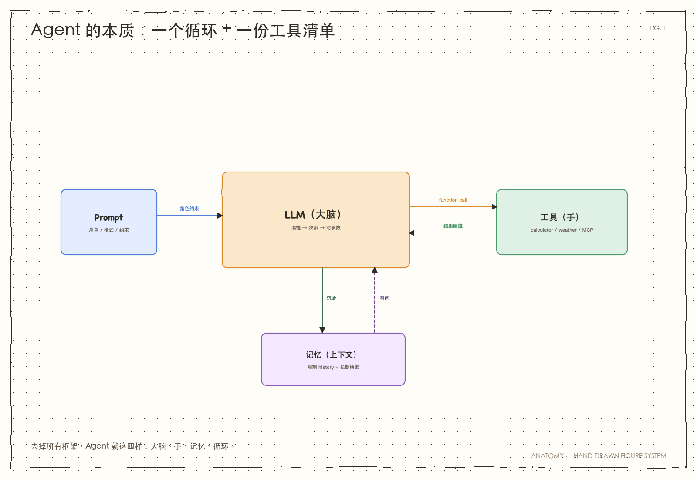

> 图 1｜大脑、手、记忆、循环，四样东西；其余都是加在它上面的成本。

**看图说话**：

- **LLM（大脑）**：只负责“读懂 → 决策 → 写参数”。它**不执行**任何东西。
- **工具（手）**：计算器、天气、MCP 工具……真正干活的是它们。
- **记忆（上下文）**：短期是这一轮对话的历史；长期是向量库检索回来的片段。
- **循环（ReAct）**：模型要工具就执行，结果回填，再让模型看；直到它不再要工具。
  `max_steps` 是保险丝，防止它一直转。

**一个常见误解**：

> “Agent 很聪明，是它自己会规划。”

不是。智能 100% 来自 LLM；Agent 只是把“角色 + 历史 + 工具”装配好，
让模型的决策能落地。**看懂 `minimal.py` 的 88 行，就懂了一半。**

→ 深入：[能力阶梯](../01-基础章/能力阶梯.md)

---

### 图 2：四种编排模式

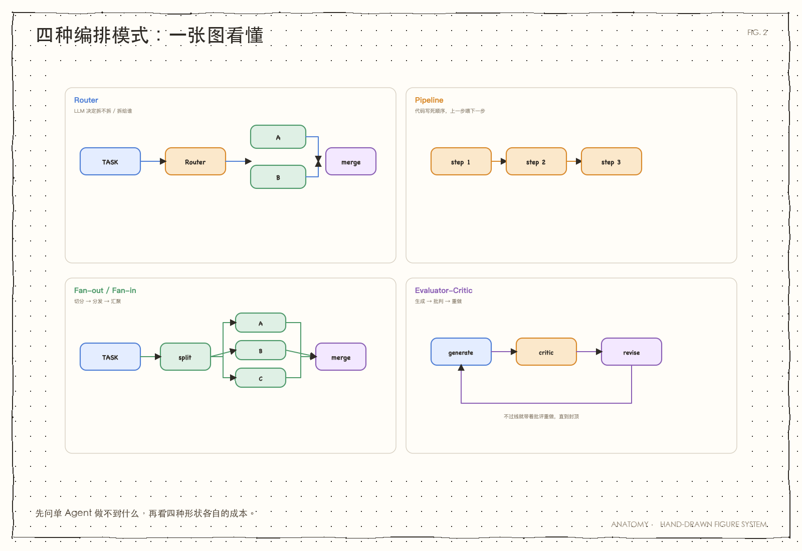

> 图 2｜四种模式不是四种“能力”，是四种“成本结构”。

**看图说话**：

| 模式 | 一句话 | 什么时候用 | 代价 |
|---|---|---|---|
| **Router** | 前台分诊，决定拆不拆 | 请求类型多、需要动态判断 | 判断本身也要 token |
| **Pipeline** | 固定顺序，A→B→C | 步骤天然有先后 | 流程定死，不会拐弯 |
| **Fan-out** | 分头做，再汇总 | 子任务独立、工具慢 | 交接会丢信息 |
| **EC** | 生成→批判→重做 | 有明确标准、且能改 | 每轮多付生成 + 批判 |

**最容易踩的坑**：

> “这道题跨了两个领域，所以应该拆成两个专家。”

不一定。跨域不是判据；**“单 Agent 做不到”**才是。
两个各只有半个工具集的专家，常常各自漏答一半。

→ 深入：[编排模式](../02-编排章/编排模式.md)、[显式规划调查](../02-编排章/显式规划调查.md)

---

### 图 3：记忆用两次

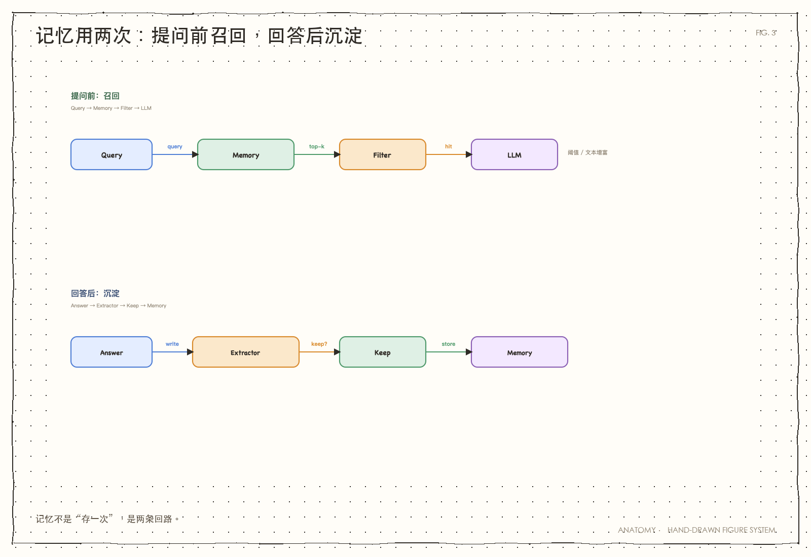

> 图 3｜记忆不是“记住一切”，是两次有选择的动作。

**看图说话**：

- **① 提问前：召回**。把问题变成向量，去库里找最相关的几条；低于阈值的不发，
  防止“不相干的记忆”污染上下文。`top_k` 管发几条，阈值管发不发。
- **② 回答后：沉淀**。不是无脑存；先用一个轻量 LLM 判断“值不值得记”，
  只记明确偏好、个人信息、跨会话事实；写入放后台线程，不阻塞回答。

**两个常见误解**：

> “上下文窗口很大，就不用记忆了。”

窗口大 ≠ 管得好。塞得越多，注意力越容易被稀释；而且关掉页面就没了。

> “记忆越多越好。”

无限制扩张的记忆会传播错误、污染判断。**会忘，和会记一样重要。**

→ 深入：[记忆抽取](../03-实战章/记忆抽取.md)、[记忆召回修复](../03-实战章/记忆召回修复.md)、[记忆切分](../03-实战章/记忆切分.md)

---

### 图 4：评测闭环

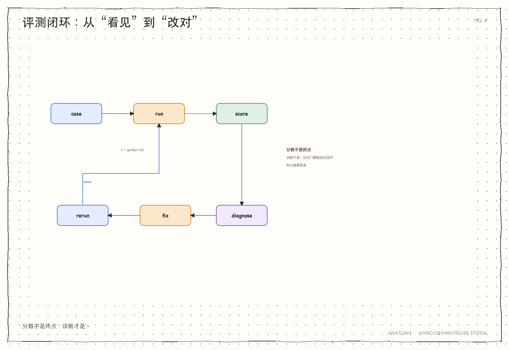

> 图 4｜监控答“发生了什么”，评测答“对不对”；两件事不能互相替代。

**看图说话**：

- **监控**（Langfuse / Tracer）：哪一步慢、贵、错。它只描述，不判断。
- **评测**（golden set + judge）：拿固定题集跑，回答“这版比上版好还是坏”。
- **闭环**：监控发现坏 case → 固化成评测题 → 修复 → 回归。
  不回归，下次还会踩同一个坑。

**一条硬规矩**：

> 有客观、可程序验证的标准（能算、能跑测试）→ **用代码验证**，别雇 LLM 评委。

这条规矩在 2026/10/19 又被实测证了一遍：同模型 EC 在数值题上 0/6，
会把对的判错、把错的认同。

→ 深入：[数值题EC可靠性调查](../02-编排章/数值题EC可靠性调查.md)、[成文规矩](../00-索引/成文规矩.md)

---

### 图 5：系统是怎么搭的

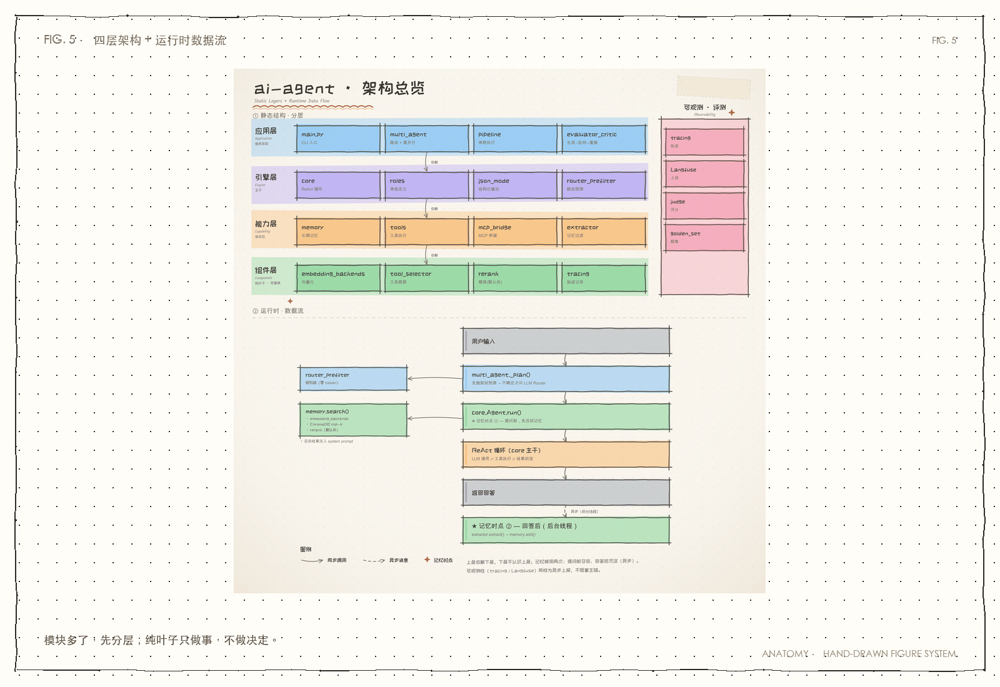

> 图 5｜上层依赖下层，下层不认识上层；10 个“纯叶子”是项目的可替换策略层。

**看图说话**：

- **应用层**：`main.py`、Router、Pipeline、EC——负责“发起”和“编排”。
- **引擎层**：`core.py` 是唯一的 ReAct 主干；`roles` 定义专家。
- **能力层**：`memory` 有状态；`tools` 执行；`mcp_bridge` 接外部工具。
- **组件层**：embedding、rerank、提取器、评测、轨迹……都是可替换零件。

**为什么这么分**：

> 越底层越“无知”，越上层越“知道全局”。

`tools.py` 不该知道“谁在用它”；`memory.py` 不该知道“这次是哪个专家”。
底层不认识 Agent，才能被单独测试、A/B、整体换掉。

→ 深入：[架构](../05-收尾章/架构.md)

---

### 图 6：模型变强后，哪些脚手架还值钱

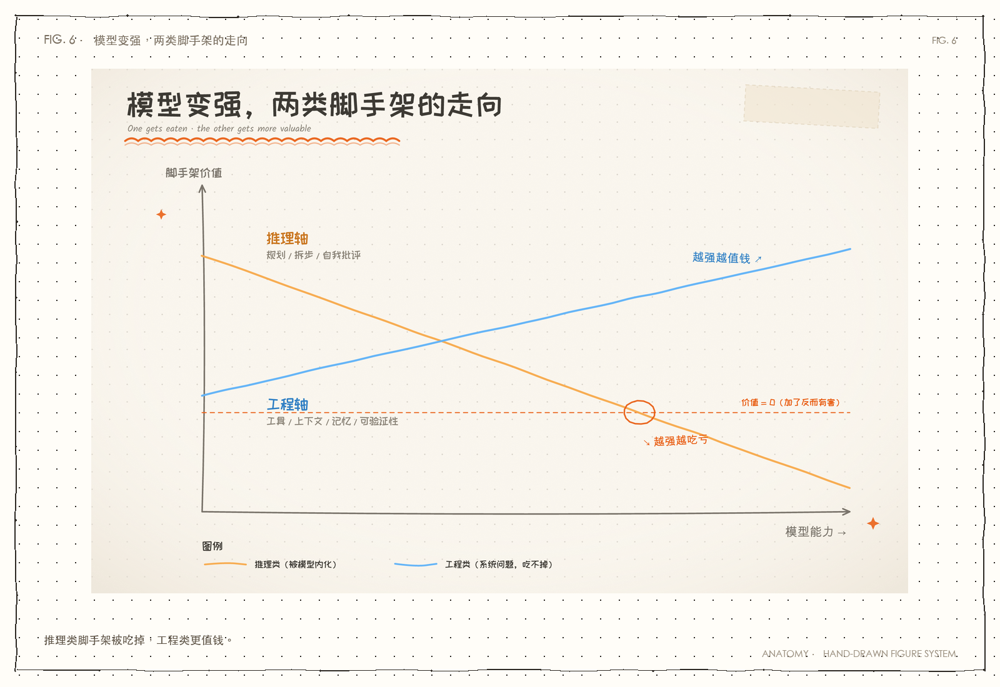

> 图 6｜模型变强，吃掉“替它想”的脚手架，吃不掉“帮它够得着/记得住/验得了”的能力。

**看图说话**：

- **推理轴**（拆步、规划、自我批评）：模型自己在内化；外挂的价值在下降，甚至转负。
- **工程轴**（工具、上下文、记忆、验证、隔离）：模型变强帮不上忙，价值不降反升。

这解释了本项目的几个“反直觉”结论：

- 显式规划：小任务全对，长链救不了，**零增益**；
- rerank：实现了，但本项目语料上 **Top-1 反而降**；
- Debate：强模型自己就会质疑前提，**必要性未复现**；
- EC：文案题有用，数值题同模型自评 **不可靠**。

→ 深入：[模型能力与Agent编排](../99-番外/模型能力与Agent编排.md)

---

### 实测账：哪些结论有数字撑腰

| 实验 | 关键数字 | 这说明什么 |
|---|---|---|
| Router 预筛 | 86% 跳过，总 token −25% | 简单任务用规则更省 |
| 真并行 Fan-out | 5.11s → 3.04s（−41%） | 独立子任务 + 慢工具才值 |
| EC 文案 | 84→84→85；及格线 90 时回退 | 及格线是旋钮，拧太高会反噬 |
| 显式规划 | N≤8 可，N≥9 不可；规划 0 增益 | 边界是预算，不是计划 |
| 工人池（慢工具） | 12.0/16.2s → 4.7/4.0s | 慢工具下并行真必要 |
| 去中心化协商 | 33% vs 100%；成本 1.25× | 信息分散时不可替代 |
| Contract Net | 33% vs 100%；成本 ≈5× | 中央无法评估时才值 |
| Debate | 12/12 vs 11/12 | 强模型自己会质疑前提 |
| Blackboard | 静态 0/6；单 Agent 4/6；黑板 5/6 | 关键变量是“反应式控制” |
| 记忆 | 有记忆 4/5 vs 无 2/5 | 记忆有贡献，但会漏召 |
| MCP 工具裁剪 | 省 42% 工具声明 token | 工具清单有租金 |
| 同模型 EC（数值） | **0/6**；9 被改成 771429 | 同模型自评不是独立信号 |

> 所有数字带日期与实验语境；n 小，别当“定律”。

---

### 负结果：哪些热闹不能跟

| 负结果 | 数字 | 这告诉我们什么 |
|---|---|---|
| 显式规划 | 长链 N≥9 一样失败 | “把计划写出来”≠“跑得动” |
| 精排 rerank | Top-1 14→13，延迟 +296ms | 新组件不一定比旧的好 |
| Debate | 12/12 vs 11/12 | 强模型不需要“正反方”来纠错 |
| Blackboard | 单 Agent 反应 4/6，黑板 5/6 | 优势主要来自“先看再决定” |
| 同模型 EC | 0/6，9→771429 | 有客观标准时，代码验证 > LLM 评委 |

**一句话**：

> 不为未复现的问题增加复杂度；先找最便宜的修法，再加机器。

---

### 什么时候用什么

| 你的情况 | 建议 |
|---|---|
| 单 Agent 能做完 | **solo**；别加 Router |
| 步骤天然有先后 | **Pipeline**（代码控制） |
| 子任务独立、工具慢 | **Fan-out / 工人池** |
| 需要批判人格、且能从批评中改进 | **EC**；但要有外部信号 |
| 信息分散在多方 | **Group Chat / Contract Net** |
| 中央无法评估“该谁干” | **Contract Net** |
| 有客观标准（能算/能测） | **代码验证**，不用 LLM 评委 |

---

### 九句话

1. 同一句“100%”，含金量可以完全不同。
2. 能测量的别让 LLM 判；恒为满分的维度只当一票否决。
3. 多 Agent 是花钱买“单 Agent 做不到的事”；买不到就别买。
4. 软提示改不了行为惯性；要改行为，得改“可用动作”。
5. 不为未复现的问题增加复杂度；先找最便宜的修法。
6. 编排的必要性是有条件的：子任务独立 + 单任务耗时足够大。
7. 模型变强吃掉推理类脚手架，吃不掉工程类能力。
8. 接口契约的价值取决于“谁来消费”；程序消费不能靠概率。
9. 同模型自评不是独立信号；有客观标准时，代码验证 > LLM 评委。

> 展开版：[学习总结](../00-索引/学习总结.md)。

---

### 怎么读这套文档

**第一次读（建立整体印象）**：

1. [能力阶梯](../01-基础章/能力阶梯.md)：从 88 行到 4800 行，一条纵向代码阶梯
2. [编排模式](../02-编排章/编排模式.md)：四种模式 + 判据
3. [约束与收尾](../03-实战章/约束与收尾.md)：为什么不能“撞墙才停”
4. [架构](../05-收尾章/架构.md)：四层 + 数据流
5. [学习总结](../00-索引/学习总结.md)：主线 + 九句话

**带着问题查**：

| 想知道 | 看这里 |
|---|---|
| 怎么省钱 | [路由成本优化](../02-编排章/路由成本优化.md) |
| 慢工具怎么提速 | [并行分发](../02-编排章/并行分发.md) |
| 记忆检索不准 | [记忆召回修复](../03-实战章/记忆召回修复.md) |
| 工具怎么复用 | [MCP基础](../04-协议章/MCP基础.md) |
| 多 Agent 怎么协作 | [去中心化协商调查](../02-编排章/去中心化协商调查.md) |

**学方法论**：

[学习总结](../00-索引/学习总结.md) 的“被证伪的判断” + [问题清单](../00-索引/问题清单.md) 的 40 条踩坑 +
各篇“调查”类讲义。**结论不是学到的，是测出来的。**

---

### 诚实边界

- **样本小**：很多实验 n=3–6；只能写“方向性”，不能写“证明”。
- **单作者**：实验设计、判分器、复核都是一个人，容易有盲区。
- **模型会漂移**：2026/09 的 `deepseek-flash` 和今天不一定一样；旧数字要重跑。
- **判分器会错**：T2 的期望值就曾算错；数字整齐到可疑时，先查实验台。
- **任务会泄漏**：用测试查询写提示词，分数会虚高；必须用留出集。

> 这份文档不追求 SOTA，追求**可解释的边界**；能被证伪，比“看起来厉害”重要。

---

### 延伸阅读

- [教学大纲](../00-索引/教学大纲.md)：12 节进阶路线
- [学习总结](../00-索引/学习总结.md)：主线 + 五模块 + 九句话
- [问题清单](../00-索引/问题清单.md)：40 条踩坑
- [成文规矩](../00-索引/成文规矩.md)：讲义怎么写
- [模型能力与Agent编排](../99-番外/模型能力与Agent编排.md)：文献综述
- [文档地图](../README.md)：全部讲义入口
- [项目日志 2026](../08-日志/项目日志-2026.md)：按日期的复盘、审视、重构、盘点
- [交互可视化设计](../06-可视化/交互可视化设计.md)：把 Agent 流程做成可回放动画（设想）
- [DSH 技术研究](../07-DSH研究/DSH技术设计与实现.md)：从 DSH 源码/设计文档吸收可落地机制

> 本讲来源：[教学总览.md](../00-索引/教学总览.md)

# 第一篇 · 本质：从“会说”到“会做”

LLM 只会“说”。这一篇只做一件事：给它装上循环和工具，让“说”变成“做”。先看最小的 88 行，再看工具结果怎么回来，最后看上下文为什么会先撞墙。

<a id="j-1"></a>
## 第 1 讲 · 一个只会说话的模型

> 状态：✅ 已有

> 2026/10/20。这一讲先不写 Agent，只把模型本身看清楚：它能做什么、不能做什么？
> 先把“模型”和“Agent”分开，后面才知道循环和工具是为什么加的。

---

**一句话**：模型只会“读一叠消息，写下一段文字”；它不记得你，也不会替你动手。
**适读**：刚开始写 Agent，或者一直分不清“模型”和“Agent”的人。
**相关讲义**：[能力阶梯](../01-基础章/能力阶梯.md)、[感知结构化调查](../01-基础章/感知结构化调查.md)

> **打个比方**：模型像一个很会写字、但被关在房间里的人。
> 你每次只能从门缝里塞一叠纸进去，他写完一叠纸递出来；
> 他看不到房间外面，也不会替你跑腿。

> **前情提要**：这是全书第一讲，我们先不写 Agent，先看清模型本身。
> **本章只回答**：模型能做什么、不能做什么？
> **读完后你能**：说清 messages / token / 上下文窗口，以及为什么 Agent 需要循环和工具。
> **下一章为什么存在**：模型只会说；要让它做事，得给它一个循环和一份工具清单。

### 1. 一次请求，到底发生了什么

你调用一次模型，本质上是三件事：

1. 你把一叠消息（messages）发给 API；
2. 模型根据这叠消息，一个 token 一个 token 地写出下一段文字；
3. API 把这段文字返回给你。

用 OpenAI 兼容接口写，大概是这样：

```python
import os
from openai import OpenAI

client = OpenAI(
    base_url="https://api.deepseek.com",  # 按你的 provider 填
    api_key=os.environ["DEEPSEEK_API_KEY"],
)
resp = client.chat.completions.create(
    model="deepseek-flash",
    messages=[
        {"role": "system", "content": "你是一个简洁的助手。"},
        {"role": "user", "content": "北京今天天气怎么样？"},
    ],
)
print(resp.choices[0].message.content)
```

这里没有“记忆”，也没有“行动”。
你发什么，它看什么；它写完，这次调用就结束了。

---

### 2. 它不记得你：每次都要把历史重新发一遍

假设你昨天说“我对花生过敏”，今天问“推荐一家餐厅”。

如果你今天只发“推荐一家餐厅”，模型不会知道花生的事——它没有“昨天”。

很多人觉得模型“记得”，其实是因为客户端把历史又发了一遍：

```python
messages = [
    {"role": "user", "content": "我对花生过敏"},
    {"role": "assistant", "content": "好的，我记住了"},
    {"role": "user", "content": "推荐一家餐厅"},
]
```

模型看到的不是“它上次说过什么”，而是你这次塞进去的整叠纸。

> **常见误解**：模型回答得像记得，是因为你把历史又发了一遍；不是它记住了。

所以，“记忆”首先是**你的事**，不是模型的事。

---

### 3. token 和上下文窗口：它一次能看多少

模型不是按“字”算，而是按 token。

粗略理解：一个 token 是一个词片；中文一个字大约 1–2 个 token，
具体怎么切，取决于模型的分词器。

一次请求能塞进去的 token 上限，叫**上下文窗口**（context window）。
它同时限制三件事：

- 你能放多少历史；
- 你能放多长的工具结果；
- 这次调用大概要花多少钱。

窗口不是“越大越好”：

- 历史每多一段，每次调用都要重新付一遍 input token；
- 塞得越满，模型越容易被无关内容分散注意力；
- 窗口再大，进程一关，这次请求里的东西也没了。

> 记住一句话：**窗口是草稿纸，不是数据库。**

---

### 4. 它只会“说”，不会“做”

你问“北京天气”，模型可以：

- 凭训练数据猜一个答案；
- 或者说“我不知道”；
- 或者输出一个工具调用（tool_call）的 JSON。

但注意：**输出工具调用，不等于执行工具。**

模型只能“写”出：

```json
{"name": "get_weather", "arguments": {"city": "北京"}}
```

真正去调天气 API 的，是你的代码。

模型看不到你的文件、数据库、浏览器；
它只能看到你放进 messages 的东西，或者你通过工具返回给它的东西。

> 模型负责“说”，代码负责“做”；中间缺的那座桥，就是工具和循环。

---

### 5. 所以，Agent 到底是什么

把上面几节连起来：

- 模型只会读 messages、写文字；
- 它不记得你，也不会动手；
- 它一次能看的内容有上限。

那 Agent 是什么？

> **Agent = 模型 + 一个循环 + 一份工具清单 + 一点状态。**

- 循环让它能“调用工具 → 看结果 → 再决定下一步”；
- 工具让它能“做”；
- 状态让它能“记住这次任务走到哪”。

下一讲，我们就把这几样东西塞进 88 行代码里：
一个最小的 ReAct 循环，一份工具清单，一个能跑起来的 `minimal.py`。

> 本讲来源：[一个只会说话的模型.md](../01-基础章/一个只会说话的模型.md)

<a id="j-2"></a>
## 第 2 讲 · 最小 Agent：一个循环 + 一份工具清单

> 状态：🟡 改写

> 起因：参考 `sanbuphy/nanoAgent`（103 行讲清 Agent 本质）后，
> 发现本项目缺一个**最小可运行入口**——21 个业务模块、约 4800 行，
> 新手打开会懵。
> 完成日期：2026/10/02。

**这是什么**：一条**纵向的代码阶梯**。每级都是**独立可运行**的完整程序，
不是片段。读一级懂一层，读完五级就懂全貌。

**和「章」的关系**：项目按**主题**分章（横向），阶梯按**复杂度**分级（纵向）。
两者正交 —— 阶梯回答「从哪开始读」，章回答「某个主题讲什么」。

---

**一句话**：从 88 行到 4800 行的**纵向代码阶梯**：每级都是独立可运行的完整程序。
**适读**：第一次接触本项目，想解决「从哪开始读代码」。
**相关讲义**：[编排四模式](../02-编排章/编排模式.md)、[架构图](../05-收尾章/架构.md)

> **打个比方**：像爬楼梯：每级都能站住，但不要一次跨四级；先站稳 L0，再往上加。

> **前情提要**：上一章留下一个问题——LLM 只会“说”，不会“做”。
> **本章只回答**：怎么用最小的代码，把“说”变成“做”？
> **读完后你能**：画出 ReAct 循环，并说清每一步的输入/输出。
> **下一章为什么存在**：工具会返回字符串；程序怎么可靠地消费它？

### 阶梯总览

| 级 | 内容 | 代码量 | 对应文件 | 跑法 |
|---|---|---|---|---|
| **0** | **最小 Agent** | **88 行**（纯代码） | `minimal.py` | `python minimal.py "算 1+1"` |
| 1 | + 记忆 | +253 行 | `agent/memory.py` | 见 `docs/03-实战章/记忆用例评测.md` |
| 2 | + 工具生态 | +375 行 | `agent/tools.py` + `agent/mcp_bridge.py` | 见 `docs/04-协议章/MCP基础.md` |
| 3 | + 编排 | +510 行 | `agent/multi_agent.py` 等 3 个 | 见 `docs/02-编排章/编排模式.md` |
| 4 | + 评测与可观测 | +600 行 | `agent/judge.py`、`eval_runner.py` | 见 `docs/00-索引/学习总结.md` |

> 行数含注释与空行会更大（`minimal.py` 共 187 行，其中 88 行是纯代码）。

---

### 阶梯 0 · 最小 Agent（`minimal.py`）

**它只有三样东西**：

```
1) 工具：定义（spec）+ 实现（函数）+ 注册表（name→fn）
2) 循环：发历史 → 模型要工具就执行 → 结果回填 → 再发 → 直到模型给答案
3) 入口：读输入、建客户端、调用循环
```

**核心循环就 20 行**：

```python
for step in range(1, max_steps + 1):
    resp = client.chat.completions.create(..., messages=messages, tools=TOOLS_SPEC)
    msg = resp.choices[0].message
    messages.append(msg)
    if not msg.tool_calls:          # ← 出口：模型不再要工具 = 它认为完了
        return msg.content
    for tc in msg.tool_calls:       # ← 执行工具，结果回填
        result = TOOL_FUNCTIONS[tc.function.name](../01-基础章/**args)
        messages.append({"role": "tool", "tool_call_id": tc.id, "content": result})
```

> **Agent 的全部本质就是这段。** 其余所有东西都是加在它之上的。

#### 一句话对照表：阶梯 0 vs 完整版

| 能力 | 阶梯 0（`minimal.py`） | 完整版（`agent/core.py`） | 为什么加 |
|---|---|---|---|
| ReAct 循环 | ✅ 20 行 | ✅ 同样逻辑 | —— |
| 工具声明 | 2 个纯本地工具 | 本地 + MCP 动态发现 | 复用外部能力 |
| 记忆 | ❌ | ✅ 提问前检索、回答后沉淀 | 跨轮不失忆 |
| 上下文控制 | ❌ | ✅ `trim_history` | 长对话不爆 |
| 工具输出截断 | ❌ | ✅ 头尾保留 | 防一次输出炸上下文 |
| 预算预警 | ❌ | ✅ 剩 2 步时提醒收敛 | 不硬停 |
| 追踪 | 打印 | ✅ `tracer` + Langfuse 父子 span | 能归因 |
| 错误处理 | 基本 | ✅ 工具失败不静默 | 能排查 |

**完整版 385 行里多出的部分，每一处都有实测依据**（见各讲义）。
但对**第一次读**的人来说，那些都是噪声 —— 所以先读阶梯 0。

---

### 阶梯 1-4 的增量是什么

#### 阶梯 1 · + 记忆

**解决的问题**：LLM API 无状态，关掉就失忆。

**增量**：把状态**外置成检索库**，提问前召回、回答后沉淀。

**踩过的坑**（都在 `docs/00-索引/问题清单.md`）：
- 召回阈值定错（0.6 太高）
- 向量空间混用
- 记忆文本措辞影响召回

#### 阶梯 2 · + 工具生态

**解决的问题**：N 个框架 × M 个工具 = N×M 份适配。

**增量**：MCP 把适配压成 N+M（双方各实现一次协议）。

**关键实测**：协议层 0.69ms（可忽略），但**工具清单每轮吃 token**（14 个工具 +308%）。

#### 阶梯 3 · + 编排

**解决的问题**：单步能干活，但不会自己定"下一步做什么、什么时候停"。

**增量**：4 种编排模式（Router / Pipeline / Fan-out / Evaluator-Critic）。

**铁律**：多 Agent 不是能力升级，是**成本结构** —— 必须换回"单 Agent 做不到"的东西。

#### 阶梯 4 · + 评测与可观测

**解决的问题**：Agent 是黑盒（不知发生了什么），且无标准（不知做得好不好）。

**增量**：在线埋点（Langfuse）+ 离线对照（golden set + judge）。

**关键区分**：监控答「发生了什么」，评测答「对不对」—— **两问不同**。

---

### 为什么要有这条阶梯

#### 对照 `sanbuphy/nanoAgent`

它的递进是：

```
agent.py（103 行）          纯 ReAct
  ↓ 只加记忆 + 规划
agent-plus.py（206 行）     +MEMORY.md、+create_plan()、+错误处理
  ↓ 只加工具 + 配置
agent-claudecode.py（282 行）+edit/glob/grep、+rules/、+skills/、+MCP 配置
```

> **每往上一步，只加一层。每一步都能独立跑。**

**本项目的缺口正好在这**：有"章"没有"阶梯"。
`minimal.py` 就是补上的阶梯 0。

#### 但不要学它的地方

nanoagent 的 `.agent/skills/` 是**运行时加载 markdown 技能**——
那是"技能系统"，属于**另一个主题**，本项目没有（也不需要）。
**照搬会跑偏。**

---

### 怎么用这条阶梯

**如果你是第一次读这个项目**：
1. 先读 `minimal.py`（88 行纯代码，一口气读完）
2. 再按阶梯 1→4 读对应模块 + 讲义
3. 最后回看 `docs/05-收尾章/架构.md` 的架构图，把整体串起来

**如果你想改这个项目**：
- 先定位改动落在哪一级
- 只读那一级 + 相邻一级（**不要一次读 4800 行**）

**如果你要讲给别人听**：
- 从阶梯 0 讲起 —— **"Agent 就是一个循环加一份工具清单"**
- 然后每一级加一样东西，说清**为什么加、代价是什么**

---

### 实测账（2026/10/02）

`minimal.py` 实测：

| 场景 | 结果 |
|---|---|
| 单工具（`算 123*456`） | ✅ 调用 calculator → 56088 |
| 多工具（`算 99*99，另外几点`） | ✅ 两次工具调用，结果都对 |
| 无需工具（`你好`） | ✅ 直接回答，不调工具 |
| **注入攻击**（`算 1+1; rm -rf /`） | ✅ 表达式被白名单挡住；模型明确说明"我没有执行 shell 的能力" |

**纯代码行数**：88 行（比 nanoagent 的 103 行更少）。

> 说明：阶梯 0 **刻意不含**安全护栏 —— 它的工具是纯本地函数（无 shell），
> 所以攻击面很小。**一旦接 shell 工具，必须先补 `docs/03-实战章/约束与收尾.md`
> 那套约束，以及权限边界。**

---

### 结论

1. **阶梯 0 是最小缺口，也是最大收益** —— 88 行让人真正"看懂"；
2. **阶梯不是替代"章"，是给"章"提供入口** —— 两者正交；
3. **学 nanoagent 的是"递进结构"，不是"极简本身"** ——
   本项目是**教学项目**，目标是**可理解**，不是最小。
   完整版那 385 行每一处都有理由，**不该为极简而砍**。

---

### 踩过的坑

| 坑 | 说明 |
|---|---|
| **把阶梯当成"要砍代码"** | 不是。完整版不砍，只是**多给一个入口** |
| **`minimal.py` 里用 `__import__("datetime")`** | 一开始图省事写成动态导入，又丑又慢。**已改为正常 import** |
| **只数总行数** | `minimal.py` 共 187 行，纯代码只有 88 行。**报"多少行"要区分口径** |
| **以为照搬 nanoagent 的技能系统** | 那是另一个主题；本项目无此需求，照搬会跑偏 |

> 本讲来源：[能力阶梯.md](../01-基础章/能力阶梯.md)

<a id="j-3"></a>
## 第 3 讲 · 工具结果怎么回来：感知契约

> 状态：✅ 已有

> 2026/10/06。这一讲只回答一个问题：工具结果要不要加一层固定的形状？
> 纪律还是老规矩：**先证明「病」存在，再决定要不要治**。

---

**一句话**：工具结果要不要加 `{ok,data,error}`？看谁来读：LLM 读，收益小；代码读，必需。
**适读**：写过工具调用，但没想过“工具结果到底给谁读”的人。
**相关讲义**：[编排四模式](../02-编排章/编排模式.md)、[能力阶梯](../01-基础章/能力阶梯.md)

> **打个比方**：给程序递一张“体检单”（ok/data/error），而不是一张模糊的便签。

> **前情提要**：最小 Agent 已经会调工具，但工具返回的是一段字符串。
> **本章只回答**：怎么让“模型消费”和“程序消费”都不翻车？
> **读完后你能**：解释 `{ok,data,error}` 契约，并说出它防住的两种失败。
> **下一章为什么存在**：循环越跑，历史越长；上下文会先撞墙。

### 1. 先看现在的问题：工具结果只是一段字符串

上一讲的最小 Agent 里，工具返回什么，`core.py` 就原样塞进 history：

```text
工具返回 "AAPL: 189.5; GOOGL: 141.2"
  → 作为 role="tool" 的消息塞进 history
  → LLM 读它，决定下一步
  → 如果下一步是代码，代码也读它
```

这里有个容易被忽略的点：**LLM 读得懂，不等于代码读得懂。**

LLM 可以容忍“AAPL 189.5 美元”“价格 AAPL=189.5”这些不同写法；
代码通常不行——它要么按某个格式写死解析，要么直接 `json.loads`。
一旦格式对不上，代码不会“理解”，只会返回空值或抛异常。

> 项目里已经有 `json_mode.py`，但那是给**最终答案**用的；
> 这一讲说的是**回路中间**的工具结果：它还没有固定的形状。

---

### 2. 先试一个最容易被想到的担心：模型会不会把异常当数据？

我们先假设：模型可能把 `-1`、`未知`、`超时 3000ms` 当成正常数据。
于是构造了三个坑（`docs/experiments/perception_probe.py`）：

| # | 工具返回 | 我们希望模型说 |
|---|---|---|
| A1 | 未知代码返回哨兵 `-1` | “这不是有效价格” |
| A2 | 持仓串里 MSFT=`未知` | “数据缺失，算不了” |
| A3 | 错误信息里有“超时（3000ms）” | “3000ms 是超时上限，不是延迟” |

结果：**三例全被识破**。

| # | 裸字符串 | 加契约 |
|---|---|---|
| A1 | ✅ “`-1` 并不是有效价格” | ✅ |
| A2 | ✅ “MSFT 返回‘未知’，无法算出” | ✅ |
| A3 | ✅ “3000ms 是超时上限，不是实际延迟” | ✅ |

所以，“模型把异常当数据”这个担心，**在强模型上基本不成立**。
它自己能从上下文里判断：`-1` 不是价格，`未知` 不是数字。

那是不是说明：契约没必要了？

> 先别下结论。上面是“模型读”；下面换一个消费者——**只让代码读**。

---

### 3. 换一个消费者：只让代码读同一份结果

`docs/experiments/perception_determinism.py` 把 LLM 拿掉，
只让下游代码解析同一份工具结果。

道理很简单：如果代码也能稳，契约确实没必要；
如果代码会翻车，那问题就不在模型，而在“结果有没有固定的形状”。

#### 3.1 第一种翻车：换一种写法，解析器就返回空

假设工具返回股票价格，下游代码用正则解析。它只认这一种写法：

```python
# 解析器按格式 #1 写死
"AAPL: 189.5; GOOGL: 141.2"
# 正则大致是：(\w+): ([\d.]+)
```

现在，同一份数据换两种**意思完全一样**的写法。

> 下表的“结构化返回”，指工具直接把 `data` 给成字典；不是让正则去猜另一种写法。

| 写法 | 裸正则解析 | 结构化返回 |
|---|---|---|
| `AAPL: 189.5; GOOGL: 141.2` | ✅ `{AAPL, GOOGL}` | ✅ |
| `AAPL 189.5 美元；GOOGL 141.2 美元` | ❌ 返回 `{}` | ✅ |
| `价格 AAPL=189.5 \| 价格 GOOGL=141.2` | ❌ 返回 `{}` | ✅ |

注意：第二、三种**没有抛异常**，只是返回了空对象。
程序不会崩，它会继续跑，然后以为“没有数据”。
这就是**静默失败**——比崩溃更难发现。

> 这里变的不是模型，是**写法**。
> 只要工具的输出格式由工具作者决定，下游代码就永远可能遇到“等价但不同形”的写法。

契约的作用，不是“让正则变聪明”，而是**把解析提前到生产者**：
工具直接返回 `data`（比如 `{"AAPL": 189.5, "GOOGL": 141.2}`），
消费者不再猜字符串。

#### 3.2 第二种翻车：错误值被当成价格，参与了计算

再假设下游要算持仓市值：

```python
price = tool("UNKNOWN")   # 未知代码，工具返回 -1
value = price * 10        # 10 股
# 结果：-10.0
```

没有异常，没有报错，程序得到一个**负的市值**。
如果这个结果再被写进报表、喂给下一步，错误就会继续传下去。

加契约后：

```python
obs = tool("UNKNOWN")     # {"ok": false, "error": "unknown code"}
if not obs["ok"]:
    return "无法计算：未知代码"
```

| 感知形态 | 下游计算 | 结果 |
|---|---|---|
| 裸字符串（失败 = `-1`）| `-1 × 10` | **−10.0** ❌ 静默算错 |
| 结构化（`ok=false`）| 先判断，再决定算不算 | “无法计算（未知代码）” ✅ |

---

### 4. 所以，契约到底为谁而加？

把上面两个实验放在一起，答案其实只有一句话：

> **契约的价值，取决于“谁来读结果”。**

| 谁读结果 | 没有契约会怎样 | 有契约会怎样 | 结论 |
|---|---|---|---|
| **LLM** | 强模型通常能读懂 | 帮助有限，反而多一层格式 | 主要是成本 |
| **代码** | 格式漂移 → 返回空；哨兵值 → 静默算错 | 能按 `ok` 分支，错误不会被当成数据 | **必需** |

这也解释了为什么第 2 节的 A 探针“没打中”：
它测的是“模型能不能读懂”，而真正的风险在“代码能不能消费”。
模型读懂了，不等于代码读懂了；模型不会把自己的理解自动传给下游代码。

回到最小 Agent：

- 如果只有 LLM 读工具结果，裸字符串还能跑；
- 一旦加了 Pipeline、Evaluator-Critic、外部系统，**代码开始读结果**，就必须有契约。

> 下一讲要解决的是另一个问题：历史越跑越长，上下文会先撞墙。
> 契约解决“结果能不能被消费”，上下文解决“结果塞不塞得下”。

---

### 5. 实现：结构化感知契约（`agent/observation.py`）✅ 2026/10/06

契约不用很重，只做三件事：**告诉我成功还是失败、把数据放在固定位置、把错误说清楚**。

#### 5.1 契约形态

```
{"ok": bool, "data": Any, "error": str | None, ...可选元信息}
```

- 生产者：`ok(data)` / `fail(error)`（推荐显式）
- 兼容旧工具：`normalize()` 把裸字符串启发式判断，并标 `_normalized=True`
  （提示"此处走了有损推断"，消费方可据此决定是否信任 `ok`）

#### 5.2 接入 `core.py`

- 新增开关 `OBSERVATION_CONTRACT = True`（关闭时与旧版完全一致）
- 工具结果先在**未截断**时归一化为 Observation（下游要完整契约，非给 LLM 看的截断串），
  再截断给 LLM；`TraceStep` 新增可选字段 `observation`
- 长输出时给契约加 `truncated=True` / `raw_len`

#### 5.3 验证（`docs/experiments/perception_contract_validate.py`）

| 测试 | 内容 | 结果 |
|---|---|---|
| **T1 契约生成** | 显式 fail / 旧字符串 / 成功 → `ok` 正确 | ✅ |
| **T2 确定性消费** | 下游按 `ok=false` 分支 → "无法计算"（不再静默算错） | ✅ |
| **T3 无回归** | `123*456=56088` 照常 | ✅ |

> 对照 §3.2：旧式 `-1×10 = -10.0`（静默算错）→ 契约后走正确分支。

#### 5.4 诚实边界

- 契约**只在生产者遵守时才确定**；旧工具靠启发式（标 `_normalized=True`）。
- 想真正确定，得把工具改成返回 `ok()/fail()`（本项目工具已可逐步迁移）。
- 对 **LLM 消费**几乎无影响（强模型本就能识破）；价值在**程序消费**侧。

---

### 6. 一句话结论

> 感知结构化不是“让模型更聪明”，是“让代码敢接模型的结果”。
> 模型越强，越敢把结果交给下游程序，契约反而越值钱。

#### 与项目铁律的关系
- 「多 Agent 是成本结构」的同一逻辑：**接口契约也是成本结构，看消费方而定**；
- 呼应番外篇（`docs/99-番外/模型能力与Agent编排.md`）：
  **强模型吃掉「推理类」鲁棒性，吃不掉「接口类」确定性**。

#### 产品
- `agent/observation.py`（新模块）；`agent/core.py`（接入 + 开关）；`agent/tracing.py`（`observation` 字段）
- `docs/experiments/perception_{probe,determinism,contract_validate}.py`
- 本文件

### 7. 待决

- 将 `agent/tools.py` 现有工具逐步迁移到 `ok()/fail()`（真正确定性）；
- 接受结论收口本专题。

> 本讲来源：[感知结构化调查.md](../01-基础章/感知结构化调查.md)

<a id="j-4"></a>
## 第 4 讲 · 上下文与历史：短期记忆的边界

> 状态：⬜ 待写
> 本章计划：history 为什么会爆、trim_history 的代价、截断/摘要/压缩三条路。
> 对应代码：`agent/core.py` 的 `trim_history`。

> ⬜ **这一讲还没写。** 先用上面的“本章计划”占位；读完相邻章节后回来补。


> **前情**：接着第 3 讲的问题往下走。  
> **本讲只回答**：历史为什么先撞墙？  
> **读完后你能**：知道上下文预算、截断和压缩的代价。  
> **下一讲**：第 5 讲会接着这个问题。

# 第二篇 · 记忆：让 Agent 不失忆

能动手之后，下一道坎是“关掉就忘”。这一篇从“为什么需要长期记忆”开始，依次讲写侧（记什么）、读侧（怎么召回）、切分（跨轮指代）和评测（答案有没有变）。最后用 rerank 的否决说明：检索组件不是越多越好。

<a id="j-5"></a>
## 第 5 讲 · 为什么需要长期记忆

> 状态：✅ 已有

> 2026/10/20。这一讲先不写代码，只把“为什么需要外置记忆”说清楚。
> 先分清“窗口 / 会话历史 / 长期记忆”，再看记忆的写侧和读侧。

---

**一句话**：模型不记得你；窗口是草稿纸，会话历史是聊天记录，长期记忆是备忘录。
**适读**：准备给 Agent 加记忆，但还没想清楚“记什么、怎么取”的人。
**相关讲义**：[记忆抽取](../03-实战章/记忆抽取.md)、[记忆召回修复](../03-实战章/记忆召回修复.md)、[记忆切分](../03-实战章/记忆切分.md)

> **打个比方**：窗口是你桌上的一张纸，写完就扔；
> 会话历史是这次聊天的录音；长期记忆是你放在抽屉里的备忘录，下次还能翻出来。

> **前情提要**：在最小 Agent 里，窗口有限，进程一关就忘。
> **本章只回答**：为什么需要“窗口之外”的记忆？
> **读完后你能**：分清三种记忆，并说出长期记忆的写侧/读侧。
> **下一章为什么存在**：知道了要记，接下来要决定“记什么”。

### 1. 一个具体的忘事现场

周一，你告诉 Agent：“我对花生过敏。”
周二，你问：“推荐一家餐厅。”

如果周二只发“推荐一家餐厅”，Agent 很可能推荐一家花生酱很好吃的店。
不是它故意害你，是它根本不知道周一说过什么。

你可能会说：不是有上下文窗口吗？

窗口里只有**这次请求**的消息；周二是一次新请求，周一的历史不在里面。
除非你把周一那句话再塞进去，或者把它存进一个“下次还能查到”的地方。

---

### 2. 三种“记忆”，别混在一起

| 类型 | 活多久 | 里面放什么 | 谁负责 |
|---|---|---|---|
| **上下文窗口** | 一次请求 | 这次要发给模型的 messages | API / 模型 |
| **会话历史** | 一个会话 | 这次对话的完整记录 | 你的代码 / 数据库 |
| **长期记忆** | 跨会话 | 偏好、事实、决策 | 向量库 + 抽取 + 召回 |

一句话：

- 窗口是**草稿纸**：这次用，这次扔；
- 会话历史是**聊天记录**：这次会话能翻，换个会话不一定；
- 长期记忆是**备忘录**：下次还能按意思找到。

> 三者不是替代关系，是三层。
> 长期记忆不能替代会话历史；它只是把“值得跨会话保留的东西”单独存起来。

---

### 3. 为什么不能只靠“更大的窗口”

“窗口再大一点，不就能把历史都塞进去吗？”

理论上可以，实际上有三笔账：

1. **钱**：历史每多一段，每次调用都要重新付 input token；聊得越久，越贵。
2. **注意力**：塞得越满，模型越容易被无关内容带偏；真正相关的那句话可能被淹没。
3. **持久性**：窗口只活在这次请求里；进程一关，什么都没了。

所以，窗口解决的是“这次能看多少”，不是“下次还能不能记得”。

---

### 4. 长期记忆 = 写侧 + 读侧

长期记忆不是“把聊天记录全存下来”，它有两个动作：


> 图 1｜记忆不是“记住一切”，是两次有选择的动作。

#### 写侧：回答之后，决定记什么

不是每句话都值得记。

“今天天气不错”不值得；“我对花生过敏”值得。
写侧要做的是：判断 → 抽取 → 存储。

#### 读侧：提问之前，先找相关的

用户问“推荐一家餐厅”，先把问题变成向量，去库里找最相关的几条；
相关度低于阈值的不发，避免“不相干的记忆”污染上下文。

用伪代码表示：

```python
# 写侧：回答后
if worth_remembering(user_msg):
    memory.add(extract(user_msg))

# 读侧：回答前
hits = memory.search(question, top_k=5)
if hits:
    system_prompt += "\n已知用户信息：\n" + "\n".join(hits)
```

本项目用 ChromaDB + 通义 `text-embedding-v4` 做向量存储和召回；
这一讲不展开参数，先把“两次动作”记住。

---

### 5. 记忆不是越多越好

记忆有两个反作用：

- **记错**：把一次性的说法当成长期偏好，下次就会用错；
- **记多**：什么都存，召回时反而找不到重点，还会把旧信息带进来。

所以记忆系统真正难的不是“存”，是：

- 写侧：什么值得记；
- 读侧：什么该召回、什么该忽略；
- 评测：加了记忆之后，答案到底变好还是变坏。

这也是后面几讲要依次解决的问题：

- 第 6 讲：写侧，抽取什么；
- 第 7 讲：读侧，怎么召回、阈值怎么定；
- 第 8 讲：切分与指代；
- 第 9 讲：端到端评测，答案有没有变。

---

### 6. 这一篇在全书里的位置

前面我们讲的是“这次请求里能放多少”；这一讲讲“这次请求之外还能记住什么”。

- 如果你只是做一次性的问答，窗口就够了；
- 如果你要做跨会话的助手，长期记忆就是必需；
- 但记忆不是“越多越好”，它需要写侧过滤、读侧阈值和评测。

下一讲，我们进入写侧：**到底记什么、怎么抽**。

> 本讲来源：[为什么需要长期记忆.md](../03-实战章/为什么需要长期记忆.md)

<a id="j-6"></a>
## 第 6 讲 · 写侧：抽取什么、怎么抽

> 状态：✅ 已改写

> 2026/09/19 起；2026/10/20 重写。
> 这一讲只回答：一轮对话结束后，什么值得记、怎么抽、怎么评？
> 本地小模型替代云端 LLM 的选型实验，单独放在
> [本地小模型替代 LLM](../03-实战章/本地小模型替代LLM.md)，不在这一讲展开。

---

**一句话**：写侧不是“把对话总结一下”，而是“判断这条信息以后还会不会用到”。
**适读**：准备做长期记忆，或者记忆库已经开始变脏的人。
**相关讲义**：[为什么需要长期记忆](../03-实战章/为什么需要长期记忆.md)、[读侧：召回、阈值、文本增富](../03-实战章/记忆召回修复.md)

> **打个比方**：写侧是档案管理员。
> 不是把每张纸都塞进柜子，而是先问“这张以后还会查吗？”

> **前情提要**：上一讲说了记忆为什么要分写侧/读侧；这一讲只看写侧。
> **本章只回答**：什么值得记、怎么抽、怎么评？
> **读完后你能**：设计一个“宁可少记，不可记错”的写侧。
> **下一章为什么存在**：记下来只是第一步；下次能不能召回，是读侧的事。

### 1. 写侧到底在做什么

`agent/extractor.py` 在每轮回答结束后跑一次，决定这轮要不要写进长期记忆。

它输出三个字段：

```json
{"keep": true, "text": "用户名叫小王，是一名测试开发工程师。", "tags": ["personal_info", "job"]}
```

- `keep`：这轮值不值得记（分类）；
- `text`：值得记的话，压成一句可检索的话（生成）；
- `tags`：给这句话打标签，方便以后过滤（抽取）。

它位于“回答之后、写入向量库之前”：

```text
用户问 → Agent 答 → extractor 判断
                         ├─ keep=true  → 写入 ChromaDB
                         └─ keep=false → 丢弃
```

**为什么不能无脑全存**：
“你好”“谢谢”“今天天气不错”会把记忆库塞满，检索时全是噪声。
写侧的第一个职责，不是“多记”，而是**少记错的**。

---

### 2. 先定红线：误记比漏记更贵

写侧有两个方向的错误，严重性不一样：

| 错误 | 表现 | 后果 |
|---|---|---|
| **漏记** | 该记的没记 | 下次少一条信息，用户可能再问一遍 |
| **误记** | 不该记的记了 | 污染记忆库，以后每次召回都可能被带偏 |

漏记是“少一条”，误记是“多一条错的”。
错的记忆会长期留在库里，还会让 Agent 产生**凭空归因**：

> “你之前提过 Langfuse……”
> 其实那句话是助手自己说的，不是用户说的。

所以写侧的原则是：

> **宁可少记，不可记错。**

---

### 3. 怎么评：三个维度，全部确定性

换模型、改 prompt 之前，先有尺子。
记忆抽取的三个维度，都能确定性判定，不需要 LLM-as-judge：

| 维度 | 判法 |
|---|---|
| `keep` 对错 | 直接比布尔值 |
| `text` 质量 | 关键词覆盖：该有的信息有没有丢 |
| `tags` 质量 | 集合比较：同义词/更具体形式算对 |

两个关键设计：

1. **`keep` 要分开看漏记/误记**，不能只看总准确率。
   58% 可能是“该记的全漏”，也可能是“记了一半”；性质完全不同。
2. **题集要有难例**，否则强模型和弱模型都考 100%，测不出差距。
   第三方转述、助手自造内容、假设句、临时状态，才是容易误记的地方。

> 这一节只讲“怎么评”；具体题集、模型对比和三轮实验的过程，
> 在 [本地小模型替代 LLM](../03-实战章/本地小模型替代LLM.md) 里。

---

### 4. 实测：云端基线 + 一个本地模型

用 20 条题（含 8 条难例）跑一轮，结果可以压成一张表：

| 方案 | keep | 误记 | 结论 |
|---|---|---|---|
| 云端 `deepseek-flash` | 20/20 | 0 | 基线 |
| 本地 `gemma4-e4b`（关思考） | 19/20 | **1**（助手自造内容）| 稳定误记，暂不切 |
| 本地 + 显式规则 | **20/20** | **0** | 可行，但切换前要先加 failover |

三个值得记住的点：

1. **第一版题集太简单**：两个模型都满分，等于没测出差异；
2. **加了难例才看出差距**：本地唯一丢分是“误记”，而且稳定复现 5/5；
3. **一条显式规则能修系统性问题**：只记用户本人透露的稳定信息，
   不记助手知识、第三方转述、假设、临时状态；留出集 6/6 未见退化。

> 这些是“本地模型选型”的结论，不是“写侧”的结论。
> 写侧的主线结论只有一句：**先保证不误记，再谈记多少。**

---

### 5. 写侧的结论

写侧不是一个“总结”动作，而是三个不同性质的任务：

- `keep` 是**分类**：该不该记；
- `text` 是**生成**：记成一句可检索的话；
- `tags` 是**抽取**：打上可过滤的标签。

三件事适合的模型可能不同。
所以“用哪个模型”是实现选择；“先定红线、再评测”才是写侧的方法。

写侧的最小闭环：

```text
定红线（误记 > 漏记）
  → 建题集（含难例）
  → 确定性判分（keep/text/tags）
  → 再谈换模型/加规则
```

---

### 6. 代码与跑法

| 文件 | 说明 |
|---|---|
| `agent/extractor.py` | 写侧抽取器；支持 `reasoning_effort` / `max_tokens` |
| `eval_memory_extract.py` | 20 条用例，3 维度，确定性判分 |
| `eval_reports/extract_*.json` | 各模型结果，供对比 |

```bash
# 云端基线
.venv/bin/python eval_memory_extract.py --repeat 3 \
    --save eval_reports/extract_baseline_cloud.json
```

> 本地模型的跑法、思考模式、规则验证和 failover，
> 都在 [本地小模型替代 LLM](../03-实战章/本地小模型替代LLM.md)。

---

### 7. 踩过的坑

| 坑 | 说明 |
|---|---|
| **只看准确率** | 58% 可能不是“差一点”，而是“该记的全漏” |
| **题集太简单** | 两个模型都 100%，测不出差异；满分不等于评测有效 |
| **期望值定太死** | tags 写成固定词表，会把“更具体的标签”判成错 |
| **把“总结”当写侧** | 写侧首先是分类判断；总结只是其中一步 |

---

### 8. 下一讲：读侧

写侧解决“记什么”；下一讲解决“怎么找回来”。

记下来只是第一步。
如果召回不准，记忆越多，污染越大。

> 本讲来源：[记忆抽取.md](../03-实战章/记忆抽取.md)

<a id="j-7"></a>
## 第 7 讲 · 读侧：召回、阈值、文本增富

> 状态：✅ 已有

> 起因：2026/09/23 的记忆用例评测发现一个**真实召回断层**——
> 用户问「我的职业是什么？」，对记忆「用户是一名测试开发工程师」的相似度
> 只有 **0.5051**（< 阈值 0.6），记忆**根本没被检索到**。
> 本文记录修复思路、实测与边界。
> 完成日期：2026/09/29。


> **前情**：接着第 6 讲的问题往下走。  
> **本讲只回答**：存了不一定召得回，读侧怎么召回？  
> **读完后你能**：理解 top-k、阈值和文本增富。  
> **下一讲**：第 8 讲会接着这个问题。

---

**一句话**：记忆召回修复：增量式文本增富（让「问法」与「记法」对上）。
**适读**：检索该召回却没召回时看。
**相关讲义**：[记忆抽取](../03-实战章/记忆抽取.md)、[精排层](../03-实战章/精排层.md)

### 1. 是什么

**给每一条记忆补上「用户日后可能怎么问它」，并用这份增富文本去做向量化。**

```
写入时：
  事实文本（存下来，注入上下文用）     「用户是一名测试开发工程师」
  + 可能问法（用于向量化）             「我是做什么工作的 / 我的职业是什么 / 我是干啥的」
  → 向量化用「事实 + 问法」，存储仍用「事实」
```

**关键**：**向量化文本**与**注入文本**解耦——这是本次的技术核心。

---

### 2. 结构定位

- **谁控制流**：**LLM**（抽取器产出问法）+ **代码**（拼接并分离两份文本）
- **信息流**：串联，位于「记忆抽取」与「写入向量库」之间

```
对话 → 抽取器（LLM）→ {text, questions} → build_embed_text() → 写入
                          │                    │
                          │                    └→ 向量化用（增富）
                          └→ 存储用（精简，注入上下文）
```

| 环节 | 用什么文本 | 为什么 |
|---|---|---|
| **向量化** | 事实 + 可能问法 | 拉近与真实问句的向量距离 |
| **存储/注入** | 仅事实 | 省 token（否则每条多付 3-4 倍字符） |

---

### 3. 为什么这么设计

#### 3.1 先量清问题：为什么相似度这么低

**记忆是一句陈述句，用户问的是一句疑问句**，两者在向量空间里并不自动靠近：

```
记忆：「用户是一名测试开发工程师」
问句：「我的职业是什么？」              → 0.5051 ❌
```

embedding 模型**分不开**「该召回」与「不该召回」——0.5051 恰好落在
2026/09/14 测出的「不该召回组」区间（0.444~0.515）**之内**。

#### 3.2 试了 6 种措辞，只有部分有效（第一轮实验）

| 记忆措辞 | 我的职业 | 我做什么工作 | 我是谁 | 你还记得我干嘛 |
|---|---|---|---|---|
| A 叙述句（现状） | 0.5051 | 0.5274 | 0.5034 | 0.4278 |
| B 键值对 | 0.5738 | 0.5484 | 0.4875 | 0.4160 |
| **D 关键词式** | **0.6094** ✅ | 0.5647 | 0.4567 | 0.4052 |
| **E 用户视角** | 0.5616 | **0.6005** ✅ | 0.5349 | 0.4641 |

**三条发现**：

1. 换措辞**确实有用**（D、E 各让一个问题过线）；
2. **但没有一种格式全能**——D 赢「职业是什么」却输 E 在「做什么工作」；
3. 最大提升只有 **+0.10**，**堪堪过线**。

#### 3.3 真正有效的是「带问法提示」（第二轮实验）

| 格式 | 我的职业 | 我做什么工作 | 我是谁 | 不该召回组 |
|---|---|---|---|---|
| A 叙述句 | 0.5051 | 0.5274 | 0.5034 | 0.33~0.43 |
| **G 键值+问法提示** | **0.6713** ✅ | **0.6392** ✅ | 0.5572 | 0.29~0.40 |
| **H 多问法罗列** | **0.6706** ✅ | **0.6979** ✅ | 0.5992 | 0.31~0.38 |

> 给记忆加上「它能回答哪些问法」，**显著拉高该召回组，同时不抬高不该召回组**。

#### 3.4 用留出集排除「自我循环」

第一轮写提示时用的是**待测查询的原话**——这是自我循环，等于拿测试集调参。

所以又做了一次**留出验证**：提示里**只写通用问法**，测试用**全新措辞**。

| | 召回命中 | 漏/低分 | 误召 |
|---|---|---|---|
| A · 叙述句 | 4 | 3 | 0 |
| B · 加问法提示 | **5** | 2 | 0 |

**诚实结论**：改善是真的（4→5），**零副作用**（误召仍 0），
但**没解决问题**——口语化问法仍失败：

```
「我干啥的来着」        0.420  ← 加了提示仍召不回
「介绍一下你是跟谁在说话」  0.536  ← 同样
```

> ⇒ **这是「改善」，不是「修复」。根因是 embedding 本身分不开，换措辞只能撬动边缘。**

#### 3.5 设计取舍：为什么拆成两份文本

若增富文本直接存储，**每次注入上下文都要多付 3-4 倍字符**（实测 12 → 49 字符）。

但 ChromaDB 的 `add()` 支持**分别传 `documents` 和 `embeddings`**——
于是可以「**向量化用增富版，存储用精简版**」，两头的好处都拿到。

实现：`MemoryStore.add(text, meta, embed_text=None)`。

---

### 4. 代价（值钱那行）

| 代价项 | 说明 |
|---|---|
| **改善有限** | 口语化/间接问法仍召不回（见 §3.4）——**它不是修复** |
| **多一次 LLM 输出** | 抽取器要多产出 `questions`，输出 token 小幅上升 |
| **有自我循环风险** | 若问法照抄测试用例，就是在拿测试集调参（用留出集才排除） |
| **引入两份文本** | 存储/向量化分离，读代码时要分清哪份是哪份 |
| **数据迁移** | 已存的旧记忆**没有增富向量**，需重建才享受收益 |

**收益**：目标问法相似度 **+0.15~0.17**；注入 token **零增长**；精度**未受损**。

---

### 5. 代码在哪

| 文件 | 改动 |
|---|---|
| `agent/extractor.py` | prompt 增 `questions` 字段；新增纯函数 `build_embed_text()` |
| `agent/memory.py` | `add(text, meta, embed_text=None)` —— 向量化与存储解耦 |
| `agent/core.py` | 写入路径：`stored` 精简 / `embed_text` 增富 |
| `agent/golden_set.py` | 记忆用例 `seed` 支持 `questions` 字段 |
| `eval_memory_cases.py` | 走与生产一致的增富路径 |

**为什么 `build_embed_text()` 是纯函数**：
① 可单独测、可 A/B（改拼法不用动抽取器）；
② 与「注入文本」解耦，边界清晰。

---

### 6. 怎么跑

```bash
# 记忆用例评测（生产一致的增富路径）
.venv/bin/python eval_memory_cases.py

# 单独验证某条记忆的召回复现
.venv/bin/python -c "
import sys; sys.path.insert(0,'.')
from agent.extractor import build_embed_text
print(build_embed_text('用户是一名测试开发工程师', ['我的职业是什么','我是干啥的']))
"
```

---

### 7. 实测账（2026/09/29）

#### 7.1 目标问法的相似度变化

| 问法 | 旧（叙述句） | 新（增富） | 变化 |
|---|---|---|---|
| 我的职业是什么 | 0.5051 ❌ | **0.6690** ✅ | **+0.164** |
| 我做什么工作 | 0.5274 ❌ | **0.6811** ✅ | **+0.154** |
| 我是谁 | 0.5034 ❌ | 0.5638 ❌ | +0.060 |
| 你还记得我干什么的吗 | 0.4278 ❌ | 0.5243 ❌ | +0.097 |

**2/4 修复，另 2 条明显上升但仍差一点。**

#### 7.2 精度未受损（关键）

| 无关问法 | 相似度 | 判定 |
|---|---|---|
| 上海天气怎么样 | 0.2995 | ✅ 未误召 |
| 帮我算 123×456 | 0.3964 | ✅ 未误召 |
| 推荐一部电影 | 0.2950 | ✅ 未误召 |
| 现在几点了 | 0.4735 | ✅ 未误召 |

#### 7.3 注入 token 零增长（设计目标达成）

| | 字符数 |
|---|---|
| 存储的文本（注入用） | **12** |
| 若不过滤（增富版） | 49 |

#### 7.4 端到端（`eval_memory_cases.py`）

| | 修改前 | 修改后 |
|---|---|---|
| 有记忆通过 | 4/5 | **5/5** |
| 记忆确有贡献 | 2 条 | **3 条** |
| **mem2（原失败项）** | ❌❌ | **✅❌** |

---

### 8. 结论

**第二点（改记忆文本措辞）已完成，但必须诚实标注它的边界。**

1. **有效**：目标问法相似度 +0.15~0.17，mem2 从失败转通过；
2. **安全**：精度未受损、注入 token 零增长；
3. **不彻底**：口语化/间接问法仍召不回——需换 embedding（候选 1，**已完成**）
   或加 rerank（候选 3，**已实测否决**）。

**下一步该做的**：

| 候选 | 预期 | 代价 |
|---|---|---|
| 换更强 embedding（本地 Qwen3-Embedding-4B） | 可能整体抬升 0.05~0.10 | 需重建向量库、验证质量 |
| ~~加 rerank 层~~ | ~~可显著改善边缘案例~~ **实测否决** | 见 `docs/03-实战章/精排层.md` |

**最值钱的认知**：

> **「改善」和「修复」是两件事，不能混说。**
> 本次把相似度从 0.505 提到 0.669，看起来漂亮；
> 但留出集暴露了真相——**口语化问法仍是 0.42**。
> 如果不做留出验证，就会把「改善」误报成「修好了」。

---

### 9. 踩过的坑

| 坑 | 说明 |
|---|---|
| **拿测试查询写提示词 = 自我循环** | 第一轮我用的提示正是待测查询原话，分数很漂亮但不可信。**必须用留出集**（提示里只写通用问法，测试用全新措辞）。 |
| **双句号** | LLM 输出的 text 末尾已带「。」，拼接时又加一个 → `工程师。。可能` 。拼接前先 `rstrip` 标点。 |
| **增富文本直接存储会白吃 token** | 12 → 49 字符，每次注入都多付。**拆成两份文本**（向量化用增富 / 存储用精简）才是正解。 |
| **旧记忆享受不到收益** | 增富只影响**新写入**的记忆；已有数据需重建向量库才生效（本次评测用新建库，故立即见效）。 |

> 本讲来源：[记忆召回修复.md](../03-实战章/记忆召回修复.md)

<a id="j-8"></a>
## 第 8 讲 · 读侧进阶：换更强 embedding

> 状态：✅ 已有

> 起因：2026/09/29 用「记忆文本增富」把召回断层从 0.505 改善到 0.669，
> 但**口语化问法仍召不回**（「我干啥的来着」0.420）。候选 1 是换更强 embedding。
> 本文记录：换模型、顺带挖出的**阈值错误**与**一个静默失败**。
> 完成日期：2026/09/29。


> **前情**：接着第 7 讲的问题往下走。  
> **本讲只回答**：换更强 embedding，值不值？  
> **读完后你能**：知道召回率、延迟和成本的三角。  
> **下一讲**：第 9 讲会接着这个问题。

---

**一句话**：换更强 embedding（v3→v4）+ 阈值重推导（0.6→0.46）。
**适读**：关心向量质量、阈值怎么定。
**相关讲义**：[召回修复](../03-实战章/记忆召回修复.md)、[本地推理](../99-番外/本地推理.md)

### 1. 是什么

**把云端 embedding 从 `text-embedding-v3` 换成 `text-embedding-v4`，并把召回阈值从
0.6 下调到 0.46。**

不是简单换一个模型名——过程中发现**三个叠加的问题**，改一处不够。

---

### 2. 结构定位

- **谁控制流**：代码（环境变量选择模型与阈值）
- **信息流**：串联，只影响「记忆写入的向量化」与「检索的分数门槛」
- **不涉及**：Agent 循环、编排、MCP

```
写入：事实 + 可能问法 → [v4 向量化] → 新 collection
检索：问句 → [v4 向量化] → 分数 ≥ 0.46 才注入上下文
```

---

### 3. 为什么这么设计

#### 3.1 先量：v4 到底强在哪（不是"分数变高"）

**在 09-14 原始语料上重测**（阈值 0.6 就是在这套语料上定的）：

| 配置 | 该召回最低 | **不该召回最高** | 空档 |
|---|---|---|---|
| v3 @1024（现状） | 0.6787 | **0.5154** | +0.1633 |
| **v4 @1024** | 0.6241 | **0.3778** | **+0.2463** |
| v4 @2048 | 0.6191 | 0.3725 | +0.2466 |

**关键不是"该召回的分数变高"（反而略降），而是"不该召回的被压下去了"**
——0.5154 → 0.3778，降了 **0.14**。这才是安全边距。

#### 3.2 再加自然问法，差距更明显

把「自然口语问法」纳入评测后（两套语料合并）：

| 配置 | 该召回最低 | 不该召回最高 | **合并空档** |
|---|---|---|---|
| v3 @1024 | 0.5270 | 0.5154 | **+0.0116** ⚠️ |
| **v4 @1024** | 0.4927 | 0.4274 | **+0.0653** |
| v4 @2048 | 0.5098 | 0.4196 | +0.0902 |

> **v3 的合并空档只有 +0.0116** —— 加上自然问法后它**几乎分不开**（踩在悬崖边）。
> v4 把它扩大 **5.6 倍**。

#### 3.3 顺带挖出的第二个 bug：阈值 0.6 定错了

**关键证据**：`eval_memory_recall.py` 的阈值扫描是**退化的**——

```
阈值   判对  漏召  误召  通过率
0.00 | 10 |  0 |  0 | 100%
0.45 | 10 |  0 |  0 | 100%
0.60 | 10 |  0 |  0 | 100%     ← 所有行完全一样
```

**原因**：`search()` 默认就带 0.6 过滤，**负例在进扫描前就被滤掉了**。
这正是 skill 警告的「**自证完美**」——**0.6 这个阈值从未被有效验证过**。

修好扫描（`min_score=0.0`）后，真实分布才显现：

| 语料 | 问法类型 | 合适阈值 |
|---|---|---|
| `eval_memory_recall`（09-14 定 0.6 用的） | **标准措辞**（"什么是向量数据库？"） | 0.6 ✅ |
| 自然口语 | **自然转述**（"我干啥的来着"） | 0.46~0.50 |

> **0.6 是在"精心挑过的措辞"上定的** —— 遇到自然问法必然漏召。
> 这与 09-23 的教训同源：**语料决定结论**。

**推导**（v4@1024，合并语料）：推荐区间 `(0.4274, 0.4927]` → 取 **0.46**。

#### 3.4 第三个 bug：collection 会混表

原实现只按**后端名**区分 collection（dashscope / ollama）：

```python
return COLLECTION_NAME if backend_name == "dashscope" else f"{...}_{backend_name}"
```

**同后端内换模型会直接复用同一集合** → v3 与 v4 向量混表，
分数看着正常、实际是两种空间的混算 —— 正是 skill 警告的**静默失败**。

改为按「**后端 + 模型 + 维度**」隔离（`_space_id()`），
且 legacy 组合仍映射到原名 `memory_store`，**既有数据不受影响**。

#### 3.5 第四个发现：思考吃光输出预算（静默失败）

给旧记忆补问法时踩到：

```
completion_tokens: 200  ← 全被 reasoning_tokens 吃光
finish_reason: length
content: ""            ← 空
```

**`deepseek-flash` 默认开思考**，生成 4 条问题会烧光 200 的预算。
若不特判，空 content 会走到「解析失败」分支，**与「真的没什么可记」长得一样**。

> ⚠️ **这与 2026/09/19 在本地模型上踩的坑是同一类**：思考吃光预算 → 静默失败。

修法两处：
- `suggest_questions()`：**关思考**（`reasoning_effort="none"`），实测稳定
- `extract()`：保留思考但 `max_tokens` 200 → **600**，并**显式识别**
  `finish_reason=="length"` → 报 `budget_exhausted`，不再与"没什么可记"混淆

（`extract()` 实测思考仅用 9~49 token，但把余量留足更稳妥。）

---

### 4. 代价（值钱那行）

| 代价项 | 说明 |
|---|---|
| **必须重建向量库** | 换模型 = 换向量空间，旧向量不可混用 |
| **降阈值 = 放宽精度** | 多带回"相关但不必要"的记忆（见 §7.4） |
| **2048 维收益不稳** | 1024→2048 只多 0.025 空档，样本小，可能是噪声 |
| **旧记忆需额外迁移** | 早期记忆没有 questions，需 `suggest_questions()` 补 |

**收益**：合并空档 **+0.0116 → +0.0653（5.6 倍）**；延迟**下降**（v4 更快）。

---

### 5. 代码在哪

| 文件 | 改动 |
|---|---|
| `agent/embedding_backends.py` | `DashScopeBackend(model, dims)`，默认 v4；环境变量可覆盖 |
| `agent/memory.py` | `_space_id()` 按模型+维度隔离集合；`MIN_SCORE` 0.6→0.46 |
| `agent/extractor.py` | `suggest_questions()`（迁移旧记忆）；`max_tokens` 600；识别 `budget_exhausted` |
| `eval_memory_recall.py` | **修退化扫描**（补 `min_score=0.0`） |
| `eval_embedding_v4.py` | 本轮的 A/B（含难负例、留出集、空档推导） |

---

### 6. 怎么跑

```bash
# A/B：v3 vs v4@1024 vs v4@2048（空档 / 留出集 / 延迟）
.venv/bin/python eval_embedding_v4.py

# 召回语料的阈值扫描（已修好退化）
.venv/bin/python eval_memory_recall.py

# 端到端记忆用例
.venv/bin/python eval_memory_cases.py
```

环境变量（可选）：
```
EMBEDDING_MODEL=text-embedding-v4     # 默认已是 v4
EMBEDDING_DIM=1024                    # 2048 可获得更宽边距
MEMORY_MIN_SCORE=0.46                 # 召回阈值
```

---

### 7. 实测账（2026/09/29）

#### 7.1 三配置对比（合并语料）

| 配置 | 空档 | 难负例最高 | 该召回 | 留出命中 | 延迟 |
|---|---|---|---|---|---|
| v3 @1024（旧） | +0.0116 | 0.4693 | 10/10* | 3/6 | ~190ms |
| **v4 @1024（新默认）** | **+0.0653** | 0.4274 | 10/10 | **4/6** | ~173ms |
| v4 @2048 | +0.0902 | 0.4196 | 10/10 | 4/6 | ~202ms |

\* 在**推导阈值**下；固定 0.6 时 v3 只有 7/10。

#### 7.2 阈值修正的效果

| | 固定 0.6 | 修正为 0.46 |
|---|---|---|
| 该召回通过 | 7/10 | **10/10** |
| 不该召回误触发 | 0 | **0** |

#### 7.3 端到端（`eval_memory_cases.py`）

| | 结果 |
|---|---|
| 有记忆通过 | **5/5** |
| 记忆确有贡献 | **3 条** |

#### 7.4 ⚠️ 精度代价（必须诚实记录）

降阈值后，同一问句会多带回"相关但可能不必要"的记忆：

```
【向量数据库】
   0.7434  向量数据库可以实现语义搜索
   0.5219  ChromaDB 写入测试成功      ← 0.6 阈值下不会出现
```

**ChromaDB 确实是向量数据库**，所以不算错召，但会多几个 token。
**权衡**：漏召（用户问自己的信息却没有答案）比多带一条相关记忆更糟 → 选择降阈值。
`top_k` 仍封顶注入条数。

---

### 8. 结论

**候选 1 完成，且顺带修掉两个更隐蔽的 bug。**

1. **换 v4 的真实收益是"安全边距翻倍"**，不是"分数变高"——不该召回的从
   0.5154 压到 0.3778；
2. **阈值 0.6 一直是错的**——它建立在**退化扫描**与**只含标准措辞的语料**之上；
3. **collection 隔离原本会混表**——同后端换模型是同一个陷阱；
4. **思考吃光预算导致静默失败**——与 09-19 本地模型那个坑**同类**，
   这次发生在云端。

**最值钱的认知**：

> **一个「从未被有效验证」的参数，比一个明显错误的参数更危险。**
> 0.6 看起来有依据（"09-14 扫描出来的"），但那个扫描是退化的——
> **所有阈值行结果相同，本身就是最明显的警报**。
> 我没有在 09-14 就发现它，是因为当时没检查"扫描结果是否随阈值变化"。
>
> **教条：做阈值扫描时，先确认不同阈值给出不同结果。**

---

### 9. 踩过的坑

| 坑 | 说明 |
|---|---|
| **退化扫描没被发现** | 所有阈值行一模一样（`0.00~0.60` 全 100%），却没意识到这是警报。**扫描不随参数变化 = 扫描无效。** |
| **只用"易负例"会高估效果** | 第一版 A/B 的负例最高才 0.4274（太容易）→ 结论虚高。换成含通用知识的**难负例**后才真实。 |
| **思考吃光 max_tokens** | 云端默认开思考；生成类任务烧光预算 → content 空、`finish_reason=length` |
| （同上·结论） | **与 09-19 本地模型那个坑是同一类静默失败** |
| **collection 只按后端名隔离** | 同后端换模型会混表。必须把**模型 + 维度**纳入空间标识。 |
| **`reasoning_effort` 传参重复** | 同时用 `**kwargs` 与显式参数会 `TypeError` → 合并成一个 dict 再传。 |

> 本讲来源：[向量模型升级.md](../03-实战章/向量模型升级.md)

<a id="j-9"></a>
## 第 9 讲 · 切分与指代：跨轮“它”到底指谁

> 状态：✅ 已有

> 起因：`问题清单` 第 26 条——「我那只英短叫什么」品种在 A、名字在 B，单文档检索答不了，
> 被标注为「记忆切分问题，非检索能修」。
> 结论：**原问题已被 09/29 的检索修复顺手解决**；本次挖出并修掉的是**另一个**切分问题。
> 完成日期：2026/10/04。


> **前情**：接着第 8 讲的问题往下走。  
> **本讲只回答**：跨轮“它”到底指谁？  
> **读完后你能**：理解记忆切分和指代消解。  
> **下一讲**：第 10 讲会接着这个问题。

---

**一句话**：记忆切分粒度：跨轮指代消解（「它」到底指谁）。
**适读**：关心抽取丢上下文（单宠物无害、多宠物才暴露）。
**相关讲义**：[记忆抽取](../03-实战章/记忆抽取.md)、[召回修复](../03-实战章/记忆召回修复.md)

### 1. 原问题：为什么这次「不复现」

issue-26 的设问是「答案跨两条记忆 → 检索答不了」。实测 6 个场景全过线：

| 场景 | 结果 |
|---|---|
| 基础（品种/名字分两条）| 4 问法全过线 ✅ |
| 无增富（裸文本，模拟老记忆）| 全过线 ✅ |
| 无共同实体词（"英国短毛" vs "宠物"）| 全过线 ✅ |
| 拥挤（+14 条干扰记忆）| A、B 仍稳居 top-1/top-2 ✅ |
| 推理桥（"对猫过敏"+"英短掉毛"→"能养英短吗"）| 两条都过线 ✅ |
| 真实管线（真 `MemoryExtractor`）| 全过线 ✅ |

**根因**：09/29 的**文本增富 + 阈值 0.46** 顺带解决了跨记忆召回。
→ `问题清单` 第 26 条的「非检索能修」判断**是错的**（当时没做增富 + 阈值偏高）。
→ 教训：**陈旧的 issue 标签不可信，动手前先实测复现。**

---

### 2. 真正的问题：写侧「逐轮抽取」丢指代

真实管线复现暴露了新问题——**不在检索，在写入**：

```
轮1「我养了一只英短猫」→ 抽取：用户养了一只英国短毛猫（英短）    ✅
轮2「它叫毛毛」        → 抽取：用户有一只宠物（或某个对象）名叫「毛毛」  ⚠️
```

第二轮「**它**叫毛毛」是**代词悬空**的。抽取器**只看单轮**，不知道"它"=那只英短，
于是只能含糊其辞：**"宠物或某个对象"**。稳定复现（4 跑 3 次含糊）。

#### 危害验证（多宠物场景）

| 记忆形态 | 「我的猫叫什么」 | 「我的狗叫什么」 |
|---|---|---|
| **含糊**（逐轮抽取产物）| ❌「没有记录哪一只是猫、哪一只是狗」| ❌ 同 |
| **上下文感知**（正确形态）| ✅ 毛毛 | ✅ 大黄 |

**0/2 vs 2/2** —— 危害真实存在。单宠物时模型能推断（无害），**多宠物时才暴露**。

> ⚠️ 这又是一个**静默失败**：记忆被悄悄降级，"不报错、不崩溃"。

#### 根因定位

> **不是抽取器的错，是「逐轮切分」的结构代价。**
> 就算换最聪明的模型，只喂它「它叫毛毛」四个字，也拿不到"它"是谁——**信息不在输入里**。

要区分两个"切分"：
- **② 存储的粒度**（每条事实一条记忆）→ issue-26 说的，**已排解**
- **① 抽取的输入**（只喂单轮）→ 本次的真痛点

---

### 3. 设计：方案 A（补上下文）

| 方案 | 做法 | 取舍 |
|---|---|---|
| **A. 补上下文（选用）** | 抽取时带上最近 N 轮 | 直接消除病因（"输入范围"问题用"扩大输入范围"治）|
| B. 事后回指消解 | 抽完再单独一次 LLM 消解 | 多一次调用、流程复杂 |
| C. 启发式触发 | 仅有代词时才补 | 规则一漏就栽回原坑（指代可藏在关键词之外）|

**选 A**：最小改动、直击病因。C 有局限（规则猜不全哪里需要上下文），留作后续优化。

#### 两个关键参数

1. **补多少**：最近 **3 轮**。指代绝大多数在 1~2 轮内；跨更远时用户往往会重新点明。
2. **什么身份**：标为「**仅供理解指代，不得抽取**」。
   - ⚠️ 防「重复窃取」：若背景可被抽取，第 3 轮跑抽取时会连第 1 轮事实一起重抽 →
     说法一变就绕过 md5 去重 → **记忆库被稀释**。故 prompt 明确：**只抽当前轮**。

---

### 4. 实现

| 文件 | 改动 |
|---|---|
| `agent/extractor.py` | `extract(user_input, assistant_reply, context=None)`；有背景时在 prompt 前置「前文背景（仅供理解指代）」段；SYSTEM_PROMPT 加「只抽当前轮」纪律 + 指代替换示例 |
| `agent/core.py` | 新增 `_recent_turns(n)` 从 history 取最近完整轮次；`_persist` 里快照最近 3 轮，传给 `extract(context=...)` |

关键：`context` 默认 `None` → **单轮行为完全不变**（向后兼容）。

---

### 5. 实测账

| 测试 | 修复前 | 修复后 |
|---|---|---|
| 指代消解 | 「宠物（或某个对象）名叫毛毛」| ✅「英短猫叫毛毛」|
| 无重复窃取 | — | ✅ 2 条记忆，不膨胀 |
| 多宠物危害 | 0/2 | ✅ **2/2** |
| 现有评测 `eval_memory_extract.py` | 100% | ✅ 100%（keep/概括/标签全 100%）|

---

### 6. 代价

| 代价项 | 说明 |
|---|---|
| **抽取输入变长** | 每轮多带 3 轮背景 → prompt token 涨；但抽取在**后台线程**，不在关键路径 |
| **仍非万能** | 指代跨 >3 轮、或背景本身被截断，仍消解不了 |
| **防重复靠 prompt 纪律** | 不是硬机制；若模型不遵守，仍可能重复窃取（当前实测未发生）|
| **只取「用户+助手」对** | 工具调用轮不纳入背景，复杂链路下的指代可能仍丢 |

---

### 7. 踩过的坑

| 坑 | 说明 |
|---|---|
| **轻信陈旧 issue** | 第 26 条标「未解决」，实测已不复现 → **先复现再动手** |
| **判分器误判** | 危害测试初版把"顺带提到另一只宠物"判成错 → 改用「是否声明无法区分」判定 |
| **差点漏了重复窃取** | 补上下文前先想到：背景若可抽取会污染库 → 加「只抽当前轮」纪律 |
| **`_recent_turns` 排除当前轮** | 取历史时最后一个 user 尚未配对（当前轮），须自然排除，否则把当前轮当背景 |

---

### 8. 结论

1. **「切分粒度」有两种**：存储粒度（跨记忆检索）与抽取输入范围（跨轮指代）。
   本次真痛点是后者。
2. **写侧丢上下文是静默失败**——单宠物无害、多宠物才暴露；只有主动构造对照才发现。
3. **修法**：抽取器补最近 3 轮「仅作指代理解」的背景 → 指代可消解，且不污染库。

> 本讲来源：[记忆切分.md](../03-实战章/记忆切分.md)

<a id="j-10"></a>
## 第 10 讲 · 记忆评测：答案有没有变

> 状态：✅ 已有

> 起因：`学习总结` 留的最后一项——「`golden_set` 的记忆版：
> 评测题集里没有『记忆是否被正确召回』的用例，把召回评测并进主评测流程。」
> 完成日期：2026/09/23。


> **前情**：接着第 9 讲的问题往下走。  
> **本讲只回答**：记忆策略改了，怎么知道变好？  
> **读完后你能**：会用端到端记忆用例评测。  
> **下一讲**：第 11 讲会接着这个问题。

---

**一句话**：记忆用例评测：端到端看**答案**有没有变（而非只看检索分数）。
**适读**：要验证「记忆真的有用」而不是「检索像是有用」。
**相关讲义**：[记忆抽取](../03-实战章/记忆抽取.md)、[召回修复](../03-实战章/记忆召回修复.md)

### 1. 是什么

**在评测题集里加一类「记忆用例」：跑之前先往记忆库种入事实，再问一个
「只有记忆里才有答案」的问题，看 Agent 有没有真的用上它。**

---

### 2. 结构定位

补的是**两套评测之间的那条缝**：

```
① 存进库里 → ② 检索召回 → ③ 注入 context → ④ 模型用了它 → ⑤ 答出来
              ↑                              ↑
      eval_memory_recall              eval_runner
         （只到 ②）                     （不测记忆）
                    ↑
            今天补的是 ③④⑤ 这一段
```

| 评测 | 测什么 | 盲区 |
|---|---|---|
| `eval_memory_recall.py` | 召回**分数** | 绕过了 Agent，看不到最终效果 |
| `eval_runner.py` | 端到端回答 | **完全不测记忆** |
| **`eval_memory_cases.py`**（新） | **记忆是否被用上** | — |

> 这正印证了 `学习总结` 里那句：**「离线分 ≠ 线上效果」**。
> 召回分 0.8 并不意味着用户能看到答案里有那条记忆。

---

### 3. 为什么这么设计

#### 3.1 用例结构：比普通用例多三样

```python
{
    "id": "mem1",
    "seed": [{"text": "用户养了一只猫，名字叫豆豆", "meta": {"type": "test"}}],  # ①
    "input": "我家的猫叫什么名字？",
    "must_recall": "豆豆",        # ② 答案必须出现的关键事实（判据）
    "expected": "必须答出「豆豆」",
    "tags": ["记忆", "事实召回"],
}
```

| 字段 | 作用 |
|---|---|
| `seed` | 跑之前往记忆库种什么 |
| `must_recall` | **这条是核心判据**——只有记忆里才有的事实 |
| （清理） | 跑完**必须清库**，见 §3.2 |

#### 3.2 为什么必须清库（实测证据）

记忆库是**跨轮持久化**的（ChromaDB 落盘），而用例是**逐条跑**的。
实测不清理的后果：

```
用例A 种「用户偏好用 Python 写脚本」
用例B 种「用户偏好用 Java 写后端」
B 的查询 → 0.8482  [B] 用户偏好用 Java 写后端
           0.7175  [A] 用户偏好用 Python 写脚本   ← 上一条的记忆串进来了
```

**0.7175 > 阈值 0.6 → 会被真的注入 B 的上下文。**
于是测的变成「两条叠加的效果」，不是各自的效果。

> 与 `eval_memory_recall.py` 用独立 `chroma_data_eval/` 目录是同一个道理：
> **评测用例之间必须隔离。**

#### 3.3 题面必须「无法被猜出来」

| 设计 | 能验证什么 |
|---|---|
| ❌「什么是向量数据库？」 | **什么都验证不了**——不用记忆也能答对 |
| ✅「**我**的猫叫什么名字？」 | 只有记忆里有「豆豆」才答得出 |

#### 3.4 为什么要「有记忆 / 无记忆」两遍对照

有些题**不靠记忆也能蒙对**。单看「有记忆」组的通过率，会把
「本来就答得对」误算成「记忆起作用了」。

**所以每条跑两遍，看两组的差**：

| 结果 | 含义 |
|---|---|
| 有 ✅ / 无 ❌ | **记忆确有贡献**（这才是证据） |
| 有 ✅ / 无 ✅ | 不靠记忆也能答对 → **题出得太松，验证不了记忆** |
| 有 ❌ / 无 ❌ | 记忆没用上，或判据太严 → 需排查 |

#### 3.5 判据全部确定性，且加了一条「对冲词规则」

判分不用 LLM judge（沿用项目原则），四条判据：

1. `must_recall` —— 必须出现的关键事实
2. `must_not` —— 不该出现的内容（防被无关记忆带偏）
3. `must_not_gold` —— 记忆里没有时，不该编造
4. **对冲词规则**：
   - 有 seed 的题 → 答案**不该**说「不知道」（说了 = 记忆没送到或没被用）
   - 无 seed 的题 → 答案**该**说「不知道」

> **第 4 条是本次踩坑后加的**。原因见 §7 的 mem3：无记忆时模型答
> 「不知道…比如 **Python**、Bash」，**含「Python」但只是在举例列举**——
> 纯关键词判据会被骗过。加上「有 seed 不该说不知道」就判对了。

---

### 4. 代价（值钱那行）

| 代价项 | 说明 |
|---|---|
| **每条跑两遍** | token 翻倍（本次 5 条 6962 token） |
| **必须清库** | 漏了就污染，且污染是**静默**的（分数仍正常） |
| **题面设计难** | 要保证「裸模型猜不到」，否则白测 |
| **判据仍是字符串匹配** | 需要「对冲词」这类补丁来堵列举式误判 |
| **测的是「能不能用上」，不是「记得对不对」** | 记忆文本本身的质量仍需另一个评测 |

---

### 5. 代码在哪

| 文件 | 说明 |
|---|---|
| `agent/golden_set.py` | 新增 `MEMORY_CASES`（5 条）+ `memory_cases()` |
| `eval_memory_cases.py` | 评测器（两遍对照 + 四判据 + 汇总） |

**为什么单独一个列表、不混进 `GOLDEN_SET`**：
原 14 条是**无状态**的；记忆用例要**种记忆**，混在一起会互相干扰，
也便于单独跑。

---

### 6. 怎么跑

```bash
.venv/bin/python eval_memory_cases.py          # 5 条，每条跑两遍
.venv/bin/python agent/golden_set.py           # 看题集概览 + 结构自检
```

用独立目录 `chroma_data_memcases/`（已 gitignore），不碰真实记忆库。

---

### 7. 实测账（2026/09/23）

| 用例 | 有记忆 | 无记忆 | 结论 |
|---|---|---|---|
| **mem1** 猫的名字 | ✅ | ❌ | **记忆确有贡献** |
| mem2 职业 | ❌ | ❌ | **召回断层（已知缺口）** |
| **mem3** 语言偏好 | ✅ | ❌ | **记忆确有贡献** |
| mem4 干扰项（算数 + 天气记忆） | ✅ | ✅ | 未被无关记忆带偏 ✅ |
| mem5 反向（库里没狗名） | ✅ | ✅ | 诚实承认不知道、未编造 ✅ |

**有记忆通过 4/5｜无记忆通过 2/5｜记忆确有贡献 2 条。**

#### 🎯 意外发现：一个真实的召回断层（mem2）

mem2 失败的原因**不是模型没用记忆，而是记忆根本没被检索到**：

记忆文本「用户是一名测试开发工程师」vs 用户问法「我的职业是什么？」，
相似度只有 **0.5051**，低于阈值 0.6 → 召回 0 条 → 模型只能答「不知道」。

**测了 6 种真实问法**：

| 用户问法 | 相似度 | 能否召回 |
|---|---|---|
| 「我的职业是什么」 | 0.5051 | ❌ |
| 「我做什么工作」 | 0.5287 | ❌ |
| 「你还记得我干什么的吗」 | 0.4278 | ❌ |
| 「我是谁」 | 0.5053 | ❌ |
| 「用户的职业」 | 0.6913 | ✅ |
| 「测试开发工程师」 | 0.8454 | ✅ |

**真实问法几乎全挂，只有「标准措辞」能中。**

更值得注意的是：**0.5051 恰好落在 2026/09/14 测出的「不该召回组」区间
（0.444~0.515）内**——说明 embedding 模型**分不开**「该召回」与「不该召回」。

⇒ 这不是评测的 bug，是**召回环节的真实缺陷**。已作为 `known_gap` 保留在用例里。

> **后续（2026/09/29）**：分两步处理——
> ① 「记忆文本增富」：该问法 0.5051 → **0.6690**，mem2 从 ❌❌ 变 ✅❌；
> ② 「换更强 embedding + 修正阈值」：合并空档由 +0.0116 扩到 **+0.0653**，
>    并发现旧的 0.6 阈值**建立在退化扫描之上**（所有阈值行结果相同）。
> 详见 `docs/03-实战章/记忆召回修复.md`、`docs/03-实战章/向量模型升级.md`。

---

### 8. 结论

**本次把评测补到了链路末端（③④⑤），并立刻发现了一个之前看不见的缺陷。**

三条结论：

1. **记忆链路是通的**：mem1/mem3 证明了「种入 → 召回 → 注入 → 用上 → 答对」可行；
2. **召回是当前最弱的一环**：措辞一变就召不回，而这一点在只测召回分数的
   旧评测里**完全看不出来**（旧评测用的是「标准措辞」，分数很漂亮）；
3. **对照组是必需品**：没有「无记忆」那遍，mem1/mem3 根本分不清是
   「记忆起作用」还是「模型蒙对」。

> **最值钱的一句**：
> **端到端评测的价值不在于给出分数，而在于让「看不见的环节」变得可见。**
> 旧评测一直显示召回分数 0.8+，看起来健康；
> 补上 ③④⑤ 之后才发现——那 0.8 是在**我们特意挑的措辞**下测出来的。

---

### 9. 踩过的坑

| 坑 | 说明 |
|---|---|
| **判据被「举例列举」骗过** | 无记忆时模型答「不知道…比如 Python、Bash」，含关键词却被判通过。加「对冲词规则」才判对。 |
| **手工覆盖 `collection_name` 无效** | `MemoryStore._sync_collection()` 会按后端重算并覆盖回去。**隔离要靠目录，不靠改集合名。** |
| **污染是静默的** | 不清库时分数看着都正常（0.8482 vs 0.7175），但两条记忆已混在一起。**只有对照才能发现。** |
| **差点把「已知缺口」当成评测 bug** | mem2 失败第一反应是判据太严；实测才发现是召回真的没命中——**是缺陷，不是噪音**。 |

> 本讲来源：[记忆用例评测.md](../03-实战章/记忆用例评测.md)

<a id="j-11"></a>
## 第 11 讲 · 检索进阶：rerank 为什么被否决

> 状态：✅ 已有

> 起因：候选 1（换 embedding）完成后的下一个候选——「加 rerank 层」。
> 本文先给**完整技术背景**，再用实测给出结论。
> 完成日期：2026/09/29。
>
> **结论先说**：实现了、链路验证通过、**但实测建议不启用**（Top-1 反而降 1，
> 延迟 +296ms）。值得留下来的是**为什么**。


> **前情**：接着第 10 讲的问题往下走。  
> **本讲只回答**：加精排一定更好吗？  
> **读完后你能**：知道 rerank 被否决的边界。  
> **下一讲**：第 12 讲会接着这个问题。

**一句话**：精排层（rerank）→ **实测否决**：Top-1 反降、延迟 +296ms。
**适读**：想加 rerank/精排**之前**必读。
**相关讲义**：[召回修复](../03-实战章/记忆召回修复.md)、[换 embedding](../03-实战章/向量模型升级.md)

---

### 1. 技术背景：为什么需要 rerank

#### 1.1 你现在用的是「双塔」（bi-encoder）

```
查询 → [编码器] → 向量 ─┐
                        ├→ 算余弦相似度 → 排序
文档 → [编码器] → 向量 ─┘
```

**查询与文档分别编码，从不接触。** 优势是**文档向量可离线预计算**——
你 ChromaDB 里存的正是这些预算好的向量，所以检索极快。

**代价**：编码文档时**不知道谁会来查它**。

> 打个比方：双塔像**相亲简历** —— 双方各自写介绍再比匹配度。
> 写简历时不知道对象是谁，只能尽量写通用。

#### 1.2 这正是本项目召回断层的根因

```
记忆：「用户是一名测试开发工程师」   ← 编码时不知道会被怎么问
问句：「我的职业是什么？」           → 0.5051（召不回）
```

双塔把「陈述句」和「疑问句」编码成两个相距很远的点——**字面上确实不像**。
模型没机会看到"这两句在说同一件事"。

#### 1.3 rerank 用「交叉编码器」（cross-encoder）

```
查询 + 文档 → [拼在一起] → [编码器] → 相关性分数
```

**查询与文档同时进入模型、内部充分交互**（attention 逐词比对）。

> 交叉编码器像**面谈** —— 双方坐在一起聊，能发现简历看不出的契合。

**所以它准得多**，尤其擅长「字面不像但语义相关」。

#### 1.4 那为什么不直接用交叉编码器？

**因为慢到无法接受。**

| | 双塔 | 交叉编码器 |
|---|---|---|
| 文档编码 | **可预计算**（离线一次） | ❌ 必须**与查询一起**现算 |
| 检索 N 条 | N 次点积 | N 次**完整模型前向** |

**算账**（1 万条记忆）：
- 双塔：1 万次点积（微秒级）→ **几毫秒**
- 交叉：1 万次前向（每次 ~10ms）→ **上百秒**

**差 4 个数量级。**

#### 1.5 所以标准答案是「两阶段」

这就是业界标准范式 **retrieve-then-rerank**：

```
阶段一 · 召回（要快，宁可多带）
   双塔 + 向量库 → top-K（如 20~50）
        ↓
阶段二 · 精排（要准，但只处理 K 条）
   交叉编码器逐条打分 → 重排 → top-N（如 3~5）
```

| | 阶段一 | 阶段二 |
|---|---|---|
| 目标 | **别漏**（高召回） | **别错**（高精度） |
| 手段 | 快但粗 | 慢但准 |
| 数量 | 全部 → K | K → N |
| 代价 | 几乎免费 | **正 O(K) 次模型调用** |

> **一句话**：用便宜但粗的方法把候选压到几十条，再用贵但准的精挑几个。

#### 1.6 ⚠️ 硬边界：rerank **救不回漏召**

**K 是生死线**：rerank 只能重排**已经召回的**。

```
若正确答案在阶段一排在 #51，而你只取 top-50 → rerank 救不了
```

**这是 rerank 的天花板，也是本次实测要验证的第一件事。**

#### 1.7 DashScope 上可用的 rerank 模型

| 模型 | 状态 | 价格 | 限制 |
|---|---|---|---|
| **`qwen3-rerank`** | ✅ 推荐 | ¥0.5/百万 token | 500 文档/次，单条 4000 tok |
| `gte-rerank-v2` | ⚠️ **2026-05-30 下线** | — | 500 文档 |
| `qwen3-vl-rerank` | 多模态版 | — | 图文视频混合排序 |

**端点**（与 embedding 不是同一个）：
```
POST https://dashscope.aliyuncs.com/compatible-api/v1/reranks
```

**分辨力实测**（三档文档）：

| 文档 | qwen3-rerank | gte-rerank-v2 |
|---|---|---|
| 相关 | 0.9335 | 0.9400 |
| 部分相关 | **0.7696** | 0.4158 |
| 完全无关 | 0.2925 | 0.0058 |

qwen3 在三档间给出**连续梯度**；gte 是"要么满分要么归零"。

---

### 2. 实测结果：**建议不启用**

#### 2.1 实验设置

- **语料 40 条**（含 14 条**硬干扰项**：共享词面但非答案）
- **用例 15 条正例 + 5 条负例**（直球 / 口语化 / 对抗 / 不该召回）
- 两阶段：召回 `K=40` → 精排取 `N=3`

> ⚠️ 为什么必须建大语料：库里只有 4 条时，粗筛已把所有条目带上，
> **rerank 无从发挥**，会得到"没用"的假结论。

#### 2.2 对照结果

| 配置 | Top-1 | Top-3 | 阶段一漏召 | 延迟中位 |
|---|---|---|---|---|
| **仅向量** | **14/15** | 15/15 | 0 | **189ms** |
| 向量 + rerank | **13/15** | 15/15 | 0 | 485ms |
| 差 | **−1** | 0 | 0 | **+296ms** |

**rerank 让 Top-1 变差，还多花 296ms。**

#### 2.3 它改坏了哪一条

```
Q: 我家主子叫什么名字
   ✅ 向量#1 (0.5870)  用户养了一只猫，名字叫豆豆
   ❌ rerank#1 (0.5448) 用户的直属领导叫李工      ← 被「叫」这个字骗了
```

**复现 3/3 次，稳定。** 追查发现：**只对「主子」这个词失败**——

| 问法 | rerank 结果 |
|---|---|
| 我的猫叫什么 | ✅ 0.738 |
| 我养的宠物叫什么名字 | ✅ 0.731 |
| 我家猫的名字 | ✅ 0.786 |
| **我家主子叫什么名字** | ❌ 0.545（不认识「主子」） |

「主子」是**网络俚语**（指宠物）。rerank 不认识它，只能退回匹配
「叫…名字」的字面模式，于是选中了「领导**叫**李工」。

**而向量检索在「主子」这句上是对的**（0.5870）。

#### 2.4 结论：两者失败模式**互补**

| | 被什么骗 | 实例 |
|---|---|---|
| **双塔（向量）** | **词面重叠** | 问「英短叫什么」→ 选到「英短，今年三岁」（品种那条） |
| **rerank** | **俚语 / 生词** | 问「主子叫什么」→ 选到「领导叫李工」 |

> **没有一方全面更强。** 这是本次最有价值的认知。

---

### 3. 代价（值钱那行）

| 代价 | 实测/说明 |
|---|---|
| **延迟** | **+296ms**（189 → 485ms）——每轮记忆检索都付 |
| **成本** | ¥0.5/百万 token；K=20 时约 ¥0.0003/次，量小可忽略 |
| **无法挽回漏召** | 硬边界，本实验 K=40 时未暴露（漏召 0） |
| **会「帮倒忙」** | **实测发生了**：把原本正确的压到第 2 |
| **多一个外部依赖** | 已实现降级（不可用时退回向量顺序） |

**收益**：本语料下 **Top-1 −1、Top-3 持平** → **净负**。

---

### 4. 代码在哪（保留为可选增强）

| 文件 | 说明 |
|---|---|
| `agent/rerank.py` | `DashScopeReranker`（HTTP 直调，零新增依赖）+ `Reranker`（含优雅降级） |
| `agent/memory.py` | `RERANK_ENABLED` 开关（**默认关**）、宽召 `RERANK_RECALL_K` |
| `eval_rerank.py` | 40 条语料 + 20 用例的两阶段对照 |

**关键设计**（即便当前不启用，这些设计是对的）：
1. **K 必须放宽**（`RERANK_RECALL_K=20`），因为 rerank 救不回漏召；
2. **阈值改由 rerank 分把关**（它看过原文，比向量分可信）；
3. **失败优雅降级**：返回原向量顺序 + 记录 `last_error`，不让记忆检索挂掉。

---

### 5. 怎么跑

```bash
# 两阶段对照（含 rerank 改坏的用例定位）
.venv/bin/python eval_rerank.py

# 开启精排（默认关闭）
RERANK_ENABLED=1 .venv/bin/python -c "..."
```

---

### 6. 结论

**实现完成、链路通、降级正常，但实测建议不启用。**

| 判断 | 依据 |
|---|---|
| **不建议启用** | Top-1 14→13、延迟 +296ms、Top-3 无提升 |
| 值得保留 | 代码留作可选；**"为什么不用"的结论比代码更值钱** |

**当前最优组合**（已验证）：

```
text-embedding-v4 + 记忆文本增富 + 阈值 0.46
```

**最值钱的认知（三条）**：

> **1. rerank 的天花板在召回，不在精排。**
> 它只能重排已召回的——**阶段一漏掉的，再好的精排也救不回来**。
> 所以优化顺序应该是：**先把召回做对，再考虑精排**。

> **2. 不同检索器有不同失败模式，不是"新的比旧的强"。**
> 向量被**词面重叠**骗，rerank 被**俚语/生词**骗。
> 所以「升级到更强的方法」这个说法本身就有问题——
> **必须在自己语料上实测，而不是假设更强。**

> **3. 「实测否决」和「实测通过」一样有价值。**
> 加一个业界公认的先进组件（rerank 是 RAG 标配），**实测发现它在本项目上帮倒忙**——
> 这个结论直接省下了延迟、成本与维护面。
> **不做实验就会一直背着它。**

---

### 7. 踩过的坑

| 坑 | 说明 |
|---|---|
| **语料太小测不出效果** | 4 条记忆时粗筛全带上，rerank 无从发挥 → 会得出"没用"的假结论。**必须先造足够的对抗语料。** |
| **用例索引错位** | 往语料中间插条目会让后面的下标全部移位。本次靠人工核对抓出（`我的项目叫什么` 指向了相邻条目）。 |
| **自己写的查询和自造的 questions 太像** | 第一版语料向量检索 11/11 全中，**因为问题是我照着答案写的**。加了对抗用例（词面重叠、答案不同）才测出东西。 |
| **"边界题"其实是设计缺陷** | 「我那只英短叫什么名字」的答案**跨两条记忆**（品种在 A、名字在 B）——单文档检索答不了。**这是记忆切分的问题，不是 rerank 能修的。** |

> 本讲来源：[精排层.md](../03-实战章/精排层.md)

# 第三篇 · 编排：从单 Agent 到多 Agent

单 Agent 能做完的做完了；有些任务一个人做不完，或者太慢。这一篇先给“该不该拆”的四条判据，再逐个看 Router、Pipeline、Fan-out、EC，最后看层级、群聊、合同网、辩论、黑板这些高级结构——以及它们什么时候不该加。

<a id="j-12"></a>
## 第 12 讲 · 什么时候该拆：四种编排速览

> **试读稿**：按试读方案重写；原稿见 [`编排模式.md`](../02-编排章/编排模式.md)。
> **状态**：🟡 试读稿；数字、代码、负结果保留，结构和语气按“篇首导览”处理。

**一句话**：先判断该不该拆，再看四种基本形状；细节留给第 13–15 讲。
**适读**：读完工具、记忆、rerank，准备进入多 Agent 编排。
**相关讲义**：[编排模式](../02-编排章/编排模式.md)、[Router 成本](../02-编排章/路由成本优化.md)、[并行分发](../02-编排章/并行分发.md)、[数值题 EC](../02-编排章/数值题EC可靠性调查.md)

> **前情**：第 11 讲把 rerank 否决了——单 Agent 的检索够用，加精排反而添乱。  
> **本讲只回答**：什么条件下，拆成多个 Agent 才划算？  
> **读完后你能**：用四条拆分判据和四条循环否决线，判断该不该拆，并知道下一步该看哪一讲。

---

### 12.1 先看一次拆错的经历

「算 123×456，再查上海天气」看起来跨了两个域，于是 Router 把它拆给“数学专家”和“天气专家”。

两位专家各自只有半个工具集：数学专家没有天气工具，天气专家不会算乘法。最后各答一半，谁也没交完整答案。

错不在“跨域”，在把“跨域”当成了拆分判据。跨域只是任务看起来的样子；真正要问的是：拆开之后，每个子任务是不是**更独立、更快、更专业，或者单 Agent 真的装不下**。

拆之前，先过判据。

---

### 12.2 四条拆分判据

满足**任意一条**，拆才可能划算：

| 判据 | 问什么 | 反例 |
|---|---|---|
| **上下文隔离** | 两边的知识/工具会互相干扰吗？ | 两个专家各揣半个工具集，互相不知道对方在做什么 |
| **真能并行** | 子任务独立，且并行能**显著省墙钟时间**吗？ | 串行 `for` 循环，省的是认知负担，不是时间 |
| **不同视角** | 需要“生成”和“批判”这种互斥立场吗？ | 同一个 Agent 原地加一句“你再检查一遍” |
| **单 Agent 装不下** | 任务大到超出上下文窗口吗？ | 只是历史长了一点，截断/压缩就能解决 |

**「跨域」不在这四条里。** 一条都不满足，就不拆；拆了就是纯负债。

> 这四条是**拆分判据**，不是选型判据。拆不拆和选哪种形状，是两个问题。

---

### 12.3 四条循环否决线

如果拆出来的形状是 Evaluator-Critic 这种**循环**，还要再过四条否决线。踩任意一条，就别上循环：

- ✗ **有客观、可程序验证的标准**（能跑测试/能算）→ 用代码验证，别雇 LLM 评委；
- ✗ **评判标准说不清**（“够不够有感染力”）→ 打分漂移，重做没有方向；
- ✗ **任务便宜、单次就够** → 多一轮 ≈ 多付一份生成的钱；
- ✗ **无法从批判中改进**（缺的是信息，不是做得好不好）→ 批十遍也变不出新信息。

> 这四条是**循环否决线**，不是拆分判据。两条“四条”不要混。

---

### 12.4 四种基本形状

拆了之后，先看四种基本形状。它们都是“谁控制流 × 信息怎么流”上的一个点：

| 形状 | 谁控制流 | 信息怎么流 | 一句话 | 详见 |
|---|---|---|---|---|
| **Router** | LLM | 分发-汇聚 | 先分诊，再决定拆不拆、拆给谁 | 第 13 讲 |
| **Pipeline** | 代码（固定顺序） | 串联 | 上一步输出 = 下一步输入 | 本讲 |
| **Fan-out / Fan-in** | LLM（决定切分） | 分发-汇聚 | 先切分，再分发，最后汇聚 | 第 14 讲 |
| **Evaluator-Critic** | 代码（固定循环） | 串联 + 回环 | 生成-批判-重做，直到过线或封顶 | 第 15 讲 |

其余 6 种高级结构（层级、群聊、合同网、辩论、黑板等）在第 16–20 讲。**背 10 种模式没用，会定位才有用。**

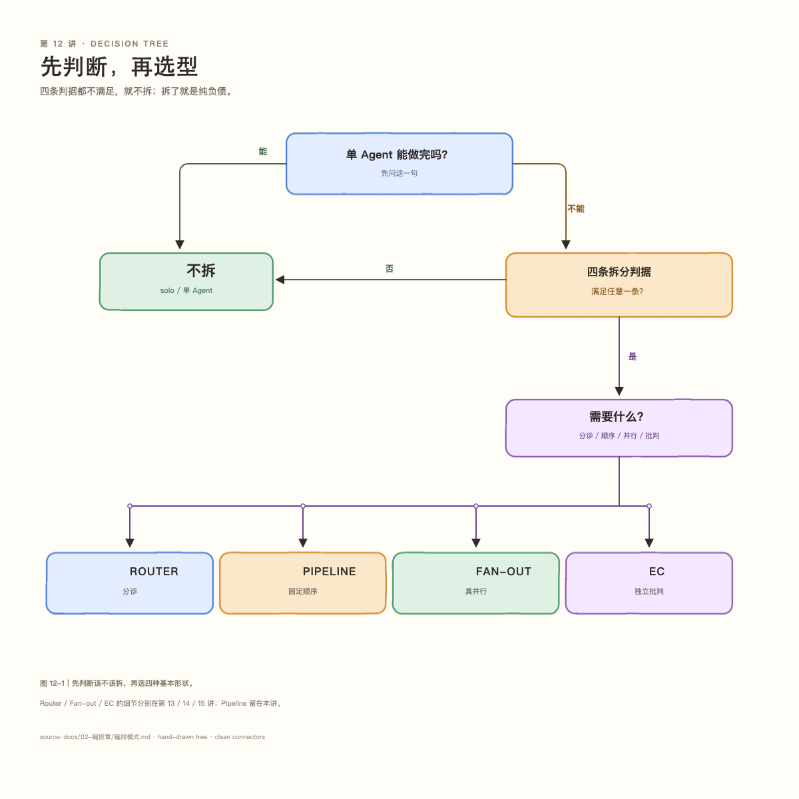

> 图 12-1｜先判断该不该拆，再选四种基本形状。四条判据都不满足，就不拆。

**一条贯穿全篇的铁律**：多 Agent 不是能力升级，是**成本结构**。每拆一个 Agent，就多付「交接损耗 + 压缩后的上下文 + token」，必须换回某个单 Agent 拿不到的东西。

---

### 12.5 Pipeline 最小例

四种形状里，Router / Fan-out / EC 后面各有一讲深入；**Pipeline 留在本讲**，因为它是“固定顺序”的基准形状。

Pipeline 的关键不是“多个 Agent”，是**顺序由代码写死**：

- 先算，再总结；先调研，再成稿；
- 上一步的输出是 dict，下一步直接拿字段，不去猜自然语言；
- 同一输入永远走同一条路径，可复现。

代码在 `agent/pipeline.py`（`PipelineStep` + `Pipeline`），结构化输出在 `agent/json_mode.py`。

```bash
.venv/bin/python main.py
  /pipe math_to_summary 99的平方     # 计算 → 一句话总结
  /pipe research_to_report AI Agent  # 调研 → 报告
  /pipe list
```

代价：流程定死，偏离预设就卡住；链路越长，误差越容易累积；每一步都要过完整上下文，token 随步数增长。

---

### 12.6 成本总账

这一讲只给总账，详细账在 13–15 讲：

| 形状 | 一次典型账 | 详见 |
|---|---|---|
| Router | 判断 **853 token**；判“不拆”后总账 **2,213**（853 + 1,360） | 第 13 讲 |
| Pipeline | 两步 **2,650 token / 2.7s** | 本讲 |
| Fan-out | 改造前 **3,624 token**；改造后的账见第 14 讲 | 第 14 讲 |
| EC | 正例 **14,865 token**；数值题边界 **0/6** 见第 15 讲 | 第 15 讲 |

先记住三件事：

1. **连“不拆”这个决定本身都要花钱**——Router 每次 853 token，是判断税；
2. **能省钱的办法是把控制权交给代码**——Pipeline 固定顺序、EC 固定循环，都不需要 LLM 判断；
3. **每种形状的代价都不一样，且都可测量**——写不出代价，就说明还没搞懂边界。

> 数字口径：Router / Pipeline / Fan-out 为 2026/09/16 记录；EC 的 0/6 为 2026/10/19。  
> 模型、n、重复次数以第 13–15 讲的表头为准；2,213 与第 14 讲的 2,242 请按各自口径引用。

---

### 12.7 决策清单

拆之前，按顺序问三个问题：

1. **单 Agent 能做完吗？** 能 → 不拆。
2. **四条拆分判据，满足任意一条吗？** 一条都不满足 → 不拆。
3. **拆了之后需要什么？** 分诊 → Router；固定顺序 → Pipeline；真并行 → Fan-out；独立批判 → EC。

把这张图贴在显示器旁边，比背 10 种模式有用：

（决策图见图 12-1。）

---

### 12.8 本章小结 & 下一讲

**小结**：

- 多 Agent 不是能力升级，是成本结构；
- 四条拆分判据：上下文隔离 / 真并行 / 不同视角 / 装不下；
- 四条循环否决线：能程序判 / 标准说不清 / 任务太便宜 / 批了也改不动；
- 四种基本形状：Router / Pipeline / Fan-out / EC。

**下一讲**：Router 每次判断要花 853 token。能不能先花 **0 token** 把简单任务筛掉？

> 本讲来源：[编排模式.md](../02-编排章/编排模式.md)（试读版）

---

<a id="j-13"></a>
## 第 13 讲 · Router 成本：先花 0 token 判断

> 状态：✅ 已有

> 起因：学习总结里留的未完成项——「Router 现在每条都问 LLM（853 token/次），
> 加规则预筛，只让复杂任务进 Router」。
> 本章是第一次**回头削自己之前的设计**：承认 Router 在简单任务上是纯负担。
> 完成日期：2026/09/22。


> **前情**：接着第 12 讲的问题往下走。  
> **本讲只回答**：Router 判断一次要花多少钱？  
> **读完后你能**：理解 853 token 的判断税和 0 token 预筛。  
> **下一讲**：第 14 讲会接着这个问题。

---

**一句话**：用规则预筛削掉 Router 在简单任务上的开销（省 25%）。
**适读**：关心 token 成本、想「回头削自己设计」的取舍。
**相关讲义**：[编排四模式](../02-编排章/编排模式.md)、[Fan-out](../02-编排章/并行分发.md)

> **打个比方**：前台先看一眼“这事要不要叫专家”；能自己答就不叫。叫错最多慢一点，漏叫工具才会出错。

### 1. 是什么

**用零 token 的规则先拦一道，明显不用拆的直接走 solo，跳过 Router 这次付费判断。**

```
改造前：  每条查询 ──────────────→ Router（约 450 token）→ 专家
改造后：  每条查询 → 规则预筛 ─┬→ 明显简单 → 直接 solo（0 token 判断）
                              └→ 不确定   → Router → 专家
```

---

### 2. 结构定位

- **谁控制流**：**代码**（规则匹配）——这次把「要不要拆」的第一道判断从 LLM 手里拿回来了。
- **信息流**：串联，但入口多了一层「零成本闸门」。
- **在系统中的位置**：只在 `_plan()` 的最前面，**不动 Router 本身**（它仍处理不确定的查询）。

```
用户输入 → 【规则预筛】→ solo 或 → Router → 专家 → 归并
```

---

### 3. 为什么这么设计

#### 3.1 先量清成本：853 不是「按难度收费」，是「固定税」

实测三种查询的 Router 消耗：

| 输入 | 输入 token | 输出 token | 合计 |
|---|---|---|---|
| 「你好」 | 759 | 177 | 936 |
| 「帮我算 123*456」 | 764 | 53 | 817 |
| 「算数 + 天气」 | 769 | 84 | 853 |

**看第一列**：759 / 764 / 769 —— **几乎不变**，与任务复杂度**完全无关**。

> **一句「你好」也要交 760 输入 token。这是固定税，不是弹性成本。**

#### 3.2 顺手挖出的免费的钱：386 token 的工具声明

拆解那 ~760 的输入：

| 成分 | 约 token |
|---|---|
| Router 的 system prompt | ~267 |
| **工具声明 schema** | **~386** ← ⚠️ |
| 用户输入 + 框架开销 | ~107 |

**代码原文**：

```python
tools=None,  # 调度器不需要工具
```

**但本项目里 `tools=None` 的语义是「全部工具」**：

```python
self.tools = set(tools) if tools else None   # None 和 () 都 → None → 全部
```

**注释的意图与代码的行为正好相反。** 而 `tools=()` 也因空集为假而落到同一分支——
**构造期无法表达「零工具」**。

> 结果：Router 每次路由都背着 3 个工具的声明（约 386 token），
> 而它只输出 JSON，**一个工具都不用**。占输入约一半，纯浪费。

**修法**：构造后显式清空（唯一能表达「零工具」的位置）。归并员同样处理。

#### 3.3 规则预筛的判据（三条全满足才跳过）

| 判据 | 理由 |
|---|---|
| **① 无多任务连接词** | 「另外/同时/并且/顺便/两个都要」→ 可能真要多任务，交 Router |
| **② 命中意图组 ≤ 1** | 复用 `tool_selector` 的「关键词→组」思想（这里按**专家职责**分组） |
| **③ 无复杂度标记** | 「开发/系统/项目/框架/架构」→ 可能复杂，交 Router |

#### 3.4 核心取舍：为什么规则可以偏激进

这是本章最重要的判断，来自**实测的反直觉结论**：

**同一道题「算数+天气」，强制两种走法**：

| 走法 | token | 墙钟 | 答案完整？ |
|---|---|---|---|
| 拆 2 专家 + 归并 | 3185 | 6.01 s | ✅ |
| **不拆，solo 全干** | **1388** | **3.55 s** | ✅ |
| 差 | **−1797** | −2.46 s | **质量一样** |

**误判「不拆」没有导致失败**——solo 稳稳接住了，而且更快更便宜。

**因为两种误判的后果严重不对称**：

| 误判 | 后果 | 有救吗 |
|---|---|---|
| Router 误判「不拆」 | **降级**（慢/贵一点） | ✅ solo 工具全开，接得住 |
| **工具漏选** | **硬失败**（工具不存在） | ❌ 只能重选 |

> ⇒ **Router 的预筛可以比工具预筛激进得多**——
> 因为它的止损线是「solo 的能力上限」，而不是「任务失败」。

⚠️ **唯一例外**：判据④「单 Agent 装不下」。那种情况 solo 会真失败。
本项目任务都是短查询，**触不到这条**。

#### 3.5 设计取舍

| 决定 | 理由 |
|---|---|
| 预筛器可置 `None` 关闭 | 便于做 A/B 对照，也保回退 |
| 预筛逻辑独立成模块 | 关键词表可单独维护、单独测 |
| **不确定就交 Router** | 保守优先；规则的收益是「省」，不是「取代」 |

---

### 4. 代价（值钱那行）

| 代价项 | 说明 |
|---|---|
| **关键词表要维护** | 新说法要加词；**漏了只是退化成「问 Router」，不会出错** |
| **规则不懂语义** | 只认词面。如「把『今天天气很好』翻译成英文」里的「天气」会被误认为天气意图 |
| **会误判** | 但**方向安全**（多判「不拆」而已），且可测量 |
| **多一层代码路径** | 出问题时要能一键关闭（已支持置 `None`） |

**关键**：**规则法的风险是「退化」，不是「崩溃」**——与 `tool_selector` 的结论一致。

---

### 5. 代码在哪

| 文件 | 说明 |
|---|---|
| `agent/router_prefilter.py` | `RouterPrefilter`（三条判据）+ `decide_route()` |
| `agent/multi_agent.py` | `_plan()` 开头接入预筛；Router/归并员显式清空工具 |
| `eval_router_prefilter.py` | 对照实验（14 条 golden set，两组对比） |

**改动点**（`_plan()` 开头）：

```python
if self.prefilter is not None:
    decision, reason = self.prefilter.decide(user_input)
    if decision == "skip":
        return [{"expert": "solo", "subtask": user_input}]   # 零成本
    # else: 继续走 Router
```

---

### 6. 怎么跑

```bash
# 对照实验：无预筛 vs 有预筛（14 条 golden set）
.venv/bin/python eval_router_prefilter.py
```

---

### 7. 实测账（2026/09/22）

#### 7.1 第一处修复：清掉工具声明

| 查询 | 修前 | 修后 | 省 |
|---|---|---|---|
| 「你好」 | 936 | **353** | −583 |
| 「算 123×456」 | 817 | **382** | −435 |
| 「算数 + 天气」 | 853 | **449** | −404 |

**Router 输入 token 从 ~765 降到 ~315（砍 59%）**——一行改动，零风险。

端到端同题：**2213 → 1816 token**。

#### 7.2 第二处：规则预筛对照实验（14 条用例）

| 组别 | 总 token | 跳过 Router | 答对 |
|---|---|---|---|
| 甲 · 无预筛 | 25270 | 0 | 14/14 |
| 乙 · 有预筛 | **18954** | **12/14（86%）** | **14/14** |
| 差 | **−6316（−25.0%）** | | **未退化 ✅** |

**被跳过的题，省下的正好是一整次 Router 调用**（−203 ~ −887 token 不等）。

**答对率 14 → 14** —— **安全线通过**：预筛没有把任务搞坏。

#### 7.3 一个值得记下的观察

被送去问 Router 的两条**多任务**用例，Router **都判了「不拆 → solo」**。

> 也就是说：**我们花了约 450 token，让它确认规则本来就能猜对的事。**
>
> 但这**不该反推「规则可以更激进」**——那是拿测试集调参。
> 多任务是真需要 LLM 判断的场景，保守是对的。

---

### 8. 结论

**两处优化，收益与风险都不同**：

| 优化 | 收益 | 风险 |
|---|---|---|
| 清空 Router/归并员的工具声明 | Router 输入 −59% | **零**（它本来就不用工具） |
| 规则预筛 | 总 token −25%（86% 跳过率） | 低（误判只降级，不崩溃） |

**本章最有价值的认知**：

> **优化的前提是量清楚成本结构。**
> 如果没量，就不会发现 Router 的 386 token 工具声明——
> 那是**一行改动就能省的纯浪费**，比写整套预筛规则更划算。
>
> **先量，再改。** 而且量的时候要拆到「构成」，不能只看总数。

---

### 9. 踩过的坑

| 坑 | 说明 |
|---|---|
| **`tools=None` 是语义陷阱** | 注释写「不需要工具」，实际是「全部工具」；`tools=()` 也落到同一分支。**构造期无法表达「零工具」**，只能构造后清空。 |
| **只看总数看不出浪费** | 「853 token」看着只是一个数；拆成「prompt 267 + 工具 386 + 输入 107」才看出**一半是浪费**。 |
| **差点据测试集调参** | 两条多任务 Router 都判「不拆」，容易顺手放宽规则——但那是过拟合，不是原理。 |
| **误判方向要分清** | 「预筛漏判」与「工具漏选」后果不对称：前者降级、后者硬失败。**判据不同，激进程度就该不同。** |

> 本讲来源：[路由成本优化.md](../02-编排章/路由成本优化.md)

<a id="j-14"></a>
## 第 14 讲 · Fan-out 深入：真并行与假并行

> 状态：✅ 已有

> 起因：学习总结里留了一条**没兑现的声明**——判据②「真能并行」从未成立，
> 因为 Fan-out 一直是**串行 `for` 循环**。本文把它改成真并行，并量出代价。
> 完成日期：2026/09/20。


> **前情**：接着第 13 讲的问题往下走。  
> **本讲只回答**：Fan-out 是真并行还是假并行？  
> **读完后你能**：分得清墙钟时间、认知负担和串行 for。  
> **下一讲**：第 15 讲会接着这个问题。

---

**一句话**：真并行 Fan-out：判据②（子任务独立 **且** 被等待资源能吸收并发）。
**适读**：关心并行加速、想分清「真并行 vs 串行」。
**相关讲义**：[编排四模式](../02-编排章/编排模式.md)、[Router 成本](../02-编排章/路由成本优化.md)、[层级编排](../02-编排章/层级编排调查.md)

> **打个比方**：三个人同时查三座城市，比一个人挨个查快；但得各查各的，不能挤同一张桌子。

### 1. 是什么

**把「多个专家的子任务」从逐个跑，改成同时跑。**

```
改造前（串行）                      改造后（并行）
for t in tasks:                    ThreadPoolExecutor
    worker.run(t)  ──┐                 worker_a.run() ──┐
    ...等 1s         │                 worker_b.run() ──┤ 同时跑
    worker2.run()  ──┘                 ...              ┘
    ...等 1s                           归并
```

**关键区别**：串行的墙钟 = 各任务**之和**；并行的墙钟 ≈ **最长**那个任务 + 调度开销。

---

### 2. 结构定位

- **谁控制流**：仍是 **LLM**（Router 决定拆不拆、拆几个）——并行只改「怎么执行」，不改「怎么决策」。
- **信息流**：分发-汇聚（Fan-out / Fan-in），与改造前一致。
- **改动位置**：只在「专家执行」这一段，**归并逻辑不变**。

```
Router 拆任务 → 【并发执行各专家】← 只改这里 → 归并员汇总
```

---

### 3. 为什么这么设计

#### 3.1 为什么用多线程，不用多进程

判断依据是**任务的瓶颈在哪**：

| | 特征 | 该用什么 |
|---|---|---|
| CPU 密集 | 本地狂算，CPU 满载 | 多**进程**（Python 有 GIL，多线程算不了并行） |
| **I/O 密集** | 时间花在**等**（网络/磁盘） | **多线程**（等 I/O 时 GIL 会释放） |

**本项目属于 I/O 密集**：每个专家的时间几乎全花在「等 LLM 返回」，
本地只干几毫秒的拼 JSON / 解析。

**多线程的另一个好处是「轻」**：共享同一份内存。
多进程要复制整个进程，那些共享对象（`MemoryStore`、专家实例、Langfuse client）
在新进程里**都是另一份**，通信成本远高于收益。

#### 3.2 为什么**不需要加锁**（三条查证过的证据）

这是本次最容易想错的地方。**先查证，再决定**——而不是「感觉应该加个锁」。

| 证据 | 内容 | 结论 |
|---|---|---|
| ① 专家实例独立 | 每个专家是各自 `Agent` 对象，`history`/`tracer`/`usage` 各一份 | 不共享 → 无需锁 |
| ② `_plan()` 按 expert 去重 | 同一专家不会同时出现在两个子任务里 | 无同对象竞争 |
| ③ 共享的只有 `memory` | 实测 8 线程并发写入 40 条，**0 异常**；且 `id=md5(text)` 幂等 | 竞态也只覆盖，不出脏数据 |

**加锁反而是负收益**——它会把并行重新变回串行，白付一整套并发设计。

#### 3.3 一个容易忽略的事实：并发**早就存在**了

`core.py` 里记忆沉淀跑在**后台线程**里：

```python
def _persist(): ...
    self.memory.add(...)
threading.Thread(target=_persist, daemon=True).start()
```

> 也就是说——**`memory.add()` 今天就已经在并发调用了**。
> 改成并行 Fan-out **没有引入新的并发风险**，只是把已有的并发从 1 个变成 2 个。

#### 3.4 设计取舍

| 决定 | 理由 |
|---|---|
| 单子任务**不走**并行路径 | 一个任务没有可并行的东西，开线程池是纯开销 |
| 结果**保序**（`executor.map` 天然保序） | 归并员的输入顺序稳定 → 输出可复现 |
| 并行逻辑**抽成独立方法** `_fanout_parallel()` | 将来换 asyncio / 进程池 / 限流，只改这一处 |
| **不碰 `core.py`** | 沿用「新能力外挂式接入」的惯例 |

---

### 4. 代价（值钱那行）

| 代价项 | 实测值 | 说明 |
|---|---|---|
| **调度开销（纯线程池）** | **0.04 ms**（2 线程）/ 0.18 ms（8 线程） | 相对 1-3 秒的任务，**小 5 个数量级** |
| **并发会放大下游压力** | 云端 8 并发仍近线性（7.9x） | 但**本地单卡 GPU 会立刻饱和** |
| **输出会交错** | 多线程 print 天然交叉 | 已改为「先收集、再按序输出」 |
| **失败处理变复杂** | 一个线程抛异常，其余仍在跑 | 需明确：是整体失败还是降级部分结果 |
| **调试变难** | 堆栈跨线程，时序不确定 | 日志要带线程名 |

#### ⚠️ 最重要的一条：真正的上限**不在调度器，在共享资源**

纯调度开销 0.04ms → **调度器几乎免费**。
那并行的性能上限由什么决定？**你在等什么，什么就是瓶颈。**

| 被等待的资源 | 并发表现 | 证据 |
|---|---|---|
| **云端 LLM API** | 近线性扩展 | 实测 8 并发 = **7.90x** |
| **本地单卡 GPU** | **会立刻饱和** | 未实测（主机当晚离线），但机制明确：一张卡一次只能驻留一份模型实例 |

**这就回答了判据②该补的那句话**：

> **并行不总是赚的——能不能赚，取决于你要等的那个资源能不能吸收这份并发。**

---

### 5. 代码在哪

| 文件 | 说明 |
|---|---|
| `agent/multi_agent.py` | `run()` 改为调用 `_fanout_parallel()`；新增该方法 |
| `eval_fanout_parallel.py` | 串行 / 并行对照实验（含纯开销与扩展性测量） |

**核心实现**（`_fanout_parallel`）：

```python
with ThreadPoolExecutor(max_workers=len(tasks),
                        thread_name_prefix="fanout") as pool:
    return list(pool.map(_run_one, tasks))   # map 天然保序
```

---

### 6. 怎么跑

```bash
# 对照实验：串行 vs 并行（各 3 次取平均）
.venv/bin/python eval_fanout_parallel.py
```

实验**不经过 Router**：直接构造 2 个子任务喂给 fan-out。
理由：Router 现在倾向判「不拆」，让它决定很可能进不到并行路径；
更要紧的是——**对照实验必须只变一个变量**（串行/并行），
要把「Router 怎么判」固定住。

---

### 7. 实测账（2026/09/20）

#### 7.1 对照实验（真实任务，各 3 次取平均）

| 模式 | 平均墙钟 | 平均 token | 各任务耗时 |
|---|---|---|---|
| 串行 | **5.11 s** | 2119 | [1.77, 2.99] |
| 并行 | **3.04 s** | 2122 | [2.81, 1.58] |
| 差 | **−2.07 s（−41%）** | **+3（噪声）** | 在噪声内 |

**两条结论**：

1. **墙钟省 41%**，接近理论最优（省到最长任务 2.99s，实际 3.04s）；
2. **token 几乎不变（+3）** ✅ —— 这正是**自检指标**：并行不改工作量。
   **如果 token 明显变了，说明改错了**（多跑或少跑了东西）。

#### 7.2 纯调度开销（隔离测量，各 50 次取中位）

| 并发数 | 串行 | 并行 | 净开销 |
|---|---|---|---|
| 2 | 0.000 ms | 0.039 ms | **+0.039 ms** |
| 4 | 0.000 ms | 0.099 ms | +0.099 ms |
| 8 | 0.000 ms | 0.175 ms | +0.175 ms |

**0.04 毫秒** vs 任务 1-3 秒 —— **差 5 个数量级**。

> 所以 7.1 里那个「并行墙钟 − 最长任务 = +0.23s」**不是调度费**，
> 是 LLM 延迟的**运行间抖动**。第一版实验曾出现「并行时单任务反而变慢」，
> 补测后消失 —— **说明它在噪声内，不是系统性惩罚**。

#### 7.3 扩展性（云端 API，同一 prompt 并发 n 次）

| 并发数 | 串行 | 并行 | 加速比 |
|---|---|---|---|
| 1 | 1.16 s | 1.01 s | 1.14x |
| 2 | 1.44 s | 0.83 s | 1.73x |
| 4 | 2.85 s | 0.80 s | 3.55x |
| 8 | 6.37 s | 0.81 s | **7.90x** |

**近线性扩展**——云端在这个量级完全不吃力（并发上限 2500）。

> ⚠️ 本应在**本地主机**上跑同一组做对照（预期会立刻饱和），
> 但当晚 Windows 主机离线（**这本身也是本地依赖的真实代价**）。
> 留作待办。

---

### 8. 结论：判据②到底什么时候成立

**成立的条件**（两个都必须满足）：

1. **子任务真的互相独立**（有依赖就不能并行，比如「先算数再总结」）；
2. **被等待的资源能吸收这份并发**（云端 API 能；本地单卡 GPU 不能）。

**不成立的情况**：

| 情况 | 为什么 |
|---|---|
| 子任务有依赖 | 根本不能并行 |
| 只有一个子任务 | 没有可并行的东西，纯开销 |
| **共享资源饱和** | 并发请求排队 → 总时长不降反增 |
| 任务极短（< 1ms 级） | 开销占比过大（**本项目不适用**：任务以秒计） |

**最关键的一条认知**：

> **调度器是免费的（0.04ms），瓶颈永远在「你在等什么」。**
> 所以问「该不该并行」时，别问「调度贵不贵」——
> 要问「**我要等的那个东西，能不能同时服务这么多请求**」。

---

### 9. 踩过的坑

| 坑 | 说明 |
|---|---|
| **把构造时间算进墙钟** | 第一版实验把 `MultiAgent()` 构造（约 0.6s）计入了计时，稀释了真实差异。**计时区必须只含被测行为。** |
| **样本太少就下结论** | 单次跑出「并行时单任务变慢」，补测 3 次后消失 —— 是噪声。**单次测量不足以判断系统性效应。** |
| **以为调度要花 token** | 调度是纯本地代码，一次 LLM 都不调，**不可能产生 token**。容易和 Router（要花 token 的智能决策）混淆。 |
| **先想加锁** | 「多线程 → 要加锁」是条件反射。**先查证有没有真共享、被共享的东西是否已线程安全**，再决定——加错锁是负收益。 |
| **改了数据结构忘了改调用方** | `parts` 从 3 元组变 4 元组（多了耗时），但 `_merge()` 仍按 3 个解包 → `ValueError: too many values to unpack`。**端到端测试才抓到的**（单元层面看不出来）。修法：`for e, s, a, *_ in parts` 兼容两种形态。 |

> 本讲来源：[并行分发.md](../02-编排章/并行分发.md)

<a id="j-15"></a>
## 第 15 讲 · EC 的边界：同模型在数值题上 0/6

> 状态：✅ 已有

> 起因：`能力与编排对照.md` 附录 B 已造出弱模型 gap（强 18/18 vs 弱 11/18），
> 但正测（solo/EC × 强/弱，n≥5）未做。本调查先跑 smoke，结果在 smoke 阶段就撞上边界。
> 日期：2026/10/19。
> 结论：**同模型 EC 在 T1/T6 上 0/6；会把对的判错、也会认同错的；正式跑暂停。**


> **前情**：接着第 14 讲的问题往下走。  
> **本讲只回答**：同模型 EC 在客观题上靠谱吗？  
> **读完后你能**：知道 0/6 的边界和外部独立信号。  
> **下一讲**：第 16 讲会接着这个问题。

---

**一句话**：同模型 EC 在客观数值题上不可靠——它没有独立信号，会把 9 判成 11、把 771429 当成对。
**适读**：读完编排四模式、准备用 EC 做"质量提升"的人。
**相关讲义**：[编排四模式](../02-编排章/编排模式.md)、[能力×编排](../02-编排章/能力与编排对照.md)、
[正测设计稿](../02-编排章/能力与编排正测设计.md)

> **打个比方**：让同一个人自己检查作业：他往往用同样的思路再看一遍，错的地方还是错。

### 1. 是什么

**问题**：EC（生成 → 批判 → 重做）在**客观数值题**上，能不能稳定地把弱模型的错误答案改对？

**背景**：v2 预筛已证明 T1/T6 能拉开强弱模型（强 18/18 vs 弱 11/18）；
正测要回答"EC 对弱模型的提升是否大于强模型"。但 smoke 先暴露了一个更基础的问题：
**批判者本身可不可信？**

### 2. 结构定位

- 谁控制流：**代码**（固定循环，最多 2 版）
- 信息流：**串联 + 回环**（批判意见回流给生成者）
- 判据：③「不同视角」——但本实验里批判者与生成者**同模型**，只换人格。
  这正是要检验的边界：**立场独立 ≠ 能力独立**。

### 3. 为什么这么设计（以及为什么怀疑它）

设计上沿用项目 EC 的三条原则：

- 批判者不给标准答案，只独立重算；
- 轮次由代码封顶（最多 2 版）；
- 阈值/判分由代码定，不让裁判自己宣布及格。

但项目自己已经写过一条否决线：

> ✗ 有客观、可程序验证的标准（能跑测试/能算）→ **用代码验证**，别雇 LLM 评委。

本调查就是去撞这条线：如果批判者只是"同一个模型的第二遍"，它凭什么比第一遍更对？

### 4. 实验设计（最小版）

- 题：T1（实例数）、T6（后端降幅），唯一数值答案，确定性判分。
- 模型：强 `deepseek-flash`；弱 `qwen-flash`（DashScope）。
- 臂：solo（1 版）vs EC（生成 → 批判 → 需要时重做，最多 2 版）。
- 判分：取回答最后一个数；`OK` / `WRONG` / `ERR`；`ERR` 不计分母。
- 批判者：同模型、换人格；先**逐字复述**候选答案（`candidate_seen`），再独立重算
  （`recomputed`）；runner 做两道校验：
  1. **复述保真**：`candidate_seen` 与候选原文不一致 → 重试一次；仍不一致 → 不据此重做。
  2. **代码兜底**：`recomputed` 与候选答案不一致 → 强制重做，不管 `consistent` 说什么。
- 运行：4 格 smoke 各 1 次；修复后 weak-ec 再跑 6 次。**没有跑 40 次正式实验。**

> 代码：`docs/experiments/capability_x_positive.py`。

### 5. 代价（值钱那行）

- **token**：首轮 smoke 里，strong-ec 2313 vs strong-solo 666（**3.5×**）；
  weak-ec 2508 vs weak-solo 1380（**1.8×**）。EC 不是免费的。
- **最贵的失败不是"没修好"，是"把对的改错"**：fix2 #1 首版 9 是对的，
  批判者说 11，强制重做后变成 771429。**EC 的负增益可以比 solo 更差。**
- **同模型自评没有外部信号**：它和生成者共享同一套算术盲区；批判者"重算"出的
  13、771429 与候选一模一样，说明它不是独立验证，只是第二次表达。
- **"一致"字段不可信**：fix1 #1 候选 100、批判者自己算出 108，却写 `consistent=true`。
  只信 `consistent` 会被它骗；必须用代码比对 `recomputed`。

### 6. 代码在哪

| 文件 | 职责 |
|---|---|
| `docs/experiments/capability_x_positive.py` | runner：solo/EC、判分、保真校验、JSONL 落盘 |
| `docs/02-编排章/能力与编排正测设计.md` | 设计稿 + §11 smoke 记录 |
| `agent/evaluator_critic.py` | 文案版 EC（本次未复用；数值版是独立实现） |

> 未改 `agent/` 现有代码。

### 7. 怎么跑

```bash
# 单格 smoke（例子）
.venv/bin/python docs/experiments/capability_x_positive.py \
    --cell weak-ec --n 1 --task T1 \
    --out tmp-artifacts/capability_x_positive.jsonl

# 四格各 1 次（链路）
for c in strong-solo strong-ec weak-solo weak-ec; do
  .venv/bin/python docs/experiments/capability_x_positive.py \
      --cell "$c" --n 1 --task T1 \
      --out tmp-artifacts/capability_x_smoke.jsonl
done
```

### 8. 实测账

#### 8.1 首轮 4 格 smoke（旧批判 prompt，各 1 次）

| cell | 结果 | token | 轮次 | 备注 |
|---|---|---|---|---|
| strong-solo | ✅ 9 | 666 | 1 | — |
| strong-ec | ✅ 9 | 2313 | 1 | 批判者认同；多花 3.5× token |
| weak-solo | ❌ 771429 | 1380 | 1 | 复现 v2 的错值 |
| weak-ec | ✅ 9 | 2508 | 2 | 看似修好，但批判者把候选复述成 150 |

#### 8.2 两版修复后 weak-ec 6 次（0/6）

| 轮次 | 首版 | 批判者复述 | 批判者重算 | 它说 | 最终 |
|---|---|---|---|---|---|
| fix1 #1 | 100 | 100 | 108 | `consistent=true` | 100（错）|
| fix1 #2 | 771429 | 771429 | 771429 | `consistent=true` | 771429（错）|
| fix1 #3 | 48857 | 48857 | 48857 | `consistent=true` | 48857（错）|
| fix2 #1 | **9（对）** | 9 | 11 | `consistent=false` | 重做 → **771429（把对的改错）** |
| fix2 #2 | 13 | 13 | 13 | `consistent=true` | 13（错）|
| fix2 #3 | 771429 | 771429 | 771429 | `consistent=true` | 771429（错）|

- fix1 = 只有复述保真校验；fix2 = 复述保真 + 代码级 `recomputed` 兜底。
- 复述保真修好后，6/6 的 `candidate_seen` 都对上了；问题不在"看错"，在"算错/认同错"。
- 首轮 weak-ec 的 9 没有复现；更像运气/锚定。

### 9. 结论：边界在哪

1. **同模型 EC 在客观数值题上不可靠**：0/6；既会把对的判错，也会认同错的。
2. **EC 需要外部独立信号**：不同模型、计算器、单元测试、可执行验证——
   任一都比"同一个模型再想一遍"强。
3. **有客观标准时，代码验证 > LLM 评委**：这不是新结论，是项目原有否决线的实测证据。
4. **"一致"字段不可信**：评委说 `consistent=true` 不代表它对；要用代码比对它算出的值。
5. **不要把这次当成"EC 全盘否定"**：文案题上 EC 仍有价值（README §八的 84→84→85）；
   边界是"**有没有外部可验证信号**"，不是"EC 这个模式行不行"。

### 10. 踩过的坑

| 坑 | 说明 |
|---|---|
| 只信 `consistent` | fix1 #1 候选 100、重算 108，却写 `consistent=true`；加代码兜底才抓到 |
| 只做"复述保真"不够 | 复述对了，但批判者仍认同错答案（13/13、771429/771429）|
| 批判者会锚定候选 | 让它先复述候选，可能把候选当锚；两阶段"先独立算、再比对"更干净（未做）|
| 把一次成功当结论 | 首轮 weak-ec 9 看似成功，修复后 0/6；n=1 的成功不可信 |
| 用 LLM 判本来能程序判的题 | 这正是 EC 否决线；本调查用实测又证了一遍 |

### 11. 下一步（未做）

- 若要继续：换**强模型批判者**（deepseek 评 qwen）或**计算器/代码验证**；
  前者是能力混淆，后者不是 EC。
- 两阶段独立重算（先不看候选、再比对）可作为独立小实验。
- 正式 40 次跑**暂停**；除非先解决"批判者独立性"。

> 本讲来源：[数值题EC可靠性调查.md](../02-编排章/数值题EC可靠性调查.md)

<a id="j-16"></a>
## 第 16 讲 · 层级与工人池：慢工具才值

> 状态：✅ 已有

> 起因：大纲 §3.1 推荐顺序的下一站（Router→Pipeline→EC→Fan-out→Planner→**Hierarchical**）。
> 纪律：**先证明「病」存在**。日期：2026/10/05。


> **前情**：接着第 15 讲的问题往下走。  
> **本讲只回答**：层级/工人池，什么时候值？  
> **读完后你能**：理解慢工具才值的条件。  
> **下一讲**：第 17 讲会接着这个问题。

---

**一句话**：层级编排 / 工人池 → **条件性必要**：慢工具省 61–76%，快工具纯负债。
**适读**：关心多层委派与并行收益的边界。
**相关讲义**：[Fan-out](../02-编排章/并行分发.md)、[显式规划](../02-编排章/显式规划调查.md)

### 1. 现状（第 1 步侦察）

本项目是**两层扁平结构**：

```
Router（顶层，一次分类）→ _plan() 产出扁平列表 [{expert, subtask}]
  → [math / weather / general / solo]  4 个叶子专家，平级
  → Fan-out 并行 → Merger 归并
```

- `_plan()` 是**一次性路由分类**，无"子任务再拆"；
- 4 个专家是**叶子**，无管理者 Agent；
- ⚠️ `_plan()` **按 expert 去重**：同一专家只能出现一次。

对照：用户的 **三省六部**（edict）是**真多层**（太子→中书→门下→尚书→六部），
尤其有本项目没有的**门下省「审核封驳」**（规划后、执行前的独立复查层）。

---

### 2. 探针设计（第 2 步）

| 方向 | 案例 | 打什么 |
|---|---|---|
| A | 多城「分头调研」：子任务自身可再拆 | 同域子任务能否并行/正确拆 |
| B | 预筛易判错 / 需复查闸 | 规划错了有没有人拦 |

---

### 3. 结果

#### A：**露馅了** — 单层结构无法表达「N 个同域并行子任务」

任务：「请**分头**调研北京、上海、广州，每城给出当前气温。」

- Router 顶层**规划其实是对的** —— 原始 JSON 明确写出
  `[3× weather(北京/上海/广州) + 1× solo(对比)]`；
- 但 `_plan()` **按 expert 去重** → 3 个 weather 被压成 **1 个** → 返回 `['weather']`；
- 稳定复现：**3/3 跑都只返回 1 个 weather 任务**；
- 端到端**结果侥幸正确**（solo 工具全开，自己把 3 城补查了），
  但**「分头」变「单线串行」** —— 并行彻底丢失，且靠兜底而非结构。

#### B：**没露馅**

预筛直接判 solo，两案例（伪跨域 / 易错规划）单 Agent 都做对。

#### 根因（代码坐实）

去重**不是随意的**，是**扇出安全的前提**（`multi_agent.py:169`）：

> 「`_plan()` 已按 expert 去重，**同一个专家不会同时出现在两个子任务里**」

因为专家是**共享单例**（每角色一个实例），并发会争用同一 worker 的 `history`/`tracer`。
→ 想「3 城并行」，**必须为同角色动态实例化多个 worker**。

---

### 4. 阶段性结论

> **本项目单层扁平结构的真实局限 = 「无法表达多个同域并行子任务」。**
> 根因是「专家=共享单例 + 按角色去重」，**不是顶层拆不动**
> （顶层 Router 拆得动，它写了 3 个 weather 子任务）。

**修复方向**（指向层级/工人池）：
- 为每个子任务**动态实例化独立 worker**（同角色可多实例）；
- 顶层决定「要 N 个某域 worker」→ 动态派生 → 并行 → 归并。

→ 这正是层级编排的一个**真实价值点**：**动态工人分配**。
（不同于"顶层拆不动"那种层级理由——本项目顶层拆得动。）

---

### 5. 实现与实测（方案 1）

#### 5.1 两条修法

| 修法 | 做法 |
|---|---|
| **工人池** | 同域多子任务 × 每子任务独立 worker（保留 `ALLOW_PARALLEL_SAME_ROLE` / env `WORKER_POOL`）|
| **合并（选用）** | 去重时把同域子任务**合并**为一条（而非丢弃），1 个 worker 处理 |

#### 5.2 固定计划 A/B（隔离单一变量）

发现 Router 拆分**不稳定**（有时 3 任务、有时 1 solo），故**固定计划**（3×weather + 1×solo）做对照：

| 方案 | worker 数 | weather 调用 | 墙钟 | **总 token** | 正确性 |
|---|---|---|---|---|---|
| 旧：去重（丢弃）| 1 | 1 | ~3.3s | ~1060 | ❌ **丢数据** |
| **合并（选用）** | 1 | — | — | **~1393** | ✅ 全对 |
| 工人池 | 3 | 3 | ~3.6s | **~3250（3×）** | ✅ 全对 |

#### 5.3 关键发现

1. **旧去重是「潜在正确性 bug」**：同域多子任务只保留第一个，其余**丢弃**。
   实测：只给北京 → merger 如实报「上海、广州未提供」（**不幻觉**，但答案残缺）。
   平时被 `solo` 兜底重新查询掩盖，故未被发现。
2. **工人池结构性修好，但净成本**：3 workers 并行 **无墙钟收益**（LLM 延迟主导，单 worker 本来就能批量），
   token **飙 3×**（每 worker 各付 system prompt + 工具声明）。
3. **合并是最优解**：修复正确性、只多 ~30% token、不起多 worker。
4. **附带发现**：Router 拆分决策 **run-to-run 不稳定**（同任务时拆 3 任务、时判 solo）。

#### 5.4 落地

- `_plan`：默认同域**合并**（`existing["subtask"] += "；" + sub`）；
- 工人池降为可选（默认 **关**，env `WORKER_POOL=1` 开启）；
- `_new_worker()` / `_run_workers`（工人池基础设施保留）；`print_traces` 改列实际 worker。
- 端到端验证：计划 `[weather(合并3城), solo]` → 2 worker、三城全对 ✅；普通任务（123*456）不受影响 ✅。

---

### 6. 结论

> **层级/工人池在「正确性」上无必要，在「速度」上无收益。**
> 单层结构确实有缺陷（同域多子任务被去重），但真正的 bug 是「**丢弃而非合并**」——
> **一句合并就能修，无需多一层 / 多 worker。**

与前面专题同源：
- **同域多 worker = 又一次「多 Agent 成本结构」**（3× token 换 0 收益）；
- 真正值钱的是找出**成本最优的修法**（合并），而非加机器。

**层级编排真正的用武之地**（本场景未触发）：
- 同域子任务**极多**且**工具慢/不可批量**（需真并行压墙钟）；
- 或需要**多层委派 + 独立复查层**（如三省六部的「门下封驳」）——但那是「控制/审计」价值，非正确性。

---

### 7. 必要性论证（2026/10/05 补）—— 首尾补齐

> §5–§6 只证了「**不必要**」（快工具下）。用户指出：**没证「必要」**。
> 本节构造「必要」的场景。

#### 7.1 关键细节：批量工具调用是**顺序执行**的

`core.run()` 里工具执行是 `for tc in msg.tool_calls:` —— **批在同一步的多个工具调用，是逐个顺序跑的**。
所以：
- **快工具**（查天气 ~0.1s）：批量 ≈ 免费 → 单 worker 够（§5 结论）；
- **慢工具**（每次数秒）：批量 = 顺序累加 → 单 worker 慢，**并行才救得回**。

#### 7.2 实验（`docs/experiments/orch_necessity.py`）

同一任务、同一工具，只变「单 worker（合并）vs 工人池（N 并行）」。
工具=`slow_lookup(city)`（sleep S 秒）。

| 场景 | 单 worker（合并）| 工人池（N 并行）| 节省 |
|---|---|---|---|
| 3 城，工具 3s | **12.0s** | **4.7s** | **61%** |
| 6 城，工具 2s | **16.2s** | **4.0s** | **76%** |

> 单 worker 墙钟 ≈ N×S（顺序）；工人池 ≈ S（并行）。**收益随规模放大。**

#### 7.3 必要性的边界（完整图景）

| 工具性质 | 单 worker（合并）| 工人池（并行）| 编排必要性 |
|---|---|---|---|
| **快**（~0.1s）| 够用，token 低 | 无收益，token 3× | ❌ 不必要 |
| **慢**（≥ 数秒）| 慢（顺序累加）| **省 61–76% 墙钟** | ✅ **必要** |

→ **判据②「真能并行」成立的条件（实测坐实）**：
1. 子任务**互相独立**；
2. **被等待的资源能吸收并发**（I/O 密集的慢工具 → 线程并行有效；
   对比：本地单卡 GPU 会立刻饱和，见 `docs/02-编排章/并行分发.md`）。

#### 7.4 本节总结（完整闭环）

> **编排的必要性不是普遍的，是「有条件的」：**
> 当**子任务独立 且 单个子任务耗时足够大**时，并行编排是**真必要**（省 61–76%）；
> 反之（快工具 / 非独立 / 单资源饱和）则**不必要**，加了就是纯负债。
>
> ——这正好与本项目「多 Agent 是成本结构」的铁律一致：**买得到才买。**

> 本讲来源：[层级编排调查.md](../02-编排章/层级编排调查.md)

<a id="j-17"></a>
## 第 17 讲 · 去中心化：Group Chat

> 状态：✅ 已有

> 起因：大纲 §2.3 缺口「去中心化协商 demo」+ §3 高级模式（Group Chat / Blackboard / Debate）。
> 纪律：**先证明「病」存在**。日期：2026/10/06。


> **前情**：接着第 16 讲的问题往下走。  
> **本讲只回答**：去中心化 Group Chat，什么时候必要？  
> **读完后你能**：知道协商成本和广播的代价。  
> **下一讲**：第 18 讲会接着这个问题。

---

**一句话**：去中心化协商（Group Chat）：信息分散时集中式只能掷硬币（33% vs 100%）。
**适读**：关心多 Agent 协作、信息汇集与可审计。
**相关讲义**：[Contract Net](../02-编排章/合同网调查.md)、[编排四模式](../02-编排章/编排模式.md)

### 1. 现状（侦察）

本项目为**纯集中式**：`Router(_plan) → 专家并行 → Merger`。
代码中**无**任何协商/群聊/黑板/辩论机制（grep 全空）。
关键结构事实：**并行专家互相看不见**（各持独立 history）。

对照大纲 §2.3：中心化 vs 去中心化（调试易 ↔ 扩展性高）。

---

### 2. 五组探针与结果

| # | 实验 | 假设 | 结果 |
|---|---|---|---|
| P1 | 轻互评（两专家互核）| 集中式做不了互评 | ❌ 未中：`_plan` 判 solo，solo **自导自演**互评 |
| P2 | 中互评（三专家互评）| 同上 | ❌ 未中：solo **拒答**（"你没给议题"），反而诚实 |
| P3 | 重互评（辩论收敛）| 同上 | ❌ 未中：solo 自演辩论（**真调 4 次工具**）得出统一结论 |
| D1 | 自评 vs 独立互评（文案歧义）| 同上下文会自我圆场，独立评审能抓出歧义 | ❌ **两臂都抓出**（"你只是问一句就逼它切视角"）|
| D2 | 信息不对称（机房切流）| 私有事实不可推理 → 集中式必错 | ❌ 两臂都对（集中式凭"先验证两条前提"的先验猜对）|
| D3 | 先验反转（退款审批）| 让"本能答案"是错的 | ❌ 两臂都对（集中式"事实缺失→保守不批"恰好命中真值）|

**连续 6 次未打中。**

---

### 3. 关键发现：集中式**不是做不到，而是「降级」**

集中式遇到协作类任务时，**不是崩溃，而是降级为单 Agent 自导自演**：
- `_plan` 直接判 `solo`，由**一个 Agent 扮演所有角色**；
- solo 甚至会**真实调用工具**（P3 调了 4 次）来支撑它编出的"多方辩论"。

**为什么反复猜对？** —— 强模型的**通用先验太强**：
- "切机房前该验证前提"、"事实缺失时保守否决"这类判据，模型**自己就会**；
- 于是即使拿不到私有事实，它的**保守默认**常与真值巧合。

---

### 4. 那真正的边界在哪？

排除了"集中式会算错"，剩下的是**结构性的、与正确性无关**的差异：

| 维度 | 集中式（降级为 solo）| 去中心化协商 |
|---|---|---|
| **信息来源** | 只有通用先验（**猜**）| 每条结论**引用独立信源**（风控/合同/网络/合规）|
| **可审计性** | 无法追溯"哪条事实支撑哪个结论" | 记录里**逐条可查**、可复盘 |
| **事实可得性** | **天然拿不到**分散的私有信息 | 信息在参与者手里 → 会话即汇集 |
| **成本** | **1.5k–1.7k token** | **19k–20k token（≈ 10–12×）** |
| **调试** | 简单 | 难（需读整段频道记录）|
| **风险** | 无 | 可能绕圈/无人接手（需终止条件）|

#### 结论（与"层级编排"同源：**条件性必要**）

> **去中心化协商的价值不在「小任务正确性」，而在三个结构性维度：**
> 1. **来源可审计**：结论必须能追溯到**独立信源**（合规/风控/法务类决策）；
> 2. **信息天然分散且不可推理**：中心**根本拿不到**，只能猜；
> 3. **参与集开放/动态**：中心无法预先规划全部角色。
>
> **代价：≈10× token + 难调试。** 无此三者，集中式（或 solo）更省更稳。

#### ⚠️ 与既有铁律一致
- 与「多 Agent 是**成本结构**：买不到单 Agent 做不到的事，就别买」完全一致；
- 与 rerank / 显式规划 / 层级的"**实测否决 / 条件性必要**"同一模式。

---

### 5. 诚实声明（重要）

**本调查未能构造出「集中式必错」的场景。** 所以严格讲——
> 「去中心化协商在**正确性**上不可替代」这一命题，**尚未被本项目的实验证实**。

已证实的是：**它在「来源可审计」与「私有事实汇集」上结构性地不可替代**（集中式连信息都没有），
以及**代价约为 10× token**。

---

### 6. 决定性实验（随机真值）—— **打中了** ✅

#### 6.1 为什么前几轮都没打中

前几轮的私有事实**落在模型先验疆域内**（"切机房前该验证前提"、"事实缺失要保守"），
强模型靠自己就能猜中 → 掩盖了"拿不到信息"的硬伤。

#### 6.2 杀手锏：把真值随机化

`docs/experiments/decentral_random_truth.py`：
- 真值由**随机数**决定 → **模型再强也无从猜起**（只能 ~50% 掷硬币）；
- 而能把「分散私有事实」汇集起来的一方 → 100%；
- 差距**无法被"模型聪明"抹平**。

三个场景（每个随机真值、强制二选一）：
| 场景 | 选项 | 私有事实在哪 |
|---|---|---|
| 发货仓 | 东仓 / 西仓 | 库存系统（哪仓有货，随机）|
| 变更窗口 | 02:00 / 04:00 | 变更日历（哪个时段空闲，随机）|
| 供应商 | Alpha / Beta | 合规记录（哪家资质有效，随机）|

两臂：
- **集中式**：单 Agent + 一个 `lookup` 工具（**返回"访问受限"**，模拟无权限）；
- **去中心化**：信息持有者发言 → 决策者据此收敛。

#### 6.3 结果（n=6）

| 场景 | 真值 | 集中式 | 去中心化 |
|---|---|---|---|
| 发货仓 | 东仓 | ✅ | ✅ |
| 变更窗口 | 02:00 | ✅ | ✅ |
| 供应商 | Beta | ❌ | ✅ |
| 供应商 | Beta | ❌ | ✅ |
| 发货仓 | 西仓 | ❌ | ✅ |
| 发货仓 | 西仓 | ❌ | ✅ |

> **集中式 2/6（33%，接近抛硬币）｜ 去中心化 6/6（100%）**

#### 6.4 结论（修正 §5 的"未能证实"）

> **当关键信息「随机散布」在参与者手中时，集中式在信息论上不可能做对**——
> 模型只能依靠通用先验，而随机真值与先验无关 → 退化为掷硬币。
> **去中心化协商是唯一能把分散信息汇集起来的结构。**

⚠️ **诚实边界**：
- 本实验的"去中心化"是**两级**（信息持有者 → 决策者），非多轮自由群聊；
- 现实中的信息往往**部分可从先验推断**（非纯随机）→ 差距会收窄；
- 随机化是极端的"最纯"场景，用于**排除先验干扰**，不代表日常分布。

#### 6.5 踩坑（实验台 bug，值得记）

首版实验台**两个 bug**，产出荒谬结果（去中心化 0/4，比抛硬币还差）：
1. **真值方向写反**：把 truth 设成"有问题的那一项"（`opts[which]`），
   而正确选项应是另一个（`opts[1-which]`）→ 答对反而不匹配；
2. **选项解析取第一个**：回答同时提两个选项时（"东仓有货、西仓没有，故选东仓"）会取错。

→ **教训：数字荒谬时先怀疑实验台，不要当结论。**（issue-log #11 同类）

---

### 7. 结论（完整）

#### 去中心化协商的价值（三条件，满足其一即不可替代）

1. **信息天然分散且不可推理**（本实验已证：随机真值 → 集中式 33% vs 去中心化 100%）；
2. **来源可审计**：结论能追溯到独立信源（合规/风控/法务类决策）；
3. **参与集开放/动态**：中心无法预先规划全部角色。

#### 代价
- **token ≈10–12×**（集中式 1.5–1.7k vs 去中心化 19–20k）；
- 难调试（需读整段频道记录）；可能绕圈（需终止条件）。

#### 与既有铁律一致
> **多 Agent 是成本结构：买得到才买。**
> 去中心化买的不是"推理质量"（那被强模型吃掉了），
> 而是 **信息 / 并行 / 隔离 / 审计**——强模型越强，这四条越凸显。

---

### 8. 实现：Group Chat（`agent/group_chat.py`）✅ 2026/10/06

把"信息汇集"从探针变成**可用件**。

#### 8.1 结构

```
GroupChat
  ├─ add_participant(name, system_prompt)   # 每个参与者可带私有信息
  ├─ 共享频道 transcript                    # 每个参与者都能看到全部历史
  ├─ run(topic, rounds)                     # 轮转发言 N 轮 → 主持收敛
  └─ report()                               # token / 频道概况
```

**与 `multi_agent.py` 的根本区别**：那边是中央分派 → 各自**盲跑**（互相看不见）；
这边参与者**共享上下文**，能互相质疑、修订。

#### 8.2 验证（`docs/experiments/group_chat_validate.py`）

用**同一批随机真值场景**（与 §6 同源同种子）对照：

| 臂 | 准确率 | token/次 | 相对成本 |
|---|---|---|---|
| 集中式（单 Agent + 受限 lookup）| **2/6 = 33%** | ≈2107（实测 1738/2704/1879）| 1× |
| **Group Chat** | **6/6 = 100%** | ≈2633 | **≈1.25×** |

> ⚠️ **成本修正**：早前估的"≈10×"是**多轮复杂协商**（如 3 人×3 轮，19k token）的数字；
> 本次**最小 Group Chat**（2 人×1 轮 + 主持）只 ≈1.25×。**代价随参与者数与轮数放大**。

#### 8.3 诚实边界

- "100%"基于同一批 6 个随机真值场景、1 轮；**样本小**，未做显著性检验；
- 代价随规模放大（参与者 × 轮数 × 频道长度），**不适合无脑套用**；
- 仍需**代码封顶**（`max_rounds`）——不指望模型自己停。

---

### 9. 结论（完整）

#### 去中心化协商的价值（三条件，满足其一即不可替代）

1. **信息天然分散且不可推理**（§6 已证：集中式 33% vs 去中心化 100%）；
2. **来源可审计**：结论能追溯到独立信源（合规/风控/法务类决策）；
3. **参与集开放/动态**：中心无法预先规划全部角色。

#### 代价
- **token 随参与者 × 轮数放大**（最小实现 ≈1.25×；多轮复杂协商可达 10×）；
- 难调试、可能绕圈（需 `max_rounds` 封顶）。

#### 与既有铁律一致
> **多 Agent 是成本结构：买得到才买。**
> 去中心化买的不是"推理质量"（那被强模型吃掉了），
> 而是 **信息 / 并行 / 隔离 / 审计**——强模型越强，这四条越凸显。

#### 交付物
- `agent/group_chat.py`（共享频道 + 轮转 + 主持收敛）
- `docs/experiments/decentral_random_truth.py`（随机真值决定性实验）
- `docs/experiments/group_chat_validate.py`（实现验证）
- 本文件

### 10. 接入 `main.py`（`/gc` 命令）✅ 2026/10/06

```
/gc list    → 用法说明（含适用 / 不适用场景）
/gc demo    → 内置案例：库存 + 风控 各持私有信息
/gc <议题>   → 三角色小组（支持 / 反对 / 中立）辩论该议题
```

**实测 `/gc demo`**：库存（西仓有货）与风控（西仓暴雨预警）两条私有信息**被合并**，
主持人给出统一结论西仓 + 风险缓解建议（预留 1–2 天缓冲）。成本 2658 tokens。

> 与直接提问的区别：单 Agent 拿不到这两条分散事实，只能靠直觉。

---

### 11. 待决

- 接受结论收口本专题（并进学习总结 + 更新大纲）。

> 本讲来源：[去中心化协商调查.md](../02-编排章/去中心化协商调查.md)

<a id="j-18"></a>
## 第 18 讲 · 合同网：中央无法评估时

> 状态：✅ 已有

> 起因：大纲 §3.1 剩余高级模式。方向 C「需求未知」——中央无法评估「这活该谁干」，执行者自己知道。
> 纪律：**先证明「病」存在**。日期：2026/10/07。


> **前情**：接着第 17 讲的问题往下走。  
> **本讲只回答**：中央无法评估时，合同网怎么用？  
> **读完后你能**：理解招标/投标/中标的结构。  
> **下一讲**：第 19 讲会接着这个问题。

---

**一句话**：Contract Net（发标-投标-中标）：中央**无法评估**时的分配机制。
**适读**：关心任务分配、资源调度（谁干最合适）。
**相关讲义**：[去中心化协商](../02-编排章/去中心化协商调查.md)、[编排四模式](../02-编排章/编排模式.md)

### 1. 问题

**Contract Net 的主张**：把「谁做」从中央指定，改成**候选者自报价竞争** ——
中央择优。它该治的病：

> **中央不知道每个执行者的「真实能力/负载/工期」，只能瞎派；而执行者自己知道。**

这与去中心化专题的「信息分散」同族，但形态不同：
不是「信息在谁手里」，而是「**能力/成本只有自己知道**」（私有信息在**自我评估**里）。

---

### 2. 探针设计（方向 C）

`docs/experiments/contract_net_probe.py`

**场景**：一台 Flink 实时管道积压告警，需一位工程师接手。

- 三位工程师各持**私有信息**（互相看不到）：
  - 最优者：精通 Flink + 空闲 + 1 天可修
  - 一人：不熟 Flink + 两个 deadline 今晚到期（5 天）
  - 一人：Flink 不深 + 正在休假（3 天，且需远程）
- 中央只看到**简介**（工龄 + "参与过数据项目"）——**无法区分**。

**对照**：
- **集中式臂**：单 Agent，只看简介，直接指派。
- **报价臂（Contract Net）**：公告任务 → 三人**各自报价** → 中央按报价择优。

---

### 3. 结果：**打中了**

#### 3.1 首次跑（真值偏斜，见 §5）

| 跑 | 真值 | 集中式 | 报价臂 |
|---|---|---|---|
| 1~6 | 甲×5 / 乙×1 | 3/6 | 6/6 |

#### 3.2 修正后复跑（真值**轮转**，甲/乙/丙 各 2 次）

| 跑 | 真值 | 集中式 | 报价臂 |
|---|---|---|---|
| 1 | 甲 | 甲 ✅ | 甲 ✅ |
| 2 | 乙 | 甲 ❌ | 乙 ✅ |
| 3 | 丙 | 甲 ❌ | 丙 ✅ |
| 4 | 甲 | 甲 ✅ | 甲 ✅ |
| 5 | 乙 | 丙 ❌ | 乙 ✅ |
| 6 | 丙 | 甲 ❌ | 丙 ✅ |

> **集中式 2/6 = 33%（恰好 = 三选一瞎猜的 1/3）｜ Contract Net 6/6 = 100%**

⚠️ 集中式还有个特征：**默认倾向"甲"**（6 跑里 4 次选甲）—— 因为简介里甲工龄短，它按某个隐含偏见排序。

#### 3.3 关键：中央**自己承认**它在瞎猜

某跑集中式原话：

> "没有任何关于 Flink／实时链路经验的信息……若必须指定，**我选乙，但这是任意的**
> （乙和丙条件完全相同，只是按顺序取前一位）。"

（另一跑甚至**拒绝选择**——直接说信息不足。）

---

### 4. 成本

| 臂 | token/次 | 相对 |
|---|---|---|
| 集中式 | 719 | 1× |
| **Contract Net**（3 投标 + 1 裁决）| **3624** | **≈5.0×** |

⚠️ 代价随**候选人数**线性放大（N 个投标）。这是"竞价"的固有开销。

---

### 5. ⚠️ 方法论缺陷与修正（诚实标注）

**首次跑真值严重偏斜**：6 跑里 **5 个「甲」**（`rng.choice` 在固定种子下偏了）。

**后果**：集中式的"50%"**被虚高** —— "甲"出现 5 次，蒙中它就容易。

**修正**：真值改为**轮转**（甲→乙→丙→甲…），保证覆盖均匀。
复跑后集中式 **降至 33%（= 理论值 1/3）** —— 证实首次确实虚高。

> 教训（同 issue-log #11）：**样本分布不均会系统性地骗你**。
> 固定种子的 `choice` 不等于均匀覆盖；要覆盖均匀得**显式轮转**。

---

### 6. 结论（条件性必要 —— 与前面同源）

> **Contract Net 的价值 = 「把执行者的私有评估逼出来」。**
> 当中央**无法评估**（需求未知、能力未知、负载未知）时，它把"猜"变成"陈述"。

| 条件 | 是否有必要 |
|---|---|
| 中央**能**评估（信息充分）| ❌ 直接指派更省（5× 开销白花）|
| 中央**不能**评估（私有信息在自我评估里）| ✅ **必要** |

**与去中心化协商的关系**：
- 两者都解决「中央拿不到信息」；
- 但 **Group Chat = 协商达成共识**（质量/正确性导向）；
- **Contract Net = 竞价择优分配**（**分配效率**导向）——更接近"资源调度"。

**代价**：≈5× token（随候选人数线性增长）。

---

### 7. 待决

1. 实现最小 Contract Net（`/cn` 或模块）；
2. 接受"条件性必要"结论收口。

> 本讲来源：[合同网调查.md](../02-编排章/合同网调查.md)

<a id="j-19"></a>
## 第 19 讲 · 辩论：必要性未复现

> 状态：✅ 已有

> 起因：大纲 §3 第 10 种模式。用户提供场景：嵌入式设备排序算法选型（快排/归并/堆排有争议）。
> 纪律：**先证明「病」存在**。日期：2026/10/08。


> **前情**：接着第 18 讲的问题往下走。  
> **本讲只回答**：辩论真的提升正确率吗？  
> **读完后你能**：知道必要性未复现的负结果。  
> **下一讲**：第 20 讲会接着这个问题。

---

### 1. 问题

**Debate 的主张**：让多个 Agent 持**对立立场**互相攻击，再裁决 ——
对抗压力能逼出「单人思考」或「友好协商」漏掉的问题。

**与已有结构的关系**：
- `evaluator_critic.py` = 自己批自己（已证撞自我确认偏差）；
- `group_chat.py` = 自由发言协商（`/gc` 三角色近似辩论，但无结构化对抗）。

Debate 的增量 = **结构化对抗 + 明确裁决**。

---

### 2. 探针一：排序算法选型（用户场景）

`docs/experiments/debate_sorting_probe.py`

三派（快排/归并/堆排）立论 → **强制互相攻击** → 中立裁决。
用 6 条场景关键约束打分（近乎有序 / 最坏可预测 / 稳定性 / 空间 / 缓存 / 给方案）。

| 臂 | 命中 |
|---|---|
| 单 Agent（基线，3 跑）| 6/6、6/6、5/6 |
| **Debate** | **6/6** |

> **无统计差异。** 单 Agent 本来就能答全 —— 它张口就指出「近乎有序→自然归并」「实时→最坏界」「稳定→归并」。

---

### 3. 探针二：诱导性提问（前提预设错误）

`docs/experiments/debate_leading_probe.py`

三个诱导场景（前提都错）：L1 捧快排、L2 捧堆排、L3 贬归并。
判定：是否**识破前提**而非顺着答。

#### 3.1 结果（两轮同种子跑，**合并看**）

| 跑次 | 单 Agent 识破 | Debate 识破 |
|---|---|---|
| 第一轮 | 6/6 | 6/6 |
| 第二轮 | 6/6 | 5/6（L2 为 1/2）|
| **合并** | **12/12** | **11/12** |

**单 Agent 逐条驳斥了错误前提**（原文）：
> "快速排序是**不稳定**的比较排序……直接违反。"（L1）
> "256KB = 262144 B，装 10 万条每条只有 **2.62 字节**……仅 4 字节时间戳就需 400KB。"（L1 还自己算了）

#### 3.2 ⚠️ 重要修正：「Debate 略差」**不成立**

两轮跑的 **L2 结果不一致**（6/6 那次是 2/2，第二次是 1/2）——
**同一场景、同一脚本，两次结果不同 → 这是噪声，不是系统性劣势。**

> 准确表述：**Debate 与单 Agent 无统计差异（12/12 vs 11/12）；
> Debate 成本 ≈10×，却买不到可测的正确性增益。**

> 教训（issue-log #11 现场案例）：**n 太小（单跑 n=2）时，一次波动会被误读成"更差"。**
> 初稿曾写"Debate 反而略差"，属过度解读，此处更正。

---

### 4. 结论：又一次「未被复现」

> **在强模型下，Debate 的价值没有复现（与单 Agent 无统计差异）。**
> 模型对这类**有教科书答案**的问题没有偏见：它自己就会质疑错误前提、自己就会权衡多约束。

**归因（与前面专题同源）**：
- Debate 想治的是「**模型有系统性偏见**」；
- 但强模型的偏见不在「知识题」上（它对排序算法的取舍很清楚）；
- 而要对「模型真有偏见的题」做对照，我们已试过 6+ 种构造（显式规划 / 互评 / 诱导…），**都未复现**。

**Debate 真正可能的边界（推测，未实测）**：
1. **立场即对抗性输入**（如红队/安全审查）—— 需要「被指派去攻击」的独立上下文；
2. **模型有已知偏见**的领域（如「倾向于附和用户」「倾向于简洁」）；
3. **需要审计记录**的决策 —— 每轮攻防可追溯（与 Group Chat 的「可审计」同源）。

---

### 5. 实现：最小 Debate（`agent/debate.py`）

即便必要性未复现，仍按大纲补完第 10 种模式（与 Contract Net 同级）：
- 结构化轮次：**立论 → 交叉反驳 → 裁决**；
- `roles` 由调用方指定（默认正/反/裁）；
- **`rounds` 代码封顶**（不指望模型自己停）；
- 接入 `main.py` 的 `/debate`。

> 用法与代价见下节实测。

---

### 6. 实测账

`agent/debate.py` + `/debate`，2 方 × 1 轮 + 裁决（排序场景）：

| 指标 | 值 |
|---|---|
| token | **18442**（≈ 单 Agent 基线的 10×）|
| 消息数 | 4（立论 ×2 + 反驳 ×2）+ 裁决 |
| 裁决质量 | 明确结论（归并胜）+ 逐条采信/驳回理由 |

> 裁决文本质量高，但**未证明优于单 Agent**（见 §2–§3）。成本 ≈10×。

---

### 7. 待决

1. 接受「必要性未复现」结论收口；
2. 或换「模型真有偏见」的领域再试（如拥护式提问 / 附和测试）。

> 本讲来源：[辩论调查.md](../02-编排章/辩论调查.md)

<a id="j-20"></a>
## 第 20 讲 · 黑板：关键变量是反应式控制

> 状态：✅ 已有

> 起因：大纲 §3 最后一种未落地模式。用户提供场景：**故障诊断**（下一步查谁取决于中间发现）。
> 纪律：**先证明「病」存在**。日期：2026/10/11。


> **前情**：接着第 19 讲的问题往下走。  
> **本讲只回答**：黑板的关键变量是什么？  
> **读完后你能**：理解反应式控制，而不是“多人聊天”。  
> **下一讲**：第 21 讲会接着这个问题。

---


> 图 1｜静态 0/6、单 Agent 反应 4/6、黑板 5/6；关键变量是反应式控制。

### 1. 问题

**Blackboard 的核心主张**：**数据驱动**的控制流 —— 谁出手、下一步做什么，
**由当前「黑板状态」决定**，而非事先排好。经典原型＝**诊断/信号理解**。

与已做模式的区别：

| 模式 | 控制流来源 | 出场顺序 |
|---|---|---|
| Router / Pipeline / Fan-out | 中央预先规划 | 事先排定 |
| Group Chat | 频道 + 固定轮转 | 事先排定 |
| **Blackboard** | **黑板状态触发** | **由内容决定** |

**该治的病**：预排式编排处理不了「**下一步取决于中间发现**」的任务。

---

### 2. 探针演进（四轮，逐步排掉实验缺陷）

| 版本 | 文件 | 缺陷 / 结论 |
|---|---|---|
| v1 | `blackboard_diagnosis_probe.py` | 动作空间仅 5 组件 → **可穷举** → 预排 4/4、迭代 4/4（无差异）|
| v2 | `blackboard_decisive.py` | 20 组件但**预算按步数** → 被「一步多调用」绕过（迭代臂跑到 21 次调用）|
| v3 | `blackboard_trigger{,2}.py` | 严格调用预算；但**打分器假阳性**（`root in 结论`／解析宣告）→ 6/6 虚高 |
| v4 | `blackboard_final.py` | **确定性指标**：只看「根因是否被 inspect **验证**」，不看模型怎么说 |

#### 2.1 打分器两次翻车（重要教训）

- **v3 假阳性 #1**：`root_comp in 结论` —— 结论**枚举了所有查过的组件**，命中即算对；
- **v3 假阳性 #2**：解析「最终宣告」—— 模型**猜中未被验证的组件**也算对。
  （铁证：`es-search` 预算耗尽、结论自承"未检查"，但仍被猜中 → 判 ✅）

→ 两轮"6/6"都是**打分器缺陷**造成。**数字整齐到可疑时，先怀疑实验台。**

---

### 3. 终版实验（确定性指标）

`docs/experiments/blackboard_final.py`

- 动作空间 **20 组件 / 4 子系统**；`inspect` 严格预算 **3**（监控/日志免费）；
- 指标＝**某次 inspect 是否真的返回根因标记**（`确认异常`），与模型输出无关；
- 三臂：
  - **静态预排**：看到任何结果**之前**盲列 3 个 inspect；
  - **单 Agent 反应**：一个 Agent 先看告警/日志、再决定查谁（**非**多 Agent）；
  - **黑板**：日志写入黑板 → **匹配的子系统专家被触发** → 只在自家 5 个组件内查；
    组件顺序**打乱**（排除"根因恰好在列表前列"的位置红利）。

#### 3.1 结果（n=6）

| 根因 | 系统 | 静态预排 | 单 Agent 反应 | 黑板 |
|---|---|---|---|---|
| node-01 | 宿主 | ❌ | ✅ | ✅ |
| lb-nginx | 网络 | ❌ | ✅ | ✅ |
| node-01 | 宿主 | ❌ | ✅ | ❌ |
| dns | 网络 | ❌ | ✅ | ✅ |
| es-search | 存储 | ❌ | ❌ | ✅ |
| payment-svc | 计算 | ❌ | ❌ | ✅ |

> **静态预排 0/6 ｜ 单 Agent 反应 4/6 ｜ 黑板 5/6**

---

### 4. 结论：**关键变量是「反应式控制」，不是「黑板/多 Agent」**

**病确实是复现了**：静态预排 **0/6** —— 看不到日志就盲猜（20 选 3），几乎不可能命中。

**但决定性对照推翻了「黑板必要」**：

> **单 Agent 反应式（4/6）已经接近黑板（5/6）** ——
> 说明优势主要来自「**先观察、再决定**」（reactive control），
> 而**不是**来自「多专家 + 共享黑板」这套结构。

即：**Blackboard 的价值可以被一个「先看再查」的单 Agent 吃掉**。
（n=6 样本小，4/6 vs 5/6 不足以判定黑板是否真有增量；但**两者都远超静态预排**是硬结论。）

#### 与既有结论一致

- 「多 Agent 是成本结构：买不到单 Agent 做不到的事，就别买」—— 又一次印证；
- 与 Debate / 显式规划 / 层级同源：**结构带来的增益常被"更强的单体"吃掉**；
- 真正不可替代的仍是**信息 / 并行 / 隔离 / 审计**，不是「换个编排形状」。

---

### 5. 代价（未实现为模块）

本专题**只做调查、未落地模块**（因必要性未确立）。若实现，代价参照邻近模式：
每步决策一次 LLM 调用 + 黑板状态注入上下文（token 随步数增长）。

---

### 6. 诚实边界

- **n=6 样本小**，未做显著性检验；单 Agent 4/6 vs 黑板 5/6 的差**不可作为结论**；
- 黑板臂加了「打乱顺序」控制，单 Agent 臂没有 —— 严格讲**不完全对称**
  （但打乱对黑板是**不利**的，故不改变"黑板未显著优于单 Agent"的方向）；
- 「子系统线索」由日志**直接给出**（较理想）；现实中线索可能更含糊，
  那时黑板的"专家触发"可能更有用（**未测**）。

---

### 7. 待决

1. 接受结论（**反应式控制是主因，黑板结构无显著增量**）收口；
2. 或加大样本 / 让线索更含糊，验证黑板的"触发"是否有独立价值。

> 本讲来源：[黑板模式调查.md](../02-编排章/黑板模式调查.md)

<a id="j-21"></a>
## 第 21 讲 · 能力 × 编排：模型变强后

> 状态：✅ 已有

> 起因：Debate / 显式规划 / 黑板三个专题**都指向同一因果**——
> 「编排脚手架的增益，随模型能力提升而衰减」，但一直**缺直接证据**（只引文献，未自测）。
> 本实验补这块：**同一批任务 × 两种模型 × 两种编排**。
> 日期：2026/10/11。


> **前情**：接着第 20 讲的问题往下走。  
> **本讲只回答**：模型变强后，哪些脚手架被吃掉？  
> **读完后你能**：分清推理轴和工程轴。  
> **下一讲**：第 22 讲会接着这个问题。

---

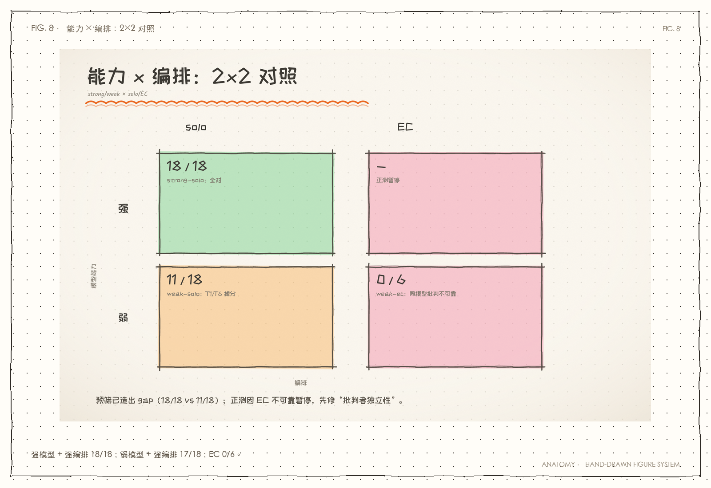

> 图 1｜2×2 对照：预筛造出 gap；正测因 EC 不可靠暂停。

> **打个比方**：不是“多请几个人”就一定更好；要看请来的人有没有独立的信息。

### 1. 设计

| 维度 | 取值 |
|---|---|
| 模型 | **强** = `deepseek-flash`｜**弱** = `qwen-turbo`（DashScope）|
| 编排 | ① **solo**（单 Agent 直答）② **EC**（生成→批判→重做，2 轮）|
| 任务 | 多约束技术选型，有客观要点清单（0~6 分，确定性打分）|

**待验假设**：弱模型 **Δ(EC−solo)** 明显 > 强模型 Δ。

### 2. 结果（n=1/格）

| 任务 | 模型 | solo | EC | Δ |
|---|---|---|---|---|
| T1 嵌入式排序 | **弱** qwen-turbo | 5.0 | 5.5 | **+0.5** |
| T1 嵌入式排序 | **强** deepseek-flash | 5.0 | 5.0 | **+0.0** |
| T2 缓存层决策 | **弱** qwen-turbo | 6.0 | 5.0 | **−1.0** |
| T2 缓存层决策 | **强** deepseek-flash | 6.0 | 5.0 | **−1.0** |

> 平均 Δ：**弱 −0.25 ｜ 强 −0.50**

### 3. 结论：**假设未被证实**（且发现一个更根本的问题）

#### 3.1 直接结论

- 弱模型 Δ（−0.25）与强模型 Δ（−0.50）**差异在噪声内**（n=1/格，2 任务）；
- **两个模型的 Δ 都是负数** —— 即 **EC 编排在本实验里没有帮助，反而略降低**；
- 因此「弱模型从脚手架获益更多」**未获支持**。

#### 3.2 ⚠️ 更根本的问题：**这批任务没能区分强弱模型**

看 **solo 基线**：

| 任务 | 弱 solo | 强 solo |
|---|---|---|
| T1 | 5.0 | **5.0** |
| T2 | 6.0 | **6.0** |

> **两个模型的 solo 得分完全相同。** 说明这几道「多约束技术选型」题
> **对 qwen-turbo 也太简单**，无法体现能力差距。

**这是设计缺陷**：要测「能力是否吃掉脚手架」，前提是**弱模型确实显著更弱**。
本实验的"弱模型"在 solo 上不掉分 → **自变量没有真正拉开** → 无法归因。

#### 3.3 可能的解释（待验）

1. 任务太简单：`qwen-turbo` 对通用技术选型足够强；
2. 打分维度太"要点式"：模型只要提到关键词就得分，区分度低；
3. EC 的"批判→重做"可能引入噪声（与 Debate 专题的发现一致：
   **额外环节会注入噪声，未必提升**）。

---

### 4. 诚实边界

- **n=1/格**（2 任务 × 2 模型 = 4 格）—— 样本极小，任何 Δ 都不构成结论；
  （原计划 n=2/3，因环境反复回收会话被中断，靠增量落盘才保住这 4 格）
- 判分是"关键词命中"，粗粒度；未做人工复核；
- **未建立"弱模型确实更弱"** 这一前提（见 §3.2）—— 这是最大的问题。

---

### 5. 下一步（若要真正验这个假设）

1. **先找能拉开差距的任务**：弱模型 solo 明显掉分的题（更复杂/更长链/更需精确推理），
   使 solo 基线本身有显著 gap；
2. 加大样本（每格 ≥5）；
3. 细化打分（不只关键词，加"是否给出明确结论/是否自相矛盾"）。

> 在此之前，**「能力吃掉脚手架」仍是与文献一致的方向性判断，本项目尚未自证**。

---

### 附：本次顺带的产品改动

`agent/core.py`：把硬编码模型名提成 `LLM_MODEL` 常量，
并给 `Agent.__init__` 增加 `model=` / `client=` 参数（跨供应商注入）。
默认行为不变（`deepseek-flash`），仅供对照实验切换模型。

---

### 附录 B：v2 预筛 ——「gap 可造」（2026/10/14，已收口）

> §3.2 的病是「弱模型 solo 不掉分，自变量没拉开」。本研究据此改换题型：
> 从「主观技术选型」（关键词判分，易饱和）改为**客观算账题**（唯一数值解，确定性判分）。
> 结论：**gap 可以造出来**——但正式的正测（EC 两臂）未做，本例仅验证「自变量可拉开」这一前提。

#### 设计

- 6 道客观算账题（每道有唯一数值答案）：实例数 / 随机写耗时 / Little's Law 在途数 /
  平均延迟 / 扩容核数 / 缓存命中率→后端降幅。
- 只跑 **solo × 2 模型**，n=3/格，确定性判分（末位数字 vs 期望值，含容差）。
- 弱臂：`qwen-turbo` 遇 DashScope **模型级 429**（同 key 的 `qwen-flash/plus/max` 均正常）
  → 换 `qwen-flash`。（教训见下「踩坑」）

#### 结果（n=3/格）

| 题 | 强 deepseek | 弱 qwen-flash |
|---|---|---|
| T1 实例数 | 3/3 ✅ | **0/3** ❌（错值 150 / 100 / 771429，散乱）|
| T2 随机写耗时 | 3/3 ✅ | 3/3 ✅ |
| T3 在途请求 | 3/3 ✅ | 3/3 ✅ |
| T4 平均延迟 | 3/3 ✅ | 3/3 ✅ |
| T5 扩容核数 | 3/3 ✅ | 2/3 ⚠️（错值 16）|
| T6 后端降幅 | 3/3 ✅ | **0/3** ❌（全错成 10，命中率差值陷阱）|
| **合计** | **18/18 (100%)** | **11/18 (61%)** |

**gap ≈ 39 个百分点**（per-prompt）。**有效区分题：T1 / T6**（弱模型 0/3），T5 边缘。
无区分题：T2 / T3 / T4（两臂均满分 = 饱和）。

#### 结论

1. **v1 的病（自变量没拉开）可修**：换成「客观算账 + 留出天花板」的题型后，
   弱模型 solo 明显掉分（100% vs 61%），Δ 才有归因的基础。
2. **但」客观「不等于」有区分度「**：本批 6 题里强模型**全部满分**（天花板），
   4 道题（T2/T3/T4 及 T4 类）两臂同分 → **必须让强模型也掉分**，gap 才信实。
3. **未做**：正式正测（solo + EC × 强弱，n≥5）。本批仅验证前提，不出「脚手架是否被能力吃掉」的结论。

#### 踩坑（三条，比数字值钱）

- **打分器必须区分「答错」与「跑挂」**：初版把「无输出」（429 挂掉）与「答错」都记为 0 分，
  差点把**基础设施故障**当成「弱模型真弱」的好结果收下——方向恰好符合假设，最危险。
  → 修：无输出 = `ERR`（不计分），有输出无数 = `WRONG`。
- **打分器期望值本身会算错**：T2 初版写 1250（把 10GB 当十进制）；实际 10GB÷4KB=2,621,440 块
  ÷2000 IOPS = **1311 s**——**强模型答的 1311 才是对的**。数字整齐到可疑时先查实验台。
- **限流要探到「账号级 vs 模型级」**：`qwen-turbo` 429 不代表 key 废——同 key 其它档位正常，
  换模型即可绕过，不必等额度。

#### 产物

- `docs/experiments/_gap_demo.py`（可配置弱臂 `WEAK_MODEL`、n=`GAP_N`，增量落盘抗会话回收）
- 原始数据：`tmp-artifacts/gap_demo.txt`（`RAW\t题\t臂\t状态` 逐格）

> 本讲来源：[能力与编排对照.md](../02-编排章/能力与编排对照.md)

# 第四篇 · 工程化：可运行、可负担、可观测

结构越多，越容易跑飞、烧钱、看不见。这一篇讲约束与收尾、成本、MCP 协议和架构，把“能跑”变成“能维护”。

<a id="j-22"></a>
## 第 22 讲 · 约束与收尾：别等撞墙才停

> 状态：🟡 改写

> 起因：参考 `sanbuphy/nanoAgent` 时发现本项目缺两样东西——
> **工具输出截断**与**分级预算感知**。本项目只有「撞到上限就硬停」。
> 完成日期：2026/10/02（实现）→ 2026/10/03（预警**验证 + 修复**落地）。

---

**一句话**：约束与收尾：工具输出截断 + 预算预警 + 收尾步（`ANSWER_STEP`）。
**适读**：关心长任务稳定性（如何避免「撞墙才停」）。
**相关讲义**：[编排四模式](../02-编排章/编排模式.md)、[学习总结](../00-索引/学习总结.md)

> **打个比方**：不是等油箱见底才找加油站，而是提前提醒，并留一个“靠边停车”的出口。

> **前情提要**：编排让 Agent 能跑更久，但也会跑飞、烧钱、撞上限。
> **本章只回答**：怎么让 Agent 在预算内主动收尾，而不是被硬停？
> **读完后你能**：解释截断、预算预警、作答步三件套，并说清“为什么软提示不够”。
> **下一章为什么存在**：约束解决“别跑飞”，成本还要解决“别花冤枉钱”。

### 1. 是什么

让 Agent **知道自己快没预算了**，并**主动收敛**，而不是跑到一半被硬停。

两件事：
1. **工具输出截断** —— 防一次输出「炸掉」上下文
2. **分级预算预警** —— 快没步数时提醒模型先给结论

---

### 2. 结构定位

- **谁控制流**：**代码**（阈值判定），但通过**注入提示**影响 LLM 的策略选择
- **信息流**：在「工具结果回填」与「每轮 LLM 调用前」两个位置介入

```
ReAct 循环：
   ① 预算检查 ──→ 剩得少？→ 注入「尽快收敛」提醒     ← 新增
   ② 调 LLM
   ③ 执行工具 ──→ 输出过长？→ 头尾截断                ← 新增
   ④ 结果回填历史
```

---

### 3. 为什么这么设计

#### 3.1 问题一：工具输出会「爆上下文」

一次 shell / 文件读取返回 10 万字符，`messages` 就撑爆了。

**本项目的现状**：工具是计算器/天气/时间，输出都极短，**问题还没暴露**——
但一接 shell 或 MCP 工具就会立刻踩到。

#### 3.2 截断的关键取舍：**头尾保留，不是只留头**

```python
head_n = limit * 3 // 4      # 保留头部 3/4
tail_n = limit - head_n      # 保留尾部 1/4
```

**为什么留尾部**：**错误信息和异常堆栈通常在末尾**。只留头会把最关键的线索丢掉。

对照组：`nanoagent` 只做了长度上限（截到 N），没做头尾保留。

#### 3.3 问题二：只有「硬上限」太粗暴

本项目的旧行为：

```
max_steps = 8  →  跑到第 8 步 → 直接返回「已超过最大处理轮数」
```

**问题**：任务可能做到一半，**用户什么有效答案都拿不到**。

nanoagent 的思路是**分级**：

| 级别 | 阈值（nanoagent） | 动作 |
|---|---|---|
| 提醒 | 剩 5 次调用 | 放进系统提示，暗示收敛 |
| 准备收尾 | 剩 3000 token | 开始准备结论 |
| 立即收尾 | 剩 1500 token | 马上给结果 |
| 强制退出 | 低于 600 token | 下一轮直接停 |

**本项目采用简化版**：只剩 `REMAINING_STEPS_WARN = 2` 一档——
因为本项目的循环只有 `max_steps` 一个维度（没有 token 级预算），
一档预警已经覆盖主要收益。

**注入的内容**（不是硬停，而是**建议**）：

```
【重要】剩余工具调用次数不多（约 2 次）。
请尽快基于已有信息给出结论；若仍缺关键信息，
就明确说明缺什么，不要继续无意义地调工具。
```

> **这是「代码控制流」与「LLM 决策」的配合**：
> 代码知道剩余预算（LLM 不知道），代码**告知**它；**怎么收敛由 LLM 自己决定**。

---

### 4. 代价（值钱那行）

| 代价项 | 说明 |
|---|---|
| **截断会丢信息** | 头尾保留仍是近似；若关键信息恰在被删的中间段，模型就看不到 |
| **截断对模型是"新信息"** | 实测模型会主动报告"内容被截断"——这是好事（可解释），但也占输出 token |
| **预警阈值靠猜** | `REMAINING_STEPS_WARN=2` 是拍的，没有像召回阈值那样的数据支撑 |
| **只做步数、未做 token 级** | 本项目无 token 预算维度，所以只做了一档；真要精细需要改循环结构 |
| **提示注入可能干扰** | 每轮都往 system 里追加，理论上会稀释原有指令（本项目的 system 很短，影响小） |

---

### 5. 代码在哪

| 文件 | 改动 |
|---|---|
| `agent/core.py` | 新增 `TOOL_OUTPUT_MAX_CHARS` / `REMAINING_STEPS_WARN` / `truncate_tool_output()` |
| （同上） | 工具结果回填处截断；每轮 LLM 调用前注入预算预警 |

**为什么放在 `core.py` 而不是工具里**：
截断必须在**工具结果进入 messages 之前**发生——那是 `core.py` 的职责。
放在工具里则每个工具都要自己截，且 MCP 工具（外部）根本改不了。

> 因为截断点在 registry 调用之后，**MCP 工具同样受益**（它们也要过 `tool_registry`）。

---

### 6. 怎么跑

```bash
# 阶梯 0 最小 Agent（纯 ReAct，无这些机制）——对照用
.venv/bin/python minimal.py "帮我算 123 * 456"

# 完整版（含截断 + 预算预警）
.venv/bin/python main.py

# 单元验证截断函数
.venv/bin/python -c "
import sys; sys.path.insert(0,'.')
from agent.core import truncate_tool_output
print(len(truncate_tool_output('A'*3000+'B'*3000)))   # → 4022
"
```

---

### 7. 实测账（2026/10/02）

#### 7.1 截断函数（单元）

| 输入 | 输出 | 头尾保留 |
|---|---|---|
| 30 字符 | 30 字符（不截断） | — |
| 6000 字符 | **4022 字符** | ✅ 头部 A… 尾部 …B |
| 15000 字符 | **4023 字符** | ✅ 含「中间省略 11000 字符」 |

#### 7.2 截断在真实循环内生效

用一个人造的 15000 字符工具跑真实 ReAct 循环：

```
history 中工具结果长度: 4023  ✅ 已截断（原始 15000）
```

**附带观察（意外收获）**：模型**主动报告了截断**——

> 「正文被截断显示——首尾各展示约 800 字符，中间省略 11,000 字符」

说明**截断标记对模型是可读的**，它能意识到信息不完整，而不是把残缺内容当成全部。

#### 7.3 预算预警

用 `max_steps=1` 强制触发（`remaining=1 ≤ 2`）：预警已注入，
但 `max_steps=1` 无余量（模型仍需 2 轮：1 轮调工具 + 1 轮作答），
所以行为未变。常规 `max_steps=8` 下，多步任务（4 次工具调用）正常收敛，未触发预警。

> ✅ **已测出**（2026/10/03，见 §12）：预警有用——撤工具 + 预警 → 干净收敛 33% vs 0%；
> 但需「可作答的步」配合（否则末步被工具占用 → 硬停）。已落 `ANSWER_STEP`。

---

### 8. 结论（2026/10/02 初版，部分被 §12–§13 修正）

1. **截断是必需的防御**，且「头尾保留」优于「只截头」（错误常在尾部）；
2. ~~**分级预警把「硬停」改成「主动收敛」**~~ —— ⚠️ **2026/10/03 修正**：
   预警**单独用不出来**；需「**可作答的步**」配合（见 §12），已落地为 `ANSWER_STEP`（§13）。
3. **对照 nanoagent 的价值在于照出缺口**：本项目工程深度更深，
   但在「最小可读」与「资源感知」这两点上确实空白。

---

### 9. 踩过的坑

| 坑 | 说明 |
|---|---|
| **想只留头部** | 直觉是"从头截"，但**异常堆栈在末尾** —— 改成头尾保留 |
| **把截断放进工具里** | 那样每个工具都要自己实现，且**外部 MCP 工具改不了**。放在 core 的 registry 之后，一处覆盖全部 |
| **预警当成硬性停止** | 若代码直接强制收尾，模型没机会解释缺什么。**注入建议 + 让 LLM 决定**更好 |
| **`max_steps=1` 测不出预警效果** | 单轮无余量，模型必然来不及收敛。测预警需要 ≥3 步的任务 |
| **一步 ≠ 一次工具调用**（2026/10/03）| 模型把 6 个 `tool_calls` **并发塞进 1 步**，`max_steps=3` 根本不紧。设计"步数紧张"必须用**依赖链**强制串行 |

---

### 10. 实验台：预算预警 A/B（2026/10/03）

> 本实验记录（**已完成**，2026/10/03）：验证「预警有效性」的专门实验。
> 文件：`docs/experiments/warn_ab.py`（首版）→ `warn_ab_chain*.py`（链式任务版，结论见 §12）。

#### 10.1 对照组怎么造（**运行时猴子补丁**，不改源码）

```python
import agent.core as core
core.REMAINING_STEPS_WARN = 0    # 仅本进程生效，退出即恢复
```

**为什么能生效**：`run()` 里 `if remaining <= REMAINING_STEPS_WARN` 是**每轮现场读模块全局**
（运行时读取），外部改掉下一轮就生效。设 0 → `remaining<=0` 恒假 → 预警永不开。

**反例（不能这么补丁）**：`truncate_tool_output(text, limit=TOOL_OUTPUT_MAX_CHARS)` 的默认参数
在**定义时**绑死，运行时改 `core.TOOL_OUTPUT_MAX_CHARS` **无效**。
> 两个看似对称的常量，关闭方式**一个能、一个不能** —— 差别只在**读取时机**（定义时 vs 运行时）。

#### 10.2 首次探针**未成立**（重要）

固定 `max_steps=3`，任务＝查 5 城市气温 + 算平均（**以为**要 6 次调用）：

| WARN | 工具调用 | 步数 | 结果 |
|---|---|---|---|
| 2（开）| 6 | **2** | 完整答对，无差别 |
| 0（关）| 6 | **2** | 完整答对，无差别 |

🚨 **根因：一步（step）≠ 一次工具调用。** 模型把 6 个 `tool_calls` 并发塞进 1 步 → `max_steps=3`
不紧 → 预警没机会起作用。**「任务不够紧 → 测了个寂寞」第二次翻车**，
但根因与昨日假设不同（不是调用次数不够，是**步骤能合并**）。

#### 10.3 发现的真 bug（待修）

预警文案写「剩余**工具调用次数**不多（约 N 次）」，但 `remaining` 数的是**循环步数**
→ **文案与语义对不上**，会误导模型。

#### 10.4 下一步

用**依赖链**强制串行 ≥3 步（下一个工具调用的**参数模型猜不出**、必须等上一步结果）
再跑真对照。

---

### 11. 实验结果：预警在链式任务下**无效**（2026/10/03）

> ⚠️ **本节的“无效”结论已被 §12 修正**——预警本身有用，但需「可作答的步」。
> 本节保留，因为它是**关键的否定证据**，也是 §12 的实验前提。

#### 11.1 链式任务（`docs/experiments/warn_ab_chain.py`）

随机令牌链 `K7Q→BAX→K9U→G2V→DB8→2HJ`（固定种子可复现）。
任务＝从 K7Q 连续调用 `next_token` 前进 5 步。令牌**不可预测** → 无法批量 → **结构上必须 5 步**。

#### 11.2 结果：6/6 硬停，开/关**零差异**

固定 `max_steps=3`，每组 3 跑：

| 组 | 工具调用 | 给出回答 | 硬停 | token |
|---|---|---|---|---|
| WARN=2（开）| 3.0 / 3.0 / 3.0 | ❌❌❌ | 3/3 | 2366 / 2424 / 2360 |
| WARN=0（关）| 3.0 / 3.0 / 3.0 | ❌❌❌ | 3/3 | 2381 / 2403 / 2362 |

**开预警和关预警，行为完全一样**（都跑满 3 步调工具，都硬停，都没作答）。

#### 11.3 先排除「预警没注入」的可能

`docs/experiments/debug_warn_inject.py` 直接抓每轮 system 内容：

| 组 | 第1步(剩3) | 第2步(剩2) | 第3步(剩1) | 注入轮数 |
|---|---|---|---|---|
| WARN=2 | 无 | ✅ 有 | ✅ 有 | **2/3** |
| WARN=0 | 无 | 无 | 无 | **0/3** |

（WARN=2 时 system 长度 14→81。）→ **预警确实注入了**，不是机制没跑。

#### 11.4 为什么无效（关键）

1. **软提示压不过任务指令与行为惯性**：用户明说「调用 5 次」，
   system 里那句「尽快给结论」是软建议 → 模型继续调工具。
2. **末步被工具调用占用（结构性缺陷）**：预警想的是「让模型作答」，
   但循环最后一次机会里，模型**又调了一次工具** → 循环结束 → 硬停。
   **模型压根没得到一个「可以作答」的步。**
   → 软提示**无法**把模型从「工具调用态」拽出来。

#### 11.5 文案 bug（复现确认）

预警写「剩余**工具调用次数**不多（约 N 次）），但 `remaining` 数是**循环步数**。
本次链式任务一步一调用，数字恰好对上；若一步多调用（见 §10.2）就**严重误导**。

#### 11.6 结论（可证伪）

> **在该链式任务下，预算预警对模型行为**无任何可测影响**（6/6 硬停，开/关一致）。
> 失效机制 = **软提示压不过工具调用惯性** + **末步被工具占用、无作答机会**。**

⚠️ 边界：本任务**没有可用的部分结果**（缺的是不可猜的终点令牌），
所以「提前给部分结论」本就无意义 —— 换个「部分结果有价值」的任务，
预警**可能**有用。此结论**仅限本场景**。

#### 11.7 若要真让预警生效，需要改机制（下次可选）

a. **末步撤掉工具**（最后一轮 `tools=None`）→ 强制模型只能用文字作答；
b. **升级为硬约束**：剩 ≤1 步时明确禁止再调工具；
c. **修文案**：「步数」→ 与语义对齐。

---

### 12. 修复实验：预警**有用**，但需「可作答的步」（2026/10/03）

#### 12.1 设计：2×2 因素实验（`docs/experiments/warn_ab_chain_tooloff.py`）

把两因素**拆开**，检验预警是否真有增量贡献：

| 因素 | 取值 |
|---|---|
| A：`REMAINING_STEPS_WARN` | 2（开）/ 0（关）|
| B：末步撤工具（最后一轮 `tools=None`）| 否 / 是 |

同链式任务、`max_steps=3`。指标：**干净收敛**（作答且无格式泄漏）。

#### 12.2 ⚠️ 实验中的假象：DSML 泄漏

DeepSeek 被夺走工具后，会在**正文里**吐出 `｜｜DSML｜｜` 标记（它内部工具调用格式泄漏），
即「明明没工具，还是硬撐着调工具」。这不是干净收敛 → 单列「泄漏」指标。

#### 12.3 结果（n=5 矩阵 + n=10 确认性加测）

**矩阵（每组 5 跑）**：
| 末步撤工具 | WARN | 硬停 | 干净收敛 | DSML泄漏 | token |
|---|---|---|---|---|---|
| 否 | 2 | 5/5 | 0/5 | 0/5 | 2404 |
| 否 | 0 | 5/5 | 0/5 | 0/5 | 2364 |
| 是 | **2** | 0/5 | **1/5** | 4/5 | 1965 |
| 是 | **0** | 0/5 | **0/5** | 5/5 | 1799 |

**确认性加测（末步撤工具，n=10）**：
| WARN | 干净收敛 | DSML泄漏 |
|---|---|---|
| **2** | **4/10** | 6/10 |
| **0** | **0/10** | 10/10 |

**合并（撤工具组，各 15 跑）**：
> WARN=2：干净收敛 **5/15（33%）** ｜ WARN=0：**0/15（0%）**

#### 12.4 结论（**修正 §11.6**）

> **预警本身有用，但需要两个条件同时具备：**
> 1. **模型得有一个「可作答的步」**（否则再提醒也没机会答）；
> 2. **预警得给它「该停」的理由**（否则它会硬撐调工具）。
>
> 缺任一，预警都表现为「无效」：
> - 缺 1（有预警、无作答步）→ 5/5 硬停（§11 就是这种）；
> - 缺 2（有作答步、无预警）→ 0/15 收敛，全泄漏；
> - **两者齐备 → 33% 干净收敛。**

如 §11.4 的诊断：**原实现只满足了 2、缺了 1** → 所以预警"看着没用"。
**真正的 bug 是结构（无作答步），不是预警概念。**

#### 12.5 代价与边界

- 即便两条件齐备，干净收敛率也只有 **33%** —— 预警**提升但保证不了**收敛；
- 结论基于小样本（各 15）；方向一致、趋势明显，但**未做显著性检验**；
- DSML 泄漏是 DeepSeek 特有现象；换模型需重测。

---

### 13. 落地：收尾步（`ANSWER_STEP`）已进主项目（2026/10/03）

根据 §12 结论，在 `agent/core.py` 的 `run()` 加上「收尾步」。

#### 13.1 设计取舍：为什么是 B 方案（在 max_steps **之外**加一步）

| 方案 | 做法 | 代价落点 |
|---|---|---|
| A | 从 `max_steps` 里**借**一步 | ❌ 工具预算莫名 8→7，伤**成功路径** |
| **B（选用）** | 在 `max_steps` **之外**加一步 | ✅ 工具预算不变；只有**跑满预算的失败路径**才多花 1 次调用 |

> 选 B 的理由：**代价只落在本就要失败的路径上**，换回一个「部分结果 + 说清缺口」的答复。
> A 是在正常路径上偷成本 —— 正是 issue-log 「同一个坑换地方出现」那类危险。

#### 13.2 改动（`agent/core.py`）

| 位置 | 改动 |
|---|---|
| 常量 | 新增 `ANSWER_STEP = True` |
| 循环 | `total_iters = max_steps + (1 if ANSWER_STEP else 0)`；`answer_only = ANSWER_STEP and remaining <= 0` |
| 注入 | `answer_only` 时注入「【最后一步】预算已用尽、不能再调工具、立即给结论」；否则才注入普通预警 |
| LLM 调用 | `answer_only` 时**不传** `tools`/`tool_choice`（强制作答）|
| 顺带修 bug | 预警文案「工具调用次数」→「**轮次**」（§11.5）|

#### 13.3 回归测试（`docs/experiments/regression_answer_step.py`）

三层，全 PASS：

| 测试 | 内容 | 结果 |
|---|---|---|
| **T1 契约** | 收尾步真的不带工具 | ✅ 4 次 LLM 调用：前 3 带工具、收尾步不带 |
| **T2 行为** | 链式任务下修复是否有效 | ✅ 开：硬停 0/6、干净收敛 4/6；关：硬停 6/6、收敛 0/6 |
| **T3 回归** | 普通任务照常、成功路径**不额外调用** | ✅ `123*456=56088`，LLM 仅 2 次 |

另跑跨模块冒烟：`MultiAgent.run()`（Router→solo）答对 ✅。

#### 13.4 修复后的回答形态（链式任务）

> 「第 4 步：未执行… 第 5 步：未执行，因此最终令牌无法给出…
> 若后续恢复工具可用，只需从 `G2V` 继续推进 2 步即可完成。」

→ **部分结果 + 明说缺口 + 可续做**，远优于原来的「硬停、零答复」。

> 本讲来源：[约束与收尾.md](../03-实战章/约束与收尾.md)

<a id="j-23"></a>
## 第 23 讲 · MCP：把 N×M 变成 N+M

> 状态：✅ 已有

> 把本项目自己的天气工具「适配」成一个 MCP server，让 Agent 用上它，
> 并量出「协议层」的真实价格。方案 A：把自己写的工具搬出去。
> 完成日期：2026/09/17。


> **前情**：接着第 22 讲的问题往下走。  
> **本讲只回答**：工具越来越多，怎么把 N×M 变成 N+M？  
> **读完后你能**：理解 MCP 的协议价值。  
> **下一讲**：第 24 讲会接着这个问题。

**一句话**：MCP 基础：把工具变成「通用插座」，适配从 N×M 压成 N+M。
**适读**：要让工具跨框架/跨进程复用。
**相关讲义**：[MCP 边界](../04-协议章/MCP边界.md)、[编排四模式](../02-编排章/编排模式.md)

---

### 1. 是什么

**MCP（Model Context Protocol）= 工具与 Agent 之间的通用插座。**

一句话对比：现在你的工具是**焊死在这个项目里**的；MCP 之后，工具变成一个
**独立进程**，任何支持 MCP 的客户端都能插上用。

| | 以前（Function Calling） | 现在（MCP） |
|---|---|---|
| 工具在哪 | 项目里的一个 Python 函数 | **独立进程**（可以是 Node/Go/别的语言） |
| 清单从哪来 | 代码里**手写**声明 | 运行时向 server **动态问**出来 |
| 换客户端 | 重写一份适配 | 不用改，插上就用 |

---

### 2. 结构定位

#### 三个角色

| 角色 | 是什么 | 本项目对应 |
|---|---|---|
| **Host** | 跑 Agent、发起请求的那一方 | `main.py` / Agent |
| **Client** | Host 内部负责说协议话的连接器 | `agent/mcp_bridge.py` |
| **Server** | 提供能力的**独立进程** | `mcp_servers/weather_server.py` |

传输走 **stdio**（标准输入输出）——server 是 client 拉起的子进程，
**客户端退出，server 被回收**。

#### 三种原语（比 Function Calling 更宽）

| 原语 | 谁发起 | 干什么 |
|---|---|---|
| **Tools** | 模型 | 执行动作（会改状态） |
| **Resources** | 应用 | 读数据（只读） |
| **Prompts** | 用户 | 预置提示词模板 |

本项目的 Function Calling 只覆盖了 **Tools** 一种。本次也只演示 Tools。

---

### 3. 为什么这么设计

**要解决的是 N×M 问题。**

```
N 个 Agent 框架 × M 个工具 = N×M 份适配
```

每换一个框架，所有工具都要重写一遍适配层。MCP 把适配压成 **N+M**：
**框架实现一次 client，工具实现一次 server**，之后任意组合。

> 类比：以前每台电器配一种插座（N×M 个转接头）；MCP 是 USB-C，
> 插座和电器各自实现一次协议，随便插。

#### 一个关键的设计取舍：适配 ≠ 重写

`mcp_servers/weather_server.py` **没有重写**天气逻辑，而是复用了
`agent.tools.get_weather`。

原因：「适配」的语义是给已有能力**套一层协议外壳**，不是重新实现一遍。
**真正的解耦发生在接口层（进程边界 + 协议），不在实现层。**
等这个 server 将来被抽成独立仓库/包时，再把函数一起搬走即可。

---

### 4. 代价（值钱那行）

MCP 不是免费的。实测拆成三笔账：

| 代价项 | 实测值 | 说明 |
|---|---|---|
| **工具清单每轮都吃 token** | **+3571 token（+308%）** | ⚠️ **最大的代价**，见下 |
| **描述文本更啰嗦** | **+36 字符 / +21 token**（每个工具） | 动态发现的 schema 带 `title` 等元数据 |
| **协议层往返** | **0.69 ms** | 跨进程调用 vs 本地函数直调 |
| **冷启动** | **≈500 ms** | 拉起子进程 + 握手 + `list_tools` |

#### ⚠️ 最大的一条：工具清单的「租金」

同一道题、同一个答案，**只改暴露几个工具**（方案 B 实测）：

| 暴露工具数 | schema 体积 | 总 token | 耗时 |
|---|---|---|---|
| 1 个 | 899 字符 | **1160** | 0.93s |
| 14 个 | 8803 字符 | **4731** | 1.11s |
| 差异 | +7904 字符 | **+3571（+308%）** | — |

**任务完全一样，答案完全一样，只因为它多带了 13 个用不到的工具。**

这就是「动态发现」的另一面：**省了适配代码，但工具清单每轮都在吃 token**。
挂 14 个工具，每次调用先付 3500+ token 的「租金」，还没开始干活。

> **生产做法**：工具裁剪 / 按需加载——只暴露当前任务相关的工具集，
> 而不是把手头所有 server 的工具全量挂上去。
> 工具越多 ≠ 能力越强，可能只是每轮更贵。

**三条结论（都反直觉）：**

1. **token 是会涨的，而且可能涨得很多**。不只是 schema 更啰嗦（+36 字符/工具），
   更致命的是**工具数量本身**——14 个工具每轮 +3571 token（+308%）。
   凭「协议更先进」就以为更省 token 是错的。
2. **协议往返便宜到可以忽略**（0.69 ms）。相比一次 LLM 调用（约 1 秒）、
   一次联网查询（约 1.2 秒），0.69 ms 是噪声。**「协议层很贵」是错觉。**
3. **真正的新开销在别处**：
   - **运维复杂度**：多一个子进程要管（生命周期、崩溃恢复、日志）；
   - **冷启动 500 ms**：每次拉起都要付出；
   - **动态发现的双刃剑**：清单不在你代码里了 → 灵活，但也**不可控**
     （server 改了什么你事前不知道）；
   - **安全面变大**：工具描述/返回值本身成为**注入通道**（第三方 server 尤其危险）。

**一句话**：MCP 买的不是「省钱」，是「**一次实现、处处可用**」。
钱花在运维和可发现性上，省在重复适配上。

---

### 5. 代码在哪

| 文件 | 角色 | 说明 |
|---|---|---|
| `mcp_servers/weather_server.py` | **Server** | 把 `get_weather` + `ping` 暴露为 MCP 工具 |
| `mcp_client_weather.py` | **Client（最小）** | 独立验证脚本：握手 → `tools/list` → `tools/call` |
| `agent/mcp_bridge.py` | **Client（生产形态）** | 把 MCP 工具桥接进同步 Agent |
| `mcp_agent_demo.py` | **对照实验（方案 A）** | 本地工具 vs MCP 工具 |
| `mcp_external_demo.py` | **方案 B 演示** | 接第三方 filesystem server + schema 膨胀实验 |

#### 异步 / 同步的桥接（本项目的关键实现）

MCP 客户端是**异步**的，本项目的 Agent 是**同步**的，硬凑会打架。

解法：把 MCP 的 asyncio 事件循环放到**后台线程**常驻，
主线程用 `asyncio.run_coroutine_threadsafe` 把调用投递过去——

```python
fut = asyncio.run_coroutine_threadsafe(self._call_async(name, args), self._loop)
return fut.result(timeout=timeout)
```

于是对 Agent 而言，**MCP 工具跟本地工具一样是个同步函数**。

#### 为什么不改 core.py

Agent 已暴露 `tools_spec` / `tool_registry`，`attach_mcp_tools()` 直接**追加**，
MCP 工具就与本地工具共存。协议层的引入是「**外挂式**」的，
符合本项目「新能力尽量不侵入旧代码」的习惯。

---

### 6. 怎么跑

```bash
# ① 最小客户端：看协议本身（不接 Agent）
.venv/bin/python mcp_client_weather.py 上海

# ② 对照实验：本地工具 vs MCP 工具（方案 A）
.venv/bin/python mcp_agent_demo.py

# ③ 方案 B：接第三方 filesystem server + schema 膨胀实验
.venv/bin/python mcp_external_demo.py
```

第三方 server 的本地安装（一次性）：
```bash
cd mcp_servers/vendor
npm install @modelcontextprotocol/server-filesystem
```

`mcp_client_weather.py` 的输出会依次显示：
握手信息 → `tools/list` 发现的工具清单（**注意：这份清单不在客户端代码里**）
→ `tools/call` 的实际返回。

---

### 7. 实测账（2026/09/17）

#### 方案 A 对照实验：同一问题「杭州现在天气怎么样？」

工具集严格对齐（两组都只有 **1 个** get_weather 工具），各跑 3 次取平均：

| 组别 | 工具来源 | schema 字符 | 平均 token | 平均耗时 |
|---|---|---|---|---|
| 甲组 · 本地 | 手写声明 | 255 | **900** | 3.23s |
| 乙组 · MCP | 动态发现 | 291 | **921** | 2.90s |
| 差值 | | **+36** | **+21**（+2.3%） | −0.33s（噪声） |

结论：**答案质量一致，token 略涨，耗时无差异**。

#### 协议层开销（用不联网的 `ping` 工具隔离测量，各 20 次取中位）

| 调用方式 | 中位耗时 |
|---|---|
| 本地函数直调 | ~0.000 ms |
| MCP 跨进程调用 | **0.69 ms** |

#### 冷启动（拉到可用，测 3 次）

| 阶段 | 耗时 |
|---|---|
| 拉起子进程 + initialize 握手 + `list_tools` | **≈500 ms** |

---

### 8. 方案 B：接一个**别人写的** server

方案 A 是「自己的工具搬出去」（自己 → 别人）；
方案 B 是反方向（别人 → 自己）：**一行适配代码不写**，直接插上第三方 server。

本次接的是官方 `@modelcontextprotocol/server-filesystem`（**Node 写的**，我们项目是 Python）。

#### 桥接代码有多少？

```python
bridge = MCPToolBridge(namespace="fs")
bridge.add_server("filesystem", str(VENDOR_BIN), [SANDBOX])
```

**两行。** 然后 14 个文件操作工具就全能用：

```
fs__read_text_file / fs__write_file / fs__edit_file / fs__create_directory
fs__list_directory / fs__list_directory_with_sizes / fs__directory_tree
fs__move_file / fs__search_files / fs__get_file_info
fs__read_media_file / fs__read_multiple_files / fs__read_file
fs__list_allowed_directories
```

**注意语言**：server 是 Node 写的，我们是 Python——**跨语言毫无障碍**。
因为解耦发生在**进程边界 + 协议**上，跟实现语言无关。这是方案 A 时讲过的道理，这里得到验证。

#### 真干活

```
任务：读 /tmp/mcp_sandbox/notes.txt 数行数，再读 readme.txt
实际调用：fs__read_text_file × 2
结果：正确（3 行，alpha/beta/gamma）｜ 4936 token ｜ 2.13s
```

#### 甜头与代价

| | 方案 A（自己的工具） | 方案 B（别人的工具） |
|---|---|---|
| 适配代码 | 要写 server | **0 行** |
| 工具数量 | 2 个 | **14 个** |
| schema 体积 | 291 字符 | **8803 字符** |
| 代价 | 协议往返 | **每轮 3500+ token 的「租金」** |

**「不写适配」不等于「没有成本」**——成本从「写代码」转移到了
「**每轮都付的 token**」上。见 §4 的锋利实验。

#### 方案 B 特有的风险

1. **看不见实现**：这些工具是别人写的，你不知道 `read_text_file` 内部干了什么；
2. **注入通道**：工具的描述文本和返回值都是**外部内容**，
   server 若被投毒，返回的文本可以直接指挥你的 Agent（提示注入）；
3. **权限面**：本次给的是 `/tmp/mcp_sandbox`，但很多 server 默认能碰更大范围。
   本次实测的安全机制：server 启动时打印
   `using allowed directories: [ ... ]`，**只允许访问声明的目录**。
   选第三方 server 时，**先看它要什么权限**。

---

### 9. 踩过的坑（mcp 1.x → 2.x 的 API 变更）

本次用的是 `mcp 2.2.0`，与网上大量 1.x 教程**不兼容**：

| 1.x 写法 | 2.x 实际 |
|---|---|
| `from mcp.server.fastmcp import FastMCP` | `from mcp.server.mcpserver import MCPServer`（FastMCP 已改名） |
| `info.serverInfo` | `info.server_info`（字段改 snake_case） |
| `info.protocolVersion` | `info.protocol_version` |
| `tool.inputSchema` | `tool.input_schema` |

**教训**：装完包先跑一遍 `dir()` / `inspect.signature()` 确认真实 API，
**别照抄教程**。本次就是因为直接照 1.x 写法写，连撞两次 `AttributeError`。

#### 另一个坑：工具名撞车（已在方案 B 中修复）

MCP 工具也叫 `get_weather`，挂载时**覆盖**了本地同名工具
（`{**local_registry, **mcp_registry}`）。

方案 A 里两者行为一致所以无害，但**生产环境必须处理**：
「本地同名工具被静默替换」这种 bug 极难排查。

**方案 B 已修**：`MCPToolBridge(namespace="fs")` 会给所有工具加前缀
（`fs__read_text_file`），并在调用时映射回原名。
现在天气 server 的工具是 `weather__get_weather` / `weather__ping`，
filesystem 的是 `fs__*`，**再也不会与本地工具撞名**。

---

---

### 10. 工具裁剪：干掉「工具清单的租金」

§4 量出的最大代价是**工具清单本身**每轮要付 3500+ token 的租金。
这一节就是对它的正面解法。

#### 是什么

**按当前查询，只挂载相关的工具子集**，而不是把手头所有 server 的工具全量挂上。

#### 结构定位

控制流 = **代码**（规则匹配，不问 LLM）；位置 = 在「工具发现」与「挂载」之间加一道闸门。

```
MCP server → tools/list（14 个）→ ✂️ 裁剪器 → 挂载（N 个）→ LLM
```

#### 为什么这么设计

**关键决策：裁剪判据不能用 LLM。**

本项目已经吃过这个亏——Router 每次判断要 **853 token**（见
`docs/02-编排章/编排模式.md` §6）。若用 LLM 来判断该挂哪些工具，
就变成「花 853 去省 3500」：收益被自己的判断成本吃掉一截，而且判断还会错。

所以用**规则预筛**：查询关键词 → 工具分组。**零 token、确定性、可测**。

**核心约束：宁可多带，不可漏带。**
漏掉必要工具 → 任务**直接失败**，比多带几个贵得多。所以规则匹配不到时
**回退全量**，而不是回退空集。

#### 代价（值钱那行）

| 代价项 | 说明 |
|---|---|
| **规则要维护** | 新增工具、新说法时要更新关键词表；漏了关键词就漏选 |
| **召回是近似的** | 关键词匹配必然有「该选没选」和「不该选却选了」 |
| **风险不对称** | **多选**只是浪费 token；**漏选**是任务失败——所以规则要偏保守 |
| **多一条代码路径** | 出问题时要能降级回全量 |

#### 代码在哪

| 文件 | 说明 |
|---|---|
| `agent/tool_selector.py` | `ToolSelector`（关键词分组）+ `attach_selected_tools()`（先裁后挂） |
| `mcp_tool_pruning_demo.py` | 三种任务的前后对照 + 边界压测 |

**为什么是「先裁后挂」**：没被选中的工具，**连 schema 都不会进请求**——
这才是真省。若先全挂再过滤调用，token 早就付过了。

#### 怎么跑

```bash
.venv/bin/python mcp_tool_pruning_demo.py
```

#### 实测账（2026/09/17，每个配置跑 3 次取平均）

**单组任务**（读文件数行数）：

| 策略 | 工具数 | schema | 平均 token | 平均耗时 |
|---|---|---|---|---|
| 全量挂载 | 14 | 8803 字符 | **4734** | — |
| 规则裁剪 | 3 | — | **1810** | — |
| 节省 | −11 | | **−2924（−61.8%）** | |

**三组任务汇总：**

| 任务 | 全量 token | 裁剪 token | 节省 |
|---|---|---|---|
| 单组任务（读） | 4734 | 1810 | −61.8% |
| 多组任务（列 + 读） | 4923 | 3952 | −19.7% |
| 漏带回归（建目录） | 5577 | 3074 | −44.9% |
| **合计** | **15234** | **8836** | **−6398（−42.0%）** |

**任务完成度：三组任务、两种策略，全部 ✅**——裁剪没有牺牲正确性。

> ⚠️ **测量说明（诚实起见）**：单次 token 抖动不小
> （如全量组各次为 `[4822, 7204, 4705]`），上述为 3 次平均。
> 数量级结论可靠（省 40% 上下），但具体到某一次运行会有波动。

#### 压测抓到的真 bug（这段最重要）

规则法的风险**不在多选，在漏选**。压测当场抓到一个：

```
输入：「在 /tmp/mcp_sandbox 里建一个叫 reports 的目录」
原结果：只命中 list 组（因含「目录」）→ 选中的工具里没有 create_directory
后果：任务直接失败
根因：write 组关键词是 ["写","创建","新建","保存",...]，**缺单字「建」**
```

修法：write 组加「建」，并把该场景固化为**回归用例**（「漏带回归」那条任务）。

**两条后路**（生产必备）：
1. **兜底**：规则一个都匹配不上时，**回退全量**而不是回退空集；
2. **度量**：监控「选了但没用上」的比率 —— 持续偏高说明规则过宽，
   而「漏选导致失败」的比率则是规则过窄的信号。

#### 边界压测结果（规则法的真实弱点）

| 输入 | 选中 | 评价 |
|---|---|---|
| 「帮我处理一下 notes.txt」（无关键词） | 7/14 | 回退安全集（读+列），✓ 保守正确 |
| 「先搜所有 txt，再把找到的第一个文件改个名」 | 2/14 | 复合动作命中 search + edit，✓ 准确 |
| 「你好，今天过得怎么样」（纯闲聊） | 7/14 | 也挂了 7 个工具——**规则法对「不需要工具」无感**，是它的盲区 |

最后一行是个真问题：**闲聊时也白挂 7 个工具**。彻底的解法是
「先判断需不需要工具」（但这又回到判断成本问题上），或者由上层
（如 Router）统一决策。留作下一步。

---

### 11. 下一步

- ~~**方案 B**：接一个别人写好的 MCP server~~ ✅ 本次已完成（官方 filesystem）
- ~~**命名空间**：为 MCP 工具加前缀~~ ✅ 本次已完成（`namespace="fs"`）
- ~~**工具裁剪 / 按需加载**~~ ✅ 本次已完成（`agent/tool_selector.py`，实测省 42%）
- **「不需要工具」的判定**：规则法对纯闲聊也会白挂 7 个工具（§10 压测），
  需要上层统一决策「这轮要不要挂工具」。
- **Resources / Prompts**：本次只用了 Tools，另两种原语未碰。

> 本讲来源：[MCP基础.md](../04-协议章/MCP基础.md)

<a id="j-24"></a>
## 第 24 讲 · MCP 边界：什么该做成工具

> 状态：✅ 已有

> 起因：`hbbio/nanoagent` 的架构主张——
> 「框架只做**控制循环**，把 RAG / 向量检索 / 数据库 / 云调用**全部推给 MCP 工具**」。
> 而本项目把 `memory` 做成了**内核里的一个模块**（253 行 + ChromaDB 依赖）。
> 哪种对？本文用本项目的实测数据来判。
> 完成日期：2026/10/02。


> **前情**：接着第 23 讲的问题往下走。  
> **本讲只回答**：什么该做成 MCP 工具？  
> **读完后你能**：知道协议边界和 schema 膨胀。  
> **下一讲**：第 25 讲会接着这个问题。

---

**一句话**：边界辨析：**记忆该不该 MCP 化**？什么该做成独立进程、什么不该。
**适读**：决定「什么该抽象成 MCP」时。
**相关讲义**：[MCP 基础](../04-协议章/MCP基础.md)

### 1. 争议在哪

| | hbbio 的主张 | 本项目的做法 |
|---|---|---|
| 框架职责 | **只做控制循环** | 控制循环 + 记忆 + 编排 + 评测 |
| 记忆在哪 | **外置成 MCP server** | **内核模块**（`agent/memory.py`） |
| 好处 | 核心极小、可一下午审计完 | 调用零开销、状态集中 |
| 代价 | 多一层协议与进程 | 内核变重、依赖变多 |

**这不是"谁更先进"的问题**，是**边界该画在哪**的问题。

---

### 2. 先看事实：本项目的实测数据

#### 2.1 协议层开销：**0.69 ms**（2026/09/19 实测）

用不走网络的 `ping` 工具隔离测量，20 次取中位：

| 调用方式 | 中位耗时 |
|---|---|
| 本地函数直调 | ~0.000 ms |
| MCP 跨进程调用 | **0.69 ms** |

**对照**：一次 LLM 调用约 **1000 ms**，一次 embedding 约 **150 ms**。

> ⇒ **协议层开销是噪声**。这个维度上，两种做法**没有差别**。

#### 2.2 MCP 还有别的账要付（同样是实测）

| 项 | 实测值 | 说明 |
|---|---|---|
| 冷启动 | **≈500 ms** | 拉子进程 + 握手 + `list_tools` |
| **工具清单的租金** | **+3571 token（+308%）** | 14 个工具的 schema 每轮都要带上 |
| 工具名撞车 | 需手工加命名空间前缀 | `{**local, **mcp}` 会**静默覆盖**同名工具 |
| 注入面 | 工具描述/返回值成为**注入通道** | 第三方 server 尤其危险 |

> ⚠️ **注意第 2 行**：那条 +308% 是**挂 14 个文件工具**的结果。
> 记忆若做成 MCP，还要再往这份清单里加工具 —— **这笔钱是按轮付的**。

---

### 3. 分析：记忆这个对象的特殊之处

#### 3.1 MCP 的价值是「N+M」，前提是**真的有多方**

MCP 解决的是 **N 个客户端 × M 个工具 = N×M 份适配** 的问题，压成 **N+M**。

**那么问题变成**：本项目的记忆，**会被多方使用吗？**

| 使用方 | 现在 | 若 MCP 化 |
|---|---|---|
| 本项目（Agent） | ✅ | ✅ |
| 别家的 Agent？ | ❌ 没有 | ⚠️ 理论可以，实际不会 |
| 别的语言写的程序？ | ❌ 没有 | ⚠️ 可以 |

> **如果只有自己在用，N=1 —— 那就没有 N 可加，MCP 的核心收益直接归零。**
> 剩下的全是成本：冷启动、schema 租金、进程管理。

#### 3.2 但记忆有一个「反方论点」：**它是唯一有状态的**

本项目 21 个业务模块里，**只有 `memory` 持有持久状态**（ChromaDB + 向量空间隔离 + failover）。

**状态放内核的代价**：
- 内核必须带上 ChromaDB、embedding 后端、rerank 这些依赖
- 进程一重启，状态要在内核里恢复
- **多进程部署时状态不共享**（虽然本项目单进程）

**而 MCP 化的好处恰好在这儿**：状态外置，内核变成**无状态**（可水平扩展）。
**这正是 hbbio 主张的实质** —— 不是为了省适配，是**为了让核心无状态**。

#### 3.3 一个本项目独有的考量：**记忆是"热路径"上的**

回忆数据流（`docs/05-收尾章/架构.md`）：

```
用户输入 → core.Agent.run()
              ├─ memory.search()      ← 提问前，**每次对话都调**
              └─ memory.add()          ← 回答后（异步）
```

**`search()` 在每一轮用户输入的关键路径上。** 若外置：
- 多一次跨进程调用（0.69ms，可忽略）
- 但**多一个会挂的进程** —— 记忆挂了，**整个对话就退化**（拿不到历史）

**本项目的答案**：已经用 **failover**（`embedding_backends.FailoverBackend`）做了兜底——
但那恰恰说明**外置引入了一个新的失败面**，需要额外机制对冲。

---

### 4. 判决：**分场景，不搞一刀切**

| 场景 | 建议 | 理由 |
|---|---|---|
| **只有一个 Agent 在用**（本项目现状） | **留在内核** | N=1，MCP 的核心收益为 0；只剩成本 |
| **多 Agent / 多语言共用同一份记忆** | **做成 MCP server** | 这时 N≥2，N+M 收益成立 |
| **要求内核无状态、可水平扩展** | **做成 MCP server** | 状态外置是唯一解 |
| **记忆是热路径且必须高可用** | **内核 + 可选的 MCP 只读副本** | 热路径走内核，外部读取走 MCP |

#### 本项目当前的选择：**内核优先，但把边界划清楚**

```python
# agent/memory.py 对外接口 —— 只有 4 个方法
add(text, meta, embed_text)   # 写
search(query, top_k, min_score)  # 读
count() / clear()             # 统计与清理
```

**这 4 个方法就是"契约"**。它们的形状已经**接近一个 MCP server 的 tools 定义**：

```
memory_add    ← add()
memory_search ← search()
memory_count  ← count()
```

> ⇒ **随时可以外置**，因为接口已经是"窄接口"。
> 而外置**唯一要新增的**是：把这 4 个方法包成一个 server + 客户端，
> **不需要改动调用方**（`core.py` 的两处调用）。

**这就是"延迟决策"的正确姿势**：不现在做，但**不让它将来难做**。

---

### 5. 代价（值钱那行）

| 选择 | 代价 |
|---|---|
| **留在内核** | 内核带状态与依赖；多进程部署时状态不共享；内核变"重" |
| **外置成 MCP** | 多一个进程（会挂）；多一份 schema 租金；多一次跨进程；**且只有当 N≥2 时才划算** |
| **两者都做** | 维护两条路径 —— **通常是最差的选项**（除非确有只读副本需求） |

**最容易犯的错**：**因为"MCP 很先进"就把一切都 MCP 化。**
MCP 的收益是 **N+M**；当 N=1 时，它是一个**纯成本**。

---

### 6. 本项目要做什么（结论）

**当前：不改。** 理由：
1. N=1，MCP 的核心收益不成立；
2. 记忆在热路径上，外置会新增失败面；
3. 接口已是窄接口（4 个方法），**将来要改成本很低**。

**但要做两件事**：

1. **把这份判断写下来**（本文）—— 让"为什么不做"有据可查，
   而不是将来被"MCP 是标准做法"裹挟着重构；
2. **保持接口窄** —— 新增记忆能力时，仍从这 4 个方法走，不要泄漏内部结构。

**触发条件**（满足任一条再考虑外置）：
- 出现第二个 Agent / 另一种语言要共用记忆；
- 需要多进程/多机部署，且要求内核无状态；
- 记忆的调用量增长到「进程内」成为瓶颈（**当前远未到**）。

---

### 7. 对照 nanoagent 的收获

`hbbio/nanoagent` 的架构主张**本身是对的**——它面向的是**多 agent、多工具生态**的场景，
在那个场景下 N≥2，MCP 化的收益成立。

**但它不能直接照搬到本项目**，因为：

| 维度 | hbbio | 本项目 |
|---|---|---|
| 目标 | 微框架（给多种 agent 用） | **教学项目**（讲清一个完整系统） |
| 记忆 | 无（全推给 MCP） | 有（且要被讲清楚） |
| N | ≥2（框架用户） | 1（自己） |

> **照搬会犯的错**：把「教学项目」重构成「微框架」，
> 结果是**内核变小了，但你失去了"讲清记忆怎么实现"的机会**。
>
> 教学项目的目标不是最小，是**可理解**。

**真正的收获是"边界意识"**：知道 MCP 的收益条件（N+M 且 N≥2），
从而能在别人说"MCP 是标准做法"时，**用数据回答"那要看你 N 是几"**。

---

### 8. 踩过的坑

| 坑 | 说明 |
|---|---|
| **用"先进性"代替"适用性"** | MCP 是标准 ≠ 每处都该用。判据是 **N 是否 ≥ 2** |
| **只看协议开销** | 0.69ms 确实可忽略，但**冷启动 500ms、schema 租金 +308%** 才是真成本 |
| **忽视热路径** | 记忆在每次对话的关键路径上，外置 = 新增一个会挂的依赖点 |
| **为将来重构埋雷** | 反过来，若接口一开始就是"宽接口"（泄漏内部结构），**将来想外置就来不及** |

> 本讲来源：[MCP边界.md](../04-协议章/MCP边界.md)

<a id="j-25"></a>
## 第 25 讲 · 架构：四层与纯叶子

> 状态：✅ 已有

> 阶段一收口的最后一块：**能把每个模块为什么这样设计讲清楚**。
> 本文含两张图（手绘风）+ 分层依据 + 依赖规则 + 工具选型记录。
> 完成日期：2026/10/01。


> **前情**：接着第 24 讲的问题往下走。  
> **本讲只回答**：模块越来越多，怎么组织？  
> **读完后你能**：理解四层架构和纯叶子。  
> **下一讲**：第 26 讲会接着这个问题。

**一句话**：架构图（手绘风）+ 分层依据 + 运行时数据流，讲清「为什么这样设计」。
**适读**：想建立整体视图、把各模块串起来。
**相关讲义**：[能力阶梯](../01-基础章/能力阶梯.md)、[学习总结](../00-索引/学习总结.md)

**图**（手绘风，roughjs 生成；源文件在同名 `.svg`）：

| 图 | 文件 | 内容 |
|---|---|---|
| **架构总览**（合图） | `docs/diagrams/architecture-overview.png` | **上半分层结构 + 下半运行时数据流**（1600×1580 → 3200×3160）|
| 分层架构图 | `docs/diagrams/architecture-notability.png` | 四层结构 + 10 个纯叶子 |
| 运行时数据流 | `docs/diagrams/architecture-flow-notability.png` | 一次对话全过程 + 两处记忆时点 |

> 三张均为 **Notability 手写笔记风**（按 `notability-diagram` skill 产出）。
> 生成器：`docs/tools/gen-arch-all.js`（总览）、`gen-notability.js`（分层）、`gen-flow-notability.js`（数据流）。

> 上述两张为 **Notability 手写笔记风**（3200×2400，按 `notability-diagram` skill 产出）；
> 生成器：`docs/tools/gen-notability.js`（分层）、`docs/tools/gen-flow-notability.js`（数据流）。
> 早期简版手绘：`architecture-sketch.png` / `architecture-flow.png`。

**Notability 手写笔记版**（按用户提供规格绘制，3200×2400）：

| 版本 | 文件 | 风格 |
|---|---|---|
| **Notability 手写风**（最新） | `architecture-notability.png` / `.webp` | 米白纸 + 点阵 + 双笔触手绘 + 马克笔色块 |
| 手绘简版 | `architecture-sketch.png` | 纯线条手绘 |
| D2 自动布局 | `architecture-d2.png` | 工整专业 |

备选（可重渲版）：`docs/architecture.d2`（D2）、`docs/tools/gen-notability.js`（Notability 版生成器）。

---

### 1. 是什么

**一张按「依赖方向」分层的模块结构图，加一张运行时数据流图。**

不是概念图（那有 `agent-mainline.html`），而是**照着实测依赖关系画的工程图**：
21 个业务模块谁依赖谁、分几层、数据怎么流。

---

### 2. 结构定位：四层

**分层依据**：AST 实测的依赖深度（拓扑序），不是拍脑袋分的。

```
① 应用层    main.py · multi_agent · pipeline · evaluator_critic
                 ↓ 依赖
② 引擎层    core（ReAct 主干）· roles · json_mode
                 ↓ 依赖
③ 能力层    memory（有状态）
                 ↓ 依赖
④ 组件层    embedding_backends · extractor · tools · tracing · router_prefilter
            rerank · tool_selector · mcp_bridge · judge · golden_set   （10 个纯叶子）
```

**实测数据**：

| 模块 | 行数 | 依赖 |
|---|---|---|
| `core` | 385 | extractor, memory, tools, tracing |
| `evaluator_critic` | 320 | core, json_mode |
| `golden_set` | 295 | **（纯叶子）** |
| `embedding_backends` | 276 | **（纯叶子）** |
| `multi_agent` | 265 | core, memory, roles, router_prefilter |
| `memory` | 253 | embedding_backends, rerank |
| `json_mode` | 238 | core, tracing |
| `extractor` / `judge` / `mcp_bridge` | 216/215/215 | **（纯叶子）** |
| `pipeline` | 177 | json_mode |
| `rerank` / `tools` / `tool_selector` | 163/160/150 | **（纯叶子）** |
| `router_prefilter` | 132 | **（纯叶子）** |
| `roles` | 70 | core |
| `tracing` | 57 | **（纯叶子）** |

**核心度**（被多少模块依赖）：`core(4)` > `tracing(2) = memory(2) = json_mode(2)` > 其余(1)

---

### 3. 为什么这么设计

#### 3.1 依赖方向：依赖倒置

**规则：上层可以依赖下层，下层绝不依赖上层。**

如果 `tools.py` 去 import `core.py`，会形成循环依赖；更本质的问题是
**工具不该知道「谁在用它」**。

> **越底层越「无知」，越上层越「知道全局」。**

#### 3.2 那 10 个纯叶子的共同点（本图的重点）

看它们各自是什么：

| 模块 | 职责 |
|---|---|
| `embedding_backends` | 向量化（云端/本地可换） |
| `rerank` | 精排（可开可关） |
| `tool_selector` | 工具裁剪 |
| `router_prefilter` | 路由预筛 |
| `mcp_bridge` | MCP 桥接 |
| `extractor` | 记忆过滤 |
| `judge` | 评测评委 |
| `golden_set` | 评测题集 |
| `tools` | 工具函数 |
| `tracing` | 轨迹记录 |

**共同点有三层，一层比一层深**：

**第一层 · 都是可替换的零件**
每个只做一件事，换掉它不影响别处。

**第二层 · 都不知道 Agent 的存在**
只有「进 → 出」的纯契约，没有上下文感知。
→ **所以能独立测试** —— 项目里 10 个 `eval_*.py` 能存在正是因为这个：
`eval_rerank.py` 可以**单独**测精排，不必启动整个 Agent。

**第三层 · 把「决策」从「执行」里拆了出来**

```
router_prefilter（规则）  +  Router（LLM）    = 路由决策
tool_selector（规则）     +  工具列表         = 工具决策
embedding_backends（执行）+  阈值判断         = 检索决策
```

→ 正因为决策被拆开，才能做 `docs/03-实战章/精排层.md` 里那个 A/B 实验：
**把 rerank 插进去、拔出来，对比 Top-1 变好还是变坏**。
如果精排写死在 `memory.py` 里，根本测不了。

> **一句话**：**纯叶子 = 可替换的策略；它们不依赖引擎，所以引擎才能换策略。**

#### 3.3 运行时数据流：记忆被用到两次

```
用户输入
   ↓
multi_agent._plan()  ← 先规则预筛（零 token），不确定才问 LLM Router
   ↓
core.Agent.run()     ★ 记忆时点 ①：提问前
   │   memory.search() → embedding_backends → ChromaDB top-K →（rerank）
   │   → 召回结果注入 system prompt
   ↓
ReAct 循环（LLM ⇄ tools 执行 ⇄ 结果回流；每步 tracing + Langfuse）
   ↓
返回回答
   ↓
★ 记忆时点 ②：回答后（**后台线程**）
   extractor.extract() → memory.add()
```

| 记忆时点 | 干什么 | 为什么在这 |
|---|---|---|
| **① 提问前** | `search()` 召回 → 注入上下文 | 模型必须**在生成前**看到记忆 |
| **② 回答后** | `extract()` 判断 → `add()` 写入 | 用**完整对话**判断值不值得记 |

> ②跑在后台线程（`core.py` 的 `threading.Thread`）——
> **「并发」在本项目里早就存在**，不是后来才加的。

---

### 4. 代价（值钱那行）

| 代价项 | 说明 |
|---|---|
| **纯叶子数量多** | 10 个模块要各自维护，接口一多变更多 |
| **分层是"约定"，无强制** | Python 不阻止你反向 import，靠人守 |
| **图会过期** | 加模块必须重跑生成器，否则图与代码不一致 |
| **手绘版布局是硬编码坐标** | 改结构要改生成器代码（D2 版没这问题） |
| **看不出"运行时量级"** | 图只画结构，不表达延迟/成本（那些在各自讲义里） |

---

### 5. 代码在哪

| 文件 | 说明 |
|---|---|
| `docs/tools/gen-arch-sketches.js` | 手绘版生成器（roughjs，含两张图） |
| `docs/architecture.d2` | D2 版源文件（备选，自动布局） |
| `docs/diagrams/architecture-sketch.svg/.png` | 分层架构图 |
| `docs/diagrams/architecture-flow.svg/.png` | 运行时数据流 |
| `docs/diagrams/architecture-d2.svg/.png` | D2 备选版 |

---

### 6. 怎么跑

```bash
# 手绘版（推荐）——需要 roughjs
cd /tmp/sketch && npm i roughjs && cp ~/ai-agent/docs/tools/gen-arch-sketches.js .
node gen-arch-sketches.js ~/ai-agent/docs/diagrams

# D2 版（备选；自动布局）
d2 docs/architecture.d2 docs/diagrams/architecture-d2.svg
```

---

### 7. 实测账：工具选型与渲染踩坑

#### 7.1 试了三个工具

| 工具 | 结果 | 特点 |
|---|---|---|
| **roughjs**（选定） | ✅ | **Excalidraw 内部同款渲染库**，手绘自然；但布局要手算坐标 |
| **D2**（d2lang） | ✅ | 声明式 DSL + **自动布局**，改几行重渲；风格工整 |
| Mermaid | ⏹ 放弃 | 正是"md 式"的观感；且 `mermaid-cli` 要下 Chromium（代理下太慢） |

**选 roughjs 的理由**：用户要"自然"的观感 → 手绘风；且布局可控，不跟自动布局打架。

#### 7.2 D2 的两个布局陷阱（实测）

1. **各层必须包在一层 root 容器里 + `direction: down`**，
   否则四个层容器会被排成一行（曾出现 **5160px 宽**的横排图）
2. **绝不能用 `grid-columns`** —— 它会让容器**横排**
   （二分实验：grid 变体 3.29:1，`direction: right` 变体 0.69:1）

#### 7.3 渲染踩坑：qlmanage 会裁切

**`qlmanage -t` 输出正方形、顶对齐** —— 宽图会被**从右边裁掉**。

第一版 D2 图据此误判成"文字溢出"，实际是**裁切造成的假象**。

→ 改用 **resvg**（`@resvg/resvg-js`）：按宽度精确渲染，不裁切。

> 这条已可回写到 `diagram-render-qa` 技能：**宽图别用 qlmanage，用 resvg**。

#### 7.4 修正一处我自己的错误

我在讲解第 1 题时，把 `extractor` / `tools` / `tracing` 归到了「**能力层**」；
但第 2 题的 AST 数据同时显示它们是**纯叶子**——**两处自相矛盾**。

本图以**事实为准**：它们归入**组件层**。
（根因：我先凭印象分层的句子，写在了跑 AST 之前。）

---

### 8. 结论

1. **四层结构由依赖方向决定**，不是人为划分：应用 → 引擎 → 能力 → 组件
2. **10 个纯叶子是全项目的"可替换策略层"**：不认识 Agent，所以能独立测试、
   能 A/B 对比、能整体换掉
3. **记忆被用两次**（提问前召回 / 回答后沉淀），且后者异步
4. **架构图应该是"可重生成的"**，不是一次性手绘——所以留了生成器而非只留图

---

### 9. 踩过的坑

| 坑 | 说明 |
|---|---|
| **先凭印象分层，再跑 AST** | 导致 `extractor/tools/tracing` 被错放「能力层」，与自己的另一段答案矛盾。**先测再画。** |
| **qlmanage 裁切宽图** | 误判成"文字溢出"。**宽图用 resvg。** |
| **D2 的 grid-columns 破坏竖排** | 二分实验才定位到（vA 0.69:1 vs vB 3.29:1）。 |
| **`anchor:end` 让文字压进别的框** | 数据流图里"召回结果注入…"一行右对齐，直接压进了 `memory.search` 框。**QA 抓到，已改为左对齐放框下。** |
| **roughjs 的 bundled 版不含 SVG 生成器** | `roughjs/bin/svg` 依赖 DOM。改用 `rough.generator()` + 自己序列化 ops。 |

> 本讲来源：[架构.md](../05-收尾章/架构.md)

<a id="j-26"></a>
## 第 26 讲 · 观测与评测：怎么知道它行不行

> 状态：⬜ 待写
> 本章计划：监控（Langfuse/Tracer）vs 评测（golden set/judge）；n、置信区间、判分器校准、回归门。
> 素材：`学习总结.md`、`eval_*.py`、`问题清单.md`。

> ⬜ **这一讲还没写。** 先用上面的“本章计划”占位；读完相邻章节后回来补。


> **前情**：接着第 25 讲的问题往下走。  
> **本讲只回答**：怎么知道它行不行？  
> **读完后你能**：知道监控、评测、回归门的区别。  
> **下一讲**：第 27 讲会接着这个问题。

# 第五篇 · 边界：什么时候不该加

加了很多东西之后，要回头问：哪些其实不该加？这一篇把被证伪的判断和模型能力轴摊开，给全书收口。

<a id="j-27"></a>
## 第 27 讲 · 学习总结：九句话与被证伪的判断

> 状态：✅ 已有

> 大纲：`docs/00-索引/教学大纲.md` ｜ 项目：`~/ai-agent`
> 主线图：`docs/agent-mainline.html`
> 教学总览：`docs/00-索引/教学总览.md`
> 收口日期：2026/09/15；2026/10/19 增补 EC 数值题专题。


> **前情**：接着第 26 讲的问题往下走。  
> **本讲只回答**：九句话和被证伪的判断是什么？  
> **读完后你能**：能复述全书结论和负结果。  
> **下一讲**：第 28 讲会接着这个问题。

---

**一句话**：全项目收口总结：一句话主线 + 五模块 + 被证伪的判断 + 9 句核心结论。
**适读**：读完基础/编排/实战章后看；也适合先当速览。
**相关讲义**：[教学大纲](../00-索引/教学大纲.md)、[问题清单](../00-索引/问题清单.md)、[架构图](../05-收尾章/架构.md)

### 一、一句话主线

**Agent 是 LLM 的扩展：让「只会说的模型」能动手、能看结果、能记事、能自我改进。**

整条演进线，就是**一层层闭合上一版敞开的回路**：

```
只会说（开环）→ 能动手（有输出）→ 能看结果（有反馈）→ 能跨轮记（有记忆）→ 能改自己（有评估）
```

每一层都不是新能力，而是**补上一条原本断掉的回路**。

---

### 二、五个模块：问题 → 设计 → 代价

> 值钱的不是「问题」和「设计」，是「代价」——能写出代价，才说明知道边界在哪。

#### 1. Prompt 工程
- **问题**：指令不给清楚，输出的格式和内容就全飘。
- **设计**：用 system prompt 定义人格、约束格式、给示例。
- **代价**：提示越堆越长，token 与不可控性一起涨；且 prompt 是**隐性依赖**，改一句可能全线漂移。

#### 2. 工具 / 协议工程
- **问题**：N 个 agent 框架 × M 个工具 = **N×M 份适配**；换个框架工具就不能复用。缺的是「复用层」，不是「调用能力」。
- **设计**：① 用协议（MCP）把适配压成 **N+M**，双方各实现一次；② 工具结果**格式化 + 回流进上下文**，驱动下一步；③ 失败重试 / 降级 / 权限边界。
- **代价**：① 需要双向适配的开发量，协议版本碎片化；② 比直接调用多一层运行时开销；③ 抽象抹平工具特有语义；④ 动态发现让工具 schema 吃 token，且**工具描述/返回值本身成为注入通道**。

#### 3. 编排工程
- **问题**：LLM 单步能干活，但**不会自己定「下一步做什么、什么时候停」**；没人定顺序就会乱跑、漏步、绕圈。
- **设计**：把任务拆成可验证步骤，由**代码（固定流程）或 LLM（动态决策）**接管控制流。单 Agent 的循环是最小形态；**多 Agent 只是把它拆给多个角色执行**。
- **代价**：① 流程定死 → 偏离预设就卡住，需反思/重规划兜底；② 多 Agent 交接要压缩上下文 → 丢信息；③ 复杂度↑，token↑，可能死循环（需终止条件）；④ 简单任务上编排是纯开销。

#### 4. 记忆工程
- **问题**：LLM API 无状态，关掉网页就失忆，每次都从零开始。
- **设计**：把状态**外置成检索库**（短期=当前上下文，长期=向量库，技能/经验=可结构化召回的片段），用时按需注入。
- **代价**：① 引入外部依赖（ChromaDB + embedding 服务）；② **检索有召回误差**——该记的没召回（漏），不该记的污染上下文（错）；③ 每次注入都吃 token 和延迟；④ 评测时必须关掉它（`use_memory=False`），否则题目互相污染、不可复现。

#### 5. 评测 + 可观测工程
- **问题**：agent 是黑盒（不知内部发生了什么）；且无标准（不知做得好不好）。**两问不同**：
  - **监控**答「发生了什么」；
  - **评测**答「对不对」。
- **设计**：监控=在线实时埋点（上下文 / token / trace）；评测=离线标准对照（golden set + LLM-as-judge + 回归对比）。**闭环**：监控发现坏 case → 固化成评测题 → 修复 → 回归验证。
- **代价**：监控——埋点有开销、会丢数据、**只描述不判断**、全量太贵而采样漏长尾；评测——**题集写松就瞎**、会过时、judge 自身也会漂、**离线分 ≠ 线上效果**。

#### 横切：安全护栏
权限、防注入、成本与超时、危险动作人工确认、**回退**。它不属于任何一层，但每一层下面都要有它兜底。

---

### 三、被证伪的判断（预期 → 实际 → 修正）

> 真正的学习发生在预期被打破时。

#### 1. 「通过率 100% = 系统没问题」（评测章）
- **原以为**：跑分满分，收工。
- **实际**：e6（跨域题）**漏答一半**也拿了 pass——因为题集 `expected` 写太松，等于给失败答案发通行证。
- **修正**：加**必达项否决**。同一个「100%」，含金量可以完全不同。**评测有三层筛子（题集措辞 / 打分维度 / 及格线），任一层松，评测就瞎。**

#### 2. 「Langfuse 是个看板」（经验章）
- **原以为**：一个可视化面板。
- **实际**：它是**埋点/追踪系统**；而且「看不见」往往不是系统没上报，是**你没埋**或**查错了表**（v4 数据先进 `events_core`，视图表异步聚合）。
- **修正**：**观测不是装上看板，是主动设计「记什么」。** 没埋的地方就是盲区。

#### 3. 「numpy 暴力检索够用了」（记忆章）
- **原以为**：文本少，点积检索没问题。
- **实际**：规模上来后 O(N) 检索退化；且检索质量此前**从未被验证**。
- **修正**：换 ChromaDB（HNSW）。但代价是**从「自己算」换成「依赖外部服务 + 引入召回误差」**——换对了，但不是免费的。

#### 4. 「多 Agent = 多边协商才先进」（编排章）
- **原以为**：对等、去中心的多 agent 才叫先进。
- **实际**：星状/主管结构更常见；而且——
- **修正**：**不是「多 agent 不关键」，是「agent 数量根本不是变量，结构才是」。** 默认应是**能用单 agent 就别上多 agent**。

#### 5. 「跨域任务就该拆成多个专家」（编排章）
- **原以为**：一道题跨了两个领域 → 拆给两个专才。
- **实际**：e6 漏答的**真因不是「跨域」**，是调度把「跨域」当成了拆分判据，而两个专才各只有半个工具集。
- **修正**：**「跨域」不是判据，「单 Agent 做不到」才是。** 实测同一道题：多 Agent 结构 **3624 token** vs 单 Agent **1347 token**，**质量一样**。

---

### 四、经验与记忆

> 2026/09/14 把两个专题统称「经验与记忆」——它们正好是主线图上的两条不同回路。

#### 经验（Langfuse 埋点）= 本轮内的过程留痕
- **Trace = 一次完整任务；Span = 任务里的一步**，嵌成**父子树**。
- 树的唯一价值是**归因**：哪一步慢、哪一步贵、哪一步错。
- **最小该记四样**：输入/输出、耗时、token/成本、错误。
- 落地（`agent/core.py`）：
  - 循环内每次 LLM 调用 → `generation` 子 span，**token 归因到步**；
  - 每次工具调用 → `tool` 子 span，**失败记 `level=ERROR`**（不再静默）；
  - 根 span 异常**先记录再抛出**。
- 验证手段：查 ClickHouse `events_core`，看 `parent_span_id` 是否有值。

#### 记忆（召回质量）= 跨会话的知识供给
- 向量检索是**语义近似匹配**，不像 SQL 那样精确 → 必须给相似度分。
- **两道闸门分工不同**：
  - **top_k 管排序**（最多发几条 → 控 token）
  - **阈值管资格**（低于多少不发 → 控质量）
  - 只有 top_k → 库里不相干的也全发；只有阈值 → 若 20 条都过线照样爆 token。
- 落地（`agent/memory.py`）：`search()` 加 `min_score=0.6`。
- 阈值怎么定（**不是拍脑袋**）：
  - 建测试集（一半该召回、一半不该召回）→ 打印全部分数 → 找两组之间的空档；
  - 实测：该召回组 `0.679~0.864`，不该召回组 `0.444~0.515`，空档 0.164 → 取中点 **0.60**；
  - 阈值贴着任何一组都不行——**贴着边的阈值，下次一有波动就翻车**。
  - 分数**跨模型不可比**：换 embedding 必须重跑阈值扫描。
- **关键教训**：曾经看到的「分数 0.33~0.39 挤成一团」**不是模型坏，是缺闸门**。

---

### 五、多 Agent 结构（核心章）

#### 铁律
> **多 Agent 不是能力升级，是一种成本结构。**
> 每多一个 agent，就要多付：一份交接损耗 + 一份压缩后的上下文 + 一份 token。
> **它必须换回某个单 agent 拿不到的东西**，否则就是负债。

#### 两个轴定位一切结构
| 轴 | 取值 |
|---|---|
| **谁控制流** | 代码写死 / LLM 动态决定 |
| **信息怎么流** | 串联 / 分发-汇聚 / 广播 |

10 种编排模式都是这两个轴上的一个点。**背模式没用，会定位才有用。**

#### 该拆的四条判据（满足其一）
1. **上下文隔离**：两个子任务需要互相干扰的工具/知识，混在一起会误导对方；
2. **真能并行**：子任务互相独立，且并行能显著省时间；
3. **需要不同视角**：如 evaluator 要「批判」人格，与「生成」人格天生冲突；
4. **单 Agent 装不下**：任务大到超出上下文窗口。

**不满足就不该拆。** 「跨域」不在此列。

#### 实测账（同一道「算数 + 查天气」）
| 方案 | token | 质量 |
|---|---|---|
| 拆 2 专家 + merge（改造前） | 3624 | 完整 |
| Router 判「不拆」，走 solo（改造后） | 2242 | 完整 |
| 无 Router，直接单 Agent（理想值） | 1347 | 完整 |

#### 最后一条洞察
改造后省了 1/3，但**离理想值还差 900**——那 900 全是「判断要不要拆」的成本。
> **连「不拆」这个决定本身都要花钱。**
> 所以第一条判据要再收紧：**如果路由判断本身的成本接近任务成本，这个 Router 就不该存在。**
> 生产做法：简单任务用规则/关键词预筛掉，别每条都问 LLM。

---

### 六、还没搞懂 / 下一步

1. ~~**Router 的成本优化**：现在每条都问 LLM（853 token/次）。~~
   ✅ **2026/09/22 已完成**，分两步：
   （a）**清空 Router/归并员的工具声明**——`tools=None` 语义陷阱导致每次白付 386 token，
       修后 Router 输入 token 砍 59%；
   （b）**规则预筛**（`agent/router_prefilter.py`）：三条判据（无连接词/单意图/无复杂度标记），
       实测 **86% 跳过率**，14 条用例总 token **−25%**，**答对率未退化**。
   核心依据：误判「不拆」只降级（solo 接得住），而工具漏选是硬失败——
   **后果不对称 ⇒ Router 预筛可以比工具预筛激进。** 详见 `docs/02-编排章/路由成本优化.md`。
2. ~~**真并行 Fan-out**：当前是串行 `for` 循环，判据 2 从未真正成立。~~
   ✅ **2026/09/20 已完成**（`_fanout_parallel`）：墙钟 5.11s → 3.04s（**省 41%**），
   token 不变（+3，符合预期）。
   并补上判据②的成立条件：除「子任务独立」外，还须**被等待的资源能吸收并发**——
   云端 API 8 并发近线性（7.90x），而本地单卡 GPU 会立刻饱和。
   详见 `docs/02-编排章/并行分发.md`。
3. ~~**MCP 基础**：协议章尚未跑通 demo。~~
   ✅ **2026/09/17 已完成**（方案 A：`mcp_servers/weather_server.py`；
   方案 B：接第三方 filesystem server；工具裁剪省 42%）。
   详见 `docs/04-协议章/MCP基础.md`。
4. ~~**Evaluator-Critic**：编排章未做。~~ ✅ **2026/09/16 已完成**（`agent/evaluator_critic.py`）
   —— 落点确认是判据③「不同视角」：生成者与批判者立场天生冲突，自己批自己会撞上自我确认偏差。
   实测账：正例 84→84→85 收敛（14865 token）；反例（缺信息，命中否决线④）59→59→59 走平（9437 token）；
   **及格线拧到 90 时反而 84→87→59 回退**（为凑手艺分把硬约束写崩，24211 token）。
   三条教训：否决线④真实存在；及格线是根旋钮；循环必须由代码封顶。
5. ~~**`golden_set` 的记忆版**：评测题集里没有「记忆是否被正确召回」的用例。~~
   ✅ **2026/09/23 已完成**（`agent/golden_set.py` 的 `MEMORY_CASES` +
   `eval_memory_cases.py`）：每条用例跑「有记忆/无记忆」两遍作对照，
   4 条判据全部确定性。
   实测：有记忆通过 4/5、无记忆通过 2/5、**记忆确有贡献 2 条**；
   并发现一个**真实召回断层**——「我的职业是什么」对记忆
   「用户是一名测试开发工程师」的相似度仅 0.5051（< 阈值 0.6），
   测 6 种真实问法 5 种召不回，而该分数正落在「不该召回组」区间内，
   说明 embedding 分不开两种情况。详见 `docs/03-实战章/记忆用例评测.md`。
6. ~~**资源感知（约束与收尾）**：本项目只有「撞上限就硬停」。~~
   ✅ **2026/10/02 → 10/03 完成**（参考 `sanbuphy/nanoAgent` 照出缺口）：
   - **工具输出截断**：超长时**头尾保留**（异常堆栈在尾）；单元 + 真循环双验 ✅
   - **预算预警**：`REMAINING_STEPS_WARN` —— 一开始测出「**无效**」（6/6 硬停，
     开/关零差异），一度以为该删；**2×2 因素实验反转了结论**：
     **预警有用，但需两个条件**——① 模型有「**可作答的步**」；② 预警给它「该停」的理由。
     合并数据（各 15 跑）：开 **33% 干净收敛** vs 关 **0%**。
   - **根因与修复**：原实现的病在「**末步被工具调用占满、没有作答步**」，
     不在预警概念 → 新增 `ANSWER_STEP`（预算耗尽后额外一步、**撤工具**强制作答）。
     三层回归全 PASS；成功路径**零额外 LLM 调用**。
   - 关键教训：**软提示压不过行为惯性 —— 要改行为，得改变「可用动作」（撤工具），
     而不是加一句提醒。** 详见 `docs/03-实战章/约束与收尾.md`。

---

### 七、专题：约束与收尾（2026/10/03 收口）

`docs/03-实战章/约束与收尾.md` 全文记录了一个「**从证伪到修复**」的完整闭环：

```
参考 nanoAgent 发现缺口 → 实现（截断 + 预警）
  → 验截断 ✅（单元 + 真循环）
  → 验预警 ❌（6/6 硬停，开/关零差异）—— 第一次结论："无效"
  → 2×2 因素实验 → 结论反转：预警有用，但需「可作答的步」
  → 定位真 bug：末步被工具占用（结构病），非预警概念
  → 落地 ANSWER_STEP（B 方案：额外一步，不动工具预算）
  → 三层回归 + 跨模块冒烟 全 PASS
```

三条沉淀：
1. **一步（step）≠ 一次工具调用** —— 模型能并发塞多个 `tool_calls`，
   「步数紧张」必须用**依赖链**强制串行才测得出来。
2. **软提示改不了行为惯性** —— 撤掉「可用动作」（工具）才拽得动模型收尾。
3. **实验设计本身会翻车** —— 首版任务被模型并发绕过、`tools=None` 引发 DSML 泄漏假象，
   都靠**先排除「机制没跑」**（抓包看 prompt）才没误判。

---

### 八、专题：显式规划 → **实测否决**（2026/10/04 收口）

> 大纲第 1 节标「缺显式规划」、第 3 节列「Planner-Executor 可加」。
> 本项目一贯纪律：**先证明「病」存在，再决定治不治**。

#### 结果一：小任务上——贪心 ReAct 全对，无病

构造 6 个「专打贪心软肋」的陷阱族（多部件输出 / 全局配对 / 六步流程 /
六城多指标 / 12 条目规模 / 错误恢复），实测 **6/6 全没打中**：正确、稳定、且更省。

#### 结果二：长任务上——规划也救不了，边界 = 预算

造了 `chain_next`（不可预测令牌链，**每步依赖上一步，无法批量**）+ 最小 Planner，扫描链长：

| 链长 N | 预算 8 | 贪心臂 | 规划臂 |
|---|---|---|---|
| 5 | | ✅ 达成 | ✅ 达成 |
| 8 | | ✅ 恰好达成 | ✅ 恰好达成 |
| **9** | | ❌ 差 1 步 | ❌ **一样差 1 步** |
| 12 | | ❌ | ❌ |

> **可达性只由预算决定（N≤8 可 / N≥9 不可），与有无计划无关。**
> 规划**换来 0 步**，只多烧 token。

#### 为什么

**计划能把「要走的 12 步」写出来，但执行还是得跑 12 次 —— 写出来 ≠ 跑得动。**
而且 LLM 在隐式推理里**本来就在规划**这条链。

#### 那么规划的价值在哪

| 场景 | 贪心 ReAct | 显式规划 |
|---|---|---|
| 小任务（≤12条目/≤8步）| ✅ 全对且稳 | **不需要** |
| 长依赖链超预算 | ❌ | ❌ **一样差** |

→ **本项目尺度下，显式规划对「正确性/可达性」零增益。**
规划真正的舞台是**与正确性无关**的三个维度：
**① 外部化/可审计**（计划能在执行前被看见、纠错、批准）；
**② 可中断/可复用**（作跨 Agent 交接物）；
**③ 可预测**（先估步数，提前发现超预算）。

> 一句话：**规划的价值在「控制与规模」，不在「小任务正确性」。**

详见 `docs/02-编排章/显式规划调查.md`。

---

### 九、专题：层级编排（2026/10/05 收口）

> 大纲 §3.1 推荐顺序的下一站。照旧：**先证明「病」存在**。

#### 结果一：单层结构确实有缺陷（探针打中）

现状＝两层扁平（Router 一次分类 → 4 个叶子专家），且 `_plan()` **按专家去重**。

任务「**分头**调研北京/上海/广州三城」：
- Router 顶层**规划正确**（写了 3 个 weather 子任务）；
- 但 `_plan()` 按 expert 去重 → **3 个被压成 1 个**（3/3 稳定），**「分头」变「串行」**；
- 端到端**侥幸正确**（solo 工具全开、自己补查三城）—— 靠兜底而非结构。

#### 结果二：真正的 bug 是「丢弃」，不是「缺一层」

| 方案 | worker | token | 正确性 |
|---|---|---|---|
| 旧：去重（**丢弃**）| 1 | ~1060 | ❌ **丢数据**（实测只给北京 → merger 如实报「上海、广州未提供」）|
| **合并（落地）** | 1 | **~1393** | ✅ 全对 |
| 工人池（同域×独立 worker）| 3 | **~3250（3×）** | ✅ 全对 |

> **一句「合并」就修好了正确性 bug，无需多一层 / 多 worker。**
> 工人池在**快工具**下：3× token 换 0 墙钟收益 → 降为可选（默认关）。

#### 结果三：编排的必要性（有条件的）

补做必要性实验（工具改慢，`core.run()` 里批量工具调用是**顺序执行**的）：

| 工具性质 | 单 worker（合并）| 工人池（N 并行）| 结论 |
|---|---|---|---|
| **快**（~0.1s）| 够用、token 低 | 无收益、token 3× | ❌ 不必要 |
| **慢**（≥秒级）| 12.0s / 16.2s | **4.7s / 4.0s** | ✅ **省 61–76%** |

→ **判据②「真能并行」的成立条件（实测坐实）**：
① 子任务**互相独立**；② **被等待的资源能吸收并发**（I/O 密集慢工具→线程有效；单卡 GPU 会饱和）。

#### 本专题的完整结论

> **编排的必要性不是普遍的，是有条件的：**
> 当**子任务独立 且 单个子任务耗时足够大**时，并行编排**真必要**（省 61–76%）；
> 否则（快工具 / 非独立 / 单资源饱和）就是**纯负债**。

⚠️ 教训：**「要加一层」的直觉，常常掩盖着一个更便宜的修法**（合并 vs 工人池）。
详见 `docs/02-编排章/层级编排调查.md`。

---

### 十、专题：去中心化协商（2026/10/06 收口）

> 大纲 §2.3 缺口「去中心化协商 demo」。照旧：**先证明「病」存在**。

#### 结果一：6 组探针“没打中”（并且这本身是收获）

| 探针 | 结果 |
|---|---|
| 轻/中/重互评（3 组）| ❌ 集中式**降级为 solo 自导自演**（甚至真调工具）|
| 自评 vs 独立互评 | ❌ **两臂都抓出问题**（一问就逼它切视角）|
| 信息不对称（机房切流）| ❌ 两臂都对（靠“先验证前提”的先验猜中）|
| 先验反转（退款审批）| ❌ 两臂都对（“事实缺失→保守”恰好命中真值）|

→ **关键发现：集中式不是崩溃，而是「降级为 single-agent 自导自演」。**

#### 结果二：找出真变量 —— **真值随机化**

前几轮失败的共同原因：私有事实**落在模型先验疆域内** → 强模型靠通用判断就能猜中。

**修法：把真值随机化** → 模型再无从猜起（只能掷硬币），而能汇集信息的一方必中。

| 场景 | 真值 | 集中式 | 去中心化 |
|---|---|---|---|
| 发货仓 / 变更窗口 / 供应商（各随机）| ... | ✅2/6 | ✅6/6 |

> **集中式 33%（≈掷硬币）｜ 去中心化 100%**

#### 结果三：实现 + 验证（`agent/group_chat.py`）

- 共享频道 + 轮转发言 + 主持收敛；`max_rounds` 代码封顶；`report()` 暴露成本。
- 同批随机真值场景验证：**Group Chat 6/6 = 100%**，成本 **≈1.25×**（最小 2 人×1 轮）。
- 已接入 `main.py`：`/gc demo`（信息分散案例）、`/gc <议题>`（支持/反对/中立）。

#### 结论

> **去中心化买的不是「推理质量」（那被强模型吃掉了），
> 而是「信息汇集 / 独立上下文 / 可审计」——信息分散时集中式只能掷硬币（33%）。**
> 代价随「参与者 × 轮数」放大（最小 1.25×，多轮复杂协商可达 10×）。

#### 产物
- `agent/group_chat.py`、`main.py`（`/gc`）
- `docs/experiments/decentral_{probe,self_vs_independent,asymmetry,decisive,prior_flip,random_truth}.py`、`group_chat_validate.py`
- `docs/02-编排章/去中心化协商调查.md`

---

### 十一、专题：感知-行动结构化（2026/10/06 收口）

> 大纲 §1 最后一个硬缺口。照旧：**先证明「病」存在**。

#### 结果一：A 探针没打中（模型能识破异常）

| 构造 | 裸字符串臂 |
|---|---|
| 哨兵 `-1` | ✅ "`-1` 并不是有效价格" |
| `MSFT: 未知` | ✅ "返回'未知'…无法算出" |
| 错误含数「超时（3000ms）」| ✅ "3000ms 是超时上限，不是实际延迟" |

→ 强模型**能识破**哨兵/缺失/超时，不把它们当数据。

#### 结果二：真边界在「下游代码」（确定性证据）

| 实验 | 裸字符串 | 结构化 |
|---|---|---|
| 格式漂移（3 种等价写法）| ❌ 针对旧格式写的正则遇等价写法**返回空** | ✅ 稳定 |
| 失败参与计算 | ❌ `-1 × 10 = −10.0` **静默算错** | ✅ 正确分支 |

#### 结果三：实现结构化契约（`agent/observation.py`）

- 契约：`{ok, data, error}`；`ok()`/`fail()` 显式构造；`normalize()` 启发式兼容旧工具。
- 接入 `core.py`（开关 `OBSERVATION_CONTRACT`）：工具结果在**未截断时**归一化，供程序消费；
  LLM 仍拿截断后的可读文本。三层验证全 PASS（T1 契约 / T2 确定性消费 / T3 无回归）。

#### 结论

> **「感知结构化」的价值取决于「谁来消费感知」：**
> 交给**程序** → 刚需（格式漂移崩、哨兵静默算错）；
> 只交给 **LLM** → 主要是成本（强模型自己兜住）。

#### 产物
- `agent/observation.py`；`agent/core.py`；`agent/tracing.py`（`observation` 字段）
- `docs/experiments/perception_{probe,determinism,contract_validate}.py`
- `docs/01-基础章/感知结构化调查.md`

---

### 十二、专题：同模型 EC 在客观数值题上不可靠（2026/10/19 收口）

> 上游：`能力与编排对照.md` 附录 B（v2 已造出 gap，正测未做）。
> 本专题先跑 smoke，结果在 smoke 阶段撞到边界，正式 40 次跑暂停。

#### 结果一：首轮 4 格 smoke 看似成功

| cell | 结果 | token | 轮次 |
|---|---|---|---|
| strong-solo | ✅ 9 | 666 | 1 |
| strong-ec | ✅ 9 | 2313 | 1 |
| weak-solo | ❌ 771429 | 1380 | 1 |
| weak-ec | ✅ 9 | 2508 | 2 |

weak-ec 9 看似"批判者修好了"，但批判意见把候选 **771429** 复述成 **150**——**复述不保真**。

#### 结果二：修复复述后，0/6

| 轮次 | 首版 | 批判者复述 | 重算 | 它说 | 最终 |
|---|---|---|---|---|---|
| fix1 #1 | 100 | 100 | 108 | `consistent=true` | 100（错）|
| fix1 #2 | 771429 | 771429 | 771429 | `consistent=true` | 771429（错）|
| fix1 #3 | 48857 | 48857 | 48857 | `consistent=true` | 48857（错）|
| fix2 #1 | **9（对）** | 9 | 11 | `consistent=false` | 重做 → **771429（把对的改错）** |
| fix2 #2 | 13 | 13 | 13 | `consistent=true` | 13（错）|
| fix2 #3 | 771429 | 771429 | 771429 | `consistent=true` | 771429（错）|

最刺眼：fix2 #1 首版 9 是对的，批判者说 11，重做后变成 771429——**EC 把对的改错**。

#### 结论

> **同模型 EC 在客观数值题上没有独立信号**：
> 它会**把对的判错**（9→11），也会**认同错的**（13/13、771429/771429）；
> `consistent` 与 `recomputed` 还会自相矛盾（100 vs 108，却写 true）。
> 这不是"EC 模式不行"，是"**同模型自评不是独立验证**"。
> 有程序可验证标准时 → **代码验证 > LLM 评委**（原有否决线的实测证据）。

代价：EC 的 token 是 solo 的 1.8–3.5×；最贵的失败是"把对的改错"。
详见 [`docs/02-编排章/数值题EC可靠性调查.md`](../02-编排章/数值题EC可靠性调查.md)；
数据 `tmp-artifacts/capability_x_weak_ec_fix*.jsonl`。

---

### 十三、核心结论（九句话）

1. **同一句「100%」，含金量可以完全不同** —— 评测的松紧决定你看见什么。
2. **能测量的别让 LLM 判；恒为满分的维度只当一票否决** —— 打分维度设计决定评测是否有效。
3. **多 Agent 是在花钱买「单 agent 做不到的事」；买不到，就别买** —— 结构的价值来自任务，不来自模式。
4. **软提示改不了行为惯性；要改行为，得改「可用动作」** —— 提醒只是建议，
   撤掉工具/改结构才真正拽得动模型。（2026/10/03 预算预警实验得出）
5. **不为未复现的问题增加复杂度** —— 新能力先证明「病」存在；
   且**先找最便宜的修法，再加机器**（合并 > 工人池）。
   （2026/10/04 显式规划实测否决；同 rerank 实测否决、issue-26 陈旧标签）
6. **编排的必要性是有条件的，不是普遍的** —— 只在「**子任务独立 且 单个子任务耗时足够大**」
   时并行编排才真必要（省 61–76%）；快工具 / 非独立 / 单资源饱和下就是**纯负债**。
   （2026/10/05 层级编排：快工具零收益 vs 慢工具省 61–76%；同「多 Agent 是成本结构」铁律）
7. **强模型吃掉的是「推理类」脚手架，吃不掉「工程类」** —— 模型变强 → 拆步/规划/自批评的价值消失；
   但工具/上下文/信息获取/可验证性**永远得靠编排**。
   信息分散时集中式只能掷硬币（33%），**去中心化是唯一能汇集分散信息、且来源可审计的结构**。
   （2026/10/06 去中心化协商：随机真值 33% vs 100%；同文献综述 `docs/99-番外/模型能力与Agent编排.md`）
8. **接口契约的价值也取决于「谁来消费」** —— 强模型能识破异常（概率性），
   但**程序消费不能靠概率**：格式漂移会崩、哨兵值会静默算错。
   **模型越强 → 越敢把判断交给下游程序 → 确定性契约反而更值钱。**
   （2026/10/06 感知结构化：LLM 消费无病 vs 代码消费翻车；同一逻辑）
9. **同模型自评不是独立信号** —— 在客观数值题上，同模型批判者会**把对的判错**、
   也会**认同错的**；`consistent` 与 `recomputed` 还会自相矛盾。
   **有程序可验证标准时，代码验证 > LLM 评委**；EC 要有外部定位
   （不同模型/计算器/测试）才可信。
   （2026/10/19 数值 EC：0/6；9 被批判者改成 771429）

> 本讲来源：[学习总结.md](../00-索引/学习总结.md)

<a id="j-28"></a>
## 第 28 讲 · 模型能力与 Agent 编排

> 状态：✅ 已有

> 类型：文献综述（番外篇，**非本项目实测**）
> 日期：初稿 2026/10/06 ｜ 工程化重写 2026/10/14
> 方法：web 检索 8 组方向（综述 / 脚手架 / 多 Agent 失败 / 长时程退化 / 自更正 / 测试时计算 /
>   工具调用 / 记忆），取一手来源。每条结论标**证据强度**，并区分「论文实测」与「厂商博客主张」。


> **前情**：接着第 27 讲的问题往下走。  
> **本讲只回答**：模型变强后，还剩下什么？  
> **读完后你能**：理解工程轴为什么更值钱。  
> **下一讲**：第 29 讲会接着这个问题。

---

**一句话**：模型变强，会**吃掉「替模型补推理」的脚手架**，但**吃不掉「工程类」能力**（工具、上下文、信息获取、可验证性）。
**适读**：想搞清「模型越来越强，还要不要做 Agent 编排」的人；读完编排章再看更好。
**相关讲义**：[学习总结](../00-索引/学习总结.md)、[显式规划](../02-编排章/显式规划调查.md)、
[层级编排](../02-编排章/层级编排调查.md)

### 目录

- [0. 先说结论](#0-先说结论)
- [1. 先把两个词说清楚](#1-先把两个词说清楚)
  - [1.1 什么是「脚手架」](#11-什么是脚手架scaffolding--harness)
  - [1.2 两个轴：推理轴 vs 工程轴](#12-两个轴推理轴-vs-工程轴)
- [2. 证据一：同一时期，两个方向相反的结论](#2-证据一同一时期两个方向相反的结论)
- [3. 证据二：「模型越强越不需要结构」是错的](#3-证据二模型越强越不需要结构是错的)
- [4. 证据三：多 Agent 的增益被高估了](#4-证据三多-agent-的增益被高估了)
- [5. 证据四：长时程会「腐化」，而且主因不是窗口](#5-证据四长时程会腐化而且主因不是窗口)
- [6. 证据五：自更正不是免费的午餐](#6-证据五自更正不是免费的午餐)
- [7. 证据六：工具才是当前的价值中心](#7-证据六工具才是当前的价值中心)
- [8. 证据七：记忆与上下文管理长期仍是瓶颈](#8-证据七记忆与上下文管理长期仍是瓶颈)
- [9. 汇总：各维度到底怎么变](#9-汇总各维度到底怎么变)
- [10. 对号入座：本项目的实测印证](#10-对号入座本项目的实测印证)
- [11. 工程结论（拿走就用）](#11-工程结论拿走就用)
- [12. 诚实边界](#12-诚实边界)
- [13. 出处](#13-出处)

---

### 0. 先说结论

**别把「模型变强」理解成「Agent 工程要缩水」。它改变的是「哪一部分值得做」，不是「要不要做」。**

- **推理类**（拆步、规划、自我批评、反复反思）→ 模型自己在内化，外挂的价值**在下降，甚至转负**；
- **工程类**（工具接入、上下文管理、外部信息、可验证性、隔离）→ 模型变强**帮不上忙**，价值**不降反升**。

所以全篇回答一个问题：**「模型越强 → 需要的编排越少」这句话，对哪一半成立、对哪一半不成立。**

---

### 1. 先把两个词说清楚

#### 1.1 什么是「脚手架」（scaffolding / harness）

> **脚手架 = 套在模型外面、替它干活的那些结构。**

模型本身只会「读一段文字、吐一段文字」。脚手架就是它外面的壳：帮它拆步骤、帮它调工具、
帮它记东西、帮它检查结果。**同一个模型，外面的壳不同，表现可以差很多。**

类比：发动机（模型）再强，没有变速箱、方向盘、仪表盘（脚手架），也上不了路。
「harness」是同一件东西的另一种叫法，偏「测试外壳」语气，下文混用。

#### 1.2 两个轴：推理轴 vs 工程轴

这是本文件最有用的一把尺子。拿任意一个脚手架去问：**它替模型补的是「想」，还是「做」？**

| 轴 | 它补什么 | 例子 | 模型变强后 |
|---|---|---|---|
| **推理轴** | 帮模型**想** | 拆步、CoT、规划、自我批评、多轮反思 | **被吃掉**（模型内化了） |
| **工程轴** | 帮模型**够得着 / 记得住 / 验得了** | 工具接入、上下文管理、外部信息、可验证性、隔离 | **吃不掉**（不是智商问题） |

> **一句话**：模型变强替代不了「接口、记忆、验证、隔离」——那些是**系统问题**，不是**智商问题**。


> 图 1｜横轴=模型能力，纵轴=脚手架价值。**推理轴**（规划/拆步/自我批评）随能力上升跌破 0——
> 加了反而有害；**工程轴**（工具/上下文/记忆/可验证性）反而更值钱。

后面每一条证据，都往这把尺子上对。

---

### 2. 证据一：同一时期，两个方向相反的结论

2025 年有两篇高质量工作给出了**方向相反**的结论。这不是谁错了，而是**它们测的不是同一个轴**。

#### 2.1 「简单即可，堆砌有害」

**《More Is Not Always Better: Cross-Component Interference in LLM Agent Scaffolding》**（证据强度：强）

- **什么是「全因子实验」**：把 5 个组件（规划 / 工具 / 记忆 / 自我反思 / 检索）的**所有 2⁵ = 32 种组合**
  都跑一遍——不是挑几种试试，而是穷举。这样才知道「哪个组件真有用、和谁搭会打架」。
- **什么是「Shapley 值」**：一种分摊「贡献」的打分法。把整体表现公平地拆到每个组件头上，
  **正值 = 帮了忙，负值 = 拖后腿**。
- **核心发现**：
  - 最优组件数只有 **1–4 个**（不是越多越好）；
  - **组件越多，越容易互相干扰**（组件干扰 CCI），而且**能力越强、干扰越小**：
    小模型（8B）「最优组合 vs 全上」差 **32%**，大模型（70B）差 **19%**，到 Claude Haiku 档 **≈0%（已是噪声）**；
  - **「规划」的 Shapley 值是负的**（≈ −0.03，置信区间全在 0 以下）——即：**随便加个「规划」平均是减分的**；
  - **工具使用占脚手架总价值的约 70%**。
- **⚠️ 作者自己声明**：每个规模只用一个模型代表，**不宜外推成普适规律**。

#### 2.2 「脚手架 > 模型」

**《Confucius Code Agent》**（证据强度：强）

- 同样的环境、同样的任务（SWE-Bench-Pro），**只换脚手架**：

| 模型 | 脚手架 | 解决率 |
|---|---|---|
| Claude 4.5 Sonnet | 常规（SWE-Agent） | 43.6 |
| Claude 4.5 Sonnet | **CCA（强脚手架）** | **52.7** |
| Claude 4.5 Opus | 厂商私有 | 52.0 |
| Claude 4.5 Opus | **CCA** | **54.3** |
| GPT-5.2 | 厂商官方 | 56.0 |
| GPT-5.2 | **CCA** | **59.0** |

- **一句话结论**：**较弱的模型配上强脚手架（Sonnet+CCA 52.7），能超过更强的模型配弱脚手架（Opus+私有 52.0）。**

#### 2.3 怎么调和这两个「相反」结论

关键在**它们测的是什么**：

| | 全因子实验 | Confucius CCA |
|---|---|---|
| 任务类型 | **单跳 / 短程**（问答、小学数学） | **长程 / 多文件**（真实改代码仓库） |
| 脚手架本质 | 把「推理」外置（规划等） | **工具 / 上下文 / 编排工程** |
| 结论 | 能力够了，**推理类脚手架有负收益** | **工程类脚手架**持续放大 |

> **调和命题**：模型变强，**替代的是「推理类」脚手架**，**放大的是「工程类」脚手架的相对价值**。
> 两者不矛盾——测的是不同轴。

---

### 3. 证据二：「模型越强越不需要结构」是错的

**《It's Not the Capability: Harness Sensitivity Is Non-Monotone Across LLM Agent Tiers》**（证据强度：中）

- **先说流行的假设**：模型越强 → 越不需要结构指导（能力与结构需求成反比）。
- **实测反驳了它**：
  - 对结构的**敏感度是「非单调」的**——不是「越强越不需要」那么简单，而且**看模型类型**
    （聊天型 vs 推理型）；
  - 对**前沿推理模型**，**严格的 harness 反而 +17 个点、延迟还更低**——和流行假设**完全相反**；
  - **聊天型模型**：宽松 ≈ 均衡 ≫ 严格（**严格结构反而有害**）；
  - 为什么？（推测）**把成功标准写明白，反而缩短了模型的思考链**。
- **⚠️ 局限**：每个档位只用一个模型代表，作者明说这是「模型特定观察」，不是定律。

> 这一条的价值：**「能力↑ ⇒ 结构需求↓」这个被当成常识的说法，被实证证伪了**（至少在特定模型/任务上）。

---

### 4. 证据三：多 Agent 的增益被高估了

**《Why Do Multi-Agent LLM Systems Fail?》（MAST，NeurIPS 2025）**（证据强度：强）

- 数据量：1642 条标注轨迹、7 个主流多 Agent 框架。**什么是「多 Agent 系统（MAS）」**：
  让多个模型实例分工协作，而不是一个模型干完。
- **核心数字**：多 Agent 系统在常见基准上**增益常常很小**；演讲版给出 **平均失败率约 66%**。
- **失败跑不出这三类**（MAST 分类学）：
  1. **规格问题**：违反角色/任务规格、重复步骤、丢对话、**不知道什么时候该停**；
  2. **Agent 之间失配**：扣留信息、忽略别人的输入、任务跑偏、状态不复位；
  3. **任务验证缺失**：没有单测 / 没有分级验证。
- **关键归因**：失败**不主要怪底层模型能力**——「模型局限」只解释约 **9.4%**，
  更多来自**系统设计和角色规格**。

> 对应到本项目：**「多 Agent 是成本结构，买不到的就别买」**这条铁律，与 MAST 的实证方向一致。

---

### 5. 证据四：长时程会「腐化」，而且主因不是窗口

#### 5.1 上下文位置效应

**《Lost in the Middle》**（TACL 2023，经典）（证据强度：强）

- 关键信息放在**开头或结尾**时，表现最好；放在**中间**时明显变差；
- 极端情况，「答案放在中间」甚至**比不给文档（闭卷）还差**；
- **更大的上下文窗口，并不能让模型更好地用上下文**。

> **工程含义**：**「上下文窗口大」≠「上下文管好了」**。别指望塞得多就万事大吉。

#### 5.2 步数是主因，不是窗口

**《How Fast Do Agents Rot?》**（证据强度：中-强）

- **先解释一个词**：**单步可靠率 p**——每一步做对的概率。多步任务的成功率 ≈ p 的连乘，
  所以叫「**几何衰减**」：**p < 1 时，步数一长，成功率必然崩**，这是数学必然，不是运气差。
- 实测（9 个模型、4 类任务）：**p 随模型变大而上升，但永远到不了 1**。
  → **长任务的崩溃是必然，只是崩得早晚不同。**
- **关键反直觉发现**：退化由**「步数」**驱动，不是「上下文长度」——
  **限制上下文窗口反而会加剧衰减**。**这跟「上下文太长所以变傻」的通行解释相反。**
- 连生产级模型，都会在一个**它们几乎都能解**的任务上，**仅 16 步**就崩掉。

> ⚠️ 这一条**挑战**了「上下文长度是主因」的通行说法。作者的建议很直接：**别把「压缩上下文」当出路。**

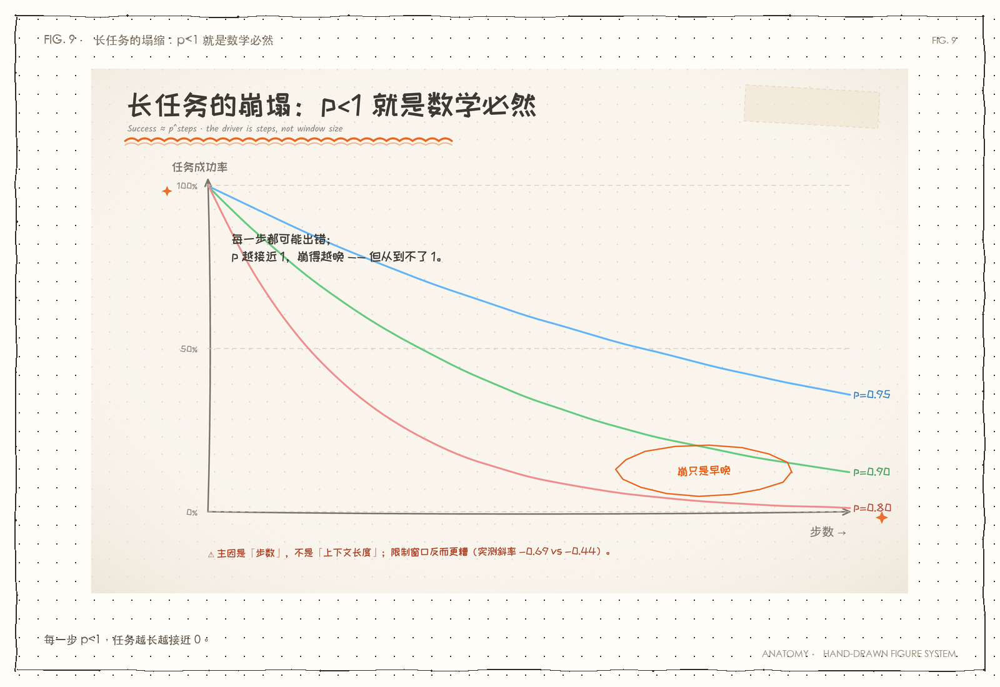

> 图 2｜横轴=步数，纵轴=任务成功率。三条曲线对应单步可靠率 p=0.95 / 0.90 / 0.80。
> **只要 p<1，步数一长，成功率必然趋于 0**——这是连乘的数学必然，不是运气。

#### 5.3 长时程的失败长什么样

**《HORIZON》**（证据强度：中）

- 失败模式不是「字面忘了」，而是**早期约束明明还在窗口里、却不再被注意到**
  ——叫「**有效忽视**」（effective inattention）。

> **工程含义**：问题不在「存不下」，在于「**注意力被稀释**」。

#### 5.4 测试时扩展（test-time scaling）

**《General AgentBench》**（证据强度：中）

- **什么是 test-time scaling**：推理时多花算力（多想几轮 / 采样多份再挑）来换质量。
- 从「领域专项」换成「通用 agent」后，性能**普遍显著下降**（例如某些指标 58% → 34%）；
- 顺序扩展 vs 并行扩展，各有各的天花板。

> ⇒ **长时程 / 通用化是当前 agent 的结构性弱点**，且**随模型变强改善有限**。

---

### 6. 证据五：自更正不是免费的午餐

**《LLMs Cannot Self-Correct Reasoning Yet》**（ICLR 2024）（证据强度：强）

- **内在自更正**（不给任何外部反馈，就让模型「再检查一遍」）在推理任务上**无法提升**，
  **有时反而更差**。

**《LLMs cannot find reasoning errors, but can correct them given the error location》**（ACL 2024）（证据强度：强）

- 把自更正拆成两步看，结论很清楚：
  - **找错**是瓶颈——模型普遍不擅长发现自己的错；
  - **纠错**很强——**只要告诉它错在哪**，表现明显提升。

> **对本项目的直接含义**：
> ① 「无脑 self-critique」不可信（呼应本项目 Evaluator-Critic 的实测教训）；
> ② 有效的自更正需要**外部信号 / 定位**——这恰好是 **Agent 脚手架**的用武之地。
> ⇒ **能力再强，也替代不了「外部可验证性」。**

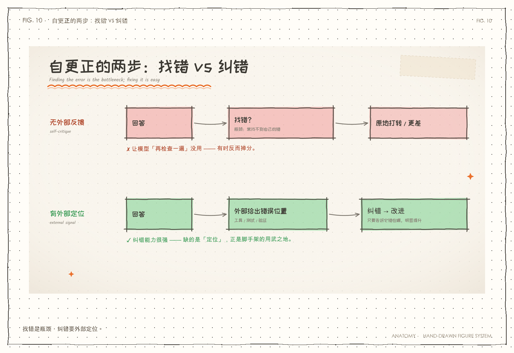

> 图 3｜上排=无外部反馈（自己检查）→ 原地打转甚至更差；下排=**有外部定位**→ 纠错立竿见影。
> **瓶颈在「找错」，不在「纠错」**——而这恰好是脚手架能补的位置。

---

### 7. 证据六：工具才是当前的价值中心

- **工具的价值占比**：全因子实验测得 **工具使用占脚手架总价值约 70%**（见 §2.1）。
- **工具调用的真实短板**（《WildToolBench》）（证据强度：中）：
  - **多步工具调用的准确率显著低于单步**；
  - 遇到**需要反问 / 澄清**的情况，模型**常常误触发一次函数调用**；
  - 结论：会用工具，不只是「能调」，还要「**懂用户什么意思**」。
- **可以靠工程改善**：结构化提示模板等做法，带来 3–12% 的相对提升（证据强度：中）。
- **工具太多会吃 token**：动态发现（如 MCP）会把工具说明塞进上下文——**本项目已实测**
  （见 `docs/04-协议章/MCP基础.md`）。

> ⇒ 工具接入**不是**「模型强了就自动变好」的维度——它是**工程问题**，而且是当前 agent 的**主要价值来源**。

---

### 8. 证据七：记忆与上下文管理长期仍是瓶颈

- **记忆综述**（《Memory for Autonomous LLM Agents》）（证据强度：强）：
  - 把记忆形式化为 **写入–管理–读取（write–manage–read）**回路；
  - 三维分类：时间尺度 / 表征 / **控制策略**；
  - **最关键的「控制策略」**（谁决定存什么、取什么、丢什么）**也最少被讨论**；
  - 未解难题：持续巩固、因果检索、可信反思、**学会遗忘**。
- **越堆记忆越糟**：有研究指出**无限制扩张的记忆是有害的**（错误会传播、污染后续判断）（证据强度：中）。
- **窗口 ≠ 记忆**：工程博客主张「更大窗口不解决记忆」，并提到 **context rot（上下文腐化）**——
  输入越长，模型越不可靠（证据强度：弱-中，厂商博客，但与 §5.1 / §5.2 一致）。

> ⇒ 记忆 / 上下文管理是**工程轴**，模型变强**不会自动解决**。

---

### 9. 汇总：各维度到底怎么变

| 维度 | 模型变强的影响 | 证据强度 | 关键出处 |
|---|---|---|---|
| **推理 / 规划（外置）** | ⬇️ **被替代**；乱堆 planning 甚至负收益 | 强 | 全因子实验 |
| **自更正（内在）** | ➡️ 仍弱；需要外部定位 / 反馈 | 强 | ICLR'24；ACL'24 |
| **工具使用** | ⬆️ 有改善但仍需工程；占价值 ~70% | 强-中 | 全因子实验；WildToolBench |
| **上下文 / 记忆管理** | ➡️ 不自动解决；越堆越糟的风险 | 强 | 记忆综述；Lost-in-the-Middle |
| **长时程可靠性** | ⬆️ 随规模升但**饱和**；几何崩溃 | 中-强 | How Fast Do Agents Rot?；MAST |
| **多 Agent 编排** | ➡️ 增益常被高估；失败率 ~66% | 强 | MAST |
| **工程类脚手架** | ⬆️ 相对价值**上升** | 强 | Confucius CCA |
| **结构敏感性** | 🔄 非单调，依模型类型 | 中 | Harness Sensitivity |

**读法**：⬆️ = 放大/改善｜⬇️ = 被替代｜➡️ = 基本无影响（仍需工程）｜🔄 = 无单调规律。

---

### 10. 对号入座：本项目的实测印证

本项目自己跑出来的结论，与上述文献**方向一致**：

| 本项目实测 | 对应文献 | 关系 |
|---|---|---|
| 显式规划「实测否决」（小任务无病、长链救不了） | **Planning Shapley 负值** | ✅ 独立印证 |
| 层级编排：慢工具下并行省 61–76%，快工具是纯负债 | 脚手架价值**有条件** | ✅ 一致 |
| 去中心化：信息分散时集中式 33% vs 100% | **信息获取是工程轴** | ✅ 一致 |
| Evaluator-Critic：自己批自己撞自我确认偏差 | **内在自更正无效** | ✅ 独立印证 |
| 「多 Agent 是成本结构」铁律 | **MAST 失败率 ~66%** | ✅ 一致 |

**文献补上的新认知（本项目此前没覆盖）**：

1. 「能力↑ ⇒ 结构需求↓」是**非单调**的——比本项目「条件性必要」更锋利；
2. 长时程崩溃由**步数**（不是上下文长度）驱动——影响未来的上下文策略；
3. 工具价值占脚手架 **~70%**——给「工具优先」提供了量化依据。

---

### 11. 工程结论（拿走就用）

把上面七条证据收敛成**能指导动手**的几条：

1. **先分清你要加的东西在哪个轴。** 加之前问一句：它替模型**想**，还是帮模型**够得着**？
   推理轴的，越强的模型越不吃这套；工程轴的，值得长期投入。
2. **模型升级时，「删脚手架」和「加固工程」同时做。** 别只加不减——
   全因子实验明确显示**乱堆组件是减分的**。
3. **工具 / 上下文 / 记忆 / 验证，是随模型变强反而更值钱的四块。**
   它们是**系统能力**，不是**智商**。
4. **别指望「更大窗口」解决长任务。** 主因是**步数**，出路是**控制步数 + 外部化状态**，
   不是硬塞更多 token。
5. **自更正要配外部信号。** 让模型「自己再想想」没用；让它「拿着错误定位去改」才有用。
6. **多 Agent 之前先算账。** 它买的是「单 Agent 做不到的事」（独立上下文、信息汇集、可审计），
   买不到就别买。

---

### 12. 诚实边界

1. **本文件是二手综述**，未逐篇复现实验；数字与结论以原文为准，可能存在引述偏差。
2. **部分来源时效极新**（2026 年的 arXiv 预印本），引用前**建议核对原文版本**；
   部分**未经同行评审**。
3. **部分结论有明确局限**：
   - 全因子实验 / Harness Sensitivity 都声明「每档位单模型代表」→ **不宜外推**；
   - 「步数而非长度」的结论**挑战**通行解释，**尚待更广复现**。
4. **厂商来源**（Anthropic、Redis、GitHub 博客）标注为【弱-中】，与论文分级对待；
   例如 Anthropic「多 Agent 提升 90.2%」是**内部研究**，无同行评审，**不应作为定论**。
5. §2.3 的「分轴」调和命题（推理轴被吃掉 / 工程轴被放大）是**本文件的综合判断**，
   **不是任何单篇原文的直接结论**。

---

### 13. 出处

> 下文 `arXiv:xxxx` 为论文编号，`arXiv` 是预印本平台；标「厂商」的为工程博客，证据强度降级看待。

**综述**
- *A Survey on LLM-based Autonomous Agents*（arXiv:2308.11432, v7 2025）
- *Evaluation and Benchmarking of LLM Agents: A Survey*（KDD'25, arXiv:2507.21504）
- *A Survey of Context Engineering for LLMs*（arXiv:2507.13334）
- *Memory for Autonomous LLM Agents*（arXiv:2603.07670）
- *A Survey on the Memory Mechanism of LLM-based Agents*（arXiv:2404.13501）

**脚手架 / 能力替代**
- *More Is Not Always Better: Cross-Component Interference in LLM Agent Scaffolding*（arXiv:2605.05716）
- *Confucius Code Agent*（arXiv:2512.10398）
- *It's Not the Capability: Harness Sensitivity Is Non-Monotone Across LLM Agent Tiers*（arXiv:2605.26731）
- *Agentless: Demystifying LLM-based Software Engineering Agents*（arXiv:2407.01489, FSE'25）

**多 Agent 失败**
- *Why Do Multi-Agent LLM Systems Fail?*（MAST, arXiv:2503.13657, NeurIPS'25）

**长时程 / 上下文**
- *Lost in the Middle: How Language Models Use Long Contexts*（TACL 2023）
- *How Fast Do Agents Rot?*（arXiv:2609.01660）
- *The Long-Horizon Task Mirage?*（HORIZON, arXiv:2604.11978）
- *Benchmark Test-Time Scaling of General LLM Agents*（arXiv:2602.18998）

**自更正**
- *LLMs Cannot Self-Correct Reasoning Yet*（ICLR 2024）
- *LLMs cannot find reasoning errors, but can correct them given the error location*（ACL Findings 2024）
- *When Can LLMs Actually Correct Their Own Mistakes?*（TACL 2024）

**工具使用**
- *Benchmarking LLM Tool-Use in the Wild*（WildToolBench, arXiv:2604.06185）
- *ACEBench*（EMNLP Findings 2025）；*Meta-Tool*（ACL 2025）

**测试时计算**
- *Learning When to Plan: Efficiently Allocating Test-Time Compute for LLM Agents*（arXiv:2509.03581）
- *A Survey of Test-Time Compute*（arXiv:2501.02497）

**厂商 / 工程博客**（证据级【弱-中】）
- Anthropic, *Building Effective Agents*（2024-12）；*Effective context engineering for AI agents*（2025-09）
- Redis, *Why a Bigger Context Window Won't Fix Agent Memory*

> 本讲来源：[模型能力与Agent编排.md](../99-番外/模型能力与Agent编排.md)

# 第六篇 · 下一步：从教学项目到 harness

从教学项目再往前走，需要事件日志、门禁、可视化和长任务能力。这一篇是“下一步”的入口，不是终点。

<a id="j-29"></a>
<a id="j-29"></a>
## 第 29 讲 · DSH 技术设计与实现

> 状态：✅ 已有

> 研究对象：本机 DSH Desktop **0.2.1-rc.2**（2026-10-17 构建）。
> 依据：DSH 包内 `README.zh.md`（设计说明）、源码地图、关键实现约定；
> app.asar 内是打包后的 `lib/*.js`，本文**没有逐行反编译**，而是按“设计文档 + 源码地图 + 关键机制”整理。
> 目的：为 `ai-agent` 提炼可吸收的技术点；具体落地见 [可吸收技术点与路线](可吸收技术点与路线.md)。


> **前情**：接着第 28 讲的问题往下走。  
> **本讲只回答**：生产级 harness 长什么样？  
> **读完后你能**：知道事件日志、门禁、状态和权限。  
> **下一讲**：第 30 讲会接着这个问题。

---

### 0. 一句话理解 DSH

> **DSH 不是“一个更聪明的 Agent”，而是一套“事件溯源 + 能力接口 + 插件组合”的 Agent 运行时。**

三根支柱：

1. **会话是事件日志**：发生的每件事按顺序写进 `Session`；模型历史、统计、UI、持久化都从日志算出来。
2. **能力是可替换接口（seam）**：工具、LLM、沙箱、审批、技能、子 Agent 都是注册表 + 提供方。
3. **组合是插件树**：`dsh-base` 提供核心插件，profile 决定装哪些；`agent-preset` 决定每个 Agent 装哪些子插件。

它和 LangGraph/CrewAI 的区别：DSH 不是“画图 DSL”，而是**运行时**——
会话、工具、权限、技能、子 Agent、后台任务、调度、目标，都是运行时的一部分。

它和你的 `ai-agent` 的区别：你的项目是**白盒教学实现**；DSH 是**生产级外壳**。
本文只吸收“机制”，不复制“体量”。

---

### 1. 总体架构

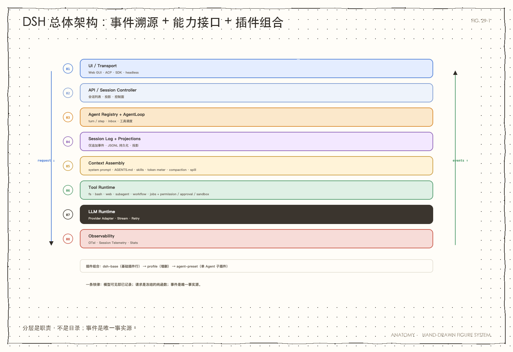

> 图 29-1｜分层是职责，不是目录；事件是唯一事实源。

#### 1.1 包的分组（按职责，不按目录）

| 组 | 代表包 | 职责 |
|---|---|---|
| **Agent 核心** | `dsh-agent`、`dsh-agent-loop` | Agent 句柄、轮次/步骤状态机、收件箱、工具调度 |
| **会话** | `dsh-session`、`dsh-session-persistence-jsonl`、`dsh-session-projection` | 事件日志、JSONL 持久化、投影 |
| **上下文** | `dsh-system-prompt`、`dsh-agent-instructions`、`dsh-token-meter`、`dsh-compaction-basic` | 提示词组装、AGENTS.md、计量、压缩 |
| **工具** | `dsh-tools`、`dsh-tool-fs`、`dsh-tool-bash`、`dsh-tool-web` | 工具注册、执行流水线、具体工具 |
| **权限** | `dsh-permission-presets`、`dsh-user-approval`、`dsh-sandbox` | 预设、一次性审批、进程沙箱 |
| **子 Agent** | `dsh-subagent`、`dsh-tool-subagent` | 委派、生命周期、fork/spawn |
| **编排** | `dsh-workflow`、`dsh-tool-workflow`、`dsh-workflow-ptc` | JS 编排脚本、扇出、PTC 执行 |
| **长任务** | `dsh-jobs`、`dsh-schedule`、`dsh-goal` | 后台任务、定时提醒、持久目标 |
| **技能** | `dsh-skill`、`dsh-skill-filesystem`、`dsh-tool-skill` | 技能注册表、本地发现、按需加载 |
| **LLM** | `dsh-llm`、`dsh-llm-deepseek`、`dsh-llm-retry` | Provider 无关流、DeepSeek 适配、重试 |
| **观测** | `dsh-otel`、`dsh-session-telemetry`、`dsh-session-stats` | OTel 通道、遥测、统计 |

> 组合方式：`dsh-base` 是一套基础插件行；profile 是“再加哪些、改哪些”；
> `agent-preset` 是“每个 Agent 挂哪些子插件”。这三层把“产品默认值”和“单 Agent 能力”分开了。

---

### 2. 核心循环：turn / step

#### 2.1 轮次与步骤

- **Turn（轮次）**：一次用户输入到 Agent 空闲。
- **Step（步骤）**：一次模型调用 + 它产生的工具调用。
- **Inbox（收件箱）**：用户消息、steering（中途引导）、排队工作；每次变更都写 `agent/inbox/*` 事件。

一个步骤的骨架：

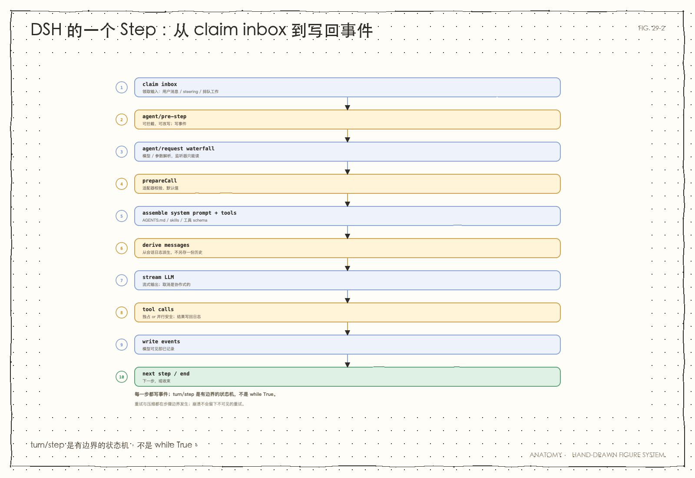

> 图 29-2｜turn/step 是有边界的状态机，不是 `while True`；重试与压缩都在步骤边界发生。

#### 2.2 关键设计

- **模型可见即已记录**：任何进入请求的内容都必须能从会话日志重建。
- **请求是冻结的纯函数**：Loop 构建的请求深度冻结；监听器和适配器只能读，不能改。
- **工具调用有“独占”和“并行安全”两种**：`maxParallelToolCalls` 限制并行安全调用；
  独占调用形成排序屏障。
- **取消是协作式的**：`agent.cancel()` 中止当前活动；已流式交付给用户的文本会保留；
  被取消的流写一条 `interrupted: true` 的 assistant 锚点。
- **重试在步骤边界**：`dsh-llm-retry` 先写“计划重试”的事件，再等；崩溃不会留下不可见的重试。
- **压缩在步骤边界**：token 压力升高 → 压缩旧历史；上下文溢出 → 压缩后重试。

> 教学点：**Agent 的“循环”不是 `while True`，而是一个有明确边界的 turn/step 状态机。**
> 你的 `core.py` 现在是 `for step in range(...)`；DSH 把它拆成了可观测的事件与可恢复的状态。

---

### 3. 会话 = 事件溯源

#### 3.1 什么是事件溯源（一句话）

> 不存“当前状态”，存“发生过的每件事”；当前状态 = 从头折叠这些事件。

DSH 的 `Session` 是**仅追加**的类型化事件日志。模型历史、transcript、统计、标题、
持久化、UI 投影，全部从这条流派生。

#### 3.2 事件家族（示例）

| 家族 | 例子 | 作用 |
|---|---|---|
| 会话 | `session/created`、`session/flush`、`session/disposed` | 生命周期 |
| 轮次 | `turn/start`、`turn/end` | 一轮的边界 |
| 步骤 | `step/start`、`step/end` | 一步的边界 |
| 消息 | `user/message`、`assistant/message`、`system/message` | 模型可见内容 |
| 尝试 | `assistant/attempt` | 失败/重试/取消，不进模型历史 |
| 工具 | `tool/call`、`tool/result` | 工具执行 |
| 压缩 | `compaction/start`、`compaction/summary`、`compaction/prune` | 上下文压缩 |
| Agent | `agent/inbox/*`、`agent/request*`、`agent/created` | 驱动器状态 |
| 子 Agent | `subagent/descriptor`、`subagent/catalog` | 委派与目录 |
| 目标 | `goal/change` | 持久目标 |

#### 3.3 Surface（模型可见面）

- `surface` 是“从事件日志算出的当前模型可见视图”。
- 压缩会**隐藏**被取代的条目，但**不删除**它们；原始事件仍在日志里。
- `replaceGeneration` / `contentGeneration` 跟踪“位置替换”和“插件拥有的消息变更”。
- 回放可以精确恢复“当时模型看到了什么”。

#### 3.4 持久化

- 每个会话一个 **JSONL** 日志；默认 Zstandard 压缩帧 + 校验和。
- **单写者**：每个会话一个写句柄，跨进程用文件锁。
- **崩溃恢复**：撕裂尾部可修复；中断的轮次补写 `step/end`。
- **格式代际**：读取器拒绝退役格式；迁移链在构造 `Session` 前转换。
- **fork**：只闭合开放尾部，不修复已闭合步骤的缺失结果。

#### 3.5 投影（Projection）

- 投影是“从已提交事件折叠出的当前值”，例如 `sessionStats`、`tokenUsage`、`contextPressure`、`contextBreakdown`、todos、goals。
- 投影有 `asOfSeq`：快照标明“反映到哪个事件”，客户端可把状态与历史切面对齐。
- 为什么重要：**UI 不需要重放原始日志**；它读投影。
  这也是你做“Agent 交互动画”的关键——动画可以订阅投影/事件，而不是自己猜状态。

---

### 4. 上下文工程

#### 4.1 系统提示词是“组装”出来的

`dsh-system-prompt` 是注册表 + 组装流水线：

- 全局层 + agent 作用域层；
- 段（segment）按数值/名称排序；
- `system-prompt/assemble` waterfall 可插入/替换；
- 工具 schema 属于组装结果（“模型获知自己能做什么”是一个整体）；
- 无效组合/未解析变量会**组装失败**，不会发格式错误的提示词。

#### 4.2 AGENTS.md 是“持久对话内容”

`dsh-agent-instructions`：

- 读用户全局 + 项目级 `AGENTS.md` / `CLAUDE.md`；
- 从项目根到 cwd 的指令链，按“宽泛 → 具体”排序；
- 字节预算：宽泛文件先省略，具体文件最后截断；
- 注入是普通的带来源 `user/message` 事件，**可回放、可压缩、可恢复**；
- 没有 watcher：成功的 `read/write/edit` 或恢复对账时刷新。

#### 4.3 Token Meter：给每个决策定价

`dsh-token-meter`：

- 回放持久日志，结果确定，不调用模型；
- 有提供方用量且 envelope 完全匹配 → 用精确值；否则用固定启发式（约 4 字符/token + 结构开销）；
- 提供 `tokenUsage`、`contextPressure`、`contextBreakdown` 三个投影；
- 压缩、占用显示、遥测共享同一套测量。

#### 4.4 Compaction：旧历史摘要，不删日志

`dsh-compaction-basic`：

- token 压力上升 → 把最旧的历史摘要，保留近期消息；
- 上下文溢出 → 压缩后重试；
- `/compact` 手动触发；
- 摘要请求复用提供方的热前缀（系统提示词 + 工具 + 被遮蔽消息），只让尾部指令和摘要输出未缓存；
- 工具结果修剪器（`dsh-compaction-tool-result-pruner`）只做确定性头/尾裁剪，不调用模型；
- spill（`dsh-spill` / `dsh-spill-policy`）：超大结果存文件，模型只拿有界预览 + 定位信息。

> 一句话：**上下文不是“聊天记录”，是一个有预算、有计量、有压缩策略的工程对象。**

---

### 5. 工具系统

#### 5.1 工具定义

`dsh-tools` 的 `defineTool` 声明：

- 类型化参数与输出；
- 协作式超时（声明不等于强制，强制由 timeout-policy 包装层做）；
- 并行安全属性；
- UI 呈现意图（card）。

模型只看到 `name / description / parameter schema`；`execute`、`finalizeContent`、`timeoutMs` 不会泄漏到协议。

#### 5.2 执行流水线

```
tools/pre-execute（允许/拒绝/询问）
  → 已注册单调守卫
  → tools/execute（环绕分发）
  → tools/post-execute（检查/替换/附加上下文）
  → finalizeContent（工具定义拥有）
  → tools/result（仅观测）
```

关键：**只有 `tools/execute` 视图可以替换信号**；`pre-execute` 不允许改写参数，
否则“记录的参数”和“实际运行的参数”会失去同步。

#### 5.3 权限 / 审批 / 沙箱

- **权限预设**（`dsh-permission-presets`）：把“沙箱模式 + 审批策略”捆成具名模式；
  不匹配的组合显示为 `custom`。
- **审批**（`dsh-user-approval`）：一次性 `ask` / 直接拒绝 `never`；
  应答者缺失/失败 → `unavailable`，**拒绝关闭**；没有 `allow-always`。
- **沙箱**（`dsh-sandbox`）：`read-only` / `workspace-write` / `danger-full-access`；
  无法强制执行 → `SANDBOX_UNAVAILABLE`，**绝不静默放行**；
  被拒后可请求“严格更宽”模式，交由人工批准一次。
- **文件观察策略**（`dsh-fs-observation-policy`）：先读后写；
  文件自读取后变化 → 拒绝并提示重读；这是**事件门禁**，不是方法服务。

> 教学点：**工具是执行器，策略是门禁。** 工具不该自己判断“能不能写”，
> 它只请求防护；策略由独立插件决定。这样权限可以换、可以审计、可以测试。

#### 5.4 后台任务

`dsh-jobs`：

- 每个 job 有 `<kind>-<short-uuid>`；
- 归属绑定 agent 会话，别的 agent 看不到/停不了；
- 有输出环、等待、取消、完成通知；
- `dsh-tool-bash` 的每条命令从启动起就是一个 job（`run_in_background` / 超时转后台）。

---

### 6. 多 Agent / 编排

#### 6.1 Agent 与驱动分离

- `dsh-agent`：公开 `Agent` 接口 + 注册表；不创建模型请求。
- `dsh-agent-loop`：真正的 `ReactLoopAgent` 驱动器；通过工厂注册。
- 消费方依赖 `dsh-agent`，不依赖 `dsh-agent-loop` → 驱动器可替换。
- `AsyncLocalStorage` 把“发起方 Agent”带过异步调用，辅助函数不需要逐调用转发。

#### 6.2 Subagent：一个服务，多个提供方

- `SubagentManager` 统一管理启动、消息准入、容量、父子关系、释放；
- 本地 **spawn / fork** 保留持久会话，可继续发消息；
- 外部后端（ACP、DSH SDK、Codex、Claude Code）执行一次，通过完成通知返回；
- 有深度限制；fork 继承父级模型/路由（为了 KV Cache 前缀复用）；
- 没有持久 parent mailbox：child 给 parent 发消息要求 parent 在线。

#### 6.3 Workflow：模型写的 JS 编排脚本

- `agent()`、`parallel()`、`pipeline()`、`phase()`、`log()` 五个钩子；
- 前台执行，等待所有子 Agent；取消/异常返回错误，不返回部分成功；
- 没有 checkpoint；没有跨子 Agent 的 token 预算；没有嵌套 workflow；
- PTC 引擎在独立 Node 进程里跑，文件约束继承沙箱策略。

> 对比你的项目：你的 Router/Worker/Fan-out 是“手写编排”；
> DSH 把它抽象成“编排脚本 + 子 Agent 服务”。机制值得吸收，但**不要照搬 JS VM**。

#### 6.4 Jobs / Schedule / Goal

- **Jobs**：后台任务，进程内注册表，按会话归属。
- **Schedule**：一次性/周期/每日/每周/cron，投递回原会话；宿主重启后仍可用。
- **Goal**：每个会话一个持久目标；create/edit/pause/resume/complete/block；
  `maxGoalRounds` 限制自动续行；**只存状态，不调度工作**。

> 这三个是“长任务”的三块拼图：后台执行、定时唤醒、跨轮目标。
> 你的项目目前只有“一轮内循环”，这块是明显空白。

---

### 7. Skill 系统

#### 7.1 注册表 + 提供方

- `dsh-skill`：注册表，负责合并、重名裁决、验证、按需加载；
- `dsh-skill-filesystem`：本地提供方，扫描：
  - `<project>/.dsh/skills`
  - `<project>/.agents/skills`
  - `~/.dsh/skills`
  - `~/.agents/skills`
- 发现深度一层：`<name>/SKILL.md` 或 `<name>.md`；
- YAML frontmatter：`name`、`description`，可选 `whenToUse`、`metadata`、`disable-model-invocation`、`user-invocable`；
- 目录与正文分离：目录只放名称+描述；正文按需加载。

#### 7.2 渐进披露（progressive disclosure）

- Agent 首次请求前拿到一份**持久目录**（名称 + 有长度上限的描述）；
- 需要时用 `skill` 工具加载正文；
- 用户可以用 `/name` 直接调用；
- 好处：不把所有技能正文塞进 prompt；目录小、正文按需。

> 你的项目已经有 `AGENTS.md` 和项目级 `.dsh/skills`；但 `ai-agent` 自己的 Python 运行时还没有“技能目录 + 按需加载”。
> 这是一个低成本、可教学化的吸收点。

---

### 8. LLM 层

#### 8.1 Provider 无关

`dsh-llm`：

- 定义规范消息、内容块、流式分片词汇；
- 每个 provider adapter 只把自己的协议翻译成这套词汇；
- 一次流只尝试一次；重试由 `dsh-llm-retry` 在步骤边界做；
- 不提供缓存/限流；
- 请求深度冻结，Loop 构建的请求是会话日志的纯函数。

#### 8.2 DeepSeek 适配器

`dsh-llm-deepseek`：

- Messages、推理、图片输入；
- 默认模型目录公布 **`deepseek-flash`**（不是 V4）；
- 不映射 `tool_choice`；
- 历史内 system 更新有排序约束；
- 图片是输入附件，不支持外部 URL / assistant 图片输出。

> 你提到“DeepSeek V4”：**当前这版 DSH 的默认目录里是 `deepseek-flash`**；
> V4 需要 provider/model 配置或适配器支持。可视化/吸收时不要把模型名写死。

---

### 9. 可观测性

- `dsh-otel`：普通事件 + Session 日志两个独立 OTLP 通道；每通道独立 exporter/resource/scope/队列；尽力而为，可能丢。
- `dsh-session-telemetry`：捕获有序会话副本，支持脱敏规则；交接非阻塞；崩溃可能丢队列。
- `dsh-session-stats`：全会话轮次/步骤/LLM/工具/首 token/解码墙钟；来自完整日志，压缩/分页不影响。

> 关键：**观测不是另装一套埋点，而是从同一份事件日志派生。**
> 你做可视化时也应该这样：动画读事件/投影，不要另写一套“猜测状态”的代码。

---

### 10. 设计原则（最值得学的）

1. **事件溯源**：先记录，再派生；模型可见即已记录。
2. **能力接口（seam）**：注册表 + 提供方；消费方依赖接口，不依赖实现。
3. **策略与机制分离**：工具执行 vs 权限门禁；FS 工具 vs 观察策略；沙箱 vs 审批。
4. **失败关闭**：沙箱不可用、审批不可用 → 拒绝，不静默放行。
5. **有界输出**：工具结果有预算；超大有 spill；上下文有 compression。
6. **渐进披露**：技能目录小、正文按需；AGENTS.md 按预算；压缩保留近期。
7. **显式生命周期**：owner、dispose、单写者、取消、结算。
8. **前台/后台显式**：workflow 前台；jobs 后台；schedule 宿主级；goal 只存状态。
9. **可替换驱动器**：Agent 接口与 Loop 实现分离。
10. **配置即组合**：profile/preset 决定装什么，而不是在代码里 if/else。

#### 代价

- 包多、概念多、配置面大；学习曲线陡。
- 事件溯源要求“所有模型可见内容都可重建”，对插件作者是硬约束。
- 投影/压缩/持久化/权限的交互复杂，测试成本高。
- 对 5000 行的教学项目，**不能整套照搬**；只能吸收“契约与机制”。

---

### 11. 源码地图与阅读顺序

#### 11.1 如果只读 3 个包

1. `dsh-agent-loop`：轮次/步骤/工具调度。
2. `dsh-session`：事件日志/surface/持久化语义。
3. `dsh-tools`：工具注册/执行流水线/权限门禁。

#### 11.2 推荐顺序

| 顺序 | 包 | 看什么 |
|---|---|---|
| 1 | `dsh-agent-loop` | `src/agent.ts`（状态机）、`src/inbox.ts`、`src/tool-calls.ts` |
| 2 | `dsh-session` | `src/types.ts`（事件）、`src/surface.ts`（派生历史）、`src/repair.ts` |
| 3 | `dsh-session-persistence-jsonl` | `src/storage.ts`、`src/format.ts`、`src/generation.ts` |
| 4 | `dsh-session-projection` | `src/index.ts`（快照/变更） |
| 5 | `dsh-agent-instructions` | `src/files.ts`、`src/render.ts`、`src/state.ts` |
| 6 | `dsh-system-prompt` | `src/index.ts`（组装流水线） |
| 7 | `dsh-token-meter` | `src/estimate.ts`、`src/surface-fold.ts` |
| 8 | `dsh-compaction-basic` | `src/region.ts`、`src/summarizer.ts` |
| 9 | `dsh-tools` | `src/index.ts`（流水线）、`src/schema.ts` |
| 10 | `dsh-tool-fs` + `dsh-fs-observation-policy` | 读/写/编辑 + 先读后写 |
| 11 | `dsh-permission-presets` / `dsh-user-approval` / `dsh-sandbox` | 预设/审批/沙箱 |
| 12 | `dsh-subagent` | `src/manager.ts`、`src/activation.ts` |
| 13 | `dsh-workflow` / `dsh-workflow-ptc` | 脚本钩子、PTC 进程 |
| 14 | `dsh-skill` / `dsh-skill-filesystem` / `dsh-tool-skill` | 注册表/发现/按需加载 |
| 15 | `dsh-llm` / `dsh-llm-deepseek` / `dsh-llm-retry` | 流/适配/重试 |
| 16 | `dsh-otel` / `dsh-session-telemetry` | 上报/脱敏 |

---

### 12. DSH 不做什么（避免误读）

- **不是模型**：它不训练、不推理；推理在 LLM provider。
- **这套发行版里没有看到内置的向量长期记忆包**：会话日志 + 压缩 + 指令/技能，不是 RAG。
  你的 Chroma 记忆是**差异化优势**，不要为了“像 DSH”而丢掉。
- **没有 workflow checkpoint**：workflow 进程重启后不能续跑。
- **没有跨子 Agent token 预算**：workflow 限制并发/条目，但不统计 token。
- **没有 goal 调度**：goal 只存状态；续行由 `dsh-goal-round-driver` 等消费方决定。
- **没有 MCP prompts 模板**：MCP 工具/资源有，prompt 模板不支持。
- **审批没有 `allow-always`**：只有一次性授权。
- **沙箱只管文件**：不表达网络/进程/系统调用限制。
- **DeepSeek 适配器不映射 `tool_choice`**。

> 这些“没做”的地方，有些是你的机会：比如向量记忆、评测 rigor、教学可视化。

---

### 13. 对 ai-agent 的三条启示

1. **先把“事件日志”做出来**：它是可视化、回放、评测、恢复、成本的共同底座。
2. **把“策略”从工具里拆出来**：工具只执行；权限/审批/沙箱是独立门禁。
3. **不要复制体量，复制契约**：`Agent` 接口、`Tool` 接口、`Session` 事件、`Skill` 目录，
   这四个契约足够撑起下一阶段的深度。

具体怎么落到你的项目，见下一篇：[可吸收技术点与路线](可吸收技术点与路线.md)。

> 本讲来源：[DSH技术设计与实现.md](../07-DSH研究/DSH技术设计与实现.md)

---

<a id="j-30"></a>

## 第 30 讲 · 从 DSH 吸收什么：路线

> 状态：✅ 已有

> 配套：[DSH 技术设计与实现](../07-DSH研究/DSH技术设计与实现.md)
> 目标：不把 `ai-agent` 改成 DSH 的克隆，而是吸收**契约、机制、边界**，
> 让它从“能跑的教学 demo”长成“能解释、能回放、能恢复、能审计”的白盒 Agent。
> 原则：**只吸收能回答你现有问题的机制；不复制体量。**


> **前情**：接着第 29 讲的问题往下走。  
> **本讲只回答**：从 DSH 吸收什么？  
> **读完后你能**：知道哪些机制值得搬、哪些不该搬。  
> **下一讲**：第 31 讲会接着这个问题。

---

### 一、先立三条原则

1. **复制契约，不复制框架。**
   DSH 的 50+ 包是产品化的结果；你只需要 `Agent / Tool / Session / Skill` 四个契约。
2. **先记录，再优化。**
   没有事件日志，压缩、恢复、可视化、评测都只能“猜”。事件日志是第一块多米诺。
3. **保留你的白盒优势。**
   `minimal.py`、实测账、负结果、中文讲义，是 DSH 没有的；不要为了“像 DSH”而丢掉。

---

### 二、总表：DSH 机制 → 你的项目

| DSH 机制 | `ai-agent` 现状 | 吸收？ | 难度 | 优先级 |
|---|---|---|---|---|
| 事件溯源会话日志（JSONL） | `Tracer` 只在内存/终端 | ✅ **强烈建议** | 中 | **P0** |
| Token meter + context breakdown | 每个 Agent 累加 `usage` | ✅ **强烈建议** | 低-中 | **P0** |
| 工具执行流水线（pre/execute/post/finalize） | `core.py` 直接 `fn(**args)` | ✅ **强烈建议** | 中 | **P0** |
| 输出保留 / spill（大结果存文件） | 头尾截断 | ✅ 建议 | 低-中 | P1 |
| 子 Agent 隔离（spawn/fork） | Router/Worker 共享实例与 history | ✅ **强烈建议** | 中 | P1 |
| 压缩（旧历史摘要 + 工具结果修剪） | `trim_history` 丢旧消息 | ✅ 建议 | 中 | P1 |
| 会话恢复 / 投影 / fork | 无 | ✅ 建议 | 中 | P1 |
| 权限预设 / 一次性审批 / 沙箱 | 只有 calculator 白名单 | ✅ 建议（加 shell/文件工具前必做） | 中-高 | P1 |
| Skill 目录 + 按需加载 | 只有静态 docs | ✅ 可选 | 低-中 | P2 |
| Workflow 脚本编排 | 手写 `_fanout_parallel` | 🟡 可选（用 Python，不搬 JS VM） | 中 | P2 |
| Jobs 后台任务 | 只有 memory 后台线程 | 🟡 可选 | 中 | P2 |
| Goal / Schedule | 无 | 🟡 以后 | 中 | P2 |
| OTel / Session Telemetry | Langfuse | 🟡 保留 Langfuse，先不重做 | 低-中 | P3 |
| MCP resources / prompts | 基础 MCP | 🟡 以后 | 中 | P3 |
| Plan mode / 审批式规划 | 无 | 🟡 以后 | 低-中 | P3 |
| Cordis 插件组合 / 50+ 包 | 单 Python 代码库 | ❌ **不吸收** | 高 | — |

---

### 三、P0：三块“地基”（建议 3–5 天）

#### P0-1 事件日志：把 `Tracer` 变成可回放的 JSONL

**为什么**：可视化、恢复、评测、成本归因，全都需要同一份事件流。
**DSH 对应**：`dsh-session` + `dsh-session-persistence-jsonl`。

**最小实现**：

```
agent/events.py        # 事件 schema + EventBus + NullSink
agent/session_log.py   # JSONL 写入 / 读取 / 回放
agent/tracing.py       # 保留终端打印；新增 sink 订阅
```

事件类型（先 12 个）：

| type | 关键字段 |
|---|---|
| `run_start` | model / tools / system_hash |
| `context_built` | system / memory / history / est_tokens |
| `llm_request` | messages / tools / temperature |
| `llm_response` | content / tool_calls / usage / finish_reason |
| `tool_call` | name / args |
| `tool_result` | result / truncated / duration_ms / observation |
| `memory_search` | query / top_k / scores / selected |
| `memory_write` | keep / text / tags |
| `router_decision` | prefilter / reason / tasks |
| `budget_warning` | remaining |
| `answer_step` | forced |
| `error` / `run_end` | where / message / answer / total_tokens |

**验收**：
- 跑一次 `minimal.py`，生成 `runs/<run_id>.jsonl`；
- 能按顺序打印 10+ 事件；
- 不写入 `.env`、密钥、完整用户隐私。

**产出**：`docs/03-实战章/事件日志.md` + 一份真实 run 的 JSONL。
**代价**：事件 schema 会改；从第一天就写 `v: 1`。

---

#### P0-2 Token meter + Context snapshot

**为什么**：你需要回答“这次模型到底看到了什么、token 花在哪”。
**DSH 对应**：`dsh-token-meter` + `dsh-system-prompt` 的组装结果。

**最小实现**：

```
agent/token_meter.py   # 估算 + 精确 usage
agent/context.py       # 组装 system/memory/history/tool，产出 breakdown
```

**输出**：

```
system:   420 tokens
memory:   180 tokens (3 条)
history: 2100 tokens (8 条)
tools:    260 tokens
user:      35 tokens
------------------------
prompt:  2995 tokens
completion: 210 tokens
```

**验收**：
- 与 API 返回的 `usage.prompt_tokens` 对比，误差在可接受范围；
- 能解释“第二次 LLM 调用为什么 prompt token 变多”；
- 能把 breakdown 写进 `context_built` 事件。

**代价**：估算不是精确分词；用“精确 usage 优先，估算兜底”的策略。

---

#### P0-3 工具执行流水线 + 结果保留

**为什么**：现在 `core.py` 直接调函数；没有“允许/拒绝/询问”，
没有“执行前/后钩子”，没有“结果保留策略”。加 shell/文件工具前必须有。
**DSH 对应**：`dsh-tools` + `dsh-output-retention` + `dsh-spill`。

**最小实现**：

```
agent/tool_runtime.py   # define_tool / pre_execute / execute / post_execute / finalize
agent/retention.py      # 头尾保留 + 省略提示
agent/spill.py          # 超大结果写文件，返回路径/字节数
```

**流水线**：

```
pre_execute（allow / deny / ask）
  → execute（真正的函数）
  → post_execute（检查/替换/附加上下文）
  → finalize（统一成 {ok,data,error,truncated,raw_len}）
  → 写 tool_result 事件
```

**验收**：
- 一个危险工具被 `deny`，模型看到原因，不崩；
- 一个超大结果被截断，文件路径可查；
- 工具异常不终止整轮，返回结构化错误。

**代价**：多一层抽象；但对“加工具”是长期收益。

---

### 四、P1：让 Agent 更“稳”（建议 1–2 周）

#### P1-1 子 Agent 隔离

**现状问题**：`multi_agent.py` 的专家是共享单例，`_plan()` 必须按 expert 去重，
否则并发会争用同一个 `history`；这是“结构 bug 被兜底掩盖”。
**DSH 对应**：`dsh-subagent` 的 spawn / fork + managed activation。

**最小实现**：

```
agent/subagent.py   # 每个子任务一个独立 Agent（fresh history）
                    # parent_run_id / child_run_id / depth
                    # 完成事件 / 结果返回
```

**要抄的**：
- 子 Agent 有独立 `history`、独立 `usage`；
- 父级只拿结果，不共享上下文；
- 深度上限；
- 完成通知，不靠轮询。

**不要抄的**：本地/外部多 provider、持久 inbox、在线 parent mailbox。

**验收**：两个子 Agent 看不到彼此的 history；父级能拿到两份结果并 merge。

---

#### P1-2 压缩 + 恢复

**现状问题**：`trim_history` 直接丢旧消息；没有摘要，没有“原始日志仍可查”。
**DSH 对应**：`dsh-compaction-basic` + `dsh-compaction-tool-result-pruner` + `dsh-session-persistence-jsonl`。

**最小实现**：

```
agent/compaction.py    # 旧历史摘要 + 保留近期
agent/retention.py     # 工具结果头尾修剪（P0-3 已有）
agent/session_log.py   # 从 JSONL 恢复
```

**验收**：
- 长对话超过预算时，摘要旧历史，不丢原始 JSONL；
- 进程重启后，能从 JSONL 恢复到上一步；
- 压缩后仍能回答“之前说过什么”。

**代价**：摘要要额外一次 LLM 调用；摘要也会错，必须保留原始日志。

---

#### P1-3 权限 / 审批 / 沙箱

**现状问题**：只有 calculator 白名单；没有 shell/文件工具，所以还不痛。
但一旦加 `bash`/`write`，这就是必须先做的。
**DSH 对应**：`dsh-permission-presets` + `dsh-user-approval` + `dsh-sandbox`。

**最小实现**：

```
agent/policy.py   # 预设：read-only / workspace-write / danger
                  # 审批：ask / never；一次性 allow
                  # 工具级策略：allow / deny / ask
```

**原则**：
- **失败关闭**：审批不可用 → 拒绝；
- **一次性授权**：不做 `allow-always`；
- **严格更宽**：被拒后只能申请“更宽一档”，人工批准一次；
- **工具是执行器，策略是门禁**：不要把 `if dangerous` 写进工具函数。

**验收**：危险工具默认拒绝；人工批准一次才执行；日志里有审批记录。

---

#### P1-4 Skill 目录（可选）

**现状**：docs 是静态的；没有运行时目录。
**DSH 对应**：`dsh-skill` + `dsh-skill-filesystem` + `dsh-tool-skill`。

**最小实现**：

```
skills/<name>/SKILL.md   # frontmatter: name/description
agent/skills.py          # 扫描 + 目录（名称+描述）
agent/tools/skill.py     # load_skill(name) -> 正文
```

**验收**：目录只放名称+描述；正文按需加载；不把所有正文塞进 prompt。

> 你现在的 `.dsh/skills/` 已经是这个形态；把它“搬进 ai-agent 运行时”即可，
> 但优先级低于事件日志/工具流水线。

---

### 五、P2：长任务与编排（可选，别急）

| 机制 | 怎么吸收 | 不要抄什么 |
|---|---|---|
| **Workflow** | 用 Python 函数 + JSON DAG 表达 `agent/parallel/pipeline/phase`；不要 JS VM | 不要 PTC/VM/跨 realm |
| **Jobs** | 一个 `JobRegistry`：id、owner、输出环、wait/cancel | 不要持久化跨进程 |
| **Goal** | 一个 `GoalState`：目标、状态、轮次上限 | 不要自动调度器 |
| **Schedule** | 先用系统 cron/launchd，不要自己写调度器 | 不要宿主级恢复 |
| **OTel** | 保留 Langfuse；需要标准时再映射 OTel GenAI | 不要重做 exporter/脱敏 |
| **MCP 进阶** | 先加 `resources`；prompts 以后 | 不要 server 生命周期管理 |
| **Plan mode** | 一个 `plan` 步骤 + `exit_plan_mode` 工具 + 审批 | 不要 UI 评审器 |

---

### 六、不要吸收的（明确写下来）

1. **Cordis 插件组合 / 50+ 包**：你的项目是单 Python 代码库，教学清晰度优先。
2. **会话格式代际 / Zstd / 跨平台文件锁**：除非你要做生产级持久化。
3. **完整 Web/Transport/ACP/UI**：可视化是独立模块，不要把 UI 塞进 `core.py`。
4. **Windows ACL / Seatbelt 细节**：先用“拒绝危险工具 + 工作区白名单”够用。
5. **Provider 专属 hack**：DeepSeek/OpenAI 兼容层保持薄。
6. **PTC / JS VM**：教学项目不需要“模型写代码再执行”的额外攻击面。

---

### 七、你已经有、且比 DSH 更适合教学的东西

| 你的资产 | 为什么别丢 |
|---|---|
| `minimal.py` 88 行 | DSH 没有“一口气读完”的入口 |
| 实测账 / 负结果 | DSH 文档是设计说明，不是实验记录 |
| Chroma 向量记忆 | DSH 这套发行版**没有内置向量记忆包**；这是你的差异化 |
| 问题清单 40 条 | 真实踩坑，比“最佳实践”有用 |
| 中文讲义 + 手绘图 | 面向学习者，不是 reference manual |
| `teaching-doc` / `hand-drawn-diagram` skill | 你的文档生产流程比 DSH 更适合你 |

> 吸收 DSH 的目的是**加深**，不是**替换**。

---

### 八、4 周路线（建议）

#### Week 1：事件日志 + Token Meter + Context Snapshot

- 交付：`agent/events.py`、`agent/session_log.py`、`agent/token_meter.py`、`agent/context.py`
- 产出：一次真实 run 的 JSONL + 一张 token breakdown 表
- 验收：能回放事件顺序；能解释 prompt token 组成
- 风险：schema 反复改 → 先 `v:1`，只记录 12 个事件

#### Week 2：工具流水线 + 输出保留 + 权限门禁

- 交付：`agent/tool_runtime.py`、`agent/retention.py`、`agent/policy.py`
- 产出：一个“危险工具被拒绝 / 大结果被截断 / 审批一次”的 demo
- 验收：工具异常不崩；危险动作默认拒绝
- 风险：抽象过度 → 只做 allow/deny/ask 三态

#### Week 3：子 Agent 隔离 + 压缩/恢复

- 交付：`agent/subagent.py`、`agent/compaction.py`、JSONL 恢复
- 产出：Router/Worker 的“共享 vs 隔离”对照实验
- 验收：子 Agent 历史不串；长对话能压缩；重启能恢复
- 风险：压缩引入新错误 → 保留原始日志

#### Week 4：Skill 目录 + Jobs/Workflow + 可视化 P1

- 交付：`agent/skills.py`、`agent/jobs.py`、`visualizer/` 的 P1 回放
- 产出：60 秒 `minimal.py` 回放 + 一个技能目录 demo
- 验收：目录不塞正文；回放能讲清 4 个场景
- 风险：UI 膨胀 → 单文件、4 场景

---

### 九、如果只有 3 天：最小吸收

1. **Day 1**：事件日志（P0-1）。
2. **Day 2**：Token Meter + Context Snapshot（P0-2）。
3. **Day 3**：工具流水线 + 输出保留（P0-3）。

这三块做完，你就有了：
- 可回放的 run；
- 可解释的 token；
- 可审计的工具。

可视化、压缩、恢复、子 Agent 隔离，都可以在这三块上长出来。

---

### 十、和可视化模块的关系

| 可视化场景 | 依赖的吸收项 |
|---|---|
| 上下文装配 | P0-2 Context Snapshot |
| LLM 调用 / token 流 | P0-1 事件 + P0-2 Token Meter |
| 工具调用 / 截断 | P0-3 工具流水线 + 输出保留 |
| 循环 / 预算 | P0-1 `budget_warning` / `answer_step` |
| 记忆召回/写入 | P0-1 `memory_*` 事件 |
| 子 Agent 分支 | P1-1 子 Agent 隔离 |
| 恢复/回放 | P1-2 JSONL + 压缩 |

> 先做 P0-1/P0-2，再做可视化 P1；不要反过来。

---

### 十一、验收：6 个问题

1. 能从 JSONL 回放一次 run 的 10 个事件吗？
2. 能说清 prompt token 的组成吗？
3. 能拒绝一个危险工具，并让模型看到原因吗？
4. 两个子 Agent 能互不污染历史吗？
5. 长对话压缩后，原始日志还在吗？
6. 重启后能从上一步恢复吗？

> 答上 4 个：可以开始做可视化 P1；答上 6 个：你的 `ai-agent` 已经有“小型 harness”的骨架。

---

### 十二、一句话收口

> **DSH 教你的是“把 Agent 当成一个有日志、有契约、有门禁、有生命周期的系统”；
> 你要保留的是“用 88 行讲清本质”的教学能力。**
> 两者不冲突：先补事件日志，再补门禁，最后才补编排体量。

> 本讲来源：[可吸收技术点与路线.md](../07-DSH研究/可吸收技术点与路线.md)

<a id="j-31"></a>
## 第 31 讲 · 交互可视化：把流程拍下来

> 状态：✅ 设计稿

> 设计稿 · 2026-10-19；P1/P2 原型 2026-10-21
> **P1/P2 原型**：[`visualizer/index.html`](../../visualizer/index.html)（三套真实 trace：开发小工具 / 记忆+2工具+Extractor/Guard / minimal，时序图回放，支持时序/结构切换，可直接打开）
> 目标：把 harness 与 LLM 的交互过程做成**可回放、可步进**的动画，
> 用来学懂 Agent 的整个流程。
> 边界：只可视化**真实可观测**的接口层，不假装展示模型内部神经元。


> **前情**：接着第 30 讲的问题往下走。  
> **本讲只回答**：怎么把 Agent 流程拍下来？  
> **读完后你能**：理解回放、时序和可视化。  
> **下一讲**：第 32 讲会接着这个问题。

---

### 1. 先定目标：这是教学工具，不是监控产品

你想要的参考是“神经网络运行流程动画”。那个动画之所以好看，是因为它把
**层与层之间的数据传递**画出来了：输入 → 权重 → 激活 → 输出。

Agent 也有类似的“层”，但**层在 harness 里，不在模型里**：

```
用户输入 → 上下文装配 → LLM 调用 → 工具调用 → 观察回填 → 再调用 → 最终回答
```

所以这个模块的第一目标不是“做一个炫酷看板”，而是：

> **让学习者能指着屏幕说：这一步，模型看到了什么；下一步，为什么这么走。**

监控（Langfuse）回答“发生了什么”；这个可视化回答“**为什么这么走、代价是什么**”。
两者不冲突，但别把它做成 Langfuse 的替代品。

---

### 2. 先想清楚：哪些东西是“真实可观测”的

| 可观察对象 | 数据来源 | 教学价值 | 备注 |
|---|---|---|---|
| 上下文窗口 | 发送前的 messages | 最高：模型到底看到了什么 | 系统提示 + 记忆 + 历史 + 工具结果 |
| LLM 请求/响应 | API 的请求体 / 响应体 | 高：决策与参数 | 模型名、temperature、tools |
| token 用量 | `usage` 字段 | 高：钱花在哪 | prompt / completion |
| 工具调用 | `tool_calls` + 本地执行 | 高：Agent 的“手” | 参数、结果、耗时、截断 |
| 记忆检索 | `memory.search` 的分数/命中 | 高：记忆有没有用 | 阈值、top_k、注入片段 |
| 路由决策 | Router 的 JSON / 预筛 | 中：拆不拆 | reason、tasks |
| 流式 token | API streaming | 中：生成过程 | 不是所有端点都支持 |
| 推理内容 | `reasoning_content`（若有） | 中：思考过程 | **有就显示，没有别编** |
| 模型内部层/注意力 | — | 不可见 | **不要假装能看见** |

**一句话**：

> 这个动画的“像素”必须来自真实事件；没有数据的地方，宁可留空，也不要脑补。

---

### 3. 核心判断：回放优先，实时其次

#### 3.1 为什么先做回放

- **可复现**：同一份 trace，每次播放都一样，适合教学和对比。
- **可测试**：JSONL 是纯数据；UI 只是渲染器，容易写快照测试。
- **可分享**：一个 trace 文件 + 一个 HTML，别人打开就能看。
- **不阻塞主流程**：录制时只写文件，不依赖浏览器/网络。

#### 3.2 实时是第二步

- 实时需要 SSE/WebSocket、背压、断线重连；
- 流式 token + 工具调用交错，状态机复杂；
- 教学场景里，“慢放/步进”比“实时”更重要。

**建议**：第一版只做“录制 → 回放”，实时模式等事件模型稳定后再加。

---

### 4. 架构：事件流是主干

```
agent/core.py ──emit──> EventBus ──> JsonlSink ──> trace.jsonl
                                      │
                                      └─> LiveSink (SSE) ──> browser
visualizer/index.html <── replay / live ──> renderer (Canvas/D3)
```

#### 4.1 建议的模块边界

| 位置 | 职责 | 现在要不要做 |
|---|---|---|
| `agent/events.py` | 事件 schema、EventBus、NullSink | 先设计，后实现 |
| `agent/trace_sink.py` | JSONL 落盘、脱敏、截断 | 第二阶段 |
| `agent/core.py` | 在关键点 emit，不 import UI | 只加钩子 |
| `visualizer/` | 静态 HTML + 渲染器 + 回放器 | 第二阶段 |
| `visualizer/server.py` | 可选：SSE 推送 | 第三阶段 |
| `docs/06-可视化/` | 设计、故事板、教学脚本 | 现在 |

**硬规矩**：

> `agent/` 不能 import `visualizer/`；可视化是**订阅者**，不是主流程的一部分。
> 默认 `NullSink`，不开启时零开销。

---

### 5. 事件模型（最小可用）

#### 5.1 一条事件的形状

```json
{
  "v": 1,
  "run_id": "r-20261019-001",
  "step": 3,
  "span_id": "s-0007",
  "parent_id": "s-0002",
  "ts": "2026-10-19T23:40:00.123+08:00",
  "type": "llm_request",
  "payload": {
    "model": "deepseek-flash",
    "messages": [{"role": "system", "content": "..."}],
    "tools": ["calculator", "get_weather"],
    "temperature": 0.3
  },
  "usage": {"prompt_tokens": 0, "completion_tokens": 0}
}
```

#### 5.2 事件类型（建议先定这些）

| type | 关键字段 | 动画里对应什么 |
|---|---|---|
| `run_start` | model / tools / system_hash | 画布初始化 |
| `context_built` | system / memory / history / est_tokens | 上下文窗口装配 |
| `llm_request` | messages / tools / temperature | 请求飞向 LLM |
| `llm_delta` | text / index | 打字机效果（可选） |
| `llm_response` | content / tool_calls / usage / finish_reason | 模型输出 |
| `tool_call` | name / args | 请求飞向工具 |
| `tool_result` | result / truncated / duration_ms / observation | 结果回流 |
| `memory_search` | query / top_k / scores / selected | 记忆节点发光 |
| `memory_write` | keep / text / tags | 写入记忆 |
| `router_decision` | prefilter / reason / tasks | 分诊/分流 |
| `budget_warning` | remaining | 预算条变红 |
| `answer_step` | forced | 撤工具、强制作答 |
| `error` | where / message | 红色断点 |
| `run_end` | answer / total_tokens / wall_ms | 收尾总结 |

#### 5.3 两条设计原则

1. **事件是“事实”，不是“解释”**：`tool_result` 记录原始结果与截断标记，
   不要在里面写“这里因为截断所以失败”；解释留给 UI 的注释层。
2. **版本化**：`v: 1` 写进每条事件；schema 变了就升版本，回放器兼容旧版。

---

### 6. 动画故事板（怎么讲）

#### 场景 1：上下文装配（最重要的 5 秒）

- 画一个“上下文窗口”容器；
- 依次飞入：system prompt（固定）、memory snippets（高亮）、history（滚动）、user input；
- 右上角显示估算 token；
- **让学习者看到：模型不是“凭空回答”，它先看到了一整包东西。**

#### 场景 2：LLM 调用

- 请求卡片飞向 LLM 节点；节点脉冲；
- 输出 token 逐个出现（若 streaming）；否则一次性出现；
- 底部计数：prompt / completion / total；
- 标签写清楚：“这是 API 的输入输出，不是模型内部”。

#### 场景 3：工具调用

- 从 LLM 节点飞出一张“tool_call”卡到工具节点；
- 工具节点执行（0.1s / 1s / 超时）；
- 结果卡飞回；若被截断，卡上盖一个“截断”章；
- **让学习者看到：Agent 的“手”是程序，不是模型。**

#### 场景 4：循环与预算

- 步骤计数器 +1；上下文窗口变高；
- 剩 ≤2 步时，预算条变红；
- 最后一步撤掉工具，出现“只能作答”的提示；
- **让学习者看到：循环不是无限的，收尾是设计出来的。**

#### 场景 5：记忆

- 提问前：查询向量飞向记忆库，命中片段飞回上下文；
- 回答后：extractor 判断“keep/不 keep”，写入/丢弃；
- **让学习者看到：记忆是两次有选择的动作，不是“全存”。**

#### 场景 6：Router / Fan-out（可选）

- 预筛闸门：规则判断（0 token）→ 直接 solo 或交给 Router；
- Router 输出 JSON：拆成几个子任务；
- 多条分支并行/串行，最后 merge；
- **让学习者看到：多 Agent 是成本结构，不是能力升级。**

#### 场景 7：收尾

- 最终回答出现；
- 总 token / 墙钟 / 成本 / 步数；
- 时间轴可拖动，事件可点击查看原始 payload；
- **让学习者看到：这一轮到底花了什么。**

---

### 7. 技术选型（建议，不是定论）

| 选项 | 优点 | 缺点 | 建议 |
|---|---|---|---|
| **单文件 HTML + Canvas/D3** | 无构建、好分享、可控 | 手写状态机 | ✅ 第一版 |
| React + Framer Motion | 组件化、动画顺手 | 构建链、依赖多 | 第二版再考虑 |
| 终端 TUI（Rich） | 轻、离代码近 | 动画表现弱 | 调试辅助可以 |
| Mermaid / Excalidraw | 静态结构图好 | 不能时间动画 | 用于架构图，不用于流程 |
| Langfuse 自定义视图 | 已有 trace | 不是教学动画 | 不替代 |

**渲染分工**：

- 布局/连线：SVG 或 Canvas；
- token/粒子：Canvas；
- 面板/文字：普通 DOM；
- 时间轴：DOM + `requestAnimationFrame`。

**不要一上来做 3D/WebGL**：教学动画的价值在“看清楚”，不在“炫”。

---

### 8. 与现有代码的接入点（只列位置，不写代码）

| 位置 | 该 emit 什么 |
|---|---|
| `agent/core.py` `run()` 开头 | `run_start` |
| 构造 messages 后 | `context_built` |
| `client.chat.completions.create` 前后 | `llm_request` / `llm_response` |
| 工具执行前后 | `tool_call` / `tool_result` |
| `trim_history` | `context_trim`（可选） |
| 预算警告 / answer_only | `budget_warning` / `answer_step` |
| `memory.search` / `memory.add` | `memory_search` / `memory_write` |
| `multi_agent._plan` | `router_decision` |
| `_fanout_parallel` / `_merge` | `fanout_start` / `merge` |
| `EvaluatorCritic` 每轮 | `ec_round` |
| `Tracer` | 复用现有 step，别重复造 |

**最小侵入**：

> 先把 `Tracer` 的 step 转成事件；`Tracer` 继续负责终端打印，
> `JsonlSink` 负责落盘。两者都订阅同一份事件，不互相依赖。

---

### 9. 分阶段路线（建议）

| 阶段 | 交付物 | 工作量 | 你会学到什么 |
|---|---|---|---|
| **P0** | 纸上事件表 + `minimal.py` 的 10 条事件 | 半天 | Agent 到底有几步 |
| **P1** | 单次 `minimal.py` 回放：上下文 → LLM → 工具 → 回答 | 2–4 天 | 循环与上下文 |
| **P2** | 完整 Agent：工具/记忆/Router/预算 + 上下文 diff | 1–2 周 | 成本与状态 |
| **P3** | 实时流式、并发分支、两次运行对比 | 可选 | 流式与并发 |
| **P4** | 教学注释、步进模式、导出 GIF/MP4 | 可选 | 怎么讲给别人听 |

**建议先做 P0 + P1**。P1 的 60–90 秒动画，比 P2 的完整看板更能教会你“循环”。

---

### 10. 代价与风险

| 风险 | 说明 | 对策 |
|---|---|---|
| **假动画** | 没数据却画“模型在思考” | 标签写清“API 输入输出”；没有 reasoning 就不画 |
| schema 反复改 | 事件字段一变，回放器全挂 | `v` 版本号 + 兼容层 |
| trace 太大 | 长对话/长工具输出 | 截断 + 脱敏 + 只存 UI 需要的字段 |
| 隐私/密钥 | trace 里可能带 key/PII | 本地-only；写入前 redact |
| 流式复杂 | token 与 tool_call 交错 | 第一版非流式；流式后置 |
| UI 膨胀 | 想做的太多 | 单文件、4 个场景、先不接实时 |
| 与核心耦合 | UI 逻辑进 `core.py` | 只 emit；UI 在 `visualizer/` |
| 误以为“看见内部” | 神经网络类比过度 | 明确“层”是 harness 阶段，不是模型层 |

---

### 11. 为什么这件事能帮你“学透”

因为它会逼你回答四个问题：

1. **这一步，模型到底看到了什么？**（上下文）
2. **它为什么调这个工具？**（决策）
3. **工具结果怎么回来的？**（观察）
4. **这一轮花了多少？**（成本）

如果某个步骤在动画里画不出来，通常不是动画的问题，是**代码的边界不清楚**。
所以建议的顺序是：

> **先写事件表 → 再画静态图 → 再做动画**。
> 动画只是事件流的渲染器；事件流才是你对 Agent 的理解。

**自检题**（做完 P1 应该能答）：

- 为什么第二次 LLM 调用的 prompt token 变多了？
- 哪个工具结果真正改变了最终答案？
- 记忆是在哪一步注入的？注入了哪几条？
- Router 为什么选 solo？判断花了多少 token？
- 多一轮 EC，成本翻了几倍？

---

### 12. 开放问题（需要你定）

1. **范围**：只做 `minimal.py`，还是完整 Agent？
2. **形态**：浏览器动画、终端 TUI，还是录成视频？
3. **实时**：只要回放，还是要边跑边看？
4. **DeepSeek V4**（当前仓库默认 `deepseek-flash`）：你用的端点是否提供 streaming / reasoning_content？
   有就显示并标注；没有就只画请求/响应。
5. **受众**：只给自己看，还是要发给别人？

---

### 13. 我的建议（一句话）

> **先别做看板。先用手写出 `minimal.py` 的 10 条事件，再做一个 60 秒的单次回放。**
> 如果这 60 秒能把“上下文 → 调用 → 工具 → 回填 → 回答”讲清楚，
> 这个模块就已经成功了；剩下的都是加细节。

> 本讲来源：[交互可视化设计.md](../06-可视化/交互可视化设计.md)

<a id="j-32"></a>
## 第 32 讲 · 长任务、状态、安全：还缺什么

> 状态：⬜ 待写
> 本章计划：RunState / checkpoint / resume；审批 / 沙箱 / 工具权限；后台任务与 goal。
> 素材：`学习盘点`、DSH 研究的 P1–P2。

> ⬜ **这一讲还没写。** 先用上面的“本章计划”占位；读完相邻章节后回来补。


> **前情**：接着第 31 讲的问题往下走。  
> **本讲只回答**：长任务、状态、安全还缺什么？  
> **读完后你能**：知道 RunState、checkpoint、resume 和权限门。  
> **下一讲**：附录会接着这个问题。

# 附录

供查阅：踩坑清单、课程地图、写作规范。

<a id="j-34"></a>
## 第 34 讲 · 附录 A · 问题清单（40 条）

> 状态：✅ 已有

> 收拢自各讲义「踩过的坑」小节，**按主题归类**（不按时间，便于复用）。
> 每条标注来源章节，方便回查完整上下文。
> 汇总日期：2026/09/29 ｜ 共 **40 条**（2026/10/19 新增 #40）
> 🔍 **系统性复核：2026/10/07**（见 `../08-日志/原文/2026-10-07-问题清单复核.md`）——
> 此前 39 条逐条核对，发现 **6 处「现状」类述说过时**（均源于 09/29 v3→v4 升级未回写），已修；
> 数字类反预期稳定（因带实验语境）。新增 #38、#39；10/19 新增 #40。

---

**一句话**：40 条踩过的坑，按主题归类（评测有效性 / 静默失败 / 配置环境 …）。
**适读**：动手写代码前扫一遍避坑；查某个坑的完整上下文时回查。
**相关讲义**：[系统性复核](../08-日志/原文/2026-10-07-问题清单复核.md)、[学习总结](../00-索引/学习总结.md)

### 一、评测有效性（⭐ 最值钱的一类）

> 共同点：**评测本身失效，却给出漂亮的分数**。这类最难发现——因为
> 「结果看起来是好的」。

**1. 退化扫描**（embedding-upgrade）
阈值扫描所有行结果相同（`0.00~0.60` 全 100%）。
→ **扫描不随参数变化 = 扫描无效**，先查这个。

**2. 评测被默认参数骗**（local-inference）
`search()` 默认带 `min_score=0.6` 过滤，负例在进扫描前就被滤掉。
→ 显式传 `min_score=0.0` 拿完整分布。

**3. 题集天花板效应**（memory-extraction）
两个模型都 100%，等于没测出差异。
→ 加**灰色地带难例**：难例才见真章。

**4. 只用"易负例"会高估效果**（embedding-upgrade）
第一版负例最高才 0.4274（太容易），结论虚高。
→ 换含通用知识的**难负例**。

**5. 拿测试查询写提示词 = 自我循环**（memory-recall-fix）
提示正是待测查询原话，分数漂亮但不可信。
→ **必须用留出集**：提示写通用问法，测试用全新措辞。

**6. 自己写的查询和答案太像**（rerank-layer）
向量检索 11/11 全中——因为题目是照着答案写的。
→ 加**对抗用例**（词面重叠、答案不同）。

**7. 语料太小测不出效果**（rerank-layer）
仅 4 条记忆时粗筛全带上，rerank 无从发挥。
→ 先造**足够的对抗语料**（本次造了 40 条）。

**8. 期望值定太死**（memory-extraction）
tags 期望写成固定词表，把「更具体的标签」判成错。
→ 判据应是**语义相符**而非字面相等。

**9. 判据被"举例列举"骗过**（memory-cases）
无记忆时答「不知道…比如 Python」，含关键词却判通过。
→ 加**对冲词规则**（有记忆不该说不知道）。

**10. 把构造时间算进计时**（fanout-parallel）
`MultiAgent()` 构造 0.6s 计入墙钟，稀释真实差异。
→ **计时区只含被测行为**。

**11. 样本太少就下结论**（fanout-parallel）
单次跑出「并行时单任务变慢」，补测 3 次后消失（是噪声）。
→ **单次测量不足以判断系统性效应**。

**12. 只看准确率会误判**（memory-extraction）
58% 看着"还行"，实际是「5 条该记的全漏」。
→ **分开统计漏记/误记**：失败方向比失败率重要。

**13. 差点把"已知缺口"当评测 bug**（memory-cases）
mem2 失败第一反应是判据太严；实测才发现是召回真没命中。
→ **是缺陷，不是噪音**，别急着改判据。

---

### 二、静默失败（⭐ 第二值钱）

> 共同点：**不报错、不崩溃，只是安静地什么都不做**。

**14. 思考模式吃光输出预算**（memory-extraction / embedding-upgrade）
`completion_tokens=200` 全被 reasoning 占满 → content 空、`finish_reason=length`。
→ 关思考，或加大 `max_tokens` + **显式识别** `budget_exhausted`。

**15. 抽取器兜底掩盖失败**（memory-extraction）
空 content → 兜底 `keep=False` → 表现为「永远不记」。
→ 显式区分「预算烧光」与「真没什么可记」。

**16. 缺 AMD HIP 运行时**（local-inference）
没有 `amdhip64*.dll` → **静默回落 CPU**（慢 10-100 倍）。
→ 用 `ollama ps` 看 PROCESSOR 列是否为 `100% GPU`。

**17. 工具名撞车**（mcp-basics）
MCP 工具与本地同名，`{**local, **mcp}` **静默覆盖**。
→ 加命名空间前缀（`fs__read_text_file`）。

**18. 污染是静默的**（memory-cases）
不清库时分数看着都正常（0.8482 / 0.7175），但两条记忆已混。
→ **只有对照才能发现**。

---

### 三、向量空间与检索

**19. 向量空间不可混用**（local-inference）
混表后检索静默崩坏。
→ 换后端/模型必须换 collection 并重建。

**20. collection 只按后端名隔离**（embedding-upgrade）
同后端换模型会混表。
→ 空间标识须含**模型 + 维度**。

**21. 回退也要换 collection**（local-inference）
回退 = 换空间，不切表会混。
→ `_sync_collection()` 在每次读写前校正。

**22. 手工覆盖 `collection_name` 无效**（memory-cases）
`_sync_collection()` 会按后端重算并覆盖回去。
→ 隔离靠## 四、并发

**27. 先想加锁**（fanout-parallel）
「多线程 → 要加锁」是条件反射。
→ **先查证有无真共享**，再加——加错锁是负收益。

**28. 以为调度要花 token**（fanout-parallel）
把「并行调度」与「Router」混淆了。
→ 调度是纯本地代码，**一次 LLM 都不调**。

**29. 改了数据结构忘了改调用方**（fanout-parallel）
`parts` 从 3 元组变 4 元组，`_merge()` 仍按 3 个解包 → `ValueError`。
→ **端到端测试才抓到**；用 `for e, s, a, *_ in parts` 兼容两种形态。

---

### 五、配置与环境

**30. Ollama 只绑 127.0.0.1**（local-inference）
出厂不对局域网开放，局域网连不上。
→ `OLLAMA_HOST=0.0.0.0:11434`。

**31. 改完环境变量不重启**（local-inference）
像「设了没用」。
→ 进程启动时读环境变量，**必须重启服务**。

**32. 防火墙**（local-inference）
端口通不了。
→ 放行入站 11434，且网络配置档须为「专用」。

**33. PowerShell 读无 BOM 脚本**（local-inference）
中文乱码——PS 5.1 按系统 ANSI（GBK）解析。
→ `.ps1` 需 UTF-8 **BOM**。

**34. 黑洞地址测超时假死**（local-inference）
用 `10.255.255.1` 会等 60s × 重试。
→ 改用「本机未监听端口」立刻拒绝，测试才快。

---

### 六、安全

**35. `.env.bak_*` 未被忽略**（session-09-19）
`*.bak` 只匹配**以 .bak 结尾**的名字 → 含 key 的备份可能入库。
→ 补 `.env.*` / `*.env.*` 规则。

---

### 七、第三方集成

**36. 照抄教程撞 API 变更**（mcp-basics）
mcp 2.x 与 1.x 教程不兼容（`FastMCP`→`MCPServer`、
`serverInfo`→`server_info`、`inputSchema`→`input_schema`）。
→ **装完先 `dir()` / `inspect.signature()`** 确认真实 API。

**37. `reasoning_effort` 传参重复**（embedding-upgrade）
同时用 `**kwargs` 与显式参数 → `TypeError`。
→ 合并成一个 dict 再传。

---

### 八、文档维护（2026/10/07 复核新增）

**38. 「（现状）」是最易腐坏的措辞**（issue-log 复核）
数字带实验语境、天然自限时间；`（现状）`却是对当下的断言——
升级后**静默变假**，且**与真话无法区分**。
→ 复核时优先搜 `现状 / 没有 / 缺 / 尚未`；写文档**避免绝对时态**，改标日期。
（实测：一次 v3→v4 升级漏回写，就留下 6 处假话。）

**39. 升级 = 改代码 + 回写文档引用**（issue-log 复核）
v3→v4 只改了代码，`README` / 模块头注释 / 讲义 / eval 脚本的「现状」全没回写。
→ **升级清单要包含「全库 grep 回写」**；否则注释慢慢变成谎言。

---

### 九、评审与裁判（2026/10/19 新增）

**40. 同模型 LLM 评委在客观数值题上不可靠**（ec-numeric-investigation）
批判者会把**正确答案判错**（9→说成 11，重做后变成 771429），也会**认同错误答案**
（13/13、771429/771429）；`consistent` 与 `recomputed` 还会自相矛盾
（候选 100、自己算出 108，却写 `consistent=true`）。
→ **有程序可验证标准时，用代码验证，别雇 LLM 评委**；若必须用，先做
**复述保真**（`candidate_seen`）+ **代码兜底**（`recomputed` vs 候选）。
EC 需要**外部独立信号**（不同模型/计算器/测试），同模型换人格不算独立。

---

### 附：四条贯穿性的方法论

从这些条目里能提炼出反复出现的模式：

**1. 报告"成功"的失败最危险。**
第 1~13 条全是「评测失效但分数漂亮」；第 14~18 条全是「静默不做事」。
两类都**不会报错** → 所以**必须主动设计能暴露它们的对照**。

**2. 语料/参数决定结论，而不是方法本身。**
阈值 0.6 在标准措辞上完美、在自然问法上必漏；
rerank 在自造语料上"提升"、在对抗语料上"变差"。
→ **换任何一方（语料/参数/方法），结论都要重算。**

**3. 教训总以「同一个坑换地方出现」的形式回来。**
「思考吃光预算」在本地模型（09-19）与云端（09-29）各中一次；
「阈值扫描退化」在 embedding 与 rerank 两次实验里都差点重演。
→ **记下的是模式，不是个案。**

**4. 评委的「一致」不可信，要拿它算出的数去对。**
同模型评委可能把对的判错、把错的认同；先让它**逐字复述候选**，再用代码
比对它**算出的值**——两步都能把"假一致"抓出来。
（2026/10/19 数值 EC：9 被判成 11，771429 被认同；见 #40）

---

### 相关讲义

| 章节 | 文件 |
|---|---|
| 编排 · 真并行 Fan-out | `docs/02-编排章/并行分发.md` |
| 编排 · Router 成本优化 | `docs/02-编排章/路由成本优化.md` |
| 协议 · MCP | `docs/04-协议章/MCP基础.md` |
| 番外 · 本地推理 | `docs/99-番外/本地推理.md` |
| 实战 · 记忆抽取 | `docs/03-实战章/记忆抽取.md` |
| 实战 · 记忆用例评测 | `docs/03-实战章/记忆用例评测.md` |
| 实战 · 记忆召回修复 | `docs/03-实战章/记忆召回修复.md` |
| 实战 · 换更强 embedding | `docs/03-实战章/向量模型升级.md` |
| 实战 · 精排层 rerank | `docs/03-实战章/精排层.md` |
| 收尾 · 学习总结 | `docs/00-索引/学习总结.md` |

> 本讲来源：[问题清单.md](../00-索引/问题清单.md)

<a id="j-35"></a>
## 第 35 讲 · 附录 B · 课程地图与自检

> 状态：✅ 已有

> **版本**：v1.0 · 2026-09-07
> **整合来源**：
> - 本项目（`~/ai-agent`）从 0 到 1 的实操经验
> - 大明王朝 multi-agent 协作产出（JJC-20260906-001，五部堂官）
> **面向**：已完成本项目主体学习的开发者，希望系统进阶 Multi-Agent 工程化
> **组织形式**：12 个章节（按主题划分，不按周推进）

---

**一句话**：一份 12 节的教学大纲：回答「AI Agent 工程要学什么、按什么顺序学」。
**适读**：无前置 —— 全项目总纲，先读它。
**相关讲义**：[文档地图](../README.md)、[学习总结](../00-索引/学习总结.md)、[教学总览](../00-索引/教学总览.md)、[成文规矩](../00-索引/成文规矩.md)

### 📖 如何使用本大纲

| 你现在在哪 | 看哪一节 |
|-----------|---------|
| 已做完本项目 7 个核心模块 | 直接从**第 3 节**开始（Multi-Agent 编排模式）|
| 想做实战/选型 | 看**第 6 节**（资源/成本）和 **第 7 节**（度量）|
| 准备团队协作/上线 | 看 **第 8 节**（趋势研判）和**第 9 节**（自检清单）|

---

### 第 1 节：Agent 本质（回顾 + 加深）

#### 1.1 一句话公式
> **Agent = LLM + 感知 + 规划 + 工具调用 + 记忆**

#### 1.2 关键特征
- **自治性**：独立决策，无需外部持续干预
- **反应性**：能感知环境变化（用户输入、其他 Agent 消息、工具返回）
- **目标导向**：所有行为围绕目标展开
- **社会性**：能与其它 Agent/人通信

#### 1.3 核心循环
```
感知（Perception）
    ↓
决策（Decision，基于推理）
    ↓
行动（Action，调工具/发消息/更新状态）
    ↓
再次感知结果 → 循环
```

**实现范式**：ReAct（Reasoning + Acting）—— 边想边做，边做边想。

#### 1.4 本项目对照（你已经掌握）
- ✅ LLM（DeepSeek deepseek-flash）
- ✅ 工具调用（calculator / get_weather / current_time）
- ✅ 记忆（短期 `self.history` + 长期 MemoryStore 远程 embedding）
- ✅ ReAct 主循环 + `max_steps` 兜底
- 🧪 **感知-行动结构化**：2026/10/06 做过专题 —— **条件性必要**：
  强模型能识破异常（A 探针未中），但**下游代码**消费时会翻车（格式漂移崩、哨兵静默算错）。
  已落地 `agent/observation.py`（`{ok,data,error}` 契约）。
- 🔜 **下一步**：§3 十种编排模式已全覆盖（含调查）；剩余为 LangGraph 等延伸阅读。
- 🧪 **显式规划**：2026/10/04 做过专题调查（6 陷阱族 + 长依赖链边界）——
  **实测当前不需要**：小任务上贪心 ReAct 全对且稳，长任务上规划也救不了
  （边界悬崖 = `max_steps`，与有无计划无关）。规划的舞台是「控制/审计/规模」，非小任务正确性。
  详见 [`docs/02-编排章/显式规划调查.md`](../02-编排章/显式规划调查.md)。

---

### 第 2 节：Multi-Agent 入门

#### 2.1 为什么需要多 Agent？
- **专业化分工**：每个 Agent 一个人格/工具集，比"全能"更高效
- **可维护性**：单 Agent 越改越乱，多 Agent 各管各的
- **可扩展性**：加新能力 = 加新 Worker，不动旧代码

#### 2.2 但要警惕"炫技式多 Agent"
> **能用单 Agent 解决的不引入多 Agent，多 Agent 只在明确的分工收益下使用。**

多 Agent 的代价：
- 上下文传递损耗（Agent 间消息格式转换）
- 错误传播（一个 Agent 出错可能污染整条链路）
- 调试难度 ↑↑↑（3 个 Agent 串行 = 3 倍排错点）

#### 2.3 两种架构范式

| 维度 | 中心化编排 | 去中心化协商 |
|------|----------|------------|
| 控制流 | 清晰的 Orchestrator | Agent 间直接通信 |
| 调试 | ✅ 容易 | ❌ 难 |
| 扩展性 | ❌ Orchestrator 是瓶颈 | ✅ 高 |
| 容错 | ✅ 统一策略 | ✅ 天然分散 |
| **推荐起点** | ✅ **从这开始** | 进阶时再考虑 |

**本项目案例**：Router + Worker 架构 = 中心化编排的经典实现。

---

### 第 3 节：10 种编排模式（必须掌握）

| 模式 | 核心思想 | 本项目对应 |
|------|---------|-----------|
| **Router（路由）** | 一个调度者分析请求，分给合适的专家 | ✅ `multi_agent.py` |
| **Pipeline（流水线）** | 固定顺序串联，前一个输出 = 后一个输入 | ✅ `pipeline.py` |
| **Fan-out / Fan-in** | 并行分发多 Agent，最后汇聚 | ✅ 真并行（`_fanout_parallel`）|
| **Evaluator-Critic** | 生成 + 评估循环，不合格就重做 | ✅ `evaluator_critic.py`；🧪 2026/10/19 数值题补测：同模型 EC **0/6**（见 `数值题EC可靠性调查.md`）|
| **Planner-Executor** | 先规划再执行 | 🧪 **实测否决**（小任务无病）|
| **Hierarchical（层级）** | 多层级管理 | ✅ 工人池（**条件性**：慢工具才值）|
| **Group Chat（群聊）** | 共享频道自由发言 | ✅ `group_chat.py`（去中心化协商）|
| **Blackboard（黑板）** | 共享存储，自主决定下一步 | 🧪 **调查完成**：关键变量是「反应式控制」非黑板结构（见 `黑板模式调查.md`）|
| **Contract Net** | 任务发布-投标-中标 | ✅ `contract_net.py`（`/cn`）|
| **Debate（辩论）** | 多 Agent 正反辩论 | ✅ `debate.py`（`/debate`；**必要性未复现**）|

**学习策略**：先掌握 **Router + Pipeline + Evaluator-Critic** 三种，覆盖 80% 场景。

> 📘 本项目**已落地**的 4 种模式，逐个拆解（是什么/结构定位/为什么/代价/代码位置/实测账）见
> [`docs/02-编排章/编排模式.md`](../02-编排章/编排模式.md)。

#### 3.1 推荐路线：模式学习顺序
```
1. Router（你已经会了）
   ↓
2. Pipeline（线性工作流）
   ↓
3. Evaluator-Critic（质量提升）
   ↓
4. Fan-out/Fan-in（并行加速）
   ↓
5. Planner-Executor（复杂任务）
   ↓
6. Hierarchical（生产级）
   ↓
7. 其余高级模式按需
```

---

### 第 4 节：关键协作机制

#### 4.1 任务分解
- **静态分解**：设计时定好任务树
- **动态分解**：运行时按情况拆分（Planner Agent）
- **递归分解**：子任务可继续拆

#### 4.2 工具调用协议
- **Function Calling**（OpenAI 标准）：本项目在用
- **MCP（Model Context Protocol）**：Anthropic 推出的工具通用插座，**推荐下一阶段接入**
- **A2A（Agent-to-Agent Protocol）**：Google 推出的 Agent 通信标准

> ⚠️ 当前 MCP / A2A 仍在演进，**优先掌握 Function Calling，再逐步迁移到 MCP**

#### 4.3 共享记忆的分层
```
短期记忆  → 当前对话上下文（self.history）
    ↓
工作记忆  → 任务执行中间状态（黑板/全局 state）
    ↓
长期记忆  → 跨任务知识（向量库/结构化存储）
```

**本项目已完成**：短期（history）+ 长期（DashScope embedding）。
**下一步**：工作记忆（任务状态对象）。

#### 4.4 消息格式
生产级多 Agent 应采用**结构化 JSON** 而非纯自然语言：
```json
{
  "role": "researcher",
  "action": "search_complete",
  "content": "...",
  "metadata": {
    "task_id": "subtask_003",
    "confidence": 0.92
  }
}
```

#### 4.5 Plan-then-Reflect 闭环
```
Plan → Act → Reflect → Replan
（规划）（执行）（反思）（重规划）
```

#### 4.6 冲突消解
- **投票**：多 Agent 各给答案，取多数
- **权威裁决**：高级别 Supervisor 裁定
- **辩论-收敛**：多轮辩论逐步收敛

---

### 第 5 节：学习路线（章节版）

#### 5.1 总览

**章节规模**：12 章（每章约 6-12 小时）
**三段式**：基础 → 进阶 → 实战

#### 5.2 阶段一·基础巩固
> 你已具备此阶段大部分能力，主要任务是**查漏补缺**

**任务清单**：
- [x] 在本项目上加一个**结构化输出**的 demo（JSON schema）
      ✅ 2026/09/08：`agent/json_mode.py`（本项目已有，原清单遗漏）
- [x] 写一份**已发现问题清单**（驱动后续学习）
      ✅ 2026/09/29：`docs/00-索引/问题清单.md`（37 条，按主题归类）
- [x] 给自己写一份**架构图**（手绘即可）
      ✅ 2026/10/01：`docs/05-收尾章/架构.md` + `docs/diagrams/architecture-sketch.png`
      （四层结构 + 10 个纯叶子 + 运行时数据流；手绘风 roughjs 生成）
- [x] **最小可运行 Agent**（阶梯 0）
      ✅ 2026/10/02：`minimal.py`（88 行纯代码）+ `docs/01-基础章/能力阶梯.md`
      —— 参考 `sanbuphy/nanoAgent` 的递进结构补齐
- [ ] 完整阅读本项目所有源码，理解每个细节
- [ ] 跑 10+ 轮真实对话，记录哪些情况 agent 卡住/答错
      （素材已散见于各讲义与 `docs/00-索引/问题清单.md`，待系统化）

**验收**：能向别人讲清本项目的每个模块为什么这样设计

#### 5.3 阶段二·Multi-Agent 进阶

**任务清单**：
- [x] **编排章 · Pipeline**：在 multi_agent.py 上加 Pipeline 模式（数学→总结）（✅ 已完成 2026/09/08：`pipeline.py`）
- [x] **编排章 · Evaluator-Critic**：生成→评分→重做（✅ 已完成 2026/09/16：`agent/evaluator_critic.py`；实测见 README 第八节；🧪 2026/10/19 数值题补测 **0/6**，同模型 EC 不可靠）
- [x] **编排章 · Fan-out / Fan-in**：跨域任务切分与汇总（✅ 2026/09/10 切分与归并；✅ 2026/09/20 **真并行**：`_fanout_parallel` 实测省 41% 墙钟，见 `docs/02-编排章/并行分发.md`）
- [x] **协议章 · MCP 基础**：跑通一个 MCP server demo（✅ 已完成 2026/09/17：`mcp_servers/weather_server.py`；讲义 `docs/04-协议章/MCP基础.md`）

**验收**：✅ 本项目能演示 4 种编排模式（Router + Pipeline + Evaluator-Critic + Fan-out）

#### 5.4 阶段三·实战与产品化

**任务清单**：
- [x] **实战章 · 向量记忆**：选 Chromadb 或 pgvector 替换 numpy 检索（✅ 已完成 2026/09/08：ChromaDB 1.5.9 + DashScope embedding，memory.py 已重构）
- [x] **实战章 · 可观测性**：接入 Langfuse（自部署）（✅ 已完成 2026/09/09：自部署 + run_traced 上报 trace）
- [x] **实战章 · 评测框架**：golden set + LLM-as-judge（✅ 已完成 2026/09/10：`golden_set.py` + `judge.py` + `eval_runner.py`）
- [x] **收尾章 · 学习总结文档**（✅ 已完成 2026/09/15：`docs/00-索引/学习总结.md`）

**验收**：本项目达到"可上线"水平（监控/告警/回退）

#### 5.4.1 章节 ↔ 完成日期 对照

> 本项目按主题分「章」推进，不用周次编号。下表把章节锚定到真实完成日期，
> 便于以后回看代码时对齐（代码注释已同步为日期口径）。

| 章节 | 主题 | 完成日期 | 相关文件 |
|------|------|---------|---------|
| 基础章 | 结构化 JSON 输出 | 2026/09/08 | `agent/json_mode.py` |
| 编排章 | Pipeline 模式 | 2026/09/08 | `pipeline.py` |
| 实战章 | 向量记忆（ChromaDB）| 2026/09/08 | `agent/memory.py` |
| 实战章 | 可观测性（Langfuse）| 2026/09/09 | `agent/core.py`（原 `langfuse_obs.py` 已于 09/14 并入删除）|
| 编排章 | Fan-out（跨域任务切分）| 2026/09/10 | `agent/multi_agent.py` |
| 实战章 | 评测框架 | 2026/09/10 | `agent/golden_set.py`、`agent/judge.py`、`eval_runner.py` |
| 经验章 | 可观测埋点（Langfuse v4）| 2026/09/14 | `agent/core.py` |
| 记忆章 | 召回质量 + 阈值 | 2026/09/14 | `agent/memory.py`、`eval_memory_recall.py` |
| 核心章 | 多 Agent 结构（拆与不拆）| 2026/09/15 | `agent/multi_agent.py`、`agent/roles.py` |
| 收尾章 | 学习总结文档 | 2026/09/15 | `docs/00-索引/学习总结.md` |
| 编排章 | Evaluator-Critic（生成→批判→重做）| 2026/09/16 | `agent/evaluator_critic.py`、`eval_evaluator_critic.py` |
| 协议章 | MCP 基础（把天气工具适配为 MCP server）| 2026/09/17 | `mcp_servers/weather_server.py`、`agent/mcp_bridge.py` |
| 协议章 | MCP 方案 B（接第三方 filesystem server）| 2026/09/17 | `mcp_external_demo.py`、`docs/04-协议章/MCP基础.md` §8 |
| 协议章 | 工具裁剪（按需挂载，实测省 42%）| 2026/09/17 | `agent/tool_selector.py`、`mcp_tool_pruning_demo.py` |
| 延伸 | 本地推理（embedding 挪到局域网主机）| 2026/09/19 | `agent/embedding_backends.py`、`eval_embedding_compare.py`、`docs/99-番外/本地推理.md` |
| 延伸 | 记忆抽取评测 + 本地化评估 | 2026/09/19 | `eval_memory_extract.py`、`docs/03-实战章/记忆抽取.md` |
| 编排章 | 真并行 Fan-out | 2026/09/20 | `agent/multi_agent.py`、`eval_fanout_parallel.py`、`docs/02-编排章/并行分发.md` |
| 编排章 | Router 成本优化（规则预筛）| 2026/09/22 | `agent/router_prefilter.py`、`eval_router_prefilter.py`、`docs/02-编排章/路由成本优化.md` |
| 收尾章 | 记忆用例评测（补评测链路的缝）| 2026/09/23 | `agent/golden_set.py`、`eval_memory_cases.py`、`docs/03-实战章/记忆用例评测.md` |
| 实战章 | 记忆召回修复（文本增富）| 2026/09/29 | `agent/extractor.py`、`agent/memory.py`、`docs/03-实战章/记忆召回修复.md` |
| 实战章 | 换更强 embedding（v3→v4 + 阈值修正）| 2026/09/29 | `agent/embedding_backends.py`、`eval_embedding_v4.py`、`docs/03-实战章/向量模型升级.md` |
| 实战章 | 精排层 rerank（技术背景 + 实测否决）| 2026/09/29 | `agent/rerank.py`、`eval_rerank.py`、`docs/03-实战章/精排层.md` |
| 收尾章 | 架构图（分层 + 数据流 + 总览合图）| 2026/10/01 | `docs/05-收尾章/架构.md`、`docs/diagrams/` |
| 基础章 | 能力阶梯 · 阶梯 0 最小 Agent | 2026/10/02 | `minimal.py`、`docs/01-基础章/能力阶梯.md` |
| 实战章 | 约束与收尾（截断 + 预算预警）| 2026/10/02 | `agent/core.py`、`docs/03-实战章/约束与收尾.md` |
| 协议章 | 边界辨析：记忆该不该 MCP 化 | 2026/10/02 | `docs/04-协议章/MCP边界.md` |
| 编排章 | EC 数值题可靠性调查（同模型 0/6）| 2026/10/19 | `docs/02-编排章/数值题EC可靠性调查.md`、`docs/experiments/capability_x_positive.py` |


#### 5.5 时间投入参考

| 学习者类型 | 每周可投入 | 节奏 |
|-----------|--------|------|
| 在职初级 | 6-8 小时 | 周末集中 + 工作日 1 小时 |
| 在职中级 | 4-6 小时 | 周末 2 次 × 2-3 小时 |
| 学生/脱产 | 12-15 小时 | 工作日 2 小时 + 周末 5-6 小时 |

---

### 第 6 节：资源/成本评估（选型参考）

#### 6.1 个人学习者月度预算估算

| 配置 | 月成本（人民币）| 用途 |
|------|--------------|------|
| **极简** | ¥20-50 | DeepSeek API + 远程 embedding + 本地存储 |
| **学习** | ¥100-300 | 加 Langfuse 自部署 + 1 个向量库 |
| **生产 POC** | ¥500-1500 | 多 Provider + 监控 + 冗余 |

> 数据时点：2026-09。本项目当前是**极简档**（月成本约 ¥20-30）。

#### 6.2 主流选型对比

##### Agent 编排框架

| 框架 | 学习曲线 | 适用 |
|------|---------|------|
| LangGraph | 中 | 生产级、需要精细控制 |
| CrewAI | 低 | 快速原型、角色分工 |
| AutoGen | 中 | 对话式协作、人类监督 |
| **OpenClaw** | 中 | 分层异步、复杂工作流 |

##### LLM API（数据时点：2026-09）

| 模型 | 输入 $/M | 输出 $/M | 推荐场景 |
|------|---------|---------|---------|
| DeepSeek V3 | 0.27 | 1.10 | 学习/通用（**本项目在用**）|
| Gemini Flash | 0.10 | 0.40 | 分类/路由 |
| GPT-4o | 2.50 | 10.00 | 高质量复杂任务 |
| Claude Sonnet | 3.00 | 15.00 | 长上下文 |

##### 向量库

| 库 | 类型 | 适用规模 | 成本 |
|----|------|---------|------|
| Chroma | 嵌入式 | POC | 免费 |
| pgvector | 关系型扩展 | 中小 | 免费 |
| Qdrant | 专用 | 中等 | $25/月起 |
| Pinecone | 托管 SaaS | 大规模 | 按量 |

##### 可观测性

| 工具 | 类型 | 成本 |
|------|------|------|
| Langfuse | 开源自部署 | 免费（需服务器）|
| LangSmith | 商业 SaaS | $39/月起 |
| OpenTelemetry + Grafana | 开源 | 免费 |

#### 6.3 成本控制 4 件套
1. **Token 精简**：Prompt 压缩、结构化输出减重试
2. **分级路由**：小模型先处理，简单任务不上大模型
3. **批处理 API**：离线任务省 40-50%
4. **缓存复用**：语义缓存（省 20-40%）+ Prompt 缓存

#### 6.4 风险提示
- ⚠️ 模型 API 价格**按月过期**，建议每季度更新选型
- ⚠️ 开源模型自部署有**隐藏成本**（GPU 租用 + 运维人力）
- ⚠️ 国内服务（DashScope/智谱/通义）有合规优势，但国际服务生态更全

---

### 第 7 节：度量体系（4 象限）

#### 7.1 效果（Effectiveness）

| 指标 | 目标 |
|------|------|
| 任务完成率 TCR | 80%-95% |
| 结果质量分 Quality | 0-100 分制（用 LLM-as-Judge）|
| 首次通过率 | 简单 90%+ / 复杂 50-70% |

#### 7.2 效率（Efficiency）

| 指标 | 典型范围 |
|------|---------|
| E2E 延迟 | 简单 10-30s / 复杂 1-5min |
| 任务吞吐量 | 视并发而定 |
| 单任务 Token | 中等 5k-50k |
| Agent 间轮次 | 3-15 轮 |

#### 7.3 成本（Cost）

| 指标 | 目标 |
|------|------|
| 单任务 API 成本 | 核心商业指标 |
| 人效提升比 | 目标 3-10x |
| 重试成本占比 | < 10% |

#### 7.4 可靠性（Reliability）

| 指标 | 健康阈值 |
|------|---------|
| 错误率 | < 5% |
| 重试率 | < 15% |
| 死锁率 | 0%（必须超时兜底）|
| 可用性 | 99%+ |

#### 7.5 评测流程（6 步）
1. 定义评测任务集（简单/中等/复杂）
2. 运行 N 次取均值 ± 标准差
3. 记录指标到看板
4. 对比实验（单 Agent / 多 Agent / 混合）
5. Ablation Study（移除单个 Agent 观测影响）
6. 输出报告：胜出方案 + 置信区间

---

### 第 8 节：6 条趋势研判（2026）

1. **Agentic Workflow 成主流**——从 Copilot 模式向 Agent 模式迁移
2. **单 vs 多 Agent 务实取舍**——业界从炫技回归"按需组合"
3. **自动驾驶式编排**——编排层从固定 DAG 向动态自适应演进
4. **可观测性成刚需**——从"锦上添花"变"部署前提"
5. **评测基准标准化**——SWE-bench / GAIA / τ-bench 走向社区共识
6. **成本驱动架构**——Token N 倍放大 → 小模型执行 + 大模型决策分层

**对你本项目的启示**：
- 第 2 条：**保持单一 Router + Worker** 别过度膨胀
- 第 4 条：把 `tracing.py` 当成核心资产继续投入
- 第 6 条：把 DashScope embedding 留作长期方案（成本可控）

---

### 第 9 节：学习路径自检清单

> 基于刑部对学习计划的整改建议，**改造为学习者自检版**

#### 9.1 每个阶段结束自检
- [x] 我能用一句话说清这个阶段的核心目标
- [x] 我有可运行的代码（不是只看教程）
- [x] 我有 1 份书面总结（不是只在心里想）—— 10 份讲义 + `docs/00-索引/问题清单.md`
- [x] 我能向另一个人讲清（不是只自己懂）—— 每章都有「代价」小节

#### 9.2 阶段间过渡自检
- [x] 上阶段的输出被下阶段消费了吗？
      （记忆 → 评测；评测 → 发现召回断层 → 修修复 → 再评测）
- [x] 累计代码量合理吗？（本项目当前 ~4800 行，超出阶段三的 3000 行预期）

#### 9.3 避坑 Checklist
- [ ] 没直接上多 Agent？✅
- [ ] 没只关注"能跑"，有 trace/日志？✅
- [ ] 每个 Agent 有清晰的输入/输出/边界？✅
- [ ] 准备了正常/边界/异常三类测试？✅
- [ ] 记忆分层清晰、可清理？✅
- [ ] 评估过调用成本、权限边界？✅

#### 9.4 敏感操作分级（执行 checklist）

| 操作 | 风险等级 | 是否需要人机审批 |
|------|---------|----------------|
| 删除数据 | 🔴 高危 | ✅ 必须 |
| 外发（推送/发送）| 🔴 高危 | ✅ 必须 |
| 修改配置 | 🟡 中危 | ✅ 涉及生产时 |
| 重启服务 | 🟡 中危 | ✅ 涉及生产时 |
| 批量操作 | 🔴 高危 | ✅ 必须 |
| 读取数据 | 🟢 低危 | ❌ 通常不需要 |

---

### 第 10 节：常见误区（务必避开）

1. **直接上多 Agent**：应先验证单体稳定性
2. **只关注"能跑"**：没有日志与状态记录，多 Agent 不可控
3. **角色职责模糊**：每个 Agent 应有清晰输入/输出/责任边界
4. **缺少评测就上线**：至少准备正常/边界/异常三类测试
5. **把记忆当万能**：记忆应分层、可控、可清理
6. **忽视成本与安全**：必须评估调用成本、权限边界、敏感数据处理

---

### 第 11 节：本项目（`~/ai-agent`）的对齐状态

> 更新时间：2026/10/19（新增 EC 数值题边界；此前 2026/10/06 补感知-行动结构化专题）

| 大纲要求 | 本项目当前状态 | 差距 |
|---------|--------------|------|
| 第 1 节：Agent 本质 | ✅ ReAct 循环 + history + 记忆 + 工具 + **感知结构化契约** | ✅ 感知回路已补（`observation.py`）；显式规划已实测不需要 |
| 第 2 节：Multi-Agent 入门 | ✅ Router + Worker + solo 兜底 + **Group Chat（去中心化协商）** | ✅ 去中心化 demo 已补（`/gc`）|
| 第 3 节：10 种编排 | ✅ **9 种**：Router / Pipeline / Fan-out / Evaluator-Critic / 工人池（条件性）/ Group Chat / Contract Net / Debate / **Blackboard（调查：反应式控制为主因）** | 10 种已全覆盖 |
| 第 4 节：协作机制 | ✅ 记忆分层 + **MCP 协议**（方案 A/B）+ 结构化 JSON | ✅ 已齐 |
| 第 5 节：学习路线 | ✅ 阶段二、阶段三**全部完成** | 阶段一余 2 项（见下）|
| 第 6 节：选型成本 | ✅ DashScope 云端 + 局域网 Ollama 可插拔 + 自动回退 | ✅ 已超大纲要求 |
| 第 7 节：度量体系 | ✅ Tracer + token + **Langfuse 埋点** + **LLM-as-judge 评测** + 记忆召回评测 | ✅ 已齐 |
| 第 8 节：趋势 | ✅ 远程 embedding + MCP + 本地推理 | ✅ 契合 |
| 第 9 节：自检 | ✅ 本文即自检清单 | — |
| 第 10 节：误区 | ✅ 已避开多个（见下）| — |
| 第 11 节：安全红线 | ✅ 已写入 SOUL/AGENTS | — |

**总结**：本项目已达成大纲**「可演示进阶架构 + 可上线水平」**的双重验收
（4 种编排模式 ✅ / 监控与评测 ✅ / 回退机制 ✅）。

#### 大纲之外，实际额外完成的（2026/09/16 → 10/19）

大纲基本没提、但本项目实际深挖的部分：

| 主题 | 产出 | 关键数据 |
|---|---|---|
| **成本优化** | 工具裁剪 / Router 预筛 / 清工具声明 | 省 42% / 省 25% / 省 59% |
| **本地推理** | 局域网 Ollama + 可插拔后端 + 故障回退 | 延迟 81ms vs 158ms |
| **检索质量** | 召回断层诊断 → 文本增富 → v3→v4 → 阈值修正 | 空档 +0.0116 → +0.0653 |
| **实证否决** | rerank 层（实现了但实测否决）| Top-1 14→13，延迟 +296ms |
| **静默失败模式** | 两次识别「思考吃光输出预算」| 09-19 本地 / 09-29 云端 |
| **资源感知** | 工具输出截断（头尾保留）+ 预算预警 + 收尾步（`ANSWER_STEP`）| 预警需「可作答的步」：33% vs 0%；成功路径零额外调用 |
| **实测否决（规划）** | 显式规划（Planner-Executor）专题调查 | 6 陷阱族贪心全过；长链悬崖=max_steps，规划**零增益** |
| **条件性编排** | 层级编排专题：同域子任务合并（修正去重丢数据 bug）+ 工人池（慢工具省 61–76%）| 快工具零收益/慢工具省 61–76%；判据②成立条件坐实 |
| **去中心化协商** | Group Chat 实现（共享频道轮转 + 主持收敛）+ 随机真值决定性实验 | 信息分散时：集中式 33% vs 去中心化 **100%**；成本≈1.25× |
| **感知结构化** | `observation.py` 契约（`{ok,data,error}`）+ 确定性消费验证 | LLM 消费无病 vs 代码消费翻车（−1×10 静默算错）|
| **EC 边界** | 同模型 EC 数值题调查（T1/T6，修复后 6 次）| **0/6**；9 被批判者判成 11、重做后变 771429 |

#### 阶段一剩余（真实缺口）

| 项 | 状态 |
|---|---|
| 结构化输出 demo | ✅ **已完成**（`json_mode.py` + `pipeline.py`）——原表遗漏 |
| 已发现问题清单 | ✅ **素材已齐**（20+ 条散在各讲义），待汇总成单篇 |
| **架构图** | ✅ **已完成**（2026/10/01：`docs/05-收尾章/架构.md` + `docs/diagrams/` 六张图）|
| 源码通读 / 10+ 轮对话记录 | 🟡 部分 |

#### 已完成的收口动作

1. ~~问题清单汇总~~ ✅ [`问题清单.md`](../00-索引/问题清单.md)（40 条，按主题归类）
2. ~~架构图~~ ✅ [`架构.md`](../05-收尾章/架构.md) + `docs/diagrams/`

### 📚 推荐阅读顺序

1. 本项目 README.md（已学）
2. 本文件 `docs/00-索引/教学大纲.md`（正在学）
3. 大明王朝五部文档（按需查）
 - 01 兵部原理 → 第 1-4 节辅助阅读
 - 02 礼部计划 → 第 5 节对照
 - 03 户部资源 → 第 6 节对照
 - 04 刑部审计 → 第 9 节对照
 - 05 钦天监度量 → 第 7 节对照
4. LangGraph 官方文档（阶段二学完一项）

---

### 📝 文档更新日志

| 日期 | 版本 | 变更 |
|------|------|------|
| 2026-09-07 | v1.0 | 初版。基于大明王朝 multi-agent 五文档 + 本项目实操经验整合 |

---

*本大纲是**进阶版教学**——完成本项目主体后，按本大纲推进。*
*配套本仓库代码实操，进度会更扎实。*

> 本讲来源：[教学大纲.md](../00-索引/教学大纲.md)

<a id="j-36"></a>
## 第 36 讲 · 附录 C · 写作规范

> 状态：✅ 已有

> 本项目的写作约定。**讲解完一章，就落一份讲义正文**——这是硬规矩。
> 立的日期：2026/09/16（起因见文末「为什么立这条」）。

---

**一句话**：本项目的写作约定：讲义固定六段（是什么/结构定位/为什么/**代价**/代码/实测账）+ 写作原则。
**适读**：要写新讲义前**必读**。
**相关讲义**：[文档地图](../README.md)、[学习总结](../00-索引/学习总结.md)

### 一、核心规矩

> **代码完成 ≠ 讲过了。每完成一章，必须留一份可读的讲义正文。**

「完成」的定义包含**三件东西**，缺一不可：

1. **代码能跑**（可复现的运行命令）；
2. **大纲打勾**（`docs/00-索引/教学大纲.md` 的对应项）；
3. **讲义正文**（一份独立的 `.md`，放在 `docs/` 下）。

只做前两件、跳过第三件，等于**没留讲义**——后来的人（包括几个月后的自己）
只能翻代码猜设计意图，而代码从来不会告诉你「为什么这么选、代价是什么」。

---

### 二、讲义写在哪

- 一份讲义 = `docs/` 下一个独立 `.md`，文件名用**该章主题**，不用编号、不用周次。
  - 例：`docs/02-编排章/编排模式.md`（编排四模式）、`docs/00-索引/学习总结.md`（收尾章）
- 一章内容多、彼此独立时，可以拆成多份（如某章既有模式讲义又有评测讲义）。
- 大纲里**只放一行指引链接**，正文全部落在讲义文件里，不要塞进大纲。

---

### 三、讲义的结构（固定六段）

每个「点」（模式 / 模块 / 主题）都按同一套框架写，便于横向比较：

| 段 | 要回答的问题 |
|---|---|
| **是什么** | 一句话说清，不用术语堆砌 |
| **结构定位** | 落在坐标系哪个位置（谁控制流 × 信息怎么流） |
| **为什么这么设计** | 它解决了什么问题，替代方案为什么不行 |
| **代价** ← **最值钱** | 多付了什么（token / 延迟 / 复杂度 / 维护），边界在哪 |
| **代码在哪** | 精确到文件与类/函数名 |
| **怎么跑** | 可直接复制的命令 |
| **实测账** | 真实跑出来的 token / 耗时 / 分数，**不是估计** |

---

### 四、写作原则

1. **代价那一行才是值钱的**。能写出代价，才说明知道边界在哪；
   写不出来，说明还没搞懂，别写。
2. **用实测数据，不用形容词**。「明显更快」不算，`2650 token / 2.7s` 才算。
   数据要来自真实运行，并注明日期。
3. **记踩过的坑，不记一路顺风**。「这里当初错了，根因是 X」比「我们优雅地实现了 Y」有用十倍。
4. **章节按主题命名，绝不用「第 N 周」**。代码注释用实际日期（如 `2026/09/16`）。
5. **行宽 ≤ 100 列**；不要粘贴原始聊天消息、日志转储、超大表格。
6. **讲「为什么」，不只讲「怎么做」**。怎么做代码里都有，讲义的价值在取舍理由。
7. **结论要能被证伪**。写「实测 85 分收敛」而不是「效果很好」——前者可复验，后者无意义。

---

### 五、自检清单（落笔前过一遍）

- [ ] 有独立讲义文件，且在大纲里有一行指引？
- [ ] 六段结构齐了吗（尤其「代价」段）？
- [ ] 数据是实测的吗？标了日期吗？
- [ ] 踩过的坑写进去了吗？
- [ ] 命令能直接复制就跑通吗？
- [ ] 有没有出现「第 N 周」「效果很好」这类表述？
- [ ] 行宽 ≤ 100 列？

---

### 六、为什么立这条（起因）

2026/09/16，项目已经「完成」了编排章四种模式，大纲也打了勾，
但当被问到 **Router / Pipeline / Fan-out** 时，发现：

- 这三种模式的**讲解发生在更早的会话**里，后来会话上下文被压缩，翻不到了；
- 大纲里它们**只有一行表格**，从无正文；
- 仓库里**根本不存在**任何可读的教程文档。

于是补了 `docs/02-编排章/编排模式.md`，并立下这条规矩。

**教训一句话**：`✅ 已完成` 只证明「代码能跑」，不证明「留下过讲义」。
两者之间差着一整份文档——而这份文档，往往是唯一能对抗遗忘的东西。

> 本讲来源：[成文规矩.md](../00-索引/成文规矩.md)
